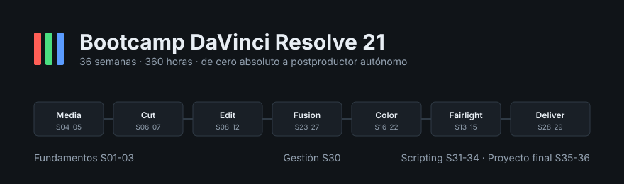

<div align="center">



# 🎬 Bootcamp DaVinci Resolve 21 — Zero to Master

**36 semanas · 360 horas · de no haber editado nunca a postproductor autónomo**

[](LICENSE)
[](https://www.blackmagicdesign.com/products/davinciresolve)
[](docs/free-vs-studio.md)
[](docs/glosario-global.md)

[English version](README_EN.md) · [Empezar por la Semana 01](bootcamp/week-01-fundamentos_de_imagen_en_movimiento/README.md)

</div>

---

## 📌 Qué es esto

Un bootcamp de **post-producción completa en DaVinci Resolve 21**, no un curso de
"cómo cortar un vídeo". Cubre las siete páginas del programa —Media, Cut, Edit,
Fusion, Color, Fairlight y Deliver— a fondo, y termina automatizando Resolve con
Python.

Está escrito para **cero absoluto**: si nunca has editado, nunca has tocado una
cámara y no sabes qué es un codec, este es el sitio. Cada término se define la
primera vez que aparece.

No hay clases en vivo ni corrección humana. Cada semana termina en un entregable
que **se verifica contra tu propio proyecto de Resolve** con un script que habla
con la API de scripting del programa.

> [!NOTE]
> Todo el temario funciona con **DaVinci Resolve Free**. Las funciones exclusivas
> de **Studio** están marcadas y siempre llevan la ruta alternativa en Free.
> Ningún entregable evaluable depende de la versión de pago.

---

## 🎯 Qué sabrás hacer al terminar

- Explicar qué es un frame, un codec, un espacio de color y un nivel de audio sin analogías vagas
- Ingestar material con integridad verificada y organizarlo para que escale a cientos de clips
- Montar con soltura quirúrgica: ripple, roll, slip, slide, dynamic trim, JKL
- Editar multicámara, gestionar subtítulos y versionar timelines
- Mezclar diálogo, música y efectos a un target de loudness concreto y medido
- Limpiar audio problemático y diseñar el sonido de una pieza
- Etalonar con gestión de color explícita, leyendo scopes en vez de decidir a ojo
- Dominar el grafo de nodos: serie, paralelo, layer mixer, key mixer, outside
- Aislar con qualifiers, windows y tracking; igualar planos; diseñar y guardar un look
- Componer en Fusion: máscaras, paint, tracking, keying, motion graphics y 3D
- Entregar a cualquier destino con el codec, el bitrate y el loudness correctos
- Gestionar, archivar y colaborar sobre proyectos de Resolve
- Automatizar Resolve con Python y construir tus propias herramientas

---

## 🗺️ Las 11 fases

| Fase | Semanas | Horas | De qué va |
| ---- | ------- | ----- | --------- |
| 0 · Fundamentos audiovisuales y setup | 01-03 | 30 | Cómo funciona la imagen en movimiento y cómo se instala y organiza Resolve |
| 1 · Media e ingesta | 04-05 | 20 | Meter material dentro sin perder nada y encontrarlo después |
| 2 · Cut page | 06-07 | 20 | Montar rápido, que es como se aprende a montar |
| 3 · Edit page | 08-12 | 50 | El montaje de verdad: precisión, efectos, multicámara, intercambio |
| 4 · Fairlight | 13-15 | 30 | Que se oiga bien, que es la mitad de que se vea bien |
| 5 · Color | 16-22 | 70 | El motivo por el que existe DaVinci Resolve |
| 6 · Fusion | 23-27 | 50 | Composición y efectos por nodos sin salir del programa |
| 7 · Deliver y entrega | 28-29 | 20 | Sacar el archivo correcto para cada destino |
| 8 · Gestión y colaboración | 30 | 10 | Proyectos que sobreviven a un cambio de máquina |
| 9 · Automatización y scripting | 31-34 | 40 | Que Resolve trabaje solo |
| 10 · Cierre | 35-36 | 20 | Una pieza completa, entregada y auditada |

---

## 📅 Las 36 semanas

### Fase 0 · Fundamentos audiovisuales y setup

| # | Semana | Temas |
| - | ------ | ----- |
| 01 | [Fundamentos de imagen en movimiento](bootcamp/week-01-fundamentos_de_imagen_en_movimiento/README.md) | Frame, fps, obturador, resolución, aspect ratio, timecode, safe areas, instalación de Resolve 21 |
| 02 | [Codecs, contenedores y flujo de datos](bootcamp/week-02-codecs_contenedores_y_flujo_de_datos/README.md) | Contenedor vs codec, intra vs long-GOP, chroma subsampling, bit depth, RAW/log/Rec.709, almacenamiento |
| 03 | [Resolve 21: anatomía, bases de datos y preferencias](bootcamp/week-03-resolve_21_anatomia_bases_de_datos_y_preferencias/README.md) | Las 7 páginas, Project Manager, bases de datos, Preferences vs Project Settings, caché, Free vs Studio |

### Fase 1 · Media e ingesta

| # | Semana | Temas |
| - | ------ | ----- |
| 04 | [Media page: ingesta y organización](bootcamp/week-04-media_page_ingesta_y_organizacion/README.md) | Media Storage, clone tool con checksum, bins, smart bins, metadata, keywords, scene cut detection |
| 05 | [Proxies, caché y sincronización](bootcamp/week-05-proxies_cache_y_sincronizacion/README.md) | Optimized media, proxy media, render cache, sync por timecode y waveform, subclips, relink |

### Fase 2 · Cut page

| # | Semana | Temas |
| - | ------ | ----- |
| 06 | [Cut page: edición veloz](bootcamp/week-06-cut_page_edicion_veloz/README.md) | Dual timeline, source tape, fast review, sync bin, las herramientas de edición rápida |
| 07 | [Cut page: acabado y quick export](bootcamp/week-07-cut_page_acabado_y_quick_export/README.md) | Transiciones, velocidad, títulos rápidos, dupe detection, quick export, cuándo Cut y cuándo Edit |

### Fase 3 · Edit page

| # | Semana | Temas |
| - | ------ | ----- |
| 08 | [Edit page: anatomía y edición básica](bootcamp/week-08-edit_page_anatomia_y_edicion_basica/README.md) | Interfaz, viewers, pistas, edición de tres puntos, insert/overwrite/replace, timeline settings |
| 09 | [Trimming quirúrgico](bootcamp/week-09-trimming_quirurgico/README.md) | Ripple, roll, slip, slide, trim edit mode, dynamic trim, JKL, marcadores |
| 10 | [Velocidad, transformaciones y estabilización](bootcamp/week-10-velocidad_transformaciones_y_estabilizacion/README.md) | Retime, speed ramps, optical flow, keyframes, transform, estabilización, lens correction |
| 11 | [Títulos, Text+, efectos y compuestos](bootcamp/week-11-titulos_texto_plus_efectos_y_compuestos/README.md) | Text vs Text+, Fusion Titles, ResolveFX, adjustment clips, compound clips, nesting |
| 12 | [Multicámara, subtítulos y gestión de timeline](bootcamp/week-12-multicam_subtitulos_y_gestion_de_timeline/README.md) | Multicam, sincronización de ángulos, subtítulos, timeline versions, media management, XML/AAF/EDL/OTIO |

### Fase 4 · Fairlight

| # | Semana | Temas |
| - | ------ | ----- |
| 13 | [Fairlight: anatomía y mezcla base](bootcamp/week-13-fairlight_anatomia_y_mezcla_base/README.md) | Pistas mono/estéreo, mixer, buses, clip gain vs track gain vs fader, dB, medidores, monitorización |
| 14 | [Limpieza de diálogo y FairlightFX](bootcamp/week-14-limpieza_de_dialogo_y_fairlight_fx/README.md) | EQ, compresor, limiter, gate, de-esser, noise reduction, Voice Isolation, ADR, automatización |
| 15 | [Diseño sonoro, música y loudness](bootcamp/week-15-diseno_sonoro_musica_y_loudness/README.md) | Capas de sonido, música y derechos, ducking, panner, targets de loudness, stems |

### Fase 5 · Color

| # | Semana | Temas |
| - | ------ | ----- |
| 16 | [Teoría del color y gestión de color](bootcamp/week-16-teoria_del_color_y_gestion_de_color/README.md) | Espacios de color, gamma, log, Rec.709/P3/Rec.2020, DaVinci YRGB, Color Managed, ACES |
| 17 | [Scopes y corrección primaria](bootcamp/week-17-scopes_y_correccion_primaria/README.md) | Waveform, parade, vectorscope, histograma, lift/gamma/gain, offset, log wheels, balance de blancos |
| 18 | [Nodos a fondo](bootcamp/week-18-nodos_a_fondo/README.md) | Serie, paralelo, layer mixer, key mixer, outside, splitter/combiner, orden de operaciones |
| 19 | [Secundarias: qualifiers, windows y tracking](bootcamp/week-19-secundarias_qualifiers_windows_y_tracking/README.md) | HSL qualifier, matte finesse, power windows, tracker, Magic Mask, rotoscopia, Depth Map |
| 20 | [Curvas, Color Warper y reducción de ruido](bootcamp/week-20-curvas_color_warper_y_reduccion_de_ruido/README.md) | Curvas custom y por eje, Color Warper, noise reduction temporal y espacial, sharpening |
| 21 | [Shot matching, grupos, stills y diseño de look](bootcamp/week-21-shot_matching_grupos_stills_y_diseno_de_look/README.md) | Galería, stills, groups, timeline node, shot match, LUTs, film emulation, versiones |
| 22 | [HDR, RAW y entrega de color](bootcamp/week-22-hdr_raw_y_entrega_de_color/README.md) | HDR wheels, tone mapping, camera raw, BRAW, control de calidad, entrega Rec.709 vs HDR |

### Fase 6 · Fusion

| # | Semana | Temas |
| - | ------ | ----- |
| 23 | [Fusion page: modelo de nodos](bootcamp/week-23-fusion_page_modelo_de_nodos/README.md) | Flow, Merge, Background, canal alpha, DoD, MediaIn/MediaOut, relación con Edit |
| 24 | [Transformaciones, máscaras y paint](bootcamp/week-24-transformaciones_mascaras_y_paint/README.md) | Transform, polyline y bspline, paint clone y stroke, cleanup, rotoscopia con keyframes |
| 25 | [Tracking y keying](bootcamp/week-25-tracking_y_keying/README.md) | Tracker de puntos, Planar Tracker, Camera Tracker, corner pin, Delta Keyer, despill |
| 26 | [Motion graphics, texto 3D y partículas](bootcamp/week-26-motion_graphics_texto_3d_y_particulas/README.md) | Text+, Text3D, Follower, modifiers, expressions, splines, partículas |
| 27 | [Fusion 3D, cámara y optimización](bootcamp/week-27-fusion_3d_camara_y_optimizacion/README.md) | Workspace 3D, Camera 3D, Renderer3D, luces, materiales, caché, macros |

### Fase 7 · Deliver y entrega

| # | Semana | Temas |
| - | ------ | ----- |
| 28 | [Deliver page: render y codecs](bootcamp/week-28-deliver_page_render_y_codecs/README.md) | Render settings, formatos, presets propios, cola de render, data levels, escalado, subtítulos |
| 29 | [Entregas por destino y control de calidad](bootcamp/week-29-entregas_por_destino_y_control_de_calidad/README.md) | Plataformas, bitrate y loudness por destino, master vs deliverable, QC, archivado |

### Fase 8 · Gestión y colaboración

| # | Semana | Temas |
| - | ------ | ----- |
| 30 | [Gestión de proyectos, archivado y colaboración](bootcamp/week-30-gestion_de_proyectos_archivado_y_colaboracion/README.md) | Project Manager, PostgreSQL, archives, collaboration mode, relink masivo |

### Fase 9 · Automatización y scripting

| # | Semana | Temas |
| - | ------ | ----- |
| 31 | [API de scripting de Resolve: fundamentos](bootcamp/week-31-api_de_scripting_de_resolve_fundamentos/README.md) | Habilitar scripting, entorno Python, jerarquía de objetos, primer script, depuración |
| 32 | [Automatizar ingesta y organización](bootcamp/week-32-automatizar_ingesta_y_organizacion/README.md) | Recorrer carpetas, crear bins, importación por lotes, metadata masiva, informes |
| 33 | [Automatizar timelines, render y entrega](bootcamp/week-33-automatizar_timelines_render_y_entrega/README.md) | Timelines por script, marcadores, SRT, cola de render, lotes, monitoreo |
| 34 | [Herramientas propias, puente MCP y agentes](bootcamp/week-34-herramientas_propias_puente_mcp_y_agentes/README.md) | Workspace > Scripts, UI Manager, puente MCP, agentes de IA, seguridad del scripting |

### Fase 10 · Cierre

| # | Semana | Temas |
| - | ------ | ----- |
| 35 | [Proyecto final: producción](bootcamp/week-35-proyecto_final_produccion/README.md) | Pieza completa: ingesta, montaje, sonido, color, VFX |
| 36 | [Proyecto final: entrega y auditoría](bootcamp/week-36-proyecto_final_entrega_y_auditoria/README.md) | Entrega multi-destino, QC, archivado, auditoría de las 35 semanas, portfolio |

---

## 🗂️ Cómo está organizada cada semana

```
bootcamp/week-XX-tema/
├── README.md                 # Objetivos, contenidos, tiempo, trucos, entregables
├── rubrica-evaluacion.md     # 30% conocimiento · 40% desempeño · 30% producto
├── checks.json               # Verificaciones automáticas contra tu proyecto
├── 0-assets/                 # Diagramas SVG
├── 1-teoria/                 # Un archivo por concepto
├── 2-practicas/              # Ejercicios guiados paso a paso
├── 3-proyecto/               # La capa que esta semana añade a tu pieza
├── 4-recursos/               # ebooks-free · videografia · webgrafia
└── 5-glosario/               # Términos A-Z, con el nombre real en inglés
```

---

## 🚀 Empezar

1. Lee [`docs/setup-entorno.md`](docs/setup-entorno.md) e instala DaVinci Resolve 21.
2. Comprueba tu hardware con [`docs/hardware-y-rendimiento.md`](docs/hardware-y-rendimiento.md).
3. Descarga el material de práctica siguiendo [`docs/pack-de-medios.md`](docs/pack-de-medios.md).
4. Elige tu pieza en [`docs/proyecto-hilo-conductor.md`](docs/proyecto-hilo-conductor.md).
5. Verifica que todo está en su sitio:

```bash
python scripts/verificar-semana.py --doctor
```

6. Abre la [Semana 01](bootcamp/week-01-fundamentos_de_imagen_en_movimiento/README.md).

---

## ✅ Cómo se evalúa

Cada semana pide tres evidencias, con un mínimo del 70 % en cada una:

| Evidencia | Peso | Cómo se comprueba |
| --------- | ---- | ----------------- |
| 🧠 Conocimiento | 30 % | Cuestionario de autoevaluación con respuestas en la rúbrica |
| 💪 Desempeño | 40 % | `python scripts/verificar-semana.py NN` contra tu proyecto real |
| 📦 Producto | 30 % | La capa semanal de tu pieza, con criterios observables escritos |

Lo objetivo lo comprueba un script hablando con Resolve. Lo estético —un grado, una
mezcla, un comp— se evalúa con criterios medibles escritos en la rúbrica, no con un
script que dictamine "bonito". Ver [`docs/autograding.md`](docs/autograding.md).

---

## 📚 Documentación transversal

| Documento | Para qué |
| --------- | -------- |
| [setup-entorno.md](docs/setup-entorno.md) | Instalar Resolve 21 y preparar Python para el scripting |
| [hardware-y-rendimiento.md](docs/hardware-y-rendimiento.md) | Qué máquina hace falta y dónde están los cuellos de botella |
| [pack-de-medios.md](docs/pack-de-medios.md) | El material de práctica común, con fuentes y estructura de carpetas |
| [free-vs-studio.md](docs/free-vs-studio.md) | Qué cambia exactamente con la licencia de pago |
| [proyecto-hilo-conductor.md](docs/proyecto-hilo-conductor.md) | La pieza que crece durante 36 semanas |
| [autograding.md](docs/autograding.md) | Formato de `checks.json` y uso del verificador |
| [atajos-de-teclado.md](docs/atajos-de-teclado.md) | Atajos por página, con equivalencias Premiere y Final Cut |
| [glosario-global.md](docs/glosario-global.md) | Todos los términos, en español y con su nombre en la UI |
| [trucos-resolve.md](docs/trucos-resolve.md) | Todos los trucos del bootcamp, agrupados por semana |

---

## 🤝 Contribuir

Lee [CONTRIBUTING.md](CONTRIBUTING.md). Antes de abrir un PR:

```bash
./scripts/verificar-enlaces.sh
```

---

## 📄 Licencia

[CC BY-NC-SA 4.0](LICENSE) — uso libre no comercial con atribución, compartiendo igual.

DaVinci Resolve y Blackmagic Design son marcas de Blackmagic Design Pty. Ltd. Este
bootcamp es material educativo independiente, sin relación oficial con Blackmagic Design.

---

<div align="center">

**BC Channel EPTI** · [bc-github](https://github.com/ergrato-dev/bc-github) · [bc-gitlab](https://github.com/ergrato-dev/bc-gitlab) · bc-davinci-resolve

</div>
