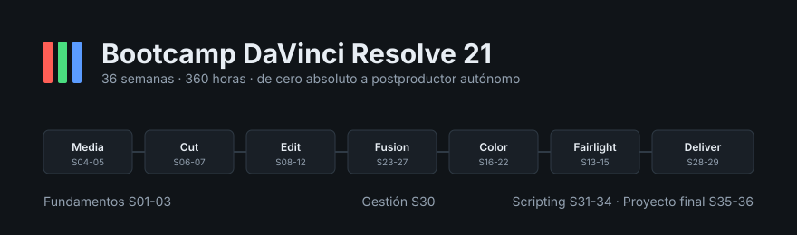

<div align="center">



# 🎬 DaVinci Resolve 21 Bootcamp — Zero to Master

**36 weeks · 360 hours · from never having edited a frame to independent post-production**

[](LICENSE)
[](https://www.blackmagicdesign.com/products/davinciresolve)
[](docs/free-vs-studio.md)

[Versión en español](README.md)

</div>

---

> [!IMPORTANT]
> **The course material is written in Spanish.** This file is the only English mirror,
> and it exists so English speakers can decide whether the bootcamp is for them. The
> 36 weeks of theory, exercises and rubrics are in Spanish, with all DaVinci Resolve
> menus, panels and feature names kept in English — which is how the software ships and
> how every tutorial in the world refers to them.

---

## What this is

A full post-production bootcamp built around **DaVinci Resolve 21**. It covers all
seven pages — Media, Cut, Edit, Fusion, Color, Fairlight and Deliver — in depth, and
ends by automating Resolve with Python.

It is written for **absolute beginners**: no editing experience, no camera experience,
no audio experience, no programming. Every technical term is defined the first time it
appears.

There are no live classes and no human grading. Each week ends in a deliverable that is
**verified against your own Resolve project** by a script that talks to the application's
scripting API.

> [!NOTE]
> The entire syllabus works on **DaVinci Resolve Free**. Studio-only features are
> flagged and always come with the Free alternative. No graded deliverable requires the
> paid version.

---

## The 11 phases

| Phase | Weeks | Hours | Focus |
| ----- | ----- | ----- | ----- |
| 0 · Moving-image fundamentals and setup | 01-03 | 30 | How moving images work; installing and configuring Resolve |
| 1 · Media and ingest | 04-05 | 20 | Getting footage in without losing it, and finding it later |
| 2 · Cut page | 06-07 | 20 | Fast editing, which is how editing is actually learned |
| 3 · Edit page | 08-12 | 50 | Precision editing, effects, multicam, interchange |
| 4 · Fairlight | 13-15 | 30 | Sound, which is half of picture |
| 5 · Color | 16-22 | 70 | The reason DaVinci Resolve exists |
| 6 · Fusion | 23-27 | 50 | Node-based compositing and VFX |
| 7 · Deliver | 28-29 | 20 | The right file for each destination |
| 8 · Project management | 30 | 10 | Projects that survive a machine change |
| 9 · Automation and scripting | 31-34 | 40 | Making Resolve work on its own |
| 10 · Capstone | 35-36 | 20 | One finished, delivered and audited piece |

---

## How grading works

Three kinds of evidence per week, 70 % minimum on each:

| Evidence | Weight | Checked by |
| -------- | ------ | ---------- |
| 🧠 Knowledge | 30 % | Self-assessment quiz with answers in the week's rubric |
| 💪 Performance | 40 % | `python scripts/verificar-semana.py NN`, against your real project |
| 📦 Product | 30 % | The week's layer of your own piece, against written observable criteria |

The objective half is checked by a script that reads your Resolve project. The aesthetic
half — a grade, a mix, a composite — is assessed against measurable written criteria
("blacks sit at 0 without clipping", "dialogue averages -12 dBFS"), never by a script
deciding whether something looks good.

The verifier is split in two pieces: a **bridge** that runs inside Resolve
(`Workspace > Scripts`) and a **client** that talks to it over local HTTP. That split is
what makes automated grading work on the **Free** edition, where external scripting is
not available.

---

## Getting started

1. Install DaVinci Resolve 21 — see [`docs/setup-entorno.md`](docs/setup-entorno.md).
2. Check your machine — [`docs/hardware-y-rendimiento.md`](docs/hardware-y-rendimiento.md).
3. Download the practice footage — [`docs/pack-de-medios.md`](docs/pack-de-medios.md).
4. Pick your capstone piece — [`docs/proyecto-hilo-conductor.md`](docs/proyecto-hilo-conductor.md).
5. Verify the environment:

```bash
python scripts/verificar-semana.py --doctor
```

6. Open [Week 01](bootcamp/week-01-fundamentos_de_imagen_en_movimiento/README.md).

---

## Contributing

See [CONTRIBUTING.md](CONTRIBUTING.md). Run `./scripts/verificar-enlaces.sh` before
opening a pull request.

---

## License

[CC BY-NC-SA 4.0](LICENSE) — free non-commercial use with attribution, share alike.

DaVinci Resolve and Blackmagic Design are trademarks of Blackmagic Design Pty. Ltd.
This is independent educational material with no official relationship to Blackmagic
Design.

---

<div align="center">

**BC Channel EPTI** · [bc-github](https://github.com/ergrato-dev/bc-github) · [bc-gitlab](https://github.com/ergrato-dev/bc-gitlab) · bc-davinci-resolve

</div>
