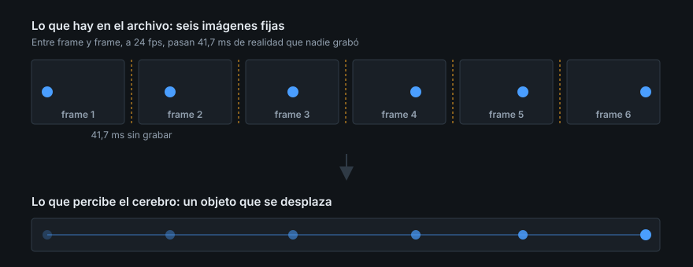

# Qué es el vídeo

> Un vídeo no contiene movimiento. Contiene imágenes fijas y una instrucción sobre a
> qué ritmo enseñarlas. El movimiento lo pone tu cerebro, y eso tiene consecuencias
> técnicas muy concretas.

## 🎯 Objetivos

- Definir qué es un **frame** y por qué es la unidad mínima de todo lo que harás
- Entender que el vídeo es un **muestreo del tiempo**, no una grabación continua
- Saber por qué una sucesión de fotos fijas se percibe como movimiento
- Reconocer los artefactos que aparecen cuando el muestreo no da abasto
- Distinguir vídeo **progresivo** de **entrelazado** y reconocer los peines
- Entender qué significa que Resolve trabaje "por frames" y no "por segundos"

---

## 1. Qué problema resuelve

Grabar movimiento es imposible. Un sensor —o una película fotoquímica— solo sabe hacer
una cosa: medir la luz que le llega durante un intervalo y guardar el resultado. Eso es
una foto.

Para representar movimiento, la única salida es hacer **muchas fotos seguidas** y
enseñarlas rápido. No es una limitación tecnológica que se vaya a superar: es la
definición misma del medio. Todo lo demás —codecs, frame rates, obturadores, timecode—
son consecuencias de esa decisión de partida.

Un **frame** (*frame*, en español a veces "fotograma" o "cuadro") es cada una de esas
imágenes fijas. Es la unidad mínima de todo:

- Un corte en el montaje ocurre **entre dos frames**, nunca en medio de uno.
- La duración de un clip se mide **en frames**, no en segundos.
- El timecode direcciona **frames**.
- Un ajuste de color se aplica **frame a frame**.

Cuando en la Semana 09 aprendas a recortar un clip con precisión, la precisión máxima
que tendrás es **un frame**. No hay nada más pequeño.

---

## 2. Cómo funciona: el vídeo es un muestreo del tiempo

**Muestrear** (*to sample*) significa tomar medidas de algo continuo a intervalos
regulares para poder representarlo con números. Es lo que hace un termómetro que anota
la temperatura cada hora: no guarda la temperatura de todos los instantes, guarda
veinticuatro valores al día.

El vídeo hace exactamente eso con el tiempo. A 24 frames por segundo, el mundo se
muestrea 24 veces cada segundo. Entre un frame y el siguiente pasan **41,7
milisegundos** de realidad que **no se han grabado**.

Esto no es un detalle académico. De ahí sale casi todo lo que verás esta semana:

| Consecuencia | Dónde aparece |
| ------------ | ------------- |
| Si el objeto se mueve mucho entre frame y frame, el movimiento se ve a saltos | *Judder*, teoría 03 |
| Si el objeto se mueve durante la exposición de un frame, ese frame sale borroso | Desenfoque de movimiento, teoría 03 |
| Si algo sucede más rápido que la frecuencia de muestreo, no se graba | Aspas de hélice que parecen girar al revés |
| Cambiar de frame rate obliga a inventar o descartar frames | Conversiones, Semana 10 |

> [!NOTE]
> El audio funciona igual pero con números mucho más grandes: se muestrea 48 000 veces
> por segundo en lugar de 24. Por eso el audio "suena continuo" y el vídeo, si te fijas,
> nunca llega a serlo del todo. Lo verás en la Semana 13.

---

## 3. Por qué vemos movimiento

La explicación que todo el mundo repite es la **persistencia de la visión** (*persistence
of vision*): la retina retiene brevemente la imagen y por eso los frames se solapan.

Esa explicación es incompleta. La persistencia retiniana explica por qué no vemos
parpadear la pantalla, pero **no** explica por qué percibimos movimiento. Lo que hace
eso es un fenómeno perceptivo distinto, el **movimiento aparente** (*beta movement*):
el sistema visual, ante dos estímulos parecidos en posiciones ligeramente distintas y
próximos en el tiempo, construye la interpretación de que **es el mismo objeto que se
ha desplazado**.

La diferencia importa en la práctica:

- Como es una **interpretación**, se puede romper. Si el salto entre frames es
  demasiado grande, el cerebro deja de leerlo como un objeto que se mueve y lo lee como
  dos objetos distintos parpadeando. Eso es el *judder*.
- Como es una **construcción**, se puede ayudar. El desenfoque de movimiento le da al
  cerebro la pista de que hubo desplazamiento, y el movimiento se percibe fluido con
  menos frames. Por eso 24 fps con desenfoque correcto se ve mejor que 24 fps sin él.

> [!TIP]
> Esta es la razón de que el cine funcione a 24 fps desde hace un siglo, mientras que
> un videojuego a 24 fps se ve inaceptable. El videojuego no tiene desenfoque de
> movimiento salvo que lo simule.

---

## 4. Progresivo y entrelazado

Hay una segunda forma de muestrear el tiempo, más antigua, que conviene reconocer porque
sigue apareciendo en material de archivo y en emisión de televisión.

**Progresivo** (*progressive*): cada frame es una imagen completa. Se escribe con una
`p`: `1080p`, `720p`. Es lo que hace todo el vídeo moderno y lo único que usarás en este
bootcamp.

**Entrelazado** (*interlaced*): cada frame se parte en dos mitades llamadas **campos**
(*fields*), una con las líneas pares y otra con las impares, **grabadas en instantes
distintos**. Se escribe con una `i`: `1080i`, `576i`.

El entrelazado se inventó para la televisión analógica: permitía duplicar la sensación
de fluidez sin duplicar el ancho de banda. La mitad de la información por imagen, el
doble de imágenes por segundo.

El problema es que ya no hay pantallas entrelazadas. Al mostrar material entrelazado en
una pantalla progresiva aparecen los **peines** (*combing*): líneas horizontales
alternas visibles en los bordes de lo que se mueve, porque las dos mitades del frame se
grabaron en momentos diferentes.

| | Progresivo | Entrelazado |
| --- | ---------- | ----------- |
| Qué es un frame | Una imagen completa | Dos campos de instantes distintos |
| Notación | `1080p`, `720p` | `1080i`, `576i` |
| Dónde aparece | Todo el vídeo moderno | Emisión de televisión, archivo, VHS digitalizado |
| Problema típico | Ninguno | Peines en el movimiento |

Convertir entrelazado a progresivo se llama **desentrelazar** (*deinterlace*), y siempre
cuesta algo: o resolución, o suavidad de movimiento. Resolve lo hace en
`clic derecho sobre el clip en el media pool > Clip Attributes > Video`, donde se declara
si el material es progresivo o entrelazado y qué campo va primero.

> [!TIP]
> Si un clip antiguo muestra líneas horizontales alternas en las zonas con movimiento,
> no es un problema de codec ni de resolución: es material entrelazado sin declarar.

---

## 5. Los dos tipos de "por segundo" que se confunden

Hay dos frecuencias distintas y mucha gente las mezcla:

- **Frame rate de captura y de la timeline**: cuántas imágenes distintas hay por
  segundo. 24, 25, 30, 50, 60. Es lo que define el material y lo que verás en la
  teoría 02.
- **Frecuencia de refresco de la pantalla** (*refresh rate*): cuántas veces por segundo
  el monitor redibuja lo que muestra. 60 Hz, 120 Hz, 144 Hz.

Son independientes. Una pantalla de 60 Hz mostrando material de 24 fps no enseña 60
imágenes distintas: enseña las mismas 24, repitiendo algunas más veces que otras. Ese
reparto desigual tiene nombre —*pulldown*— y es la causa de que a veces un vídeo de cine
se vea con un ligero tirón en un ordenador.

**Que tu monitor sea de 144 Hz no mejora tu material de 24 fps.** No hay más
información que mostrar.

---

## 6. Cómo se ve esto en DaVinci Resolve 21

Resolve razona en frames, no en segundos, y lo enseña por todas partes:

- El contador de tiempo de los *viewers* muestra timecode (`HH:MM:SS:FF`), donde `FF`
  son frames. Haz **clic derecho sobre ese contador** para alternar entre timecode y
  número de frames.
- Las flechas `←` y `→` mueven el cursor de reproducción **exactamente un frame**.
- Las duraciones en el media pool y en el Inspector se expresan en timecode, no en
  segundos decimales.
- Cuando la Semana 33 automatice cosas por script, la API devuelve `start_frame`,
  `end_frame` y `duration_frames`. Los segundos son un cálculo derivado, no el dato.

> [!IMPORTANT]
> Un mismo número de frames dura cosas distintas según el frame rate. 120 frames son
> 5 segundos a 24 fps y 2 segundos a 60 fps. Por eso, cuando conviertas frames a tiempo,
> tienes que usar el frame rate **de la timeline**, que puede no coincidir con el de los
> clips que contiene.

---

## 7. Antipatrones

| Antipatrón | Por qué duele | Qué hacer |
| ---------- | ------------- | --------- |
| Pensar en segundos y no en frames | "Corta en el segundo 3,5" no es una instrucción ejecutable: no existe medio frame | Piensa y comunica en timecode. Es la dirección exacta de un frame |
| Creer que más frame rate es siempre mejor | 60 fps no es "mejor" que 24: es distinto, cuesta el doble de datos y comunica otra cosa | Elige el frame rate por criterio (teoría 02), no por número más grande |
| Culpar al monitor de un movimiento con tirones | Casi siempre es *pulldown* o falta de desenfoque de movimiento, no la pantalla | Comprueba primero el frame rate del material y el del proyecto |
| Suponer que todos los clips van al mismo frame rate | Un proyecto mezcla material de móvil a 30, de cámara a 25 y de pantalla a 60 constantemente | Comprueba el frame rate de cada clip antes de montar (Semana 04) |

---

## 8. Trucos

| Truco | Cómo |
| ----- | ---- |
| Ver la posición en frames en vez de en timecode | Clic derecho sobre el contador de timecode del viewer |
| Avanzar exactamente un frame | `←` y `→`. Con `Shift` se avanza de segundo en segundo |
| Contar cuántos frames dura algo sin calcular | Marca entrada y salida con `I` y `O`: Resolve muestra la duración de la selección |

---

## 📚 Recursos Adicionales

- [DaVinci Resolve Reference Manual](https://www.blackmagicdesign.com/support/family/davinci-resolve-and-fusion) — el manual oficial en PDF, gratuito. Su primer capítulo sobre conceptos de imagen es la referencia canónica de todo lo de esta semana, y no envejece entre versiones.
- [Persistence of vision — por qué la explicación clásica es insuficiente](https://en.wikipedia.org/wiki/Persistence_of_vision) — merece la lectura porque desmonta la explicación que aparece en el 90 % de los tutoriales, y entender la correcta ayuda a razonar sobre el *judder*.
- [Blackmagic Design Training](https://www.blackmagicdesign.com/products/davinciresolve/training) — las guías oficiales gratuitas, escritas por el equipo del producto.

---

## ✅ Checklist de Verificación

- [ ] Puedo explicar qué es un frame sin usar la palabra "vídeo"
- [ ] Entiendo por qué el vídeo es un muestreo del tiempo y qué se pierde entre frames
- [ ] Sé que el movimiento lo construye la percepción, no el archivo
- [ ] Distingo `1080p` de `1080i` y sé qué son los peines
- [ ] Distingo frame rate de frecuencia de refresco del monitor
- [ ] Sé alternar el contador del viewer entre timecode y frames
- [ ] Sé que 120 frames duran cosas distintas según el frame rate de la timeline

---

| Anterior | Actual | Siguiente |
| -------- | ------ | --------- |
| — | **01 · Qué es el vídeo** | [02 · Frame rate](02-frame-rate.md) |

← [Volver a la Semana 01](../README.md)
