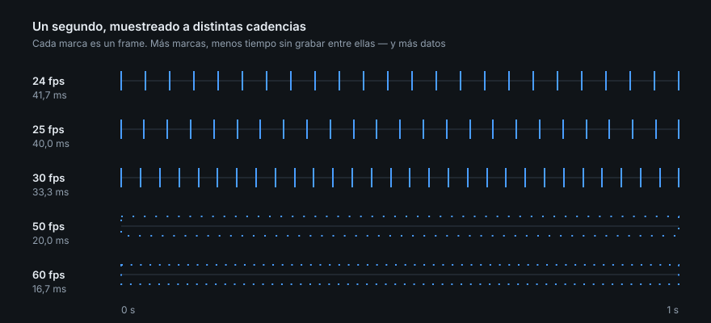

# Frame rate

> El frame rate es la primera decisión irreversible de un proyecto. En Resolve, una vez
> hay clips en el media pool, ya no se puede cambiar. Conviene saber por qué eliges lo
> que eliges.

## 🎯 Objetivos

- Definir **frame rate** y saber leerlo en cualquier archivo
- Conocer los frame rates estándar y de dónde viene cada uno
- Entender por qué existen 23.976 y 29.97, y qué es la fracción 1000/1001
- Saber distinguir frame rate de captura, de timeline y de reproducción
- Elegir el frame rate de un proyecto con un criterio defendible
- Saber qué pasa cuando se mezclan frame rates y por qué hay que evitarlo

---

## 1. Qué problema resuelve

El **frame rate** (*frame rate*, "cadencia" o "frecuencia de cuadro") es cuántos frames
se muestran por segundo. Se mide en **fps** (*frames per second*).

Es la respuesta a una pregunta económica: ¿cuántas fotos por segundo son suficientes
para que el movimiento se perciba fluido, sin gastar más de lo necesario?

En 1927, cuando el cine sonoro fijó el estándar, "gastar" significaba metros de película
por minuto de proyección. Se eligió **24 fps** porque era el mínimo que sonaba bien
—la banda sonora óptica necesitaba una velocidad mínima— y se veía aceptable. No hubo
ninguna razón perceptiva profunda: fue un compromiso de coste que lleva un siglo
funcionando.

---

## 2. Cómo funciona: los frame rates estándar



| fps | De dónde viene | Se usa para |
| --- | -------------- | ----------- |
| **23.976** | 24 dividido entre 1.001 | Cine y ficción distribuidos en países con herencia NTSC (América, Japón) |
| **24** | Estándar del cine desde 1927 | Cine, ficción, publicidad. El "aspecto de película" |
| **25** | Mitad de los 50 Hz de la red eléctrica europea | Televisión y broadcast en Europa, África, Asia, Oceanía (herencia PAL) |
| **29.97** | 30 dividido entre 1.001 | Televisión en países con herencia NTSC |
| **30** | Mitad de los 60 Hz de la red eléctrica americana | Vídeo web, contenido de móvil, grabaciones de pantalla |
| **50** | 25 × 2 | Deporte y broadcast europeo de alta cadencia |
| **59.94** | 60 dividido entre 1.001 | Deporte y broadcast NTSC |
| **60** | 30 × 2 | Vídeo web de alta cadencia, videojuegos, cámara lenta ligera |
| **120, 240** | Múltiplos altos | Cámara lenta pronunciada. Casi nunca se entrega así: se graba a 120 y se reproduce a 24 |

> [!NOTE]
> **PAL y NTSC** eran los dos sistemas de televisión analógica en color. Ya no existen
> como tecnología, pero su herencia sigue viva en los frame rates: por eso Europa se
> mueve en múltiplos de 25 y América en múltiplos de 30.

---

## 3. Los decimales: de dónde salen 23.976 y 29.97

Este es el detalle que más confusión causa y tiene una explicación histórica exacta.

La televisión en blanco y negro en Estados Unidos iba a **30 fps** exactos, atados a los
60 Hz de la red eléctrica. Cuando en 1953 se añadió el color, hubo que meter la
información de color en la misma señal **sin romper los televisores en blanco y negro**
que ya existían en millones de casas.

La solución fue insertar una portadora de color en un hueco de frecuencia de la señal.
Pero esa portadora interfería ligeramente con el sonido. El arreglo: **bajar la
velocidad de cuadro un 0,1 %**, exactamente la fracción **1000/1001**.

```
30 × 1000/1001 = 29.970029... → 29.97 fps
24 × 1000/1001 = 23.976023... → 23.976 fps
60 × 1000/1001 = 59.940059... → 59.94 fps
```

Un apaño de compatibilidad de 1953 que sigue en tu cámara en 2026. Setenta años después,
sigue obligándote a decidir entre `23.976` y `24` en el menú de un proyecto.

> [!IMPORTANT]
> **Cuál elegir.** Si tu material está a 23.976 o 29.97, tu proyecto va a 23.976 o
> 29.97. Si está a 24 o 30 exactos, va a 24 o 30. **No los mezcles**: la diferencia es
> del 0,1 %, invisible en un plano y visible como una deriva de audio de más de tres
> segundos a la hora.

---

## 4. Tres frame rates distintos que conviven

En Resolve hay que distinguir tres cosas que suenan igual:

| Cuál | Qué es | Dónde se ve |
| ---- | ------ | ----------- |
| **Frame rate del clip** | A cuántos fps se grabó ese archivo | Columna *Frame Rate* del media pool, o el panel de Metadata |
| **Timeline frame rate** | A cuántos fps trabaja el proyecto | `File > Project Settings > Master Settings > Timeline frame rate` |
| **Playback frame rate** | A cuántos fps se reproduce en pantalla | `File > Project Settings > Master Settings > Playback frame rate` |

El que manda es el **timeline frame rate**. Si metes un clip de 60 fps en una timeline
de 24 fps, Resolve no lo ralentiza: descarta frames para que la duración sea la misma.
El clip sigue durando lo que duraba, pero con menos frames distintos.

> [!WARNING]
> **El timeline frame rate no se puede cambiar una vez hay clips en el media pool.**
> Es la decisión irreversible de esta semana. Si te equivocas, la única salida es crear
> un proyecto nuevo. Fíjalo **antes** de importar nada.

---

## 5. Cómo se elige

Un criterio que funciona, en orden de prioridad:

**1. ¿Te lo imponen?** Si entregas a un cliente, una televisión o una plataforma con
especificación técnica, el frame rate viene dado. Fin de la decisión.

**2. ¿A qué está grabado tu material?** Si todo tu material está a 25 fps, tu proyecto
va a 25 fps. Convertir cadencias es siempre peor que no tener que hacerlo.

**3. ¿Dónde vives?** Si estás en Europa y tu material viene de cámaras europeas,
25 o 50. Si estás en América, 23.976, 29.97 o 59.94. Esto importa sobre todo por la luz
artificial: grabar a 30 fps bajo luces de 50 Hz produce un parpadeo visible.

**4. ¿Qué quieres que parezca?**

| Quieres que parezca | Elige |
| ------------------- | ----- |
| Cine, ficción, narrativo | 24 o 23.976 |
| Televisión, documental europeo | 25 |
| Vídeo web, tutorial, contenido de móvil | 30 |
| Deporte, acción, videojuego, "hiperreal" | 50 o 60 |

**5. ¿Necesitas cámara lenta?** Graba a 4 o 5 veces el frame rate de entrega (120 fps
para entregar a 24) y ralentiza en montaje. Eso da cámara lenta real, sin inventar
frames. La Semana 10 lo desarrolla.

Para este bootcamp el proyecto va a **24 fps**: es el estándar narrativo, funciona en
cualquier plataforma, y es el frame rate con el que más material de aprendizaje libre
te vas a encontrar.

---

## 6. Mezclar frame rates

Va a pasar: material de móvil a 30, de cámara a 25, una grabación de pantalla a 60.
Resolve los acepta todos en la misma timeline, y ahí empieza el problema.

Cuando el frame rate del clip no coincide con el de la timeline, hay que **conformar**
(*conform*) el material, y solo hay tres maneras:

| Método | Qué hace | Cuándo sirve |
| ------ | -------- | ------------ |
| **Descartar o repetir frames** | Tira los que sobran o duplica los que faltan | Rápido; produce un movimiento a tirones si la diferencia es grande |
| **Mezclar frames** (*frame blending*) | Promedia dos frames vecinos para inventar el intermedio | Suaviza; produce imágenes fantasma en movimientos rápidos |
| **Optical Flow** | Analiza el movimiento y genera frames nuevos plausibles | El mejor resultado; el más caro y el que falla con más aparatosidad |

Se configura en `Clip Attributes` y en los ajustes de retiming del Inspector, y se ve a
fondo en la Semana 10.

> [!TIP]
> La regla práctica: **conformar de más a menos es fácil, de menos a más es feo.**
> Bajar 60 a 30 es tirar uno de cada dos frames, invisible. Subir 24 a 30 obliga a
> inventar información que no existe.

---

## 7. Antipatrones

| Antipatrón | Por qué duele | Qué hacer |
| ---------- | ------------- | --------- |
| Importar primero y configurar después | El timeline frame rate se bloquea con el primer clip del media pool | Configura el proyecto **antes** de importar nada |
| Mezclar 24 y 23.976 "porque es casi igual" | 0,1 % de deriva son más de 3 segundos de desincronía de audio en una hora | Elige uno y quédate en él para todo el proyecto |
| Grabar a 60 fps "por si acaso" | El doble de datos, el doble de decodificación, y el aspecto no es el que quieres | Graba a 60 solo si vas a ralentizar de verdad |
| Elegir el frame rate por el número más alto | 60 fps no es mejor, es distinto; comunica inmediatez, no cine | Elige por el criterio de la sección 5 |
| No comprobar el frame rate del material antes de empezar | Te enteras en la semana cuatro, cuando ya no puedes cambiarlo | Míralo en la columna *Frame Rate* del media pool nada más ingestar |

---

## 8. Trucos

| Truco | Cómo |
| ----- | ---- |
| Ver el frame rate de un clip sin importarlo al proyecto | Página Media, selecciónalo en el Media Storage y mira el panel de Metadata |
| Comprobar el frame rate del proyecto de un vistazo | `File > Project Settings > Master Settings`. Es lo primero de la lista |
| Saber si un proyecto ya está bloqueado | Si hay algo en el media pool, el campo de timeline frame rate aparece atenuado |

---

## 📚 Recursos Adicionales

- [DaVinci Resolve Reference Manual](https://www.blackmagicdesign.com/support/family/davinci-resolve-and-fusion) — el capítulo de Project Settings documenta cada campo de Master Settings, incluido qué se puede cambiar después y qué no.
- [ITU-R BT.470 y el legado de PAL/NTSC](https://www.itu.int/rec/R-REC-BT/en) — las recomendaciones oficiales de la UIT, útiles cuando alguien discute de dónde salen los 25 y los 29.97 y hace falta una fuente que no sea un foro.
- [Blackmagic Design Training](https://www.blackmagicdesign.com/products/davinciresolve/training) — sus guías incluyen ejercicios concretos de conformado de cadencias.

---

## ✅ Checklist de Verificación

- [ ] Sé decir qué significa fps sin dudar
- [ ] Puedo explicar de dónde salen 23.976 y 29.97, y qué es la fracción 1000/1001
- [ ] Distingo frame rate del clip, de la timeline y de reproducción
- [ ] Sé dónde se fija el timeline frame rate en Resolve 21
- [ ] Sé que ese ajuste se bloquea en cuanto hay clips en el media pool
- [ ] Tengo un criterio para elegir el frame rate de un proyecto nuevo
- [ ] Sé qué significa conformar material y cuáles son los tres métodos

---

| Anterior | Actual | Siguiente |
| -------- | ------ | --------- |
| [01 · Qué es el vídeo](01-que-es-el-video.md) | **02 · Frame rate** | [03 · Obturador y desenfoque de movimiento](03-obturador-y-desenfoque-de-movimiento.md) |

← [Volver a la Semana 01](../README.md)
