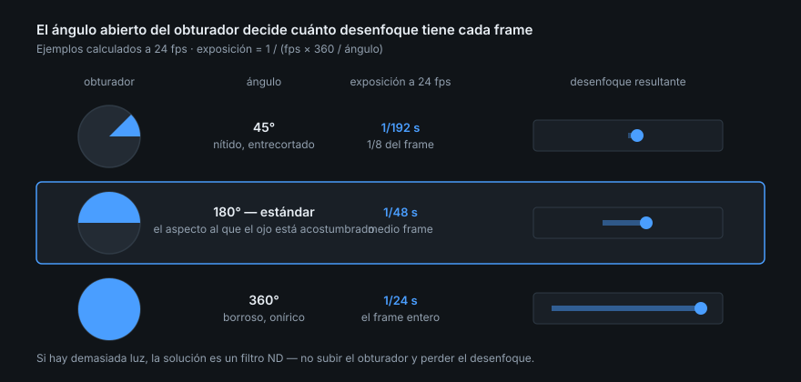

# Obturador y desenfoque de movimiento

> El desenfoque de movimiento no es un defecto que haya que evitar: es la pista que tu
> cerebro necesita para leer 24 imágenes por segundo como movimiento continuo. Quitarlo
> es lo que hace que un vídeo se vea "raro" sin que sepas por qué.

## 🎯 Objetivos

- Definir **obturador** y **velocidad de obturación**
- Entender el **ángulo de obturador** y por qué se sigue midiendo en grados
- Aplicar la **regla de los 180°** y saber cuándo romperla a propósito
- Reconocer el ***judder*** y saber de dónde viene
- Reconocer el ***rolling shutter*** y saber cuándo va a aparecer
- Saber qué de esto se arregla en post y qué no

---

## 1. Qué problema resuelve

Cada frame se graba dejando entrar luz durante un rato. El **obturador** (*shutter*) es
el mecanismo que decide **cuánto** rato.

La **velocidad de obturación** (*shutter speed*) es ese tiempo, expresado como una
fracción de segundo: `1/50 s`, `1/100 s`, `1/1000 s`.

Ese único número controla dos cosas a la vez, y ahí está toda la gracia:

1. **Cuánta luz entra.** Más tiempo, más luz, imagen más brillante.
2. **Cuánto se mueve el sujeto durante la exposición.** Más tiempo, más borroso.

Ese segundo efecto es el **desenfoque de movimiento** (*motion blur*): la estela que
deja un objeto que se movió mientras el sensor estaba midiendo. No es un fallo. Es
información sobre el movimiento, grabada dentro de una imagen fija.

---

## 2. Cómo funciona: el ángulo de obturador

En las cámaras de cine el obturador era literalmente un **disco giratorio con un trozo
recortado**. El disco daba una vuelta completa por frame; mientras el hueco pasaba por
delante de la película, esta se exponía; mientras pasaba la parte opaca, la película
avanzaba al siguiente frame.

El tamaño del hueco se medía en **grados**. Un hueco de 180° significaba que la película
estaba expuesta durante **la mitad** del tiempo de cada frame.



Las cámaras digitales no tienen disco, pero la unidad se conservó porque es más útil que
la fracción: **el ángulo es relativo al frame rate y la fracción no**.

```
velocidad de obturación = 1 / (fps × 360 / ángulo)
```

Con 180°, eso se simplifica a algo que conviene memorizar:

```
velocidad de obturación = 1 / (2 × fps)
```

| Frame rate | Obturador a 180° | Lo que suele haber en el menú |
| ---------- | ---------------- | ----------------------------- |
| 24 fps | 1/48 s | `1/50` |
| 25 fps | 1/50 s | `1/50` |
| 30 fps | 1/60 s | `1/60` |
| 50 fps | 1/100 s | `1/100` |
| 60 fps | 1/120 s | `1/125` |
| 120 fps | 1/240 s | `1/250` |

> [!NOTE]
> Muchas cámaras no ofrecen `1/48`, solo `1/50`. La diferencia es de un 4 % y es
> perfectamente aceptable. Nadie va a notarlo.

---

## 3. La regla de los 180°

**Pon el obturador al doble del frame rate.** Es el estándar de facto de todo el cine
y la televisión, y funciona porque produce la cantidad de desenfoque a la que el ojo
está acostumbrado desde hace un siglo.

Lo que pasa al saltársela:

| Ángulo | Obturador a 24 fps | Aspecto |
| ------ | ------------------ | ------- |
| 360° | 1/24 s | Muy borroso, onírico, movimiento pastoso |
| **180°** | **1/48 s** | **Natural. El estándar** |
| 90° | 1/96 s | Nítido y algo nervioso |
| 45° | 1/192 s | Muy nítido, entrecortado, sensación de urgencia |
| 11° | 1/750 s | Extremo. El desembarco de *Salvar al soldado Ryan* |

Romper la regla es una decisión narrativa legítima. **Romperla sin querer es un
problema**, y es lo que pasa cuando grabas en exteriores muy luminosos: la cámara sube
la velocidad de obturación para no sobreexponer, y tu vídeo sale nítido y entrecortado
sin que lo hayas pedido.

> [!TIP]
> La solución correcta a "hay demasiada luz" **no** es subir el obturador: es poner un
> filtro de densidad neutra (*ND filter*), que es un cristal gris que quita luz sin
> tocar nada más. Es el accesorio más barato que más mejora el aspecto de un vídeo.

---

## 4. Judder: cuando el muestreo no da abasto

El ***judder*** es ese tirón entrecortado que se ve en una panorámica lenta o en un
plano de un coche pasando. Ocurre cuando **el objeto se desplaza demasiado entre un
frame y el siguiente** y el cerebro deja de leerlo como un objeto que se mueve.

Tiene tres causas, y conviene distinguirlas porque se arreglan distinto:

| Causa | Cuándo aparece | Solución |
| ----- | -------------- | -------- |
| **Movimiento de cámara demasiado rápido para el frame rate** | Panorámicas rápidas a 24 fps | Panear más despacio, o grabar a más fps |
| **Falta de desenfoque de movimiento** | Obturador muy rápido | Bajar a 180° o poner filtro ND |
| ***Pulldown*** de reproducción | Material de 24 fps en pantalla de 60 Hz | No es del material; es de cómo se muestra |

Regla práctica de rodaje: a 24 fps, una panorámica que cruce todo el encuadre debería
tardar **al menos 5 segundos**. Más rápido que eso y tendrás judder por mucho que hagas
bien todo lo demás.

> [!IMPORTANT]
> **El judder no se arregla en post.** Ni con reducción de ruido, ni con estabilización,
> ni con Optical Flow. La información no está en el archivo. Esta es la primera de
> muchas cosas que esta semana te enseña a arreglar **antes** de grabar, porque después
> ya no hay arreglo.

---

## 5. Rolling shutter: la gelatina

Casi todos los sensores modernos son **CMOS**, y casi todos leen la imagen **línea a
línea, de arriba abajo**, no de golpe. Ese barrido tarda unos milisegundos.

Si algo se mueve rápido durante ese barrido, la parte de arriba del frame se grabó en un
instante ligeramente distinto de la de abajo. El resultado es la deformación conocida
como ***rolling shutter***:

- Postes verticales que se inclinan al hacer una panorámica rápida
- Aspas de hélice que salen dobladas o partidas
- La imagen entera ondulándose ("efecto gelatina") con vibración de cámara
- Un flash que solo ilumina media imagen

Es un artefacto de **captura**. Aparece más con panorámicas rápidas, con vibración y con
sensores grandes o lentos.

Resolve tiene herramientas que lo reducen —hay un ResolveFX específico, y la
estabilización de la Semana 10 ayuda con los casos leves— pero es corrección de daños,
no reparación. La prevención es la misma que para el judder: mover la cámara despacio.

---

## 6. Cómo se ve esto en DaVinci Resolve 21

Poco, y esa es justamente la lección de esta sección: **el obturador es una decisión de
rodaje que Resolve hereda y no puede deshacer**.

Lo que sí puedes hacer en Resolve:

- **Leer** el obturador con el que se grabó, si la cámara lo escribió en los metadatos:
  página **Media**, panel de **Metadata**, sección *Camera*.
- **Añadir** desenfoque de movimiento que no existía, con el `Motion Blur` de la página
  Color. Es una función de **Studio**, y aun así es simulación: inventa la estela
  analizando el movimiento entre frames. Ayuda; no sustituye a haber grabado bien.
- **Reducir** el rolling shutter con las herramientas de la Semana 10.

> [!IMPORTANT]
> **Studio** · `Motion Blur` (página Color) solo existe en DaVinci Resolve Studio.
> En Free no hay equivalente directo: la ruta es grabar con el obturador correcto, y si
> el material ya está grabado, aceptar el aspecto o disimularlo bajando la velocidad del
> movimiento. Ningún entregable del bootcamp lo necesita.

---

## 7. Antipatrones

| Antipatrón | Por qué duele | Qué hacer |
| ---------- | ------------- | --------- |
| Dejar la cámara en obturador automático | Cambia solo según la luz y el aspecto salta de plano a plano | Fija el obturador a 180° y controla la exposición con ISO, diafragma y filtro ND |
| Subir el obturador para no sobreexponer | Pierdes el desenfoque de movimiento y aparece el judder | Filtro ND. Es la herramienta que existe exactamente para esto |
| Pensar que el desenfoque se añade después | El `Motion Blur` de Studio simula, no reconstruye | Grábalo bien; corregirlo después siempre es peor y además necesita Studio |
| Hacer panorámicas rápidas a 24 fps | Judder garantizado, sin arreglo posible | Panea despacio, o graba esa toma a 50 o 60 fps |
| Confundir judder con un problema del monitor | Se pierde el tiempo cambiando de pantalla | Comprueba primero obturador, frame rate y velocidad del movimiento |

---

## 8. Trucos

| Truco | Cómo |
| ----- | ---- |
| Saber con qué obturador se grabó un clip | Página Media, panel de Metadata, sección *Camera*. No todas las cámaras lo escriben, pero muchas sí |
| Calcular el obturador de cualquier cadencia mentalmente | Multiplica los fps por dos y usa la fracción más cercana del menú de la cámara |
| Detectar rolling shutter antes de montar | Reproduce a velocidad normal y busca verticales que se inclinen en las panorámicas |

---

## 📚 Recursos Adicionales

- [DaVinci Resolve Reference Manual](https://www.blackmagicdesign.com/support/family/davinci-resolve-and-fusion) — el capítulo de metadatos documenta qué campos de cámara lee Resolve y de cuáles depende cada herramienta.
- [Blackmagic Design Training](https://www.blackmagicdesign.com/products/davinciresolve/training) — el material oficial incluye tomas rodadas a distintos ángulos de obturador, que es la única forma real de ver la diferencia.
- [Rolling shutter — explicación técnica](https://en.wikipedia.org/wiki/Rolling_shutter) — útil para entender por qué el artefacto tiene la forma que tiene, y por qué depende del sensor y no del codec.

---

## ✅ Checklist de Verificación

- [ ] Sé qué es la velocidad de obturación y qué dos cosas controla a la vez
- [ ] Puedo calcular el obturador a 180° para cualquier frame rate
- [ ] Entiendo por qué el ángulo de obturador se sigue midiendo en grados
- [ ] Sé reconocer el judder y nombrar sus tres causas
- [ ] Sé reconocer el rolling shutter y cuándo va a aparecer
- [ ] Sé que ni el judder ni la falta de desenfoque se arreglan de verdad en post
- [ ] Sé dónde mira Resolve los metadatos de cámara

---

| Anterior | Actual | Siguiente |
| -------- | ------ | --------- |
| [02 · Frame rate](02-frame-rate.md) | **03 · Obturador y desenfoque de movimiento** | [04 · Resolución](04-resolucion.md) |

← [Volver a la Semana 01](../README.md)
