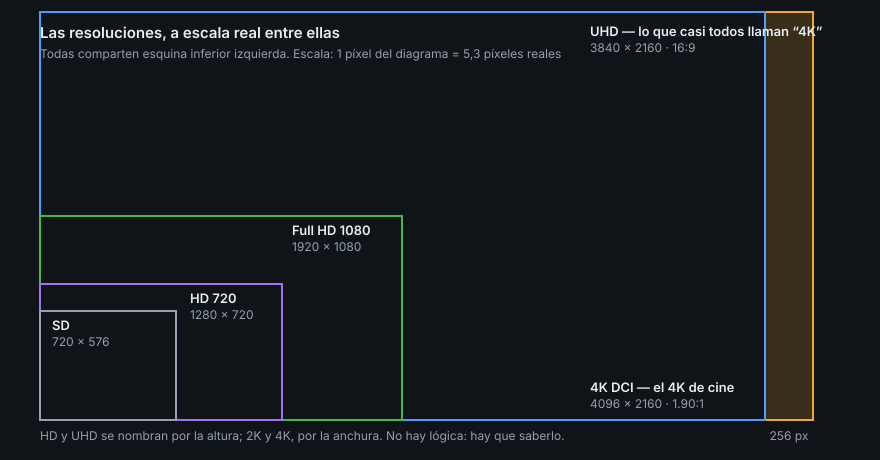

# Resolución

> "4K" no es una resolución. Son al menos dos, se llevan 256 píxeles de ancho, y elegir
> la equivocada te obliga a reencuadrar el proyecto entero. Vale la pena dedicarle
> media hora.

## 🎯 Objetivos

- Definir **resolución** y **píxel**
- Conocer las resoluciones estándar y sus nombres reales
- Distinguir **UHD** de **4K DCI**, que no son lo mismo
- Entender la diferencia entre resolución de captura, de timeline y de entrega
- Saber cuándo escalar es inofensivo y cuándo destruye la imagen
- Entender por qué grabar a más resolución de la que entregas suele merecer la pena

---

## 1. Qué problema resuelve

Una imagen digital es una **cuadrícula de puntos de color**. Cada punto es un **píxel**
(*pixel*, de *picture element*). La **resolución** es cuántos puntos tiene esa
cuadrícula: `1920 × 1080` significa 1920 columnas por 1080 filas, algo más de dos
millones de píxeles.

Más resolución es más detalle, y también más datos que mover, decodificar, procesar y
almacenar. Toda la discusión sobre resolución es un intercambio entre esas dos cosas.

---

## 2. Cómo funciona: las resoluciones estándar



| Nombre habitual | Nombre real | Píxeles | Aspect ratio |
| --------------- | ----------- | ------- | ------------ |
| SD (PAL) | 576i / 576p | 720 × 576 | 4:3 o 16:9 |
| HD, "720p" | HD | 1280 × 720 | 16:9 |
| **Full HD, "1080p"** | **HD 1080** | **1920 × 1080** | **16:9** |
| 2K DCI | 2K | 2048 × 1080 | 1.90:1 |
| **UHD, "4K" de televisión** | **UHD** | **3840 × 2160** | **16:9** |
| **4K de cine** | **4K DCI** | **4096 × 2160** | **1.90:1** |
| 6K | — | 6144 × 3456 | 16:9 |
| 8K UHD | — | 7680 × 4320 | 16:9 |

> [!IMPORTANT]
> **UHD (3840×2160) y 4K DCI (4096×2160) no son lo mismo.** Se llevan 256 píxeles de
> ancho: un 6,7 % más de anchura. Cuando alguien dice "4K" a secas casi siempre quiere
> decir **UHD**, porque es lo que usan televisores, YouTube, móviles y prácticamente
> todo lo que no sea una sala de cine. En el bootcamp, "4K" significa UHD salvo que se
> diga *DCI* explícitamente.

Los nombres son un desastre histórico. Fíjate en la incoherencia: **HD y UHD se nombran
por la altura** (1080 líneas, 2160 líneas), mientras que **2K y 4K se nombran por la
anchura** (2048, 4096 columnas). No hay lógica que rescatar: hay que saberlo.

---

## 3. Tres resoluciones distintas que conviven

Igual que con el frame rate, hay tres cosas que suenan igual:

| Cuál | Qué es | Dónde se ve en Resolve |
| ---- | ------ | ---------------------- |
| **Resolución del clip** | A qué resolución se grabó el archivo | Columna *Resolution* del media pool |
| **Timeline resolution** | La cuadrícula sobre la que se trabaja | `File > Project Settings > Master Settings > Timeline resolution` |
| **Resolución de entrega** | La del archivo final que se renderiza | Página **Deliver**, en los ajustes de render |

A diferencia del frame rate, **la resolución de timeline sí se puede cambiar después**.
Cambiarla reescala todo, así que no es gratis —los encuadres y los tamaños de texto se
mueven— pero no es irreversible.

Y la resolución de entrega es independiente: puedes trabajar en 1080 y entregar en UHD,
o al revés. La Semana 28 lo desarrolla.

> [!NOTE]
> **Resolve Free renderiza hasta UHD (3840×2160).** Por encima de eso hace falta
> Studio. Para todo el bootcamp y para todas las plataformas que se estudian, UHD es más
> que suficiente. Ver [`docs/free-vs-studio.md`](../../../docs/free-vs-studio.md).

---

## 4. Escalar: cuándo duele y cuándo no

**Escalar** (*scale*) es cambiar el tamaño en píxeles de una imagen. Hay dos
direcciones y no son simétricas:

**Reducir** (*downscale*): de 4K a 1080. Sobra información, hay que decidir qué se tira.
El resultado es **más nítido que grabar directamente a 1080**, porque partir de cuatro
píxeles para calcular uno da un resultado más limpio que medir ese píxel una sola vez.
Esto se llama **sobremuestreo** (*oversampling*) y es la razón principal por la que
merece la pena grabar a más resolución de la que entregas.

**Ampliar** (*upscale*): de 1080 a 4K. Falta información y hay que **inventarla**. Por
bueno que sea el algoritmo, no hay detalle nuevo: solo una interpolación más o menos
convincente. Nunca es mejor que el original.

| Operación | Qué pasa | Veredicto |
| --------- | -------- | --------- |
| 4K → 1080 (reducir) | Sobra detalle, se promedia | Mejora la nitidez y el ruido. Hazlo |
| 1080 → 1080 (nada) | Nada | Ideal |
| 1080 → 4K (ampliar) | Se inventa detalle | Evítalo salvo obligación |
| 1080 → recorte y a 1080 | Se usa una parte y se amplía | Cada 10 % de recorte cuesta nitidez |

> [!TIP]
> **Grabar a 4K y entregar a 1080 te da un reencuadre gratis.** Puedes recortar hasta la
> mitad del cuadro y seguir teniendo píxeles de sobra para un 1080 limpio. Es la
> técnica que permite sacar un primer plano de un plano medio, o estabilizar sin perder
> calidad. Vale más que casi cualquier accesorio que puedas comprar.

En Resolve, cómo se escala un clip que no coincide con la timeline se controla en
`File > Project Settings > Image Scaling`, y se ve a fondo en la Semana 10.

---

## 5. Resolución y percepción: cuándo se nota

Más píxeles solo se ven si se dan tres cosas a la vez: una pantalla que los muestre, una
distancia de visionado suficientemente corta y un ojo capaz de resolverlos.

A la distancia típica de un sofá, la diferencia entre 1080 y UHD en un televisor de 55
pulgadas es difícil de apreciar. En un móvil a 30 cm, sí se nota. En una sala de cine,
mucho.

Lo que **siempre** se nota, y a menudo más que la resolución:

- El **bitrate** (Semana 02): un 1080 con buen bitrate se ve mejor que un 4K comprimido a lo bruto
- El **enfoque**: una toma desenfocada a 8K sigue estando desenfocada
- La **exposición** y el **color** (Fase 5)
- La **estabilidad** de la cámara

> [!IMPORTANT]
> La resolución es la especificación que más se anuncia y de las que menos determinan
> si un vídeo se ve bien. Que quede dicho ahora, en la semana uno.

---

## 6. Cómo se hace en Resolve 21

**Fijar la resolución del proyecto**:
`File > Project Settings > Master Settings > Timeline resolution`

El desplegable trae los presets habituales, y `Custom` para cualquier otra. Justo debajo
está `Use vertical resolution` para proyectos verticales, y más abajo
`Timeline output resolution`, que es la resolución con la que sale el render y **puede
ser distinta** de la de la timeline.

**Ver la resolución de un clip**: columna *Resolution* del media pool, o el panel de
Metadata en la página Media.

**Comprobarlo por script** (lo que hace el verificador del bootcamp):

```
project_settings → settings.timelineResolutionWidth  = "1920"
                   settings.timelineResolutionHeight = "1080"
```

> [!WARNING]
> Ojo con los tipos: Resolve devuelve las resoluciones como **cadena de texto**, no como
> número. En un check hay que convertir: `int(r['settings']['timelineResolutionWidth'])`.
> Es la clase de detalle que hace fallar un check que parecía correcto.

Para el bootcamp, la timeline va a **1920×1080**: es suficiente para aprenderlo todo, va
fluido en cualquier máquina que cumpla los mínimos, y no obliga a nadie a comprar un
disco nuevo en la semana cuatro.

---

## 7. Antipatrones

| Antipatrón | Por qué duele | Qué hacer |
| ---------- | ------------- | --------- |
| Decir "4K" sin especificar cuál | UHD y DCI se llevan 256 px de ancho; en una entrega profesional eso es un rechazo | Di UHD o 4K DCI, con los números si hay duda |
| Trabajar la timeline en 4K "porque el material es 4K" | Multiplicas por cuatro el coste de cada nodo y cada efecto sin ganar nada si entregas en 1080 | Timeline a la resolución de **entrega**; el material 4K sigue dándote reencuadre |
| Ampliar 1080 a 4K para "entregar en 4K" | No hay detalle nuevo, solo un archivo cuatro veces más pesado | Entrega a la resolución real del material |
| Recortar mucho un plano de 1080 | Cada recorte amplía, y ampliar destruye | Graba a más resolución de la que entregas si sabes que vas a reencuadrar |
| Creer que más resolución arregla una toma mala | El enfoque, la exposición y el pulso no dependen de los píxeles | Arregla la causa real |

---

## 8. Trucos

| Truco | Cómo |
| ----- | ---- |
| Ver la resolución de un archivo sin importarlo | Página Media, selecciónalo en el Media Storage y mira el panel de Metadata |
| Trabajar 4K con una máquina modesta | Timeline a 1080 y `Timeline output resolution` a UHD: editas ligero y entregas grande |
| Comprobar la resolución del proyecto de un vistazo | `File > Project Settings > Master Settings`, justo debajo del frame rate |

---

## 📚 Recursos Adicionales

- [DaVinci Resolve Reference Manual](https://www.blackmagicdesign.com/support/family/davinci-resolve-and-fusion) — el capítulo de Image Scaling explica qué algoritmo usa Resolve al escalar y cuándo conviene cambiarlo, que es más de lo que parece.
- [Comparativa oficial Free y Studio](https://www.blackmagicdesign.com/products/davinciresolve/studio) — la referencia para el límite de resolución de render de la versión gratuita.
- [DCI Digital Cinema System Specification](https://www.dcimovies.com/) — la especificación de la que salen los 4096×2160 y el 1.90:1, para cuando alguien discuta de dónde vienen esos números.

---

## ✅ Checklist de Verificación

- [ ] Sé qué es un píxel y qué significa `1920 × 1080`
- [ ] Distingo UHD de 4K DCI y sé cuántos píxeles se llevan
- [ ] Sé por qué HD se nombra por la altura y 4K por la anchura
- [ ] Distingo resolución del clip, de timeline y de entrega
- [ ] Sé por qué reducir mejora la imagen y ampliar no
- [ ] Sé dónde se fija la resolución de timeline en Resolve 21
- [ ] Sé que Resolve devuelve las resoluciones como cadena de texto, no como número

---

| Anterior | Actual | Siguiente |
| -------- | ------ | --------- |
| [03 · Obturador y desenfoque de movimiento](03-obturador-y-desenfoque-de-movimiento.md) | **04 · Resolución** | [05 · Aspect ratio y encuadre seguro](05-aspect-ratio-y-encuadre-seguro.md) |

← [Volver a la Semana 01](../README.md)
