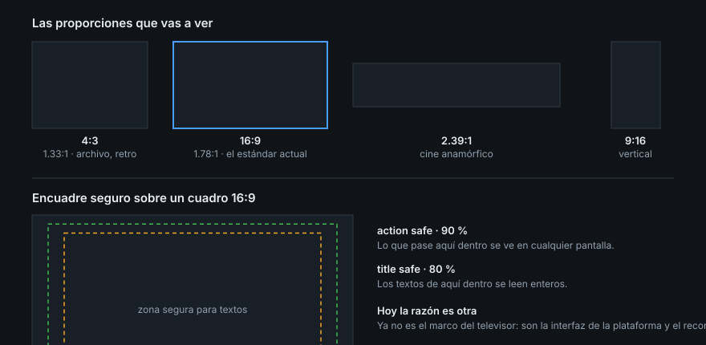

# Aspect ratio y encuadre seguro

> La resolución dice cuántos píxeles hay. El aspect ratio dice qué forma tienen. Son
> preguntas independientes, y confundirlas es lo que produce esas barras negras que
> nadie sabe de dónde salieron.

## 🎯 Objetivos

- Definir **aspect ratio** y distinguirlo de la resolución
- Conocer los aspect ratios habituales y para qué se usa cada uno
- Entender qué son las **barras negras** y por qué aparecen
- Distinguir **aspect ratio de imagen** de **aspect ratio de píxel**
- Saber qué son las ***safe areas*** y cuándo siguen importando
- Configurar y ver todo esto en Resolve 21

---

## 1. Qué problema resuelve

El **aspect ratio** (*aspect ratio*, "relación de aspecto") es la proporción entre el
ancho y el alto de la imagen. Se escribe de dos maneras:

- Como proporción: **16:9**, **4:3**, **9:16**
- Como número: **1.78:1**, **1.33:1**, **2.39:1** — cuántas veces más ancha que alta

Son la misma información: `16 ÷ 9 = 1.78`.

Es una decisión **de composición**, no técnica. Un formato ancho invita a poner cosas a
los lados y a hablar del entorno; un formato vertical obliga a mirar a una persona. Por
eso el cine se fue haciendo cada vez más ancho durante los años cincuenta, y por eso el
móvil lo devolvió todo a vertical setenta años después.

---

## 2. Cómo funciona: los aspect ratios que vas a ver

| Ratio | Número | Dónde se usa |
| ----- | ------ | ------------ |
| **4:3** | 1.33:1 | Televisión clásica, cine mudo, material de archivo, estética retro |
| **16:9** | 1.78:1 | **El estándar actual**: televisión, YouTube, casi todo el vídeo web |
| 1.85:1 | 1.85:1 | Cine "plano" (*flat*), el formato panorámico estándar de sala |
| **2.39:1** | 2.39:1 | Cine anamórfico (*scope*). El formato ancho de las grandes producciones |
| **9:16** | 0.56:1 | Vertical: TikTok, Reels, Shorts, Stories |
| 1:1 | 1:1 | Cuadrado. Publicaciones de feed en redes |
| 4:5 | 0.8:1 | Vertical suave, muy usado en feed de redes sociales |

> [!NOTE]
> **2.39:1 y 2.35:1** verás las dos cifras usadas indistintamente. 2.35:1 fue el
> estándar hasta 1970; después se ajustó a 2.39:1. Coloquialmente todo el mundo dice
> "2.35" y se refiere a 2.39. La diferencia son unos pocos píxeles de altura.

---

## 3. Barras negras: de dónde salen

Cuando el aspect ratio de la imagen no coincide con el del contenedor donde se muestra,
sobra sitio en algún lado. Hay dos formas de rellenarlo y las dos tienen nombre:

| Nombre | Qué pasa | Cuándo |
| ------ | -------- | ------ |
| ***Letterbox*** | Barras arriba y abajo | Imagen más ancha que el contenedor: un 2.39:1 en una pantalla 16:9 |
| ***Pillarbox*** | Barras a los lados | Imagen más estrecha: un 4:3 en una pantalla 16:9 |

Y hay dos maneras de evitarlas, ambas con coste:

- **Recortar** (*crop*): tirar los lados que sobran. Pierdes composición.
- **Deformar** (*stretch*): estirar la imagen hasta que encaje. Todo el mundo sale gordo
  o estirado. **No se hace nunca.**

> [!IMPORTANT]
> Cuando entregues a una plataforma, la plataforma **añadirá las barras que hagan
> falta** por su cuenta. Lo que tú controlas es dónde está la imagen dentro de tu
> archivo. Un 2.39:1 se puede entregar de dos formas: como archivo 2.39:1 puro, o como
> archivo 16:9 con las barras "quemadas" dentro. Para YouTube, lo correcto es lo
> primero. La Semana 29 lo detalla.

---

## 4. El aspect ratio de píxel: la trampa histórica

Hay un segundo aspect ratio que casi nadie menciona hasta que da problemas: el de **cada
píxel individual**.

- **PAR** (*pixel aspect ratio*): la forma de un píxel.
- **DAR** (*display aspect ratio*): la forma de la imagen completa al mostrarse.

En todo el vídeo moderno los píxeles son **cuadrados** (PAR 1:1), y entonces la
resolución determina el aspect ratio directamente: `1920 ÷ 1080 = 1.78` = 16:9. Fin.

Pero el vídeo de definición estándar usaba **píxeles rectangulares**. Un archivo PAL de
`720 × 576` da `1.25:1` si haces la división, y sin embargo se muestra como 4:3 o como
16:9 — porque cada píxel es más ancho que alto y la resolución sola no basta para saber
la forma final.

Solo te toparás con esto si trabajas con material de archivo, VHS digitalizado o DVD. Si
un clip antiguo se ve deformado, esta es la causa: se corrige en
`clic derecho sobre el clip en el media pool > Clip Attributes > Video > Pixel Aspect Ratio`.

---

## 5. Safe areas: el margen que la televisión se comía

Los televisores de tubo no mostraban la imagen entera: los bordes quedaban tapados por
el marco, y cuánto se comían variaba de un aparato a otro. Para que un rótulo no
quedase cortado, se definieron dos márgenes:

| Zona | Margen aproximado | Qué garantiza |
| ---- | ----------------- | ------------- |
| ***Action safe*** | 90 % del cuadro | Lo que pase aquí dentro se verá en cualquier pantalla |
| ***Title safe*** | 80 % del cuadro | Los textos de aquí dentro se leerán enteros |

Hoy las pantallas muestran el cuadro completo, así que la razón original desapareció.
Pero las safe areas siguen siendo útiles por dos motivos nuevos:

1. **Las interfaces de las plataformas tapan los bordes.** El botón de "me gusta", la
   barra de progreso, el nombre del canal, los subtítulos automáticos. En vertical es
   especialmente agresivo: TikTok e Instagram se comen tiras enteras arriba y abajo.
2. **El recorte automático.** Un vídeo 16:9 recortado a 1:1 para un feed pierde los
   laterales. Si tu texto vivía ahí, desaparece.

> [!TIP]
> La regla moderna: **nada importante fuera del 80 % central**, y en vertical, nada
> importante en el 15 % superior ni en el 20 % inferior. Es el equivalente actual del
> *title safe*, y por las mismas razones prácticas.

En Resolve: `View > Safe Area > On`, y en ese mismo submenú se activan las guías de
*action*, *title*, centro y ratios alternativos.

---

## 6. Cómo se hace en Resolve 21

**Fijar el aspect ratio del proyecto**: no hay un campo de "aspect ratio". Se define
implícitamente con la resolución, en
`File > Project Settings > Master Settings > Timeline resolution`.
`1920×1080` es 16:9; `1080×1920` es 9:16.

**Trabajar en formato ancho tipo cine** dentro de una timeline 16:9: no se cambia la
resolución, se usa un recorte. `File > Project Settings > Master Settings > Use vertical
resolution` es para vertical, pero para un 2.39:1 lo habitual es aplicar el ResolveFX
`Letterbox`, o recortar en el Inspector, sobre un `Adjustment Clip` que cubra toda la
timeline (Semana 11).

**Ver las guías**: `View > Safe Area`, con sus submenús para *action*, *title*, centro y
proporciones alternativas.

**Corregir un clip deformado**: `clic derecho en el media pool > Clip Attributes > Video`.

**Entregas verticales o cuadradas** a partir de un montaje 16:9: se resuelven con
reencuadre por clip en la Semana 10, y con las entregas por destino de la Semana 29.

Para el bootcamp la timeline es **1920×1080**, es decir **16:9**: el formato en el que
hay más material de práctica libre y el que sigue siendo el estándar de entrega.

---

## 7. Antipatrones

| Antipatrón | Por qué duele | Qué hacer |
| ---------- | ------------- | --------- |
| Estirar la imagen para que "llene" la pantalla | Todo el mundo sale deformado y no tiene arreglo | Barras negras o recorte, nunca deformación |
| Quemar barras de 2.39:1 en un archivo 16:9 para YouTube | La plataforma añade las suyas encima y acabas con barras dobles | Entrega el archivo en su ratio real |
| Poner texto pegado al borde | Lo tapa la interfaz de la plataforma o lo recorta un reencuadre | Nada importante fuera del 80 % central |
| Montar en 16:9 y decidir en el último día que hay versión vertical | El reencuadre plano a plano de una pieza entera es días de trabajo | Decide los formatos de entrega en la semana 01, no en la 29 |
| Ignorar el aspect ratio de píxel con material antiguo | El material se ve deformado y se corrige "a ojo" estirándolo más | `Clip Attributes > Pixel Aspect Ratio` |

---

## 8. Trucos

| Truco | Cómo |
| ----- | ---- |
| Ver las safe areas | `View > Safe Area > On`. Se pueden activar *action*, *title* y centro por separado |
| Previsualizar cómo quedaría en otro ratio | En el mismo submenú de `View > Safe Area` hay guías de proporciones alternativas |
| Arreglar un clip antiguo que se ve deformado | `clic derecho en el media pool > Clip Attributes > Video > Pixel Aspect Ratio` |

---

## 📚 Recursos Adicionales

- [DaVinci Resolve Reference Manual](https://www.blackmagicdesign.com/support/family/davinci-resolve-and-fusion) — el capítulo de Project Settings y el de Clip Attributes documentan exactamente qué hace cada campo, incluido el aspect ratio de píxel.
- [DCI Digital Cinema System Specification](https://www.dcimovies.com/) — de dónde salen 1.85:1 y 2.39:1 como formatos de sala.
- [Blackmagic Design Training](https://www.blackmagicdesign.com/products/davinciresolve/training) — sus guías incluyen ejercicios de entrega multiformato a partir de un mismo montaje.

---

## ✅ Checklist de Verificación

- [ ] Sé qué es el aspect ratio y por qué es independiente de la resolución
- [ ] Sé convertir entre `16:9` y `1.78:1`
- [ ] Distingo *letterbox* de *pillarbox* y sé por qué aparecen
- [ ] Sé que deformar la imagen nunca es una opción
- [ ] Distingo aspect ratio de imagen del de píxel, y sé dónde se corrige el segundo
- [ ] Sé qué son *action safe* y *title safe*, y por qué siguen importando hoy
- [ ] Sé activar las safe areas en Resolve 21

---

| Anterior | Actual | Siguiente |
| -------- | ------ | --------- |
| [04 · Resolución](04-resolucion.md) | **05 · Aspect ratio y encuadre seguro** | [06 · Timecode](06-timecode.md) |

← [Volver a la Semana 01](../README.md)
