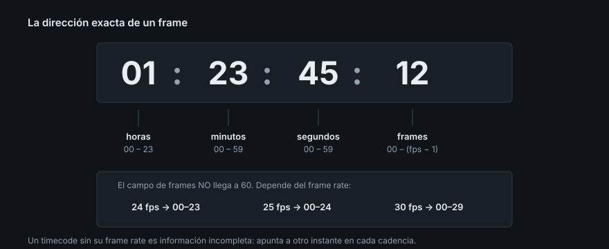
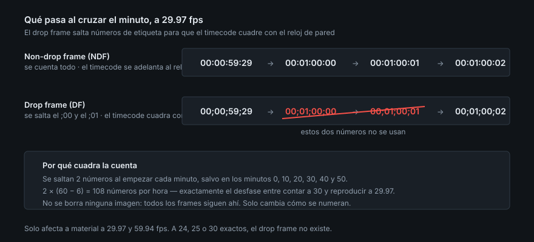

# Timecode

> El timecode es la dirección postal de un frame. Sin él, "el plano donde se ríe" es lo
> único que puedes decir; con él, `01:04:23:11`. Es la diferencia entre trabajar solo y
> trabajar con alguien.

## 🎯 Objetivos

- Leer y escribir **timecode** correctamente
- Convertir entre timecode, número de frames y segundos
- Entender qué es el **drop frame** y por qué existe
- Distinguir el timecode de **origen** del de **la timeline**
- Saber dónde se ve y cómo se usa el timecode en Resolve 21

---

## 1. Qué problema resuelve

Un vídeo de diez minutos a 24 fps tiene **14 400 frames**. Hace falta una forma de
nombrar uno concreto que sea:

- **Exacta**: sin ambigüedad sobre cuál es
- **Legible**: que un humano pueda leerla y decirla por teléfono
- **Ordenable**: que se sepa cuál va antes
- **Compartida**: que signifique lo mismo en tu máquina y en la de otro

El **timecode** (*timecode*, "código de tiempo") es esa forma, y es un estándar de la
industria desde los años sesenta.

---

## 2. Cómo funciona: la anatomía

```
01 : 23 : 45 : 12
│    │    │    └── frames  (00 a fps-1)
│    │    └─────── segundos (00-59)
│    └──────────── minutos  (00-59)
└───────────────── horas    (00-23)
```



Lo único raro es el último campo. Los frames **no llegan a 60**: llegan hasta el frame
rate menos uno.

| Frame rate | Rango de frames | El frame antes del segundo siguiente |
| ---------- | --------------- | ------------------------------------ |
| 24 fps | 00 a 23 | `00:00:00:23` |
| 25 fps | 00 a 24 | `00:00:00:24` |
| 30 fps | 00 a 29 | `00:00:00:29` |

Por eso `00:00:00:24` es un timecode válido a 25 fps e **imposible** a 24 fps. El
timecode no significa nada sin saber a qué frame rate pertenece.

> [!IMPORTANT]
> Corolario práctico: **un timecode sin su frame rate es información incompleta.**
> Cuando anotes o comuniques timecodes, el frame rate va implícito en el proyecto. Si
> el proyecto cambia de cadencia, todos tus timecodes apuntan a otro sitio.

---

## 3. Convertir entre timecode, frames y segundos

Las tres conversiones que hay que saber hacer.

**Timecode a frames** (a 24 fps, `00:01:30:12`):

```
minutos × 60 × fps  =  1 × 60 × 24 = 1440
segundos × fps      = 30 × 24      =  720
frames              =                  12
                                    ─────
total                                2172 frames
```

**Frames a segundos**:

```
segundos = frames ÷ fps  →  2172 ÷ 24 = 90,5 s
```

**Segundos a timecode** (90,5 s a 24 fps): 90 s son 1 min y 30 s; el 0,5 restante son
12 frames → `00:01:30:12`.

> [!WARNING]
> Usa **siempre el frame rate de la timeline**, que puede no coincidir con el de los
> clips que contiene. Un clip de 60 fps dentro de una timeline de 24 fps se direcciona
> con el timecode de la timeline. Es el error de cálculo más frecuente al automatizar
> con scripts en la Semana 33.

---

## 4. Drop frame: el ajuste que confunde a todo el mundo

Recuerda la teoría 02: el vídeo NTSC no va a 30 fps, va a **29.97**.

Eso crea un desfase entre el timecode y el reloj de pared. Contando frames de 30 en 30
como si fuesen 30 exactos, al cabo de una hora real habrías contado **108 frames de
más**: el timecode marcaría casi 4 segundos más de lo que realmente ha pasado.

En televisión, donde un bloque publicitario dura lo que dura, eso es inaceptable.

La solución, el **drop frame** (*drop frame timecode*), es un truco de contabilidad:

> **Al empezar cada minuto, sáltate los números de frame `00` y `01`. Excepto en los
> minutos múltiplos de 10.**

```
... 00:00:59:29  →  00:01:00:02   (se saltan el :00 y el :01)
... 00:09:59:29  →  00:10:00:00   (minuto 10: no se salta nada)
```



La cuenta cuadra: se saltan 2 números por minuto en 54 de los 60 minutos de una hora,
que son exactamente los **108** frames de desfase.

> [!IMPORTANT]
> **No se borra ningún frame.** El drop frame **salta números de etiqueta**, no
> imágenes. Todos los frames siguen ahí. Lo único que cambia es cómo se numeran, para
> que la última etiqueta de la hora coincida con el reloj de pared.

**Cómo se distingue en pantalla**: el drop frame se escribe con **punto y coma** antes
de los frames, o con puntos y comas en todas las separaciones.

| Tipo | Notación |
| ---- | -------- |
| Non-drop frame (NDF) | `01:00:00:00` |
| Drop frame (DF) | `01;00;00;00` o `01:00:00;00` |

**Cuándo te afecta**: solo con material a 29.97 o 59.94. Si trabajas a 24, 25 o 30
exactos —como el proyecto de este bootcamp— el drop frame no existe para ti. Pero hay
que saber leerlo, porque el día que abras material NTSC ajeno aparecerá.

---

## 5. Timecode de origen y timecode de timeline

Hay dos timecodes distintos en cualquier proyecto, y confundirlos es fuente de errores:

| Cuál | Qué es | Para qué sirve |
| ---- | ------ | -------------- |
| **Source timecode** | El que la cámara grabó dentro del archivo | Identificar un frame **del material original**. Sincronizar cámaras. Relink |
| **Record timecode** | La posición dentro de la timeline | Identificar un frame **del montaje**. Dar notas de revisión |

El de origen es el que permite sincronizar tres cámaras que grabaron la misma escena:
si las tres tenían el mismo timecode, alinearlas es automático (Semana 05).

El de timeline es el que usas para comunicar. Cuando alguien te dice "en el 04:12 hay un
salto de audio", habla del timecode de timeline.

Por convención, las timelines suelen empezar en `01:00:00:00` en lugar de en cero. La
razón es histórica —dejar espacio antes del programa para barras de color y claqueta— y
sigue siendo útil: distingue de un vistazo un timecode de timeline de uno de origen.

> [!NOTE]
> En el proyecto del bootcamp verás que las timelines arrancan en `01:00:00:00`. A 24
> fps eso son 86 400 frames de desplazamiento. Si un script te devuelve un
> `start_frame` enorme, es esto y no un error.

---

## 6. Cómo se hace en Resolve 21

**Ver el timecode**: los contadores encima de cada *viewer*. El del viewer de origen
muestra el timecode del clip; el del viewer de timeline, el del montaje.

**Cambiar entre timecode y número de frames**: **clic derecho sobre el contador**.

**Saltar a un timecode concreto**: con la timeline enfocada, **escribe el timecode
directamente** y pulsa `Enter`. No hay que abrir ningún cuadro de diálogo. También
funcionan los saltos relativos: escribir `+100` avanza 100 frames, `-50` retrocede 50.

**Cambiar el timecode de inicio de una timeline**:
`clic derecho sobre la timeline en el media pool > Timelines > Starting Timecode`.

**Ver el timecode de origen de un clip**: página Media, panel de Metadata.

**Leerlo por script** (Semana 33): `timeline_probe` devuelve `start_frame`, `end_frame`
y `duration_frames`, más el `fps` con el que convertir. Los segundos son un cálculo
derivado, no el dato.

---

## 7. Antipatrones

| Antipatrón | Por qué duele | Qué hacer |
| ---------- | ------------- | --------- |
| Dar notas de revisión "en el minuto 4 y pico" | No es una dirección: son 24 frames candidatos por segundo | Da el timecode completo, `00:04:12:07` |
| Anotar timecodes sin decir el frame rate | El mismo timecode apunta a otro frame en otra cadencia | Frame rate implícito en el proyecto, explícito al comunicar fuera |
| Creer que el drop frame borra frames | Se toman decisiones absurdas "para no perder imagen" | Salta números de etiqueta, no imágenes |
| Mezclar timecode de origen y de timeline en la misma nota | La otra persona busca en el sitio equivocado | Di siempre cuál de los dos estás dando |
| Calcular con el frame rate del clip en vez del de la timeline | El resultado se desvía y el error crece con la duración | Usa siempre el `fps` de la timeline |

---

## 8. Trucos

| Truco | Cómo |
| ----- | ---- |
| Saltar a un punto exacto | Con la timeline enfocada, escribe el timecode y pulsa `Enter` |
| Avanzar o retroceder una cantidad exacta | Escribe `+100` o `-50` y `Enter` |
| Alternar entre timecode y frames | Clic derecho sobre el contador del viewer |
| Cambiar dónde empieza la timeline | `clic derecho en el media pool > Timelines > Starting Timecode` |

---

## 📚 Recursos Adicionales

- [DaVinci Resolve Reference Manual](https://www.blackmagicdesign.com/support/family/davinci-resolve-and-fusion) — el capítulo de timecode documenta cómo Resolve interpreta el timecode de origen y qué hace cuando falta o está duplicado, que es el caso raro que acaba apareciendo.
- [SMPTE — estándares de timecode](https://www.smpte.org/) — la organización que definió el formato. Útil cuando hay que citar una fuente y no una explicación de foro.
- [Blackmagic Design Training](https://www.blackmagicdesign.com/products/davinciresolve/training) — los ejercicios oficiales de sincronización multicámara son el mejor sitio para ver el timecode de origen haciendo su trabajo.

---

## ✅ Checklist de Verificación

- [ ] Sé leer `01:23:45:12` y decir qué significa cada campo
- [ ] Sé por qué los frames no llegan a 60
- [ ] Puedo convertir un timecode a frames y a segundos con papel y lápiz
- [ ] Sé qué es el drop frame, por qué existe y que **no borra frames**
- [ ] Distingo la notación de drop frame de la de non-drop frame
- [ ] Distingo timecode de origen de timecode de timeline
- [ ] Sé saltar a un timecode escribiéndolo directamente en Resolve

---

| Anterior | Actual | Siguiente |
| -------- | ------ | --------- |
| [05 · Aspect ratio y encuadre seguro](05-aspect-ratio-y-encuadre-seguro.md) | **06 · Timecode** | [07 · Instalar DaVinci Resolve 21](07-instalar-davinci-resolve-21.md) |

← [Volver a la Semana 01](../README.md)
