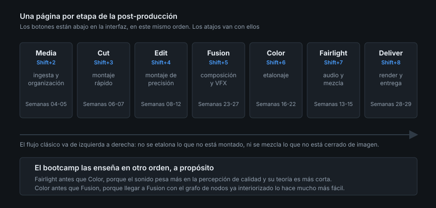

# Anatomía de Resolve

> Resolve no es un programa: son siete programas compartiendo un proyecto. Entender por
> qué están separados y en qué orden se usan es entender el flujo de trabajo entero de
> la post-producción.

## 🎯 Objetivos

- Nombrar las **siete páginas** y saber qué hace cada una
- Entender por qué la post-producción está dividida en esas siete etapas
- Navegar entre páginas sin ratón
- Distinguir **Preferences** de **Project Settings**
- Reconocer los elementos que se repiten en todas las páginas
- Saber en qué orden se usan las páginas y por qué el bootcamp no las enseña en ese orden

---

## 1. Qué problema resuelve

DaVinci Resolve nació en 1984 como un sistema de **etalonaje** exclusivamente: un
armario carísimo para corregir color de cine. Blackmagic Design lo compró en 2009, lo
hizo gratuito, y desde entonces le ha ido añadiendo el resto de la cadena: montaje
(2014), audio con Fairlight (2018), efectos con Fusion (2018), y la página Cut (2019).

Esa historia explica la arquitectura. En vez de meterlo todo en una interfaz gigante,
cada disciplina conservó **su propio espacio de trabajo optimizado**. Un montador y un
colorista no necesitan las mismas herramientas a la vista, y ninguno de los dos necesita
las de un mezclador de sonido.

El resultado: **una página por etapa de la post-producción**, todas sobre el mismo
proyecto, sin exportar ni importar nada entre ellas.



---

## 2. Las siete páginas

Los botones están abajo, siempre en el mismo orden. Ese orden **es** el flujo de trabajo
clásico.

### 🎞️ Media — `Shift+2`

Meter material dentro y organizarlo. Copiar de la tarjeta verificando integridad,
importar, crear bins, poner metadata, generar proxies, sincronizar audio.

Es la página que más determina si un proyecto grande será manejable o un infierno.
**Semanas 04-05.**

### ✂️ Cut — `Shift+3`

Montaje rápido. Interfaz reducida, doble timeline, herramientas pensadas para pasar de
tres horas de material a un montaje bruto en el menor tiempo posible.

Es la página más nueva y la más incomprendida: mucha gente la ignora por creerla "la
versión fácil de Edit". No lo es: es una filosofía de montaje distinta, y es más rápida.
**Semanas 06-07.**

### 🎬 Edit — `Shift+4`

Montaje de precisión. Es la página donde vivirás más horas: trimming fino, títulos,
transiciones, efectos, multicámara, subtítulos.

Si vienes de otro editor, esta es la que te resultará familiar. **Semanas 08-12.**

### 🌀 Fusion — `Shift+5`

Composición y efectos visuales, **por nodos**. Máscaras, tracking, keying, rotoscopia,
motion graphics, partículas, 3D.

Es el cambio mental más grande del bootcamp: se deja de pensar en capas apiladas y se
empieza a pensar en un grafo de operaciones. **Semanas 23-27.**

### 🎨 Color — `Shift+6`

Etalonaje. El motivo por el que Resolve existe y sigue siendo el estándar de la
industria. Nodos, scopes, primarias, secundarias, tracking, gestión de color, looks.

**Semanas 16-22**, la fase más larga del bootcamp: siete semanas.

### 🔊 Fairlight — `Shift+7`

Audio profesional: mezclador, buses, EQ, dinámica, limpieza de diálogo, diseño sonoro,
loudness. No es "la pestaña de audio": es una estación de trabajo de audio completa
dentro del programa.

**Semanas 13-15.**

### 📤 Deliver — `Shift+8`

Render y entrega. Codecs, presets, cola de render, entregas por destino.

**Semanas 28-29.**

> [!TIP]
> Los atajos van en el orden de los botones, de izquierda a derecha. Es el único atajo
> que conviene memorizar el primer día, porque lo usarás cientos de veces.

---

## 3. El orden real y el orden del bootcamp

El flujo clásico de post-producción recorre las páginas de izquierda a derecha:

```
Media  →  Cut / Edit  →  Fusion  →  Color  →  Fairlight  →  Deliver
ingesta    montaje        efectos    color     sonido       entrega
```

Hay una lógica detrás: **no se etalona lo que no está montado**, porque etalonar planos
que luego se caen es tirar el trabajo. **No se mezcla lo que no está cerrado de
imagen**, por lo mismo.

El bootcamp **no sigue ese orden**, y la razón es pedagógica:

| Orden del bootcamp | Por qué |
| ------------------ | ------- |
| Fairlight (13-15) **antes** que Color (16-22) | El sonido tiene más impacto en la percepción de calidad que el color, y su teoría es más corta. Se domina antes |
| Color (16-22) **antes** que Fusion (23-27) | Fusion es el salto conceptual más grande. Llegar con el grafo de nodos ya interiorizado desde Color lo hace mucho más fácil |
| Cut (06-07) **antes** que Edit (08-12) | Se aprende a montar montando rápido. Empezar por la precisión antes que por el ritmo es empezar por el final |

En tu **proyecto** sí seguirás el orden clásico: montaje, sonido, color, efectos,
entrega. Lo que cambia es el orden en que se enseñan las herramientas.

---

## 4. Lo que se repite en todas las páginas

Aunque cada página es distinta, hay una estructura común:

| Elemento | Qué es | Dónde |
| -------- | ------ | ----- |
| **Viewer** | Donde se ve la imagen | Centro o arriba |
| **Media Pool** | Los clips del proyecto | Se abre y se cierra en casi todas las páginas |
| **Inspector** | Los parámetros de lo que tengas seleccionado | Derecha |
| **Timeline** | El montaje | Abajo, en Cut, Edit, Fusion, Color y Fairlight |
| **Barra de páginas** | Los siete botones | Abajo del todo, siempre visible |

Los paneles se muestran y se ocultan desde `Workspace`. Y si acabas con la interfaz
descolocada:

**`Workspace > Reset UI Layout`** devuelve la disposición por defecto sin tocar el
proyecto. Es la red de seguridad de esta semana.

También puedes guardar tu propia disposición: `Workspace > Layout Presets > Save Layout
Preset`, útil cuando en la Semana 17 tengas los scopes colocados exactamente donde los
quieres.

---

## 5. Preferences frente a Project Settings

Dos sitios de configuración que se confunden constantemente:

| | Preferences | Project Settings |
| --- | ----------- | ---------------- |
| **Alcance** | Esta máquina, todos los proyectos | Este proyecto, en cualquier máquina |
| **Ruta** | `DaVinci Resolve > Preferences` | `File > Project Settings` |
| **Atajo** | `Ctrl+,` (Win) / `Cmd+,` (Mac) | `Shift+9` |
| **Ejemplos** | Dónde va la caché, qué GPU se usa, idioma, Live Save | Frame rate, resolución, ciencia de color, ajustes de render |

La regla para saber dónde buscar algo: **si describe tu ordenador, es Preferences; si
describe tu vídeo, es Project Settings.**

Y una consecuencia importante: cuando lleves tu proyecto a otra máquina (Semana 30), los
Project Settings viajan con él y las Preferences no.

---

## 6. Cómo se hace en Resolve 21

- **Cambiar de página**: `Shift+2` a `Shift+8`, o los botones de abajo.
- **Abrir Project Settings**: `File > Project Settings`, atajo `Shift+9`.
- **Abrir Preferences**: `DaVinci Resolve > Preferences` (macOS) o
  `DaVinci Resolve > Preferences` desde el menú de la aplicación (Windows); atajo
  `Ctrl+,` (Win) / `Cmd+,` (Mac).
- **Volver al Project Manager** sin cerrar el proyecto: el icono de casa en la esquina
  inferior derecha, o `File > Project Manager`.
- **Mostrar y ocultar paneles**: menú `Workspace`.
- **Resetear el layout**: `Workspace > Reset UI Layout`.
- **Guardar un layout propio**: `Workspace > Layout Presets > Save Layout Preset`.
- **Ver en qué página estás por script**: la operación `ping` del puente devuelve
  `current_page`. Lo usarás en la Semana 34.

---

## 7. Antipatrones

| Antipatrón | Por qué duele | Qué hacer |
| ---------- | ------------- | --------- |
| Ignorar la página Cut por creerla "la fácil" | Te pierdes la forma más rápida de llegar a un montaje bruto | Dale las Semanas 06-07 con honestidad antes de juzgarla |
| Empezar a etalonar antes de cerrar el montaje | Etalonas planos que después se caen del montaje | Color cuando la imagen esté cerrada. En tu proyecto, Fase 5 |
| Buscar el frame rate en Preferences | No está ahí y se pierde el tiempo | Si describe tu vídeo, es Project Settings |
| Recolocar paneles a mano cada sesión | Se pierden minutos todos los días | Guarda un Layout Preset |
| Usar el ratón para cambiar de página | Cientos de veces al día, medio segundo cada una | `Shift+2` a `Shift+8` |

---

## 8. Trucos

| Truco | Cómo |
| ----- | ---- |
| Cambiar de página sin ratón | `Shift+2` a `Shift+8`, en el orden de los botones |
| Abrir los ajustes del proyecto de un golpe | `Shift+9` |
| Recuperar un layout destrozado | `Workspace > Reset UI Layout` |
| Guardar tu propia disposición de paneles | `Workspace > Layout Presets > Save Layout Preset` |
| Volver al Project Manager sin cerrar nada | El icono de casa, abajo a la derecha |

---

## 📚 Recursos Adicionales

- [DaVinci Resolve Reference Manual](https://www.blackmagicdesign.com/support/family/davinci-resolve-and-fusion) — cada página tiene su propia sección en el manual; el índice sirve como mapa de todo lo que el bootcamp va a cubrir en nueve meses.
- [Blackmagic Design Training](https://www.blackmagicdesign.com/products/davinciresolve/training) — las guías oficiales están organizadas por página, y son útiles como segunda voz sobre el mismo tema.
- [Foro oficial de DaVinci Resolve](https://forum.blackmagicdesign.com/) — tiene un subforo por página, lo que ayuda a saber si una duda es de montaje, de color o de audio antes de buscar.

---

## ✅ Checklist de Verificación

- [ ] Sé nombrar las siete páginas en orden y decir qué hace cada una
- [ ] Sé cambiar de página con el teclado
- [ ] Entiendo por qué el flujo clásico va de Media a Deliver
- [ ] Sé por qué el bootcamp enseña Fairlight antes que Color, y Color antes que Fusion
- [ ] Distingo Preferences de Project Settings y sé la regla para saber dónde buscar
- [ ] Sé resetear el layout sin tocar el proyecto
- [ ] Sé volver al Project Manager sin cerrar el proyecto

---

| Anterior | Actual | Siguiente |
| -------- | ------ | --------- |
| [07 · Instalar DaVinci Resolve 21](07-instalar-davinci-resolve-21.md) | **08 · Anatomía de Resolve** | — |

← [Volver a la Semana 01](../README.md)
