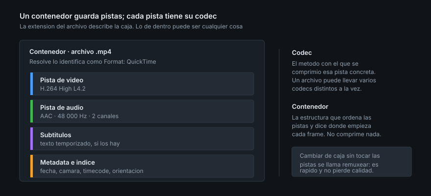

# Contenedor y codec

> `.mp4` no es un formato de vídeo. Es una caja. Lo que hay dentro de la caja puede ser
> cualquier cosa, y esa diferencia explica la mitad de los problemas de compatibilidad
> que vas a tener en nueve meses.

## 🎯 Objetivos

- Definir **contenedor** y **codec**, y saber por qué no son lo mismo
- Leer la extensión de un archivo sin creerte que te dice lo que hay dentro
- Conocer los contenedores que te vas a encontrar y qué suele viajar en cada uno
- Distinguir **remuxear** de **transcodificar**, y saber cuál de las dos destruye calidad
- Saber por qué DaVinci Resolve no abre `.mkv` y qué hacer al respecto
- Leer en Resolve 21 el contenedor y el codec reales de un archivo

---

## 1. Qué problema resuelve

Tienes dos archivos. Los dos se llaman `.mp4`. Uno se reproduce en cualquier sitio; el
otro hace que Resolve se arrastre. Los dos duran lo mismo y se ven parecidos, pero uno
ocupa 80 MB y el otro 2 GB.

La extensión no te ha dicho nada de eso, porque la extensión describe la **caja**, no lo
que hay dentro. Separar esas dos cosas —la caja y su contenido— es lo que te permite
diagnosticar un archivo en diez segundos en vez de probar cosas al azar.

---

## 2. Cómo funciona

Un archivo de vídeo tiene dos capas independientes.



### El contenedor

El **contenedor** (*container*, también *wrapper* o "formato de archivo") es la
estructura que guarda varias pistas juntas y explica cómo están ordenadas:

- Una o varias pistas de **vídeo**
- Una o varias pistas de **audio**
- **Subtítulos**, si los hay
- **Metadata**: fecha, cámara, timecode, orientación, geolocalización
- Un **índice**: en qué byte del archivo empieza cada frame, para poder saltar

El contenedor no comprime nada. Es la caja y el albarán.

### El codec

El **codec** (*codec*, de *coder-decoder*, "codificador-decodificador") es el método con
el que se comprimieron los datos de una pista. Es un par de algoritmos: uno que convierte
imágenes en un flujo de bits pequeño, y otro que hace el camino inverso.

Cada pista de un archivo lleva su propio codec. En un `.mp4` típico de móvil, el vídeo
está en H.264 y el audio en AAC: **dos codecs distintos dentro del mismo contenedor**.

> [!NOTE]
> **Formato** es una palabra que la industria usa para las dos cosas y por eso confunde.
> Cuando alguien diga "¿en qué formato está?", la respuesta útil siempre tiene dos
> partes: contenedor y codec. `MP4 / H.264` dice algo. `MP4` solo, no.

---

## 3. Los contenedores que te vas a encontrar

| Contenedor | Extensión | Qué suele llevar dentro | Dónde aparece |
| ---------- | --------- | ----------------------- | ------------- |
| **MP4** | `.mp4` | H.264 o H.265 de vídeo, AAC de audio | Móviles, cámaras de consumo, internet entero |
| **QuickTime** | `.mov` | ProRes, DNxHR, H.264, sin comprimir | Cámaras de cine, flujos de trabajo de montaje, material de Apple |
| **MXF** | `.mxf` | XAVC, DNxHD/HR, AVC-Intra | Broadcast, cámaras profesionales de Sony y Panasonic |
| **AVI** | `.avi` | Casi cualquier cosa; formato antiguo de Microsoft | Material de archivo, capturas antiguas |
| **Matroska** | `.mkv` | Casi cualquier cosa | Descargas, grabaciones de OBS, material de internet |
| **Blackmagic RAW** | `.braw` | Solo Blackmagic RAW | Cámaras Blackmagic (ver [teoría 06](06-blackmagic-raw.md)) |

MP4 y QuickTime son **parientes**: los dos derivan del mismo estándar, el *ISO Base
Media File Format*, que a su vez nació del formato QuickTime de Apple en los años
noventa. Por eso se parecen tanto por dentro y por eso pasa lo siguiente:

> [!IMPORTANT]
> En DaVinci Resolve 21, un archivo `.mp4` aparece con el campo `Format` a
> **`QuickTime`**. No es un error ni una confusión de Resolve: es que reconoce la familia
> del contenedor, no la extensión. *Verificado en 21.0.4.5, agosto de 2026.*

---

## 4. Remuxear no es transcodificar

Esta es la distinción que ahorra horas y calidad.

| Operación | Qué hace | Cuánto tarda | ¿Pierde calidad? |
| --------- | -------- | ------------ | ---------------- |
| **Remuxear** (*remux*) | Saca las pistas de una caja y las mete en otra, **sin tocarlas** | Segundos | **No.** Los bits del vídeo son idénticos |
| **Transcodificar** (*transcode*) | Descomprime y vuelve a comprimir con otro codec | Minutos u horas | **Sí**, salvo con codecs sin pérdida |

Un `.mkv` con vídeo H.264 se convierte en un `.mp4` con vídeo H.264 en unos segundos,
copiando los datos tal cual. Ese mismo `.mkv` convertido a ProRes es otra cosa: hay que
descomprimir cada frame y volver a comprimirlo con otro método.

La orden de remux, con `ffmpeg`, es esta —`-c copy` significa "copia las pistas, no las
recodifiques":

```bash
ffmpeg -i grabacion.mkv -c copy grabacion.mp4
```

> [!TIP]
> Cuando alguien te diga "conviértelo a mp4", pregunta si hace falta cambiar el codec. La
> mayoría de las veces no: basta con cambiar la caja, y eso es gratis y no daña nada.

---

## 5. El caso `.mkv` y DaVinci Resolve

**DaVinci Resolve no importa archivos `.mkv`.** Ni en Free ni en Studio, ni en la 21. El
archivo simplemente no aparece o entra sin vídeo.

Esto importa porque **OBS Studio graba en `.mkv` por defecto**, y OBS es lo que usa casi
todo el mundo para capturar pantalla o directos. Hay dos soluciones, y la primera es
mejor:

1. **Que OBS no grabe en `.mkv`.** En `Ajustes > Avanzado > Grabación` existe la opción
   de remuxear automáticamente a `.mp4` al terminar. Se activa una vez y ya no vuelves a
   pensar en ello.
2. **Remuxear después**, con la orden `ffmpeg` de la sección anterior.

> [!NOTE]
> OBS graba en `.mkv` por una razón sensata: si el ordenador se cuelga a mitad de una
> grabación, un `.mkv` truncado se sigue reproduciendo y un `.mp4` truncado no, porque el
> índice del `.mp4` se escribe al final. El precio de esa seguridad es un archivo que
> Resolve no abre.

---

## 6. Cómo se lee el contenedor y el codec en Resolve 21

Con el clip ya en el media pool:

1. Ve a la página **Media** (`Shift+2`).
2. Selecciona el clip.
3. Abre el panel **Metadata** y busca los campos:

| Campo de Resolve | Qué te dice |
| ---------------- | ----------- |
| `Format` | La familia del **contenedor** (`QuickTime` para `.mp4` y `.mov`) |
| `Video Codec` | El codec de la pista de vídeo, con su perfil y nivel (`H.264 High L4.2`) |
| `Audio Codec` | El codec de la pista de audio (`AAC`, `Linear PCM`) |
| `File Name` / `File Path` | El nombre y la ruta reales del archivo en tu disco |
| `Type` | Qué pistas trae: `Video + Audio`, `Video`, `Audio` |

También puedes verlo sin abrir el panel: en la **vista de lista** del media pool, clic
derecho sobre la cabecera de las columnas para añadir las columnas que te interesen.

> [!WARNING]
> Hay un dato que Resolve **no** muestra: el **chroma subsampling** (`4:2:0`, `4:2:2`).
> No está en Metadata ni en las columnas. Para leerlo hace falta una herramienta externa
> —MediaInfo es gratuita y de código abierto— y se explica en la
> [teoría 03](03-chroma-subsampling.md) y en la [práctica 01](../2-practicas/01-leer-la-ficha-tecnica-de-un-archivo.md).

---

## 7. Antipatrones

| Antipatrón | Por qué duele | Qué hacer |
| ---------- | ------------- | --------- |
| Renombrar la extensión para "convertir" un archivo | Cambiar `.mkv` por `.mp4` a mano no mueve un solo byte: el archivo sigue siendo Matroska y Resolve lo sigue rechazando | Remuxear de verdad, con `ffmpeg -c copy` |
| Decir "está en mp4" y creer que eso describe el archivo | Dentro puede haber H.264 de 8 bits o H.265 de 10 bits, y se comportan de forma muy distinta al montar | Cita siempre contenedor **y** codec |
| Transcodificar cuando bastaba remuxear | Horas de proceso y una generación de pérdida a cambio de nada | Comprueba primero si el codec de dentro ya te sirve |
| Grabar en `.mkv` y descubrirlo el día de montar | Te enteras cuando arrastras el archivo a Resolve y no pasa nada | Configura OBS para remuxear al terminar, hoy |
| Fiarte del icono del explorador de archivos | El sistema operativo también mira solo la extensión | Mira la ficha técnica real: MediaInfo, o el panel Metadata de Resolve |

---

## 8. Trucos

| Truco | Cómo |
| ----- | ---- |
| Saber qué hay dentro de un archivo antes de importarlo | MediaInfo en vista *Tree*: contenedor, codecs, chroma, bit depth y bitrate en una pantalla |
| Comprobar si Resolve ha reconocido bien el archivo | Página Media, panel Metadata, campo `Video Codec`. Si está vacío, Resolve no ha entendido la pista |
| Remuxear una carpeta entera de `.mkv` de una vez | `for f in *.mkv; do ffmpeg -i "$f" -c copy "${f%.mkv}.mp4"; done` |
| Ver el contenedor sin salir del media pool | Vista de lista, clic derecho sobre la cabecera de columnas y activa las columnas de codec |

---

## 📚 Recursos Adicionales

- [DaVinci Resolve Reference Manual](https://www.blackmagicdesign.com/support/family/davinci-resolve-and-fusion) — el capítulo de *Media Pool Metadata* lista todos los campos que Resolve expone de un clip y de dónde saca cada uno.
- [MediaInfo](https://mediaarea.net/MediaInfo) — herramienta libre (licencia BSD) que vuelca la ficha técnica completa de cualquier archivo. Es la segunda opinión cuando Resolve y tú no estáis de acuerdo.
- [Documentación de FFmpeg](https://ffmpeg.org/documentation.html) — la sección de *stream copy* explica exactamente qué hace `-c copy` y por qué no toca los datos.

---

## ✅ Checklist de Verificación

- [ ] Sé explicar la diferencia entre contenedor y codec sin usar la palabra "formato"
- [ ] Sé que un `.mp4` puede llevar dentro codecs muy distintos
- [ ] Sé por qué Resolve muestra `QuickTime` en el campo `Format` de un `.mp4`
- [ ] Distingo remuxear de transcodificar y sé cuál de las dos pierde calidad
- [ ] Sé que Resolve no importa `.mkv` y conozco las dos formas de arreglarlo
- [ ] Sé dónde se leen `Format`, `Video Codec` y `Audio Codec` en Resolve 21
- [ ] Sé que el chroma subsampling no lo muestra Resolve y hace falta una herramienta externa

---

| Anterior | Actual | Siguiente |
| -------- | ------ | --------- |
| — | **01 · Contenedor y codec** | [02 · Compresión: intra-frame y long-GOP](02-compresion-intra-frame-y-long-gop.md) |

← [Volver a la Semana 02](../README.md)
