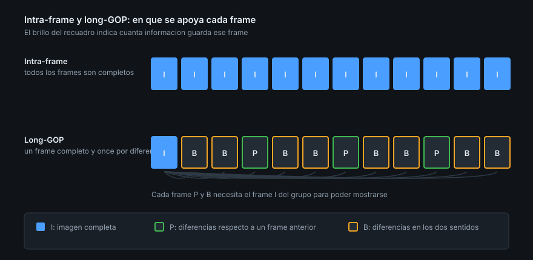

# Compresión: intra-frame y long-GOP

> Un minuto de vídeo HD sin comprimir ocupa unos 9 GB. El mismo minuto grabado por tu
> móvil ocupa 60 MB. Ese factor de 150 no sale gratis, y la forma concreta en que se
> consigue decide si tu montaje va fluido o a tirones.

## 🎯 Objetivos

- Calcular cuánto ocupa el vídeo sin comprimir y entender por qué hay que comprimirlo
- Distinguir compresión **con pérdida** de compresión **sin pérdida**
- Definir **frame I**, **frame P**, **frame B** y **GOP**
- Explicar por qué un codec long-GOP se reproduce bien y se monta mal
- Conocer los codecs de montaje (*intermediate*) y cuándo compensa pasarse a ellos
- Saber qué codecs de montaje están disponibles en DaVinci Resolve 21 Free

---

## 1. Qué problema resuelve

Empecemos por el número. Un frame de 1920 × 1080 con tres canales de color de 8 bits
ocupa:

```
1920 × 1080 × 3 bytes = 6 220 800 bytes ≈ 5,9 MB por frame
5,9 MB × 24 frames = 142 MB por segundo
142 MB × 60 = 8,5 GB por minuto
```

Ocho gigabytes y medio por minuto, en HD. En UHD son cuatro veces más. Ningún móvil, y
casi ninguna cámara, escribe a esa velocidad ni tiene ese espacio.

La compresión existe para eso. Y como toda decisión de ingeniería, se paga: unos codecs
pagan en calidad, otros en tamaño y otros en trabajo de tu procesador.

---

## 2. Con pérdida y sin pérdida

| Tipo | Qué hace | Ejemplos |
| ---- | -------- | -------- |
| **Sin pérdida** (*lossless*) | Al descomprimir recuperas exactamente los mismos bits. Como un `.zip` | FFV1, PNG, ProRes 4444 XQ (casi), audio PCM sin comprimir |
| **Con pérdida** (*lossy*) | Se tira información que el ojo o el oído difícilmente notan. No se recupera nunca | H.264, H.265, AAC, JPEG |

Todo el vídeo que grabas es **con pérdida**. La pregunta útil no es "¿pierde calidad?",
sino "¿cuánta, y cuántas veces la voy a hacer perder?".

> [!IMPORTANT]
> **Cada vez que recomprimes con pérdida, pierdes otra vez.** Es la *pérdida
> generacional*. Exportar un H.264, volver a montarlo, exportar otra vez y repetir es la
> forma más común de arruinar material sin darse cuenta. La regla: **una sola compresión
> con pérdida, al final de la cadena**.

---

## 3. Cómo funciona: dentro de un frame y entre frames

Un codec de vídeo aprovecha dos tipos de redundancia.

**Redundancia espacial** — dentro de un mismo frame. Un cielo azul son miles de píxeles
casi idénticos: en vez de guardar cada uno, se guarda la descripción de la zona. Es lo
mismo que hace un JPEG.

**Redundancia temporal** — entre frames vecinos. Entre dos frames consecutivos de un
plano fijo, el 98 % de la imagen no ha cambiado. En vez de guardar el frame entero, se
guarda **qué ha cambiado**.

De ahí salen los tres tipos de frame:



| Frame | Nombre largo | Qué guarda | Se puede decodificar |
| ----- | ------------ | ---------- | -------------------- |
| **I** | *intra-coded* | La imagen completa, comprimida como un JPEG | Solo con él mismo |
| **P** | *predicted* | Las diferencias respecto a un frame **anterior** | Necesita ese frame |
| **B** | *bi-directional* | Las diferencias respecto a un frame anterior **y** uno posterior | Necesita los dos |

Un **GOP** (*Group of Pictures*, "grupo de imágenes") es un frame I y todos los frames P
y B que dependen de él, hasta el siguiente I. Un GOP típico de móvil tiene entre 15 y 60
frames.

---

## 4. Las dos familias de codecs

### Long-GOP (o *inter-frame*)

Guardan un frame I cada tantos frames y el resto por diferencias.

- **Ejemplos**: H.264, H.265 (HEVC), AV1, XAVC, AVCHD
- **Ventaja**: archivos pequeñísimos. Es lo que hace posible grabar en un móvil y ver
  vídeo por internet
- **Precio**: para mostrarte el frame 47, el ordenador tiene que decodificar el frame I y
  todos los intermedios. **Saltar a un punto cualquiera es caro**

### Intra-frame (o *all-I*)

Cada frame se comprime por separado, como una secuencia de fotos.

- **Ejemplos**: Apple ProRes, Avid DNxHR, GoPro CineForm, DNxHD, AVC-Intra
- **Ventaja**: cualquier frame se decodifica solo. Saltar, retroceder y reproducir hacia
  atrás es inmediato
- **Precio**: entre 3 y 10 veces más espacio en disco

> [!TIP]
> La regla de bolsillo: **long-GOP para grabar y para entregar; intra-frame para
> trabajar**. Los tres momentos tienen exigencias distintas y ningún codec es bueno en
> los tres.

---

## 5. Por qué tu montaje va a tirones

Cuando arrastras la cabeza lectora hacia atrás sobre un clip H.264, le estás pidiendo al
ordenador algo que ese codec no sabe hacer barato: reconstruir hacia atrás una cadena de
dependencias. Los síntomas son reconocibles:

- El *scrubbing* (arrastrar la cabeza lectora) va a saltos, aunque la reproducción normal
  vaya bien
- La reproducción hacia atrás (`J`) es mucho peor que hacia delante (`L`)
- El indicador de frames descartados de la parte superior derecha del viewer empieza a
  contar
- Todo empeora al añadir un segundo clip encima, o un efecto

Nada de eso significa que tu ordenador sea insuficiente. Significa que le has dado un
codec de distribución para hacer un trabajo de montaje.

Las tres salidas, de menos a más trabajo:

| Salida | Qué hace | Semana |
| ------ | -------- | ------ |
| **Optimized media** | Resolve genera una copia intra-frame de cada clip y monta con ella | Semana 05 |
| **Proxies** | Copias intra-frame **y** de menor resolución, más ligeras aún | Semana 05 |
| **Render cache** | Resolve precalcula y guarda los tramos costosos | Semana 05 |

Esta semana solo necesitas **reconocer el problema y saber nombrarlo**. La Semana 05
entera trata de resolverlo.

---

## 6. Qué codecs de montaje hay en Resolve 21 Free

Los codecs que Resolve puede **escribir** dependen de la versión y del sistema operativo.
En una instalación de **DaVinci Resolve 21.0.4.5 Free sobre Windows**, consultando la
lista de formatos de salida del propio programa, aparecen entre otros:

| Contenedor | Codecs de montaje disponibles |
| ---------- | ----------------------------- |
| **MKV** | FFV1 (sin pérdida, 8/10/12/16 bits), ProRes, H.264, H.265 |
| **AVI** | GoPro CineForm YUV 10-bit, Grass Valley HQ y HQX, sin comprimir 8 y 10 bits |
| **MP4** | H.264, H.265, AV1 |
| **DPX**, **EXR**, **TIFF** | Secuencias de imágenes de 8 a 16 bits, y coma flotante en EXR |

*Verificado en 21.0.4.5, agosto de 2026, sobre Windows.*

> [!WARNING]
> **Esa lista cambia con tu sistema operativo.** Los codecs de Apple —ProRes en
> particular— dependen de lo que el sistema ofrezca: un Resolve en macOS escribe ProRes
> con normalidad, y uno en Windows no siempre. **Comprueba tu propia lista** antes de
> planificar un flujo de trabajo: página Deliver, panel de *Render Settings*, desplegables
> `Format` y `Codec`. Lo que veas ahí es la verdad de tu máquina.

Para **leer**, Resolve es mucho más generoso que para escribir: abre ProRes, DNxHR,
CineForm, H.264, H.265, BRAW y casi todo lo demás en cualquier sistema.

---

## 7. Antipatrones

| Antipatrón | Por qué duele | Qué hacer |
| ---------- | ------------- | --------- |
| Montar directo sobre H.265 de 10 bits de móvil | Es el codec más caro de decodificar que te vas a encontrar, y encima long-GOP | Optimized media o proxies (Semana 05) |
| Exportar en H.264 para "guardar el máster" | Cada reimportación y reexportación acumula pérdida generacional | El máster se guarda en un codec intra-frame; el H.264 es la copia de reparto |
| Culpar al ordenador cuando el scrubbing va a saltos | Se compra hardware que no resuelve el problema real, que es el codec | Prueba antes con optimized media; suele bastar |
| Elegir un codec de montaje sin mirar el disco | ProRes 422 HQ ocupa unas 10 veces más que el H.264 de origen | Calcula el espacio antes ([teoría 08](08-flujo-de-datos.md)) |
| Suponer que la lista de codecs de un tutorial es la tuya | Depende de versión, licencia y sistema operativo | Mira tus propios desplegables en la página Deliver |

---

## 8. Trucos

| Truco | Cómo |
| ----- | ---- |
| Saber si un archivo es long-GOP sin abrir nada | MediaInfo, campo *Format settings*: si menciona `CABAC` y un `GOP` con frames B, es long-GOP |
| Distinguir un problema de codec de uno de efectos | Quita todos los efectos y reproduce. Si sigue yendo a tirones, es el codec |
| Ver cuántos frames estás perdiendo | El contador de frames descartados del viewer, en la esquina superior derecha, durante la reproducción |
| Comprobar qué codecs escribe **tu** instalación | Página Deliver, `Render Settings`, desplegables `Format` y `Codec` |

---

## 📚 Recursos Adicionales

- [DaVinci Resolve Reference Manual](https://www.blackmagicdesign.com/support/family/davinci-resolve-and-fusion) — el capítulo de *Optimized Media and Render Cache* explica qué codecs usa Resolve internamente para trabajar y por qué.
- [Documentación de FFmpeg — códecs de vídeo](https://ffmpeg.org/ffmpeg-codecs.html) — la referencia de qué hace cada codec y qué parámetros acepta, útil cuando hay que preparar material fuera de Resolve.
- [Especificación de FFV1 (IETF RFC 9043)](https://datatracker.ietf.org/doc/rfc9043/) — el codec sin pérdida y libre que Resolve 21 escribe en MKV; la especificación explica bien qué significa "sin pérdida" de verdad.

---

## ✅ Checklist de Verificación

- [ ] Sé calcular cuánto ocupa un minuto de vídeo sin comprimir
- [ ] Distingo compresión con pérdida de compresión sin pérdida
- [ ] Sé qué es un frame I, uno P y uno B, y qué es un GOP
- [ ] Sé explicar por qué un long-GOP se reproduce bien y se monta mal
- [ ] Conozco al menos tres codecs intra-frame y sé para qué sirven
- [ ] Sé dónde comprobar qué codecs escribe mi instalación concreta
- [ ] Sé que la pérdida generacional se acumula y cómo evitarla

---

| Anterior | Actual | Siguiente |
| -------- | ------ | --------- |
| [01 · Contenedor y codec](01-contenedor-y-codec.md) | **02 · Compresión: intra-frame y long-GOP** | [03 · Chroma subsampling](03-chroma-subsampling.md) |

← [Volver a la Semana 02](../README.md)
