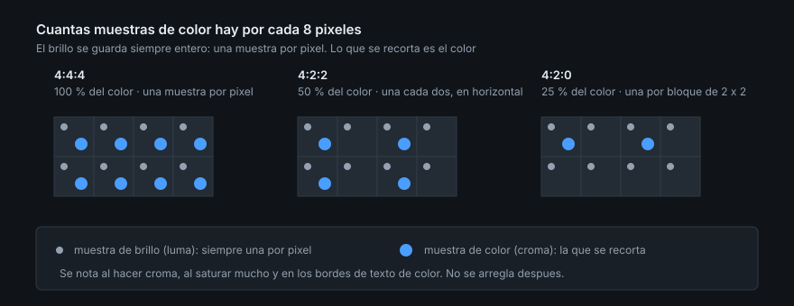

# Chroma subsampling

> Tu móvil tira tres cuartas partes de la información de color de cada frame antes de
> guardarlo. Casi nunca se nota. Se nota justo cuando intentas hacer un croma o subir
> mucho la saturación, y entonces ya no hay marcha atrás.

## 🎯 Objetivos

- Entender por qué el vídeo separa **luminancia** de **crominancia**
- Leer la notación `4:4:4`, `4:2:2` y `4:2:0` sin memorizarla
- Saber qué material lleva cada una y por qué
- Reconocer los síntomas de un `4:2:0` llevado al límite
- Saber cuándo el chroma subsampling importa de verdad en tu flujo de trabajo
- Saber dónde se lee, ya que Resolve no lo muestra

---

## 1. Qué problema resuelve

El ojo humano no reparte su atención por igual. Tiene unos 120 millones de bastones,
sensibles al **brillo**, y unos 6 millones de conos, sensibles al **color**. Ves mucho
mejor los detalles de luz y sombra que los detalles de color.

Eso es explotable. Si guardas el brillo con toda la resolución y el color con la mitad o
la cuarta parte, el resultado se ve casi igual y ocupa mucho menos. Es la compresión más
antigua del vídeo en color: existe desde la televisión analógica, antes de que hubiera
un solo bit digital.

---

## 2. Cómo funciona: separar luz de color

El vídeo no se guarda en R, G, B. Se convierte a un espacio llamado **Y'CbCr**:

| Canal | Nombre | Qué guarda |
| ----- | ------ | ---------- |
| **Y'** | *luma*, luminancia | El brillo. La imagen en blanco y negro |
| **Cb** | *chroma blue* | Cuánto se desvía del gris hacia el azul |
| **Cr** | *chroma red* | Cuánto se desvía del gris hacia el rojo |

Con Y', Cb y Cr se reconstruyen R, G y B. La ventaja es que ahora el brillo está en un
canal **separado**, y se le puede dar más resolución que a los otros dos.

> [!NOTE]
> La comilla de `Y'` (se lee "y prima") indica que el valor está codificado con una curva
> de gamma, no es luz lineal. Es un detalle que importará mucho en la Semana 16; de
> momento basta con saber que la comilla no es una errata.

---

## 3. La notación J:a:b

La notación viene de una rejilla de referencia de **4 píxeles de ancho por 2 de alto**:

| Número | Qué significa |
| ------ | ------------- |
| **J** | El ancho de la rejilla de referencia. Siempre 4 |
| **a** | Cuántas muestras de color hay en la **fila de arriba** |
| **b** | Cuántas muestras de color **cambian** en la fila de abajo respecto a la de arriba |



| Notación | Muestras de color | Información de color conservada | Dónde aparece |
| -------- | ----------------- | ------------------------------- | ------------- |
| **4:4:4** | Una por píxel | 100 % | RAW revelado, ProRes 4444, gráficos, material de VFX |
| **4:2:2** | Una por cada 2 píxeles en horizontal | 50 % | Cámaras profesionales, ProRes 422, DNxHR, grabadores externos |
| **4:2:0** | Una por cada bloque de 2 × 2 píxeles | 25 % | Móviles, cámaras de consumo, YouTube, Blu-ray, casi todo internet |
| **4:1:1** | Una por cada 4 píxeles en horizontal | 25 % | DV y DVCPRO. Material de archivo de los noventa |

El brillo (**Y'**) nunca se reduce. Siempre hay una muestra de brillo por píxel. Lo que
se recorta es solo el color.

---

## 4. Cuándo se nota y cuándo no

**Casi nunca se nota mirando.** Un `4:2:0` bien codificado y visto a tamaño normal es
indistinguible de un `4:4:4`. Por eso el estándar sobrevive: funciona.

Se nota en cinco situaciones concretas, y son justo las de post-producción:

| Situación | Qué pasa | Semana |
| --------- | -------- | ------ |
| **Croma / keying** | El borde del sujeto se calcula sobre un color que tiene la cuarta parte de resolución: el recorte sale escalonado y con halo | 25 |
| **Texto de color saturado sobre fondo de color** | Los bordes de las letras se emborronan y aparecen flecos | 11 |
| **Subir mucho la saturación** | Los bloques de color de 2 × 2 se hacen visibles como cuadros | 17-21 |
| **Secundarias con qualifier** | El selector de color trabaja sobre información interpolada y la máscara "respira" | 19 |
| **Escalar mucho una imagen** | El color se amplía desde menos muestras y se ve blando frente al brillo | 10 |

> [!IMPORTANT]
> El chroma subsampling **no se arregla en post**. La información no está: se descartó en
> la cámara al grabar. Todo lo que puedes hacer es paliar el síntoma. Por eso una decisión
> de cinco segundos en el menú de la cámara pesa más que cualquier cosa que hagas después.

---

## 5. Qué puedes hacer con esto

**Si estás grabando ahora:**

- Si tu cámara ofrece `4:2:2` (habitual en cámaras sin espejo recientes, a veces solo en
  10 bits o solo por HDMI), úsalo para lo que vayas a etalonar con fuerza o a recortar
- Si vas a hacer croma, `4:2:2` es casi obligatorio, y `4:4:4` mejor
- Para todo lo demás, `4:2:0` está bien y ocupa la mitad

**Si el material ya está grabado en `4:2:0`** —que es el caso normal en este bootcamp:

- No pasa nada. Todo el temario funciona con `4:2:0`
- Ilumina bien el croma si lo grabas tú: separación entre sujeto y fondo, fondo uniforme.
  Un croma bien iluminado en `4:2:0` recorta mejor que uno mal iluminado en `4:2:2`
- Evita subir la saturación de forma brutal en zonas grandes de color plano
- Trabaja en un espacio de trabajo de más precisión: Resolve procesa internamente en
  coma flotante de 32 bits, independientemente de lo que entre

> [!TIP]
> **Convertir a `4:4:4` no recupera nada.** Un `4:2:0` transcodificado a ProRes 4444 sigue
> teniendo la información de color de un `4:2:0`: solo has dejado de perder más. Eso sí
> tiene sentido —es lo que hace un flujo de trabajo intermedio— pero no llames a eso
> "mejorar el color".

---

## 6. Cómo se lee: Resolve no te lo dice

Este es el dato de la ficha técnica que **DaVinci Resolve 21 no muestra**. No está en el
panel Metadata, ni en `Clip Attributes`, ni en las columnas del media pool.
*Verificado en 21.0.4.5, agosto de 2026.*

Para leerlo hace falta una herramienta externa:

| Herramienta | Dónde mirar |
| ----------- | ----------- |
| **MediaInfo** (libre, multiplataforma) | Vista *Tree*, sección *Video*, campo `Chroma subsampling` |
| **ffprobe** (parte de FFmpeg) | El campo `pix_fmt`: `yuv420p` es 4:2:0, `yuv422p10le` es 4:2:2 de 10 bits |

```bash
ffprobe -v error -select_streams v:0 \
        -show_entries stream=codec_name,pix_fmt,width,height \
        -of default=noprint_wrappers=1 tu-clip.mp4
```

El campo `pix_fmt` se lee así:

| `pix_fmt` | Chroma | Bit depth |
| --------- | ------ | --------- |
| `yuv420p` | 4:2:0 | 8 bits |
| `yuv420p10le` | 4:2:0 | 10 bits |
| `yuv422p10le` | 4:2:2 | 10 bits |
| `yuv444p10le` | 4:4:4 | 10 bits |

---

## 7. Antipatrones

| Antipatrón | Por qué duele | Qué hacer |
| ---------- | ------------- | --------- |
| Rodar croma en `4:2:0` sin cuidar la iluminación | Se juntan los dos problemas y el key es irrecuperable | Fondo plano, bien iluminado y sujeto separado de él; el chroma pasa a segundo plano |
| Transcodificar a `4:4:4` esperando ganar color | La información descartada no vuelve; solo ocupas cinco veces más | Transcodifica por el codec de montaje, no por el chroma |
| Elegir cámara solo por los "10 bits 4:2:2" | Muchas cámaras solo lo dan por HDMI a un grabador externo, o con recorte de sensor | Lee la letra pequeña del modo concreto que vas a usar |
| Comparar chroma mirando una captura de pantalla | La captura ya ha pasado por otra compresión | Compara sobre el archivo original, ampliando un borde de color saturado |
| Suponer el chroma por la extensión | Un `.mov` puede ser `4:2:0`, `4:2:2` o `4:4:4` | Míralo con MediaInfo o `ffprobe` |

---

## 8. Trucos

| Truco | Cómo |
| ----- | ---- |
| Ver el chroma de golpe en una carpeta entera | `ffprobe` en bucle, o MediaInfo en vista *Sheet*, que muestra una fila por archivo |
| Comprobar si un croma va a dar problemas | Amplía un borde del sujeto al 400 % en el viewer de Resolve: si el color va "escalonado" respecto al brillo, es subsampling |
| Recordar la notación sin memorizarla | Suma `a + b` y divide entre 8: `4:2:2` da 50 %, `4:2:0` da 25 % de la información de color |
| Saber si tu cámara puede más | Busca en su menú los modos "All-I", "10 bits" o "4:2:2"; suelen estar escondidos y limitar la duración de grabación |

---

## 📚 Recursos Adicionales

- [ITU-R BT.601 y BT.709](https://www.itu.int/rec/R-REC-BT/en) — las recomendaciones donde se define la conversión RGB a Y'CbCr y de donde sale toda esta familia de formatos. Fuente primaria, no un blog.
- [MediaInfo](https://mediaarea.net/MediaInfo) — la forma más rápida de leer el chroma de un archivo. Gratuita y de código abierto.
- [Documentación de FFmpeg — formatos de píxel](https://ffmpeg.org/ffmpeg-utils.html) — la tabla completa de valores de `pix_fmt`, que es la que traduce `yuv420p` a "4:2:0 de 8 bits".

---

## ✅ Checklist de Verificación

- [ ] Sé por qué el vídeo separa luminancia de crominancia
- [ ] Sé leer `4:4:4`, `4:2:2` y `4:2:0` y decir cuánta información de color guarda cada uno
- [ ] Sé que el canal de brillo nunca se reduce
- [ ] Puedo nombrar tres situaciones en las que el `4:2:0` se nota
- [ ] Sé que el subsampling no se arregla en post
- [ ] Sé que Resolve no muestra este dato y con qué herramienta se lee
- [ ] Sé traducir un `pix_fmt` de `ffprobe` a notación de chroma y bit depth

---

| Anterior | Actual | Siguiente |
| -------- | ------ | --------- |
| [02 · Compresión: intra-frame y long-GOP](02-compresion-intra-frame-y-long-gop.md) | **03 · Chroma subsampling** | [04 · Profundidad de bits](04-profundidad-de-bits.md) |

← [Volver a la Semana 02](../README.md)
