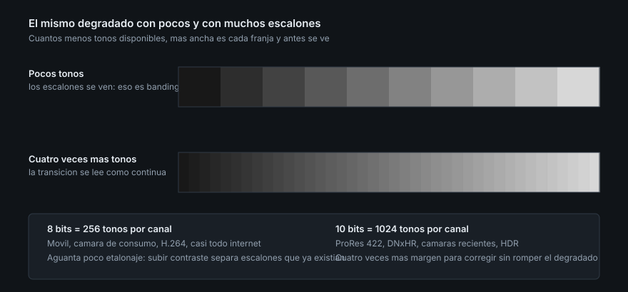

# Profundidad de bits

> Ocho bits dan 256 tonos por canal. Suena a mucho hasta que degradas un cielo y aparecen
> franjas. Diez bits dan 1024, y ese salto de cuatro veces es la diferencia entre un
> etalonaje que aguanta y uno que se rompe.

## 🎯 Objetivos

- Definir **profundidad de bits** y calcular cuántos tonos da cada valor
- Reconocer el **banding** y saber de dónde viene
- Distinguir la profundidad del **archivo** de la del **procesado interno** de Resolve
- Entender qué son los **niveles de datos** (*full* frente a *video*) y qué pasa al fallarlos
- Saber leer los dos campos en Resolve 21 y qué hacer con lo que digan

---

## 1. Qué problema resuelve

Un valor de color es un número. La **profundidad de bits** (*bit depth*) es cuántos bits
se dedican a ese número en cada canal, y por tanto cuántos tonos distintos se pueden
representar entre el negro y el blanco:

| Bits por canal | Tonos por canal | Colores posibles | Dónde aparece |
| -------------- | --------------- | ---------------- | ------------- |
| **8** | 256 | 16,7 millones | H.264 de móvil y de consumo, JPEG, la mayoría de internet |
| **10** | 1024 | 1073 millones | ProRes 422, DNxHR, cámaras recientes, HDR, Blu-ray UHD |
| **12** | 4096 | 68 700 millones | ProRes 4444, cine digital, RAW revelado |
| **16** | 65 536 | — | Masters de VFX, EXR, escaneos de película |
| **32 flotante** | Prácticamente continuo | — | El procesado interno de Resolve, EXR de coma flotante |

El problema que resuelve es la **cuantización**: la luz del mundo es continua y hay que
representarla con números enteros. Cuantos más números disponibles, más fino el escalón
entre un tono y el siguiente.

---

## 2. Cómo funciona: el banding

El **banding** (*banding*, "bandas" o "posterización") son franjas visibles donde debería
haber una transición suave. Aparece en cielos, en paredes iluminadas por un lado, en
fundidos a negro y en fondos de degradado.

Su causa es aritmética. En una zona de cielo que va del valor 100 al 110 hay **once
escalones** disponibles en 8 bits. Si esa zona ocupa 400 píxeles de alto, cada escalón
mide 36 píxeles: una franja perfectamente visible.

Y aquí está el punto importante para post-producción:

> [!IMPORTANT]
> **El etalonaje empeora el banding.** Al subir el contraste estás separando valores que
> ya eran escalones: los once tonos del ejemplo siguen siendo once, pero ahora ocupan el
> doble de rango. No se inventan tonos intermedios. Por eso el material de 8 bits admite
> mucho menos etalonaje que el de 10.

---

## 3. Lo que entra y lo que Resolve hace por dentro

Hay dos profundidades distintas y confundirlas lleva a conclusiones falsas:

| Cuál | Qué es | Valor |
| ---- | ------ | ----- |
| **La del archivo** | Con cuántos bits se guardó el clip en la cámara | 8, 10, 12… |
| **La del procesado** | Con cuántos bits calcula Resolve cada operación | **Coma flotante de 32 bits** |

DaVinci Resolve procesa internamente en **coma flotante de 32 bits**. Eso significa que
las operaciones intermedias —dos correcciones encadenadas, un nodo tras otro— no añaden
error de redondeo apreciable.

Lo que **no** significa es que recupere información. Si el clip entró con 256 tonos,
sigue habiendo 256 tonos de origen, por muy fina que sea la aritmética que se aplique
encima.

> [!TIP]
> Consecuencia práctica: **un flujo de trabajo intermedio de 10 bits sobre material de 8
> bits sí sirve**, aunque suene absurdo. No mejora el origen, pero evita que cada paso
> siguiente vuelva a cuantizar a 256 tonos. Es lo que hacen optimized media y proxies bien
> configurados (Semana 05).

---

## 4. Los niveles de datos: *full* y *video*

Aquí hay una trampa clásica y merece su sección.

Un vídeo de 8 bits tiene 256 valores posibles, del 0 al 255. Pero hay dos convenios
distintos sobre **qué valor es el negro y cuál el blanco**:

| Convenio | Nombre en Resolve | Negro | Blanco | De dónde viene |
| -------- | ----------------- | ----- | ------ | -------------- |
| **Video** (o *legal*, *limited*) | `Video` | 16 | 235 | Televisión: los valores fuera del rango se reservaban para señalización |
| **Full** (o *data*, *extended*) | `Full` | 0 | 255 | Informática: todo el rango es imagen |

Si Resolve interpreta como `Video` un archivo que en realidad es `Full`, los negros se
levantan y los blancos se apagan: la imagen se ve **lavada**. Al revés, se ve
**recortada**: se pierde detalle en sombras y altas luces de verdad, y no se recupera.

En Resolve 21 el ajuste está por clip, en el campo **`Data Level`** de las propiedades
del clip, con tres valores: `Auto`, `Video` y `Full`. El valor por defecto es `Auto`, y
acierta casi siempre porque lee la etiqueta que el archivo trae dentro.

*Verificado en 21.0.4.5, agosto de 2026: el campo `Data Level` aparece en las propiedades
de clip con el valor `Auto` por defecto.*

> [!WARNING]
> **No toques `Data Level` "porque la imagen se ve rara".** Se cambia cuando hay una
> evidencia concreta: los negros no llegan a 0 o los blancos superan el 100 % en el
> waveform, y solo en ese clip. Los scopes que hacen falta para verlo son la Semana 17;
> hasta entonces, `Auto`.

---

## 5. Cómo se lee en Resolve 21

Página **Media** (`Shift+2`), clip seleccionado, panel **Metadata**:

| Campo | Qué te dice |
| ----- | ----------- |
| `Bit Depth` | Los bits por canal de la pista de **vídeo**: `8`, `10`, `12` |
| `Audio Bit Depth` | Los bits por muestra de la pista de **audio**: `16`, `24`, `32` |
| `Data Level` | Cómo interpreta Resolve el rango de valores: `Auto`, `Video`, `Full` |

> [!NOTE]
> `Bit Depth` y `Audio Bit Depth` **no tienen nada que ver entre sí** aunque se llamen
> parecido. Uno cuenta tonos de color por canal; el otro, precisión de amplitud sonora.
> El audio se explica en la [teoría 07](07-audio-digital.md).

---

## 6. Qué hacer si tu material es de 8 bits

Que lo es, casi seguro, si viene de un móvil o de una cámara de consumo. No es un
problema: es una restricción con la que se trabaja.

1. **Expón bien al grabar.** Un 8 bits bien expuesto aguanta mucho más etalonaje que un
   10 bits mal expuesto. Es la única palanca grande que tienes.
2. **No grabes en log con 8 bits** salvo que sepas exactamente lo que haces: el log
   reparte los mismos 256 tonos en un rango mucho mayor y el banding llega antes (ver
   [teoría 05](05-log-raw-y-rec709.md)).
3. **Corrige poco y en pocos pasos.** Cinco nodos que se corrigen entre sí castigan más
   que uno bien puesto.
4. **Añade grano si hace falta.** Un poco de ruido rompe las franjas visualmente: es lo
   que hace un *dither*. Resolve trae ResolveFX de grano y en Fusion hay opciones.
5. **Trabaja en un intermedio de 10 bits** cuando montes con optimized media (Semana 05).

---

## 7. Antipatrones

| Antipatrón | Por qué duele | Qué hacer |
| ---------- | ------------- | --------- |
| Grabar en log con una cámara de 8 bits | El log necesita rango de tonos y en 8 bits no lo hay: aparece banding en cuanto se aplica la LUT | Graba en el perfil estándar, o sube a 10 bits si la cámara puede |
| Cambiar `Data Level` a ojo | La imagen "mejora" en pantalla mientras se recortan sombras y altas luces de verdad | Déjalo en `Auto` hasta saber leer un waveform (Semana 17) |
| Creer que exportar a 10 bits mejora un origen de 8 | La información no aparece; solo pesa más | Exporta a 10 bits por el flujo intermedio, no por la calidad del origen |
| Diagnosticar banding en un monitor malo | Muchas pantallas son de 6 bits con simulación y muestran franjas que no están en el archivo | Comprueba el archivo en otra pantalla antes de dar por bueno el diagnóstico |
| Confundir `Bit Depth` con `Audio Bit Depth` | Se toman decisiones sobre color mirando el campo del sonido | Son dos campos distintos en el mismo panel: lee la etiqueta entera |

---

## 8. Trucos

| Truco | Cómo |
| ----- | ---- |
| Ver banding que a simple vista no se ve | Sube mucho el contraste temporalmente en un nodo: si hay franjas latentes, saltan a la vista. Luego deshaz |
| Comprobar el bit depth sin abrir Resolve | MediaInfo, campo `Bit depth`; o `ffprobe` y el `pix_fmt`: el sufijo `10le` significa 10 bits |
| Saber si un archivo es `Full` o `Video` sin adivinar | `ffprobe` muestra `color_range: pc` (full) o `tv` (video) |
| Ocultar banding en un fundido a negro | Un poco de grano fino en la zona afectada rompe las franjas mejor que cualquier desenfoque |

---

## 📚 Recursos Adicionales

- [DaVinci Resolve Reference Manual](https://www.blackmagicdesign.com/support/family/davinci-resolve-and-fusion) — los capítulos de *Clip Attributes* y *Data Levels* documentan exactamente cuándo Resolve reetiqueta un clip y cuándo respeta lo que trae el archivo.
- [ITU-R BT.709](https://www.itu.int/rec/R-REC-BT/en) — define el rango legal 16-235 del que sale toda la confusión entre *full* y *video*. Fuente primaria.
- [MediaInfo](https://mediaarea.net/MediaInfo) — la vía rápida para leer bit depth y rango de un archivo sin importarlo a ningún sitio.

---

## ✅ Checklist de Verificación

- [ ] Sé cuántos tonos por canal dan 8, 10 y 12 bits
- [ ] Sé qué es el banding y por qué el etalonaje lo empeora
- [ ] Distingo la profundidad del archivo de la del procesado interno de Resolve
- [ ] Sé que Resolve procesa en coma flotante de 32 bits y qué implica eso
- [ ] Sé qué son los niveles de datos `Full` y `Video` y qué se ve cuando se equivocan
- [ ] Sé dónde están `Bit Depth`, `Audio Bit Depth` y `Data Level` en Resolve 21
- [ ] Sé qué hacer para sacar el máximo de material de 8 bits

---

| Anterior | Actual | Siguiente |
| -------- | ------ | --------- |
| [03 · Chroma subsampling](03-chroma-subsampling.md) | **04 · Profundidad de bits** | [05 · Log, RAW y Rec.709](05-log-raw-y-rec709.md) |

← [Volver a la Semana 02](../README.md)
