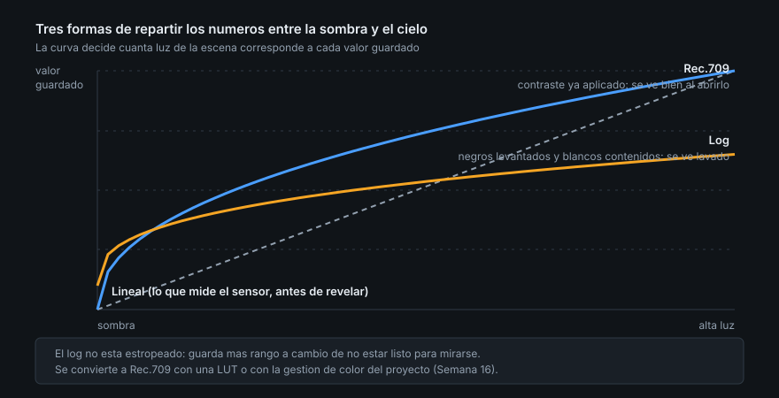

# Log, RAW y Rec.709

> Un clip log se ve gris, lavado y sin contraste, y está perfectamente bien. Un clip RAW
> ni siquiera es una imagen todavía. Entender qué son las tres cosas evita el error más
> caro de un principiante: "arreglar" material que no estaba roto.

## 🎯 Objetivos

- Entender qué es una **curva de transferencia** y por qué el vídeo no guarda luz lineal
- Definir **Rec.709** y saber por qué es el punto de partida por defecto
- Explicar qué es **log** y por qué un clip log se ve lavado
- Definir **RAW** y por qué no es un formato de vídeo como los demás
- Saber cuál de los tres tienes delante y qué se hace con cada uno
- Leer los campos de espacio de color y gamma en Resolve 21

---

## 1. Qué problema resuelve

Un sensor mide luz. La luz del mundo tiene un rango enorme: de la sombra bajo una mesa al
cielo hay unas 20 000 veces más luz en el segundo caso. Guardar eso con números enteros y
repartirlos por igual sería un desperdicio, porque el ojo tampoco los percibe por igual:
distingue muchísimo mejor los cambios en zonas oscuras que en zonas brillantes.

La solución es una **curva de transferencia** (*transfer function*): una función que
decide cuánta luz corresponde a cada número. No es un ajuste estético, es el diccionario
que traduce números a luz. Y hay varios diccionarios.

---

## 2. Cómo funciona: tres formas de repartir los números

### Rec.709 — el vídeo "normal"

**Rec.709** (*ITU-R BT.709*) es la recomendación que define el vídeo HD: qué rojo es el
rojo, qué verde es el verde, y qué curva de gamma se aplica. Es lo que sale de un móvil,
lo que espera YouTube y lo que muestra cualquier pantalla de consumo.

Su curva ya lleva **el contraste aplicado**. Un clip Rec.709 se ve "bien" nada más
abrirlo porque ya está preparado para mirarse. A cambio, las decisiones ya están tomadas:
lo que la cámara consideró blanco quemado, se quedó quemado.

### Log — guardar el rango, no la belleza

**Log** (*logarithmic*, "logarítmico") es una familia de curvas que reparten los números
siguiendo una escala logarítmica en vez de una perceptual. Cada fabricante tiene la suya:
S-Log3 de Sony, C-Log de Canon, V-Log de Panasonic, Blackmagic Film de Blackmagic.

El objetivo es **conservar rango dinámico**: guardar detalle tanto en la sombra como en
el cielo del mismo plano, para decidir después cuál te interesa.

El precio es que la imagen resultante **no está pensada para verse**. Se ve gris, plana y
desaturada. Eso no es un defecto: es material en bruto a la espera de que le apliques la
curva de visualización que quieras.

> [!IMPORTANT]
> **Un clip log no está estropeado.** Es el error de diagnóstico más común de la primera
> semana con una cámara buena. Se convierte a una imagen normal con una LUT o con la
> gestión de color del proyecto, y eso es materia de la Semana 16.

**LUT** (*Look-Up Table*, "tabla de consulta") es un archivo con una tabla de conversión
de color: para cada valor de entrada, da un valor de salida. Es la forma habitual de
llevar un log a Rec.709.

### RAW — ni siquiera es una imagen

**RAW** ("crudo") no es vídeo comprimido de otra manera: es un volcado de lo que midió el
sensor, **antes** de convertirlo en imagen.

Un sensor no ve color. Ve intensidad, a través de una rejilla de filtros de color —el
*patrón de Bayer*— donde cada fotosito mide solo rojo, solo verde o solo azul. Convertir
eso en píxeles con tres canales es un cálculo llamado **debayer** (o *demosaicing*), y en
un archivo RAW **todavía no se ha hecho**.

Consecuencias:

- El balance de blancos, el ISO y a veces la curva **no están fijados**: son parámetros
  que se aplican al revelar, y se pueden cambiar sin pérdida
- Hace falta más potencia de cálculo para reproducirlo
- No hay un formato RAW: hay muchos, y cada cámara trae el suyo

---

## 3. Los tres, comparados

| | **Rec.709** | **Log** | **RAW** |
| --- | --- | --- | --- |
| ¿Es una imagen? | Sí, terminada | Sí, pero sin mirar | No, hay que revelarla |
| Cómo se ve al abrirlo | Normal | Gris y lavado | Depende del revelado |
| Rango dinámico guardado | Poco | Mucho | Todo el del sensor |
| Balance de blancos | Fijado | Fijado | Ajustable sin pérdida |
| Cuánto ocupa | Poco | Poco o medio | Mucho |
| Cuánto cuesta reproducir | Poco | Poco | Mucho |
| Bit depth mínimo sensato | 8 | **10** | 12 |
| Cuándo usarlo | Entregas, contenido rápido, 8 bits | Cuando vas a etalonar de verdad | Cine, publicidad, VFX |

> [!WARNING]
> **Log con 8 bits es mala combinación.** El log reparte los tonos disponibles en un rango
> mucho más ancho, así que con 256 tonos por canal las transiciones se rompen en cuanto
> aplicas la LUT. Si tu cámara graba log solo en 8 bits, graba en el perfil estándar.
> Ver [teoría 04](04-profundidad-de-bits.md).

---

## 4. Cómo se lee en Resolve 21

En el panel **Metadata** de la página Media, con el clip seleccionado:

| Campo | Qué dice | Valor típico |
| ----- | -------- | ------------ |
| `Input Color Space` | Qué primarios asume Resolve para este clip | `Rec.709 (Scene)` |
| `Input Gamma` | Qué curva de transferencia asume | `Rec.709` |
| `RAW` | Si el clip es RAW y de qué tipo | Vacío si no lo es |

Para material RAW, Resolve añade además un panel completo de revelado:

- `File > Project Settings > Camera RAW`, para fijar el criterio de todo el proyecto
- El panel **Camera Raw** de la página Color, para ajustar clip a clip

*Verificado en 21.0.4.5, agosto de 2026: un `.mp4` de móvil llega con
`Input Color Space: Rec.709 (Scene)`, `Input Gamma: Rec.709` y el campo `RAW` vacío.*

> [!NOTE]
> Que Resolve etiquete un clip como `Rec.709` **no lo convierte** en Rec.709. Es una
> suposición basada en la etiqueta del archivo. Si grabaste en log y el archivo no lo
> declara, Resolve seguirá diciendo `Rec.709` y la imagen seguirá viéndose plana. Corregir
> esa etiqueta es parte de la Semana 16.

---

## 5. Qué hacer esta semana con esto

No etalones nada todavía. Lo que sí toca es **saber qué tienes**:

1. Abre uno de tus clips y mira `Input Color Space` e `Input Gamma`
2. Compara con lo que grabaste: ¿pusiste un perfil plano o log en la cámara?
3. Si tu material es Rec.709 de 8 bits —lo normal— déjalo así: el bootcamp entero
   funciona con eso
4. Si tienes acceso a material log o RAW, guárdalo en `04-log-y-raw/` del pack de medios:
   lo vas a necesitar en las Semanas 16 a 22

---

## 6. Antipatrones

| Antipatrón | Por qué duele | Qué hacer |
| ---------- | ------------- | --------- |
| "Arreglar" un clip log subiéndole el contraste a ojo | Se tira la mitad del rango que el log existía para conservar | Se convierte con LUT o con gestión de color (Semana 16) |
| Grabar en log con una cámara de 8 bits | Banding garantizado al aplicar la LUT | Perfil estándar, o 10 bits si la cámara lo ofrece |
| Aplicar una LUT de otra cámara "porque queda bien" | Las curvas log no son intercambiables: cada fabricante tiene la suya | Usa la LUT de conversión de tu cámara concreta |
| Grabar RAW sin comprobar el disco | El RAW multiplica por varias veces el bitrate; la tarjeta se llena o falla a mitad de toma | Calcula el espacio antes ([teoría 08](08-flujo-de-datos.md)) |
| Suponer que RAW significa "mejor" en todos los casos | Cuesta más disco, más cálculo y más tiempo, y para una pieza de entrega rápida no aporta nada | Elige RAW cuando el etalonaje sea el objetivo, no por defecto |

---

## 7. Trucos

| Truco | Cómo |
| ----- | ---- |
| Saber si un clip es log sin conocer la cámara | Si al abrirlo se ve gris, con negros levantados y poca saturación, es log o un perfil plano |
| Ver el nombre de la curva que Resolve asume | Panel Metadata, campos `Input Color Space` e `Input Gamma` |
| Comprobar si un archivo es RAW de verdad | El campo `RAW` del panel Metadata, y la aparición del panel Camera Raw en la página Color |
| Guardar el rango sin grabar log ni RAW | Expón para las altas luces: es lo que más detalle irrecuperable evita en Rec.709 |

---

## 📚 Recursos Adicionales

- [ITU-R BT.709](https://www.itu.int/rec/R-REC-BT/en) — la recomendación que define el vídeo HD: primarios, punto blanco y curva. La fuente cuando alguien discute qué es "Rec.709 de verdad".
- [DaVinci Resolve Reference Manual](https://www.blackmagicdesign.com/support/family/davinci-resolve-and-fusion) — los capítulos de *Camera Raw* y *Color Management* explican cómo Resolve etiqueta cada clip y qué hace con esa etiqueta.
- [Blackmagic Design — Training](https://www.blackmagicdesign.com/products/davinciresolve/training) — sus guías de color incluyen material log y RAW de ejemplo, que es exactamente lo que hace falta para practicar esto.

---

## ✅ Checklist de Verificación

- [ ] Sé qué es una curva de transferencia y por qué el vídeo no guarda luz lineal
- [ ] Sé qué define Rec.709 y por qué es el punto de partida por defecto
- [ ] Sé por qué un clip log se ve lavado y que eso no es un defecto
- [ ] Sé qué es una LUT y para qué se usa con material log
- [ ] Sé qué es RAW, qué es el debayer y qué parámetros quedan ajustables
- [ ] Sé por qué log de 8 bits es mala idea
- [ ] Sé dónde leer `Input Color Space`, `Input Gamma` y `RAW` en Resolve 21

---

| Anterior | Actual | Siguiente |
| -------- | ------ | --------- |
| [04 · Profundidad de bits](04-profundidad-de-bits.md) | **05 · Log, RAW y Rec.709** | [06 · Blackmagic RAW](06-blackmagic-raw.md) |

← [Volver a la Semana 02](../README.md)
