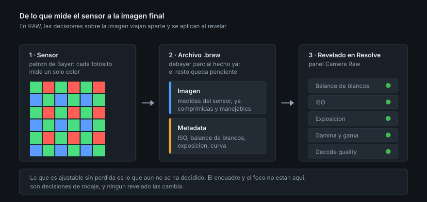

# Blackmagic RAW

> El RAW clásico obliga a elegir entre calidad y poder trabajar con el material.
> Blackmagic RAW existe para no tener que elegir, y es el único RAW que DaVinci Resolve
> trata como si fuera de casa.

## 🎯 Objetivos

- Saber qué es **Blackmagic RAW** y en qué se diferencia de un RAW tradicional
- Entender qué es un **debayer parcial** y por qué hace el archivo manejable
- Distinguir los dos modos de compresión: **constant bitrate** y **constant quality**
- Saber qué parámetros siguen siendo ajustables después de grabar
- Saber que funciona en DaVinci Resolve 21 **Free** y dónde se ajusta
- Decidir si te afecta o no, según el material que tengas

---

## 1. Qué problema resuelve

El RAW tradicional tiene dos costes que lo hacen incómodo:

1. **Ocupa muchísimo.** Un flujo RAW sin comprimir de cine llena discos a una velocidad
   difícil de sostener sin infraestructura.
2. **Cuesta reproducirlo.** El debayer —convertir las medidas del sensor en píxeles de
   tres canales— es un cálculo pesado que hay que hacer en cada frame, cada vez.

El resultado clásico es un flujo de trabajo en dos pasos: se graba RAW, se transcodifica
a un codec de montaje, se monta con eso y se vuelve al RAW solo para etalonar. Funciona,
pero cuesta tiempo, disco y confusión sobre qué versión es la buena.

**Blackmagic RAW** (extensión `.braw`) se diseñó para saltarse ese doble paso.

---

## 2. Cómo funciona: el debayer parcial

Un archivo BRAW hace **parte** del debayer al grabar, dentro de la cámara, y deja el
resto para el momento de reproducir. La parte cara y no destructiva se hace una vez; la
parte que decide el aspecto final se deja abierta.

De ahí salen sus tres propiedades características:

| Propiedad | Qué significa |
| --------- | ------------- |
| **Es un archivo único** | Un `.braw` por toma, con vídeo, audio y metadata dentro. No una carpeta con miles de frames sueltos |
| **Se reproduce como un codec normal** | El coste de decodificación es comparable al de un intermedio, no al de un RAW clásico |
| **Conserva los parámetros ajustables** | ISO, balance de blancos, exposición y curva siguen siendo decisiones abiertas |

---

## 3. Los dos modos de compresión

Al grabar se elige entre dos criterios distintos, y no son intercambiables:

| Modo | Ajustes típicos | Qué garantiza | Cuándo conviene |
| ---- | --------------- | ------------- | --------------- |
| **Constant bitrate** | `3:1`, `5:1`, `8:1`, `12:1` | Un tamaño de archivo **predecible**: sabes cuánto vas a llenar la tarjeta | Rodajes largos, presupuesto de disco cerrado |
| **Constant quality** | `Q0`, `Q1`, `Q3`, `Q5` | Una **calidad** constante: el bitrate sube en los planos complejos y baja en los simples | Cuando importa más el resultado que la previsibilidad |

Los números de *constant bitrate* son ratios de compresión: `3:1` comprime tres veces,
`12:1` doce. Los de *constant quality* van al revés de lo que parece: **`Q0` es el de más
calidad** y `Q5` el de menos.

> [!NOTE]
> Los modos concretos que ofrece el menú dependen del modelo de cámara y de su firmware.
> La lista de arriba es la habitual; comprueba la de tu cámara antes de planificar espacio.

---

## 4. Qué sigue siendo ajustable después de grabar

Esto es lo que hace RAW a un RAW, y lo que lo diferencia de un log:

| Parámetro | ¿Ajustable en post? | Nota |
| --------- | ------------------- | ---- |
| **Balance de blancos** y **tinte** | Sí, sin pérdida | Es la ventaja más práctica: una toma con la temperatura mal puesta se rescata entera |
| **ISO** | Sí | Dentro del rango que el sensor registró de verdad |
| **Exposición** | Sí, con margen | No inventa detalle donde el sensor saturó |
| **Curva y espacio de color** | Sí | Se elige el gamma y la gama de salida en el revelado |
| **Sharpening y reducción de ruido de cámara** | Sí | Se aplican en el revelado, no vienen grabados |
| **Encuadre, foco, movimiento** | **No** | Nada de esto es RAW; son decisiones de rodaje |

---

## 5. Cómo se trabaja en Resolve 21

Blackmagic RAW funciona en **DaVinci Resolve 21 Free**. No es una función de Studio: es
el formato de la propia casa y se lee en las dos versiones.

Dos sitios donde se ajusta, y hay que entender la relación entre ellos:

| Dónde | Alcance | Para qué |
| ----- | ------- | -------- |
| `File > Project Settings > Camera RAW` | Todo el proyecto | Fijar el criterio general: decode quality, espacio de color, gamma |
| Panel **Camera Raw** de la página **Color** | El clip seleccionado | Ajustar una toma concreta que se sale del criterio general |

El ajuste que más afecta al rendimiento es **decode quality**: revelar a media resolución
o a un cuarto mientras montas hace que el material vuele, y volver a resolución completa
solo para etalonar y renderizar. Es el equivalente a los proxies, pero sin generar
archivos.

> [!TIP]
> Si trabajas con BRAW y el montaje va justo, baja la *decode quality* antes de generar
> proxies. Es un desplegable y no crea ni un archivo nuevo en tu disco.

---

## 6. Los otros RAW que te vas a encontrar

BRAW no es el único. Conviene reconocer los nombres, porque el flujo de trabajo cambia
bastante según cuál te llegue:

| Formato | Cámaras | Cómo llega | En Resolve 21 Free |
| ------- | ------- | ---------- | ------------------ |
| **Blackmagic RAW** (`.braw`) | Blackmagic | Un archivo por toma | Nativo, con panel Camera Raw |
| **CinemaDNG** (`.dng`) | Blackmagic antiguas, drones | Una **carpeta** con un archivo por frame | Se lee, con panel Camera Raw |
| **REDCODE RAW** (`.r3d`) | RED | Un archivo por toma, a veces troceado | Se lee, con panel Camera Raw |
| **ARRIRAW** (`.ari`, `.mxf`) | ARRI | Secuencia o MXF | Se lee, con panel Camera Raw |
| **ProRes RAW** (`.mov`) | Grabadores externos Atomos y otros | Un archivo por toma | **No se lee**: Resolve no soporta ProRes RAW |

> [!WARNING]
> **ProRes RAW es la excepción que sorprende.** Es un formato de Apple y DaVinci Resolve
> no lo abre, ni en Free ni en Studio. Si grabas con un grabador externo, comprueba esto
> **antes** del rodaje: la alternativa habitual es grabar ProRes normal, que Resolve sí
> lee sin problemas.

Lo que todos comparten es el patrón: la imagen y las decisiones sobre la imagen viajan
separadas, y el revelado las junta cuando tú se lo pides.

---

## 7. Si no tienes una cámara Blackmagic

Que es lo más probable. Entonces esta teoría te sirve para tres cosas:

1. **Reconocer un `.braw`** cuando te lo pasen y saber que no necesitas convertirlo
2. **Entender el patrón general**: metadata separada de imagen, decisiones aplazadas al
   revelado. Es el mismo modelo de casi todo el RAW moderno
3. **Practicar con material de ejemplo**: Blackmagic publica material BRAW junto a sus
   guías de formación, y es la forma barata de tocar RAW sin comprar nada

Descárgalo a `04-log-y-raw/` del pack de medios cuando prepares la Semana 22.

> [!IMPORTANT]
> **Ningún entregable de este bootcamp exige material RAW.** Las Semanas 16 a 21 funcionan
> enteras con Rec.709. Solo la Semana 22 pierde parte de su práctica si no tienes RAW, y
> está avisado en su README.

---

## 8. Antipatrones

| Antipatrón | Por qué duele | Qué hacer |
| ---------- | ------------- | --------- |
| Transcodificar BRAW a ProRes "para montar mejor" | Se pierde todo lo ajustable del RAW y se ocupa más disco, a cambio de nada: BRAW ya se monta bien | Baja la *decode quality* mientras montas |
| Grabar `Q0` sin calcular el disco | Es el modo de más calidad y de bitrate impredecible; una tarjeta se llena a mitad de toma | Usa *constant bitrate* cuando el espacio esté ajustado |
| Creer que `Q5` es mejor que `Q0` porque el número es mayor | Va al revés y se graba un rodaje entero en el modo de menos calidad | `Q0` es el mejor. `12:1` comprime más que `3:1` |
| Suponer que RAW arregla una toma mal encuadrada o desenfocada | RAW conserva medidas del sensor, no decisiones de rodaje | Lo que no está grabado no se revela |
| Cambiar los ajustes de Camera RAW clip a clip sin criterio | Se pierde la coherencia entre planos y el shot matching de la Semana 21 se complica | Fija el criterio en Project Settings y desvíate solo con motivo |

---

## 9. Trucos

| Truco | Cómo |
| ----- | ---- |
| Montar BRAW en un portátil modesto | `File > Project Settings > Camera RAW`, baja *decode quality* a un cuarto. Súbela solo para etalonar y renderizar |
| Saber si un clip trae panel de revelado | Selecciónalo en la página Color: si el panel **Camera Raw** se activa, Resolve lo ha reconocido como RAW |
| Rescatar una toma con el balance de blancos mal | Panel Camera Raw del clip, temperatura y tinte. En RAW es una decisión, no una corrección |
| Conseguir material BRAW gratis para practicar | Los proyectos de práctica que Blackmagic publica junto a sus guías oficiales de formación |

---

## 📚 Recursos Adicionales

- [Blackmagic RAW — página oficial](https://www.blackmagicdesign.com/products/blackmagicraw) — la descripción del formato por quien lo hace, incluidos los modos de compresión y el SDK, que es gratuito.
- [DaVinci Resolve Reference Manual](https://www.blackmagicdesign.com/support/family/davinci-resolve-and-fusion) — el capítulo de *Camera Raw* documenta cada control del panel y qué hace exactamente *decode quality*.
- [Blackmagic Design — Training](https://www.blackmagicdesign.com/products/davinciresolve/training) — de aquí sale el material BRAW de práctica, que es material real de cámara y no un archivo de demostración.

---

## ✅ Checklist de Verificación

- [ ] Sé qué es Blackmagic RAW y qué problema del RAW clásico resuelve
- [ ] Sé qué es un debayer parcial y por qué hace el archivo manejable
- [ ] Distingo *constant bitrate* de *constant quality* y sé que `Q0` es el mejor
- [ ] Sé qué parámetros siguen siendo ajustables después de grabar y cuáles no
- [ ] Sé que BRAW funciona en Resolve 21 Free
- [ ] Sé dónde se ajusta el revelado, a nivel de proyecto y a nivel de clip
- [ ] Sé para qué sirve bajar la *decode quality*
- [ ] Sé que Resolve no abre ProRes RAW y qué hacer si mi grabador solo ofrece eso

---

| Anterior | Actual | Siguiente |
| -------- | ------ | --------- |
| [05 · Log, RAW y Rec.709](05-log-raw-y-rec709.md) | **06 · Blackmagic RAW** | [07 · Audio digital](07-audio-digital.md) |

← [Volver a la Semana 02](../README.md)
