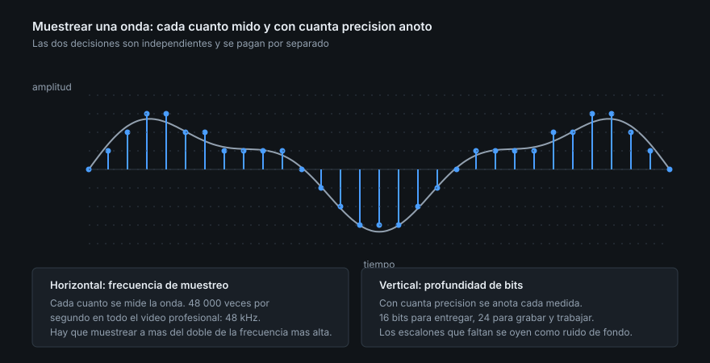

# Audio digital

> El audio es la mitad de tu pieza y ocupa el 2 % del disco. Es la parte más barata de
> hacer bien y la que más se nota cuando está mal: un vídeo feo se ve, un audio malo se
> apaga.

## 🎯 Objetivos

- Entender qué es **muestrear** una onda y por qué el vídeo trabaja a 48 kHz
- Definir **profundidad de bits de audio** y qué son los 32 bits en coma flotante
- Distinguir audio **PCM** de audio **comprimido con pérdida**
- Saber qué contenedores y codecs de audio te vas a encontrar
- Entender por qué el diálogo se graba y se guarda sin comprimir
- Leer los campos de audio de un clip en Resolve 21

---

## 1. Qué problema resuelve

El sonido es una onda de presión: una magnitud continua que cambia en el tiempo. Un
ordenador solo guarda números. Convertir lo uno en lo otro es exactamente el mismo
problema que resuelve el vídeo con los frames, pero en una dimensión y a mucha más
velocidad.

Hay dos decisiones que tomar, y son independientes:

1. **Cada cuánto mido** la onda → la frecuencia de muestreo
2. **Con cuánta precisión anoto** cada medida → la profundidad de bits

---

## 2. Cómo funciona: muestreo

La **frecuencia de muestreo** (*sample rate*) es cuántas medidas se toman por segundo. Se
mide en hercios (Hz) o kilohercios (kHz).

Existe un límite teórico exacto, el **teorema de muestreo de Nyquist-Shannon**: para
reconstruir una onda hay que muestrear a **más del doble** de su frecuencia más alta. El
oído humano llega hasta unos 20 kHz, así que hacen falta algo más de 40 000 muestras por
segundo.

| Frecuencia | De dónde viene | Dónde se usa |
| ---------- | -------------- | ------------ |
| **44,1 kHz** | El estándar del CD, heredado de las grabadoras de vídeo de los ochenta | Música, CD, Spotify |
| **48 kHz** | El estándar del vídeo profesional | **Todo el vídeo.** Cine, televisión, streaming |
| **96 kHz** | El doble de 48 | Grabación de música, diseño sonoro con mucha manipulación |

> [!IMPORTANT]
> **El vídeo trabaja a 48 kHz.** Si mezclas material a 44,1 kHz, hay que remuestrear, y
> ese proceso puede introducir artefactos o, peor, desincronía progresiva si algo lo hace
> mal. Es la razón por la que en la práctica de esta semana se pide una pista de audio a
> 48 kHz: no es un capricho, es el estándar del medio.

---

## 3. Profundidad de bits de audio

La **profundidad de bits** (*bit depth*) es con cuántos bits se anota cada muestra. Igual
que en vídeo, más bits significa escalones más finos, pero aquí el efecto se oye como
**ruido de fondo**, no como banding.

| Bits | Rango dinámico aproximado | Dónde se usa |
| ---- | ------------------------- | ------------ |
| **16** | 96 dB | CD, entrega final, la mayoría de los archivos de música |
| **24** | 144 dB | El estándar de grabación y de post-producción |
| **32 en coma flotante** | Prácticamente ilimitado | Grabadoras recientes y el procesado interno de los programas |

El **rango dinámico** es la distancia entre el sonido más suave que se puede representar y
el más fuerte antes de saturar. Con 24 bits sobra margen para grabar bajo y subir después
sin que aparezca ruido audible.

Los **32 bits en coma flotante** merecen una nota, porque parecen magia y casi lo son:
como los valores no tienen un techo fijo, una grabación que "satura" se puede bajar
después y recuperar intacta. Varias grabadoras de campo recientes graban así, y es la
razón por la que en Resolve el campo `Audio Bit Depth` de un archivo puede decir `32`.

> [!NOTE]
> Un `Audio Bit Depth` de `32` en el panel Metadata **no significa mejor micrófono**.
> Significa que el archivo guarda las muestras en coma flotante. Es útil, pero la calidad
> del sonido la sigue decidiendo lo que entró por el micro.

---

## 4. PCM frente a codecs con pérdida

| Familia | Qué hace | Ejemplos | Dónde |
| ------- | -------- | -------- | ----- |
| **PCM** (*Pulse-Code Modulation*) | Guarda las muestras tal cual, sin comprimir | *Linear PCM*, WAV, AIFF | Grabación, montaje, masters |
| **Sin pérdida comprimido** | Comprime como un `.zip`: se recupera idéntico | FLAC, ALAC | Archivo y distribución de música |
| **Con pérdida** | Descarta lo que el oído difícilmente distingue | AAC, MP3, Opus, AC-3 | Distribución, cámaras, móviles |

**PCM no es un codec de compresión**: es la forma directa de escribir las muestras. Por
eso un WAV ocupa lo que ocupa —unos 10 MB por minuto en estéreo a 48 kHz y 24 bits— y por
eso no se degrada al abrirlo y guardarlo mil veces.

El audio de tu móvil o de tu cámara casi seguro es **AAC**, que es con pérdida. Funciona
bien para escuchar, pero tiene dos inconvenientes en post:

- Cada reexportación vuelve a comprimir y acumula pérdida
- La limpieza de diálogo (Semana 14) trabaja peor sobre material que ya ha perdido
  información en las frecuencias altas

> [!TIP]
> La regla es la misma que en vídeo: **una sola compresión con pérdida, al final**. Graba
> y trabaja en PCM; comprime a AAC solo al exportar la copia que se va a ver.

---

## 5. Cómo se lee en Resolve 21

Página **Media**, clip seleccionado, panel **Metadata**:

| Campo | Qué dice | Valor típico |
| ----- | -------- | ------------ |
| `Audio Codec` | El codec de la pista de audio | `AAC`, `Linear PCM` |
| `Sample Rate` | La frecuencia de muestreo, en Hz | `48000` |
| `Audio Bit Depth` | Bits por muestra | `16`, `24`, `32` |
| `Audio Ch` | Cuántos canales trae | `2` para estéreo, `1` para mono |
| `Type` | Si el clip trae audio | `Video + Audio`, `Audio` |

*Verificado en 21.0.4.5, agosto de 2026: un `.mp4` de captura de pantalla reporta
`Audio Codec: AAC`, `Sample Rate: 48000`, `Audio Bit Depth: 32`, `Audio Ch: 2`.*

El ajuste del **proyecto** está en `File > Project Settings > Fairlight`, y es el que
determina a qué frecuencia trabaja la timeline. La Semana 13 lo desarrolla; esta semana
basta con saber que existe y que debería decir 48 kHz.

---

## 6. Un caso que da problemas: audio de cámara y de grabadora

Cuando grabas la voz con una grabadora aparte —lo habitual en cuanto el sonido importa—
acabas con dos archivos del mismo momento:

| Origen | Formato típico | Para qué sirve |
| ------ | -------------- | -------------- |
| **Cámara** | AAC dentro del `.mp4`, calidad discreta | Referencia para sincronizar |
| **Grabadora** | WAV PCM 48 kHz 24 bits | El audio que se usa de verdad |

Los dos tienen que estar a **la misma frecuencia de muestreo** o la sincronía derivará a
lo largo de la toma. La sincronización automática de Resolve es materia de la Semana 05;
la comprobación que sí toca hoy es mirar que los dos digan `48000`.

---

## 7. Antipatrones

| Antipatrón | Por qué duele | Qué hacer |
| ---------- | ------------- | --------- |
| Trabajar con música a 44,1 kHz en una timeline a 48 kHz | Remuestreo innecesario y, si algo va mal, deriva de sincronía | Convierte la música a 48 kHz antes de importarla |
| Exportar el máster de audio en AAC | Pérdida acumulada en cada vuelta; y la mezcla de la Semana 15 parte de material ya dañado | El máster va en WAV PCM; el AAC es la copia de reparto |
| Grabar el diálogo con el micro de la cámara y darlo por bueno | El problema no se arregla en post por mucha limpieza que se aplique | Cualquier micro cercano al sujeto mejora más que cualquier plugin |
| Confundir `Bit Depth` con `Audio Bit Depth` | Se decide sobre color mirando el campo de sonido, o al revés | Son dos campos distintos del mismo panel |
| Normalizar todo al máximo "para que se oiga" | Se pierde el margen (*headroom*) que necesita la mezcla | El *headroom* es el espacio libre hasta el techo; se explica en la Semana 13 |

---

## 8. Trucos

| Truco | Cómo |
| ----- | ---- |
| Comprobar la frecuencia de muestreo de una carpeta entera | MediaInfo en vista *Sheet*: una fila por archivo con su `Sample rate` |
| Convertir a 48 kHz sin tocar nada más | `ffmpeg -i musica.wav -ar 48000 musica-48k.wav` |
| Saber si un clip trae audio antes de importarlo | Campo `Type` del panel Metadata: `Video + Audio` o solo `Video` |
| Ver cuántos canales trae de verdad un archivo | Campo `Audio Ch`. Un "estéreo" que en realidad es mono duplicado se detecta aquí |

---

## 📚 Recursos Adicionales

- [EBU R 128](https://tech.ebu.ch/publications/r128) — la recomendación de loudness que se usará en la Semana 15. Conviene saber que existe desde ahora, porque condiciona cómo se graba.
- [DaVinci Resolve Reference Manual](https://www.blackmagicdesign.com/support/family/davinci-resolve-and-fusion) — el capítulo de *Fairlight Project Settings* documenta la frecuencia de muestreo del proyecto y qué pasa al importar material que no coincide.
- [Freesound](https://freesound.org/) — banco de sonido libre; cada archivo indica su frecuencia de muestreo y su licencia, lo que lo hace útil también como ejercicio de lectura de fichas técnicas.

---

## ✅ Checklist de Verificación

- [ ] Sé qué es la frecuencia de muestreo y por qué el vídeo trabaja a 48 kHz
- [ ] Sé enunciar el criterio de Nyquist-Shannon con mis palabras
- [ ] Sé qué es la profundidad de bits de audio y qué aportan los 32 bits en coma flotante
- [ ] Distingo PCM de un codec con pérdida y sé cuál se usa en cada momento
- [ ] Sé por qué el máster de audio no se guarda en AAC
- [ ] Sé leer `Audio Codec`, `Sample Rate`, `Audio Bit Depth` y `Audio Ch` en Resolve 21
- [ ] Sé que `Bit Depth` y `Audio Bit Depth` son cosas distintas

---

| Anterior | Actual | Siguiente |
| -------- | ------ | --------- |
| [06 · Blackmagic RAW](06-blackmagic-raw.md) | **07 · Audio digital** | [08 · El flujo de datos](08-flujo-de-datos.md) |

← [Volver a la Semana 02](../README.md)
