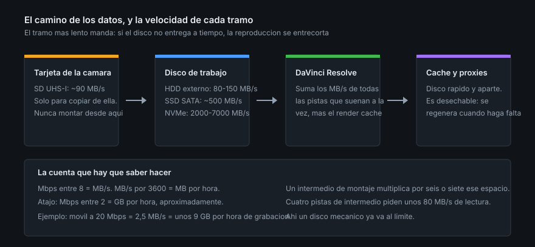

# El flujo de datos

> Montar vídeo es, sobre todo, mover bytes de un sitio a otro a tiempo. Si el disco no
> los entrega a la velocidad que el codec pide, no hay procesador ni tarjeta gráfica que
> lo arregle: la reproducción se entrecorta y no sabes por qué.

## 🎯 Objetivos

- Definir **bitrate** y convertirlo a espacio en disco y a velocidad de lectura
- Calcular cuánto ocupa una hora de tu material, y cuánto ocuparía en un intermedio
- Conocer la velocidad real de cada tipo de disco y saber cuál necesitas
- Entender por qué la carpeta de caché no va donde va el material
- Fijar la estructura de carpetas de tu proyecto y saber qué va en cada una
- Saber dónde se configuran las carpetas de trabajo en Resolve 21

---

## 1. Qué problema resuelve

Tres síntomas muy distintos tienen la misma causa:

- La reproducción se entrecorta aunque el ordenador esté ocioso
- Copiar el material de la tarjeta tarda una tarde
- El disco se llena a mitad de proyecto y hay que mover cosas con Resolve abierto

Los tres son el mismo problema: **caudal de datos**. Y es el único de los problemas de
esta semana que se puede calcular con exactitud antes de que ocurra.

---

## 2. Cómo funciona: bitrate

El **bitrate** (*bit rate*, "tasa de bits") es cuántos bits por segundo ocupa un flujo de
vídeo o de audio. Se mide en **Mbps** (megabits por segundo) y es lo que decide a la vez
el tamaño del archivo y la velocidad de lectura que hace falta.

La conversión que hay que tener en la cabeza es esta, y el único truco es que **un byte
son ocho bits**:

```
Mbps ÷ 8       = MB/s   (megabytes por segundo)
MB/s × 3600    = MB por hora
MB por hora ÷ 1024 = GB por hora aproximados
```

Un ejemplo con material de móvil, a 20 Mbps:

```
20 ÷ 8 = 2,5 MB/s
2,5 × 3600 = 9000 MB/hora ≈ 8,8 GB/hora
```

> [!TIP]
> El atajo de bolsillo: **divide los Mbps entre 2 y tienes los GB por hora**,
> aproximadamente. 20 Mbps ≈ 10 GB/h. 100 Mbps ≈ 50 GB/h. Sirve para decidir si cabe en
> el disco sin sacar la calculadora.

---

## 3. Cuánto ocupa cada cosa

Órdenes de magnitud en HD (1920 × 1080). Los valores exactos dependen del codec, del
ajuste concreto y del contenido:

| Material | Bitrate aproximado | Por hora |
| -------- | ------------------ | -------- |
| H.264 de móvil, 1080p | 20 Mbps | ~9 GB |
| H.265 de móvil, 4K | 50-100 Mbps | ~22-45 GB |
| Intermedio de montaje 1080p (ProRes 422, DNxHR SQ) | 120-150 Mbps | ~55-65 GB |
| Intermedio de alta calidad 1080p (ProRes 422 HQ) | ~180-220 Mbps | ~80-100 GB |
| Sin comprimir 1080p 8 bits | ~1000 Mbps | ~450 GB |
| Audio WAV PCM 48 kHz 24 bits estéreo | 2,3 Mbps | ~1 GB |

Dos lecturas de esta tabla:

1. **El intermedio multiplica por seis o por siete** el espacio del material original. Es
   el coste de poder montar con soltura, y hay que preverlo antes de generarlo.
2. **El audio es gratis en comparación.** Un GB por hora. No hay ninguna razón para
   comprimir el audio de trabajo.

---

## 4. La velocidad del disco



De poco sirve tener espacio si el disco no entrega los datos a tiempo. Velocidades de
lectura secuencial habituales:

| Soporte | Velocidad típica | ¿Sirve para montar? |
| ------- | ---------------- | ------------------- |
| **Disco duro mecánico (HDD)** externo por USB | 80-150 MB/s | Para material de móvil sí; para intermedios y varias pistas, justo |
| **SSD SATA** | ~500 MB/s | Sí, con holgura para casi todo el bootcamp |
| **SSD NVMe** interno | 2000-7000 MB/s | Sí, sin discusión |
| **Tarjeta SD UHS-I** | ~90 MB/s | Solo para copiar de ella, nunca para montar desde ella |
| **Red gigabit** | ~110 MB/s efectivos | Sirve para material ligero; se nota en cuanto hay varias pistas |

La cuenta que importa: si un clip pide 2,5 MB/s y tienes **cuatro pistas de vídeo**
sonando a la vez más el render cache, estás pidiendo unos 15 MB/s. Cualquier disco
aguanta eso. Pero con intermedios a 20 MB/s por pista, cuatro pistas son 80 MB/s, y ahí
un disco mecánico ya va al límite.

> [!WARNING]
> **Nunca montes directamente desde la tarjeta de la cámara ni desde una carpeta que
> sincronice con la nube.** La tarjeta es lenta y se puede desconectar; la nube puede
> mover o descargar bajo demanda un archivo mientras Resolve lo lee, y el clip aparecerá
> como *offline* en mitad de una sesión. Copia primero, monta después.

---

## 5. Dónde va cada cosa

Resolve escribe en más sitios de los que parece, y separarlos es lo que evita que un
disco lleno pare el trabajo:

| Qué | Cuánto crece | Dónde debería vivir |
| --- | ------------ | ------------------- |
| **Material original** | Lo que grabes | Disco grande. Nunca se borra |
| **Optimized media y proxies** | Varias veces el original | Disco rápido. **Es desechable**: se regenera |
| **Render cache** | Crece solo, sin avisar | Disco rápido. Desechable |
| **Gallery stills** | Poco | Con el proyecto |
| **Entregas** | Un archivo por destino | Disco cualquiera |
| **Respaldos `.drp`** | Kilobytes | En otro sitio. Idealmente en otro disco |

La distinción clave es entre lo que **no se puede regenerar** —el material y los
respaldos— y lo que **sí** —caché, proxies y entregas—. Lo primero se protege; lo segundo
se borra sin miedo cuando falta espacio.

Esta es la estructura que usa el bootcamp desde la Semana 01:

```
BC-Resolve/
├── 00-medios-bootcamp/     material común descargado (pack de medios)
├── 01-material-propio/     lo que grabes tú
├── 02-cache/               caché, optimized media y proxies. Desechable
├── 03-entregas/            renders. Desechable
└── 04-respaldos/           .drp y fichas. Lo más valioso y lo que menos ocupa
```

---

## 6. Cómo se configura en Resolve 21

Dos sitios distintos, con alcances distintos:

| Dónde | Alcance | Qué se fija |
| ----- | ------- | ----------- |
| `DaVinci Resolve > Preferences > System > Media Storage` | **Tu máquina** | La lista de discos de trabajo. El primero de la lista es donde Resolve escribe por defecto |
| `File > Project Settings > Master Settings > Working Folders` | **Este proyecto** | `Cache files location` y `Gallery stills location` |

> [!IMPORTANT]
> `Media Storage` es una preferencia de **tu ordenador** y no viaja con el proyecto. Al
> abrir el proyecto en otra máquina hay que revisarla. Es la razón número uno por la que
> un proyecto que funcionaba en un sitio llena el disco equivocado en otro.

Para vaciar la caché cuando el disco se llene:

> [!WARNING]
> `Playback > Delete Render Cache > All` borra **toda** la caché del proyecto, y hay que
> volver a calcularla. No se pierde trabajo —la caché es desechable por definición— pero
> sí tiempo de máquina. Compruébalo antes de lanzarlo en mitad de una sesión.

---

## 7. Cuánto disco necesitas para este bootcamp

Una estimación con la que planificar, para una pieza de 5 a 10 minutos con material
propio de móvil:

| Concepto | Espacio |
| -------- | ------- |
| Pack de medios común | 20-40 GB |
| Tu material propio (unas 3 horas de grabación) | ~30 GB |
| Optimized media y proxies | ~60 GB |
| Render cache | 20-50 GB, variable |
| Entregas de las Semanas 28-29 | ~10 GB |
| **Total con holgura** | **200 GB** |

Con 200 GB libres en un disco decente vas sobrado los nueve meses. Si vas justo, lo que
se sacrifica primero es la caché, que se regenera.

---

## 8. Antipatrones

| Antipatrón | Por qué duele | Qué hacer |
| ---------- | ------------- | --------- |
| Montar desde la tarjeta de la cámara | Lenta, y si se desconecta el proyecto se queda *offline* | Copia al disco de trabajo antes de importar nada |
| Guardar el proyecto en una carpeta sincronizada con la nube | La sincronización mueve archivos mientras Resolve los lee | Fuera de OneDrive, Dropbox e iCloud Drive |
| Dejar la caché en el mismo disco que el material, y lleno | Se llena el disco y Resolve deja de responder a mitad de sesión | Caché en un disco rápido y aparte, revisada de vez en cuando |
| Generar proxies sin calcular el espacio | Se descubre a mitad del proceso, con el disco al 100 % | Multiplica por seis el tamaño del original y comprueba antes |
| Renombrar o mover carpetas de material con el proyecto ya montado | Todos los clips se quedan *offline* y hay que relinkarlos | Decide la estructura ahora; el *relink* masivo es Semana 30 |
| Tratar los respaldos `.drp` como algo prescindible | Pesan kilobytes y son lo único irremplazable junto al material | Uno por fase, en otro disco |

---

## 9. Trucos

| Truco | Cómo |
| ----- | ---- |
| Calcular el bitrate real de un archivo | Tamaño en MB × 8 ÷ duración en segundos = Mbps. O `ffprobe`, campo `bit_rate` |
| Saber si tu disco da la talla | Compara la velocidad de lectura secuencial con la suma de los MB/s de todas las pistas que vayas a reproducir a la vez |
| Recuperar espacio de golpe sin perder trabajo | Borra la caché: `Playback > Delete Render Cache > All`. Se regenera sola |
| Saber cuánto ocupa un proyecto de verdad | Mira el tamaño de `02-cache/`: casi siempre es la carpeta más grande y la única desechable |
| Comprobar dónde escribe Resolve | `Preferences > System > Media Storage`: el primer disco de la lista es el que se usa por defecto |

---

## 📚 Recursos Adicionales

- [DaVinci Resolve Reference Manual](https://www.blackmagicdesign.com/support/family/davinci-resolve-and-fusion) — los capítulos de *Media Storage* y *Optimized Media and Render Cache* explican exactamente dónde escribe Resolve y con qué criterio.
- [Blackmagic Design — soporte](https://www.blackmagicdesign.com/support/) — las notas de configuración de sistema y los requisitos por versión, que es donde se publican los mínimos reales de disco y memoria.
- [`docs/hardware-y-rendimiento.md`](../../../docs/hardware-y-rendimiento.md) — la guía de hardware del bootcamp, con los mínimos y lo que de verdad merece la pena mejorar primero.

---

## ✅ Checklist de Verificación

- [ ] Sé convertir Mbps a MB/s y a GB por hora
- [ ] Puedo estimar cuánto ocupa una hora de mi material y su intermedio
- [ ] Conozco la velocidad típica de un HDD, un SSD SATA y un NVMe
- [ ] Sé por qué no se monta desde la tarjeta ni desde una carpeta sincronizada
- [ ] Distingo lo regenerable (caché, proxies, entregas) de lo irremplazable (material, respaldos)
- [ ] Sé dónde se configuran `Media Storage` y `Working Folders` en Resolve 21
- [ ] Tengo una estimación del disco que necesito para los nueve meses

---

| Anterior | Actual | Siguiente |
| -------- | ------ | --------- |
| [07 · Audio digital](07-audio-digital.md) | **08 · El flujo de datos** | — |

← [Volver a la Semana 02](../README.md)
