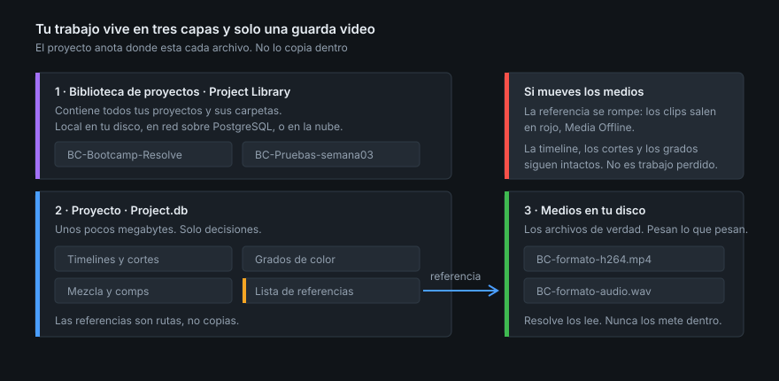

# El modelo de datos de Resolve

> Tu trabajo vive en tres sitios distintos y ninguno de ellos es el que crees. Entender
> cuáles son —y qué pasa cuando uno se mueve sin los otros— es lo que separa a quien
> pierde una semana de trabajo de quien no.

## 🎯 Objetivos

- Nombrar las **tres cosas separadas** que componen tu trabajo en Resolve
- Explicar qué guarda un proyecto y qué **no** guarda
- Saber por qué un proyecto de dos horas de material puede ocupar tres megabytes
- Entender qué significa que un clip esté *offline* y por qué ocurre
- Localizar en tu disco dónde vive de verdad un proyecto de Resolve
- Saber por qué nunca se toca esa carpeta a mano

---

## 1. Qué problema resuelve

Tienes un proyecto montado. Copias la carpeta del material a otro disco para hacer
sitio. Abres Resolve al día siguiente y la timeline está entera —los cortes, los
títulos, todo— pero cada clip aparece en rojo y el viewer dice *Media Offline*.

O al revés: le pasas a alguien un `.drp` de 4 MB creyendo que le mandas la película.
Lo abre y no tiene nada que ver.

Las dos cosas pasan por lo mismo: **Resolve nunca guarda tu vídeo dentro del
proyecto**. El proyecto guarda decisiones; el vídeo sigue donde lo dejaste. Son dos
cosas separadas, y hay una tercera —la biblioteca que contiene los proyectos— que casi
nadie sabe que existe hasta que se rompe.

---

## 2. Las tres capas



### Capa 1 · La biblioteca de proyectos (*project library*)

Es el **contenedor de todos tus proyectos**. Cuando abres Resolve y ves el
Project Manager, lo que estás viendo es el contenido de una biblioteca.

Hasta la versión 17, Blackmagic la llamaba **base de datos** (*database*), y mucha
documentación y muchos tutoriales siguen usando esa palabra. Son lo mismo. En
Resolve 21 la interfaz dice **Project Libraries**, y este bootcamp usa "biblioteca"
salvo cuando cite un texto que diga *database*.

Una biblioteca guarda: los proyectos, sus carpetas de organización, los usuarios y
algunos ajustes compartidos. **No guarda vídeo.**

### Capa 2 · El proyecto (*project*)

Un proyecto es todo lo que has decidido:

- Las **timelines** y cada corte, transición y efecto que hay en ellas
- El **media pool**: no los archivos, sino una **lista de referencias** a archivos del disco
- Los **grados de color**, nodo a nodo
- Los **comps de Fusion**, la **mezcla de Fairlight**, los **marcadores**, la metadata
- Los **Project Settings** (frame rate, resolución, ciencia de color)

Todo eso cabe en unos pocos megabytes, porque son instrucciones, no imágenes.

### Capa 3 · Los medios (*media*)

Los archivos de vídeo, audio e imagen que hay en tu disco. Resolve los **lee**; no los
copia, no los mueve y no los mete dentro de nada.

Cuando importas un clip, lo que entra en el media pool es una **referencia**: la ruta
del archivo, más lo que Resolve ha leído de él (duración, codec, timecode). Es como el
número de una estantería en una biblioteca: si alguien mueve el libro, el número deja
de servir.

> [!IMPORTANT]
> **Referencia** (*reference*, también *link*) significa "una anotación de dónde está
> algo", no una copia de ese algo. Es el concepto central de esta semana y explica
> los tres problemas más comunes del bootcamp: clips *offline*, proyectos que pesan
> nada, y respaldos que resultan estar vacíos.

---

## 3. Qué pasa cuando una capa se mueve sin las otras

| Qué mueves | Qué se rompe | Cómo se ve |
| ---------- | ------------ | ---------- |
| Los **medios**, dejando el proyecto | Todas las referencias | Clips en rojo, *Media Offline* en el viewer. La timeline está intacta |
| El **proyecto** a otra máquina, sin medios | Todas las referencias | Igual: se abre entero, pero no hay imagen |
| La **biblioteca** entera a otra máquina, con los medios en la misma ruta | Nada | Todo funciona |
| Renombrar un archivo de medios | La referencia a ese archivo | Un solo clip en rojo |
| Renombrar la **carpeta** de medios | Todas las referencias a esa carpeta | Todo el bin en rojo |

Ninguno de esos casos destruye trabajo: la timeline, los cortes y los grados siguen
ahí. Lo que se pierde es el puente entre las decisiones y las imágenes, y se vuelve a
tender con **relink** (*volver a enlazar*), que es materia de la Semana 30 en su
versión masiva.

Pero la lección de hoy es otra: **si decides la estructura de carpetas una vez y no la
tocas, esto no te pasa nunca**. Es exactamente lo que hiciste en la Semana 01.

> [!WARNING]
> Las carpetas sincronizadas con la nube (OneDrive, iCloud Drive, Google Drive, Dropbox)
> son la causa número uno de clips *offline* inesperados. El servicio puede descargar un
> archivo bajo demanda, dejar solo un marcador en disco o renombrarlo al resolver un
> conflicto, y Resolve ve un archivo que aparece y desaparece. **El material de trabajo
> no va en una carpeta sincronizada.**

---

## 4. Dónde vive todo esto en tu disco

Un proyecto de una biblioteca local es **una carpeta con un archivo dentro**:

```
.../Resolve Project Library/Resolve Projects/Users/guest/Projects/<nombre del proyecto>/
├── Project.db          ← todo tu proyecto, en un archivo SQLite
└── Batch Renders/      ← aparece cuando usas la cola de render
```

`Project.db` es una **base de datos SQLite**: un formato de archivo estándar que guarda
tablas dentro de un solo fichero. Ahí dentro está la timeline entera, el media pool y
los grados.

`guest` es el usuario por defecto de la biblioteca local. Si nunca has creado usuarios
en Resolve —y no hace falta—, todos tus proyectos están bajo `guest`.

La carpeta raíz, por sistema:

| Sistema | Ruta |
| ------- | ---- |
| **Windows** | `%APPDATA%\Blackmagic Design\DaVinci Resolve\Support\Resolve Project Library\` |
| **macOS** | `~/Library/Application Support/Blackmagic Design/DaVinci Resolve/Support/Resolve Project Library/` |
| **Linux** | Dentro del directorio de datos de DaVinci Resolve de tu usuario |

> [!NOTE]
> La ruta de Windows está **verificada en 21.0.4.5, agosto de 2026**, en la instalación
> con la que se escribió este material. Las otras dos son la ruta equivalente del
> sistema; si en la tuya no está ahí, búscala por el nombre de carpeta
> `Resolve Project Library`. La práctica 01 de esta semana te hace localizarla y
> anotarla.

Un detalle que sorprende: si tu instalación viene de Resolve 17 o anterior, esa carpeta
puede llamarse `Resolve Disk Database`. Es el nombre viejo del mismo sitio.

> [!WARNING]
> **Nunca abras, edites, copies ni borres nada dentro de esa carpeta con Resolve
> abierto**, y a poder ser tampoco con Resolve cerrado. Un `Project.db` copiado a mano a
> medias es un proyecto corrupto, y no hay forma de repararlo desde la interfaz. Para
> mover, copiar o respaldar un proyecto existen `Export Project` y los archivos de
> proyecto, que es de lo que trata la [teoría 04](04-copias-de-seguridad.md).

---

## 5. Por qué esto se enseña ahora y no en la Semana 30

Porque las tres decisiones que dependen de este modelo hay que tomarlas **antes** de
tener material dentro:

1. **Dónde va tu material** y con qué estructura de carpetas. Ya lo hiciste en la
   Semana 01; ahora sabes por qué importaba.
2. **Dónde va tu biblioteca de proyectos.** Por defecto, en el disco del sistema. La
   [teoría 02](02-bibliotecas-de-proyectos.md) explica cuándo eso es un problema.
3. **Qué respaldas y cada cuánto.** Respaldar el `.drp` no respalda el vídeo;
   respaldar el vídeo no respalda el montaje. Hacen falta los dos, y son operaciones
   distintas.

---

## 6. Antipatrones

| Antipatrón | Por qué duele | Qué hacer |
| ---------- | ------------- | --------- |
| Creer que el proyecto "contiene" los clips | Se comparte un `.drp` de 3 MB creyendo que va todo dentro, y al otro lado no hay imagen | Para llevarte medios **y** proyecto hace falta un *Project Archive* (teoría 04) |
| Reorganizar las carpetas de material "para dejarlo bonito" | Todas las referencias se rompen a la vez | La estructura se decide una vez, antes de importar |
| Guardar el material en una carpeta sincronizada con la nube | Los archivos aparecen y desaparecen bajo los pies de Resolve | Disco local para trabajar; la nube, para respaldos que no se editan |
| Copiar a mano la carpeta `Project.db` para "hacer una copia" | Con Resolve abierto, se copia una base a medio escribir: proyecto corrupto | `Export Project`, que escribe un `.drp` coherente |
| Renombrar archivos de vídeo ya importados | Un clip *offline* por cada renombrado | Renombrar **antes** de importar; después se hace desde el media pool si acaso |
| Tratar los clips en rojo como una pérdida de trabajo | Se rehace un montaje que no hacía falta rehacer | Un clip *offline* es un enlace roto, no un montaje perdido: se vuelve a enlazar |

---

## 7. Trucos

| Truco | Cómo |
| ----- | ---- |
| Saber si un proyecto pesa lo que debería | Mira el tamaño de su `Project.db`. Unos pocos MB es normal; cientos de MB suele indicar miles de stills en la galería |
| Comprobar la ruta real de un clip antes de mover nada | Página Media, panel Metadata, campo `File Path` |
| Ver de un vistazo qué está *offline* | Vista de lista del media pool: los clips sin archivo salen marcados |
| Copiar un proyecto de verdad, sin tocar archivos internos | Project Manager, clic derecho sobre el proyecto > `Export Project` |
| Saber qué versión de biblioteca tiene tu instalación | El nombre de la carpeta: `Resolve Project Library` (18 en adelante) o `Resolve Disk Database` (17 y anteriores) |

---

## 📚 Recursos Adicionales

- [DaVinci Resolve Reference Manual](https://www.blackmagicdesign.com/support/family/davinci-resolve-and-fusion) — el capítulo *Project Management* describe la relación entre biblioteca, proyecto y medios, y es la fuente de verdad cuando este material y tu instalación no coincidan.
- [SQLite — qué es un archivo de base de datos](https://www.sqlite.org/about.html) — media página que explica qué es exactamente el formato en el que Resolve guarda tu proyecto. Útil para entender por qué copiarlo a mano mientras se escribe lo rompe.
- [Foro oficial de DaVinci Resolve](https://forum.blackmagicdesign.com/) — el subforo de gestión de proyectos es donde se resuelven los casos raros de bibliotecas y de material *offline*.

---

## ✅ Checklist de Verificación

- [ ] Sé nombrar las tres capas: biblioteca, proyecto y medios
- [ ] Sé que el proyecto guarda referencias, no vídeo
- [ ] Sé explicar por qué un `.drp` pesa unos pocos megabytes
- [ ] Sé qué significa que un clip esté *offline* y por qué no es una pérdida de trabajo
- [ ] Sé dónde vive mi biblioteca de proyectos en mi disco
- [ ] Sé que no se toca esa carpeta a mano, y por qué
