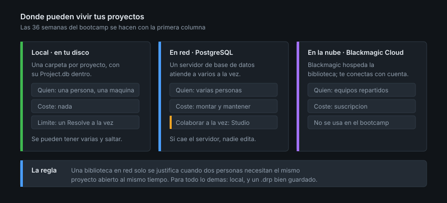

# Bibliotecas de proyectos: local, en red y en la nube

> Todos tus proyectos viven dentro de un contenedor que casi nadie mira hasta que falla.
> Hay tres tipos, y elegir el que no te corresponde cuesta o dinero o un fin de semana.

## 🎯 Objetivos

- Distinguir los tres tipos de **biblioteca de proyectos** de Resolve 21
- Saber cuál usa tu instalación ahora mismo y dónde está
- Entender qué es **PostgreSQL** y por qué Resolve lo ofrece
- Saber cuándo hace falta una biblioteca en red y cuándo es complicarse la vida
- Crear una biblioteca local nueva sin romper la que ya tienes
- Saber cómo se respalda una biblioteca, que no es lo mismo que respaldar un proyecto

---

## 1. Qué problema resuelve

Un proyecto suelto es fácil de guardar. Cincuenta proyectos con tres personas
abriéndolos a la vez, no. Resolve resuelve las dos situaciones con la misma pieza —la
**biblioteca de proyectos**— pero con tres implementaciones distintas por debajo,
porque un disco local y un servidor compartido no tienen los mismos problemas.

Saber cuál tienes importa por tres motivos muy concretos: dónde ocupa espacio, qué pasa
si el disco del sistema se llena, y qué tienes que copiar el día que cambies de
ordenador.

---

## 2. Los tres tipos

### 📁 Local (*Local*)

Archivos en tu disco, una carpeta por proyecto con su `Project.db` dentro, como viste
en la [teoría 01](01-el-modelo-de-datos-de-resolve.md).

- **Quién la usa**: una persona, una máquina. El 95 % de los casos
- **Coste**: nada
- **Límite**: un solo Resolve puede tenerla abierta a la vez
- **Es lo que usas ahora mismo**, y lo que usarás las 36 semanas

Se pueden tener **varias** bibliotecas locales a la vez y saltar entre ellas. Es la
forma limpia de separar el trabajo del cliente A del trabajo del cliente B, o —lo que
te interesa esta semana— de tener una biblioteca de pruebas donde romper cosas sin
miedo.

### 🌐 En red (*Network*), sobre PostgreSQL

**PostgreSQL** es un gestor de bases de datos: un programa que corre como servicio,
escucha por la red y atiende a varios clientes a la vez sin que se pisen. Resolve puede
guardar una biblioteca dentro de un servidor PostgreSQL en vez de en carpetas.

- **Quién la usa**: varias personas sobre los mismos proyectos, o una persona con
  varias máquinas
- **Coste**: montar y mantener el servidor
- **Ventaja real**: acceso simultáneo y bloqueos gestionados por la base de datos
- **Precio**: es infraestructura. Si el servidor cae, nadie edita

El instalador de Resolve incluye un componente opcional para montar ese servidor, y
Blackmagic distribuye además una aplicación aparte, **DaVinci Resolve Project Server**,
para crear y administrar bibliotecas en red.

> [!IMPORTANT]
> **Studio** · El **modo de colaboración** —varias personas trabajando a la vez sobre el
> mismo proyecto, con bloqueo de timelines y fusión de cambios— es de DaVinci Resolve
> Studio. En Free, la forma de trabajar entre varias personas es pasarse el proyecto
> exportado (`.drp`), que se explica en la [teoría 04](04-copias-de-seguridad.md) y se
> trata a fondo en la Semana 30.

### ☁️ En la nube (*Blackmagic Cloud*)

Blackmagic hospeda la biblioteca y tú te conectas con una cuenta. Está pensado para
equipos repartidos geográficamente y es de **pago por suscripción**.

No lo vas a usar en el bootcamp. Se menciona porque aparece en la misma barra lateral
que las otras dos y conviene saber qué es antes de pulsarlo.

---

## 3. Cuál te conviene

| Situación | Biblioteca |
| --------- | ---------- |
| Aprendes tú solo, una máquina | **Local**. Sin discusión |
| Editas en dos ordenadores, uno cada vez | **Local** en cada uno, y pasas `.drp` entre ellos |
| Dos personas, turnos distintos, mismo material | **Local** compartida en un disco, abierta por una sola a la vez |
| Dos personas, a la vez, mismo proyecto | **En red** + Studio |
| Equipo repartido en varias ciudades | **Nube**, y presupuesto |

La regla corta: **una biblioteca en red solo se justifica cuando dos personas necesitan
el mismo proyecto abierto al mismo tiempo**. Para todo lo demás, local y un `.drp` bien
guardado ganan por sencillez.

---

## 4. Cómo se hace en Resolve 21

Todo ocurre en el **Project Manager** (`File > Project Manager` si ya estás dentro de
un proyecto). En su esquina inferior izquierda hay un botón que muestra y oculta la
**barra lateral de bibliotecas**, rotulada `Project Libraries`.

Ahí aparecen tus bibliotecas agrupadas por tipo, y la que está en uso queda resaltada.

### Crear una biblioteca local nueva

1. Abre la barra lateral de bibliotecas
2. Pulsa el botón de añadir (`+`) al pie de la barra
3. Elige el tipo **`Disk`**
4. Ponle **nombre** y elige la **carpeta** donde vivirá
5. Confirma

A partir de ahí la biblioteca nueva aparece en la lista. Un clic sobre ella cambia el
Project Manager entero: verás **otros** proyectos, porque estás mirando otro contenedor.

> [!NOTE]
> La biblioteca nueva se crea **vacía**. Tus proyectos no se copian solos: siguen en la
> biblioteca de origen. Para llevar uno de una a otra se exporta un `.drp` desde la
> primera y se importa en la segunda ([teoría 03](03-el-project-manager.md)).

### Conectar con una biblioteca en red

El mismo botón, eligiendo el tipo de PostgreSQL, y pidiendo los datos del servidor: la
dirección IP o el nombre de la máquina, el nombre de la base y las credenciales. Si no
tienes un servidor montado, no hay nada que poner: es una opción para entornos que ya
lo tienen.

> [!TIP]
> Los nombres exactos de los botones y de los campos de este diálogo cambian entre
> versiones. Si algo no coincide con lo que ves, gana tu instalación: el capítulo
> *Project Management* del manual oficial lleva las capturas de la versión que tengas.

---

## 5. Respaldar una biblioteca no es respaldar un proyecto

Son dos operaciones distintas y hacen falta las dos:

| Qué respaldas | Con qué | Qué recuperas |
| ------------- | ------- | ------------- |
| **Un proyecto** | `Export Project` → un `.drp` | Ese proyecto, sin medios |
| **Un proyecto con sus medios** | *Project Archive* → un `.dra` | Ese proyecto y todos sus archivos |
| **Una biblioteca local entera** | Copia de la carpeta, **con Resolve cerrado** | Todos los proyectos de esa biblioteca |
| **Una biblioteca en red** | Un volcado de la base PostgreSQL | Todos los proyectos de esa biblioteca |

> [!WARNING]
> Copiar la carpeta de una biblioteca local **con Resolve abierto** produce copias
> corruptas: se están escribiendo archivos mientras los copias. Cierra Resolve antes, o
> —mejor— respalda proyecto a proyecto con `.drp`, que es una operación que Resolve sí
> hace de forma coherente y que puedes automatizar en la Semana 33.

Para el bootcamp, la estrategia es la de la [teoría 04](04-copias-de-seguridad.md): un
`.drp` por semana en `04-respaldos/`. Cuesta diez segundos y cubre el caso realista.

---

## 6. Antipatrones

| Antipatrón | Por qué duele | Qué hacer |
| ---------- | ------------- | --------- |
| Montar PostgreSQL "porque es más profesional" | Añade un servidor que mantener a un problema que no tenías | En red solo cuando haya acceso simultáneo real |
| Dejar la biblioteca local en un disco del sistema que se llena | Resolve deja de poder guardar y el proyecto abierto queda en el aire | Vigila el espacio, o crea la biblioteca en el disco de trabajo |
| Crear una biblioteca por proyecto | Treinta bibliotecas con un proyecto cada una, y saltar entre ellas todo el día | Una biblioteca, y carpetas dentro para organizar |
| Copiar la carpeta de la biblioteca con Resolve abierto | Copia corrupta, y no te enteras hasta que la necesitas | Cierra Resolve, o exporta `.drp` |
| Suponer que cambiar de biblioteca "lleva" tus proyectos | La biblioteca nueva sale vacía y cunde el pánico | Los proyectos se mueven de uno en uno, con `.drp` |
| Guardar la biblioteca en una carpeta sincronizada con la nube | El servicio toca los archivos mientras Resolve escribe | Biblioteca en disco local; los respaldos, en la nube |

---

## 7. Trucos

| Truco | Cómo |
| ----- | ---- |
| Saber en qué biblioteca estás | Abre la barra lateral del Project Manager: la activa aparece resaltada |
| Tener un sitio donde romper cosas sin miedo | Crea una biblioteca local `BC-Pruebas` y trastea ahí |
| Separar clientes o cursos sin mezclar proyectos | Una biblioteca por contexto, no por proyecto |
| Saber cuánto ocupan todos tus proyectos | Mira el tamaño de la carpeta `Resolve Project Library` en tu disco |
| Reconocer una instalación antigua | Si la carpeta se llama `Resolve Disk Database`, viene de Resolve 17 o anterior |

---

## 📚 Recursos Adicionales

- [DaVinci Resolve Reference Manual](https://www.blackmagicdesign.com/support/family/davinci-resolve-and-fusion) — el capítulo *Project Management* documenta los tres tipos de biblioteca y el diálogo de creación con las capturas de tu versión exacta.
- [Blackmagic Design — soporte y descargas](https://www.blackmagicdesign.com/support/) — aquí se descarga **DaVinci Resolve Project Server**, la aplicación con la que se administran las bibliotecas en red.
- [PostgreSQL — documentación oficial](https://www.postgresql.org/docs/) — qué es y cómo funciona el gestor de bases de datos que hay debajo de una biblioteca en red. Solo si vas a montar una de verdad.

---

## ✅ Checklist de Verificación

- [ ] Sé nombrar los tres tipos de biblioteca de proyectos
- [ ] Sé cuál estoy usando y dónde está en mi disco
- [ ] Sé qué es PostgreSQL y por qué Resolve lo ofrece
- [ ] Sé la regla para decidir si necesito una biblioteca en red
- [ ] Sé crear una biblioteca local nueva y volver a la anterior
- [ ] Sé que una biblioteca nueva nace vacía y que los proyectos se mueven con `.drp`
- [ ] Sé que respaldar una biblioteca y respaldar un proyecto son cosas distintas

---

| Anterior | Actual | Siguiente |
| -------- | ------ | --------- |
| [01 · El modelo de datos de Resolve](01-el-modelo-de-datos-de-resolve.md) | **02 · Bibliotecas de proyectos: local, en red y en la nube** | [03 · El Project Manager](03-el-project-manager.md) |

← [Volver a la Semana 03](../README.md)
