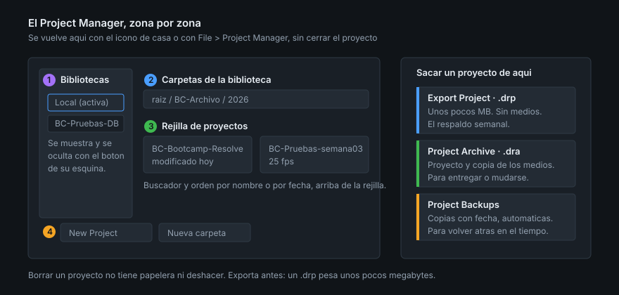

# El Project Manager

> Es la primera pantalla que ves al abrir Resolve y la que más gente usa peor: como una
> lista de iconos que se va llenando hasta que hay ochenta y ya no se encuentra nada.
> Es, en realidad, el panel donde se crean, se organizan, se mueven y se archivan
> proyectos enteros.

## 🎯 Objetivos

- Reconocer las cuatro zonas del Project Manager y para qué sirve cada una
- Organizar proyectos en **carpetas** dentro de una biblioteca
- Volver al Project Manager sin cerrar el proyecto abierto
- Distinguir **exportar**, **archivar** y **respaldar**, que no son lo mismo
- Saber qué hace y qué no hace **Dynamic Project Switching**
- Borrar un proyecto sabiendo exactamente qué se lleva por delante

---

## 1. Qué problema resuelve

Al mes tres del bootcamp tendrás el proyecto del hilo conductor, un par de proyectos de
prueba, alguno que empezaste y abandonaste, y la copia que hiciste "por si acaso". Al
mes nueve, el doble.

El Project Manager es lo que evita que eso se convierta en una carpeta de descargas.
Y hace además tres cosas que no se pueden hacer desde ningún otro sitio del programa:
mover un proyecto a otra máquina, empaquetarlo con sus medios y recuperarlo cuando algo
sale mal.

---

## 2. Las cuatro zonas

### 1 · La barra lateral de bibliotecas (`Project Libraries`)

A la izquierda, se muestra y se oculta con el botón de su esquina. Lista tus
bibliotecas y marca la activa. Es lo que viste en la
[teoría 02](02-bibliotecas-de-proyectos.md).

### 2 · Las carpetas

Dentro de una biblioteca, los proyectos se organizan en **carpetas** (*folders*). No
son carpetas del disco: son organización dentro de la biblioteca, igual que un bin no
es una carpeta del disco sino organización dentro del proyecto.

Se crean con el botón de **carpeta nueva** de la barra inferior, o con clic derecho
sobre un área vacía.

> [!IMPORTANT]
> El verificador del bootcamp lista los proyectos de la **carpeta actual** de la
> biblioteca. Si mueves `BC-Bootcamp-Resolve` dentro de una carpeta, tienes que estar
> viendo esa carpeta en el Project Manager para que el check lo encuentre. Por eso el
> bootcamp deja su proyecto en la raíz de la biblioteca.

### 3 · La rejilla de proyectos

Cada proyecto con su miniatura, su nombre y su fecha. Arriba hay un **buscador** y un
selector de **orden** (por nombre, por fecha de modificación), que a partir de treinta
proyectos deja de ser un adorno.

Doble clic abre. Clic derecho da el menú de acciones sobre ese proyecto.

### 4 · La barra inferior

Los botones de crear proyecto y crear carpeta, y el interruptor de la barra lateral.

---

## 3. Volver aquí sin cerrar nada

Desde dentro de un proyecto:

- `File > Project Manager`
- O el **icono de casa** de la esquina inferior derecha de la interfaz

Volver al Project Manager **no cierra** tu proyecto: sigue abierto detrás. Puedes mirar
la lista, crear una carpeta y volver con `Escape` o abriendo el mismo proyecto otra vez.

Lo que sí lo cierra es **abrir otro proyecto**. Resolve guarda el actual y carga el
nuevo, y eso, en un proyecto grande, tarda.

---

## 4. Dynamic Project Switching

Es un modo que permite tener **varios proyectos abiertos a la vez** y saltar entre
ellos al instante, en vez de cerrar uno para abrir otro.

Se activa desde el menú `File`, como interruptor. Con él encendido, cada proyecto que
abras se queda cargado, y en el menú `File` aparece la lista de los abiertos para
saltar entre ellos.

Para qué sirve de verdad: copiar una timeline, un nodo o un clip de un proyecto a otro.
Copias en uno, saltas, pegas en el otro. Sin él, hay que exportar e importar.

> [!WARNING]
> Cada proyecto abierto ocupa memoria RAM y caché. Con dos proyectos medianos y 16 GB
> de RAM no pasa nada; con cinco proyectos grandes, Resolve se arrastra o se cierra
> solo. Es un modo que se enciende para una tarea concreta y se apaga después.

> [!TIP]
> Si en tu instalación no lo encuentras en el menú `File`, búscalo por nombre en
> `Keyboard Customization`: el buscador de comandos te dice dónde está y qué atajo
> tiene. Es el método general para cualquier comando que se haya movido de sitio entre
> versiones.

---

## 5. Exportar, archivar y respaldar

Tres cosas distintas que la gente confunde a diario. Están en el menú de clic derecho
sobre un proyecto.

| Acción | Qué produce | Lleva los medios | Para qué |
| ------ | ----------- | ---------------- | -------- |
| **Export Project** | Un archivo `.drp` de unos pocos MB | **No** | Mandar el montaje, mover el proyecto de biblioteca, respaldo semanal |
| **Project Archive** | Una carpeta `.dra` que pesa lo que pese tu material | **Sí** | Entregar el trabajo completo, archivar al terminar, cambiar de máquina |
| **Project Backups** | Copias automáticas que hace Resolve solo | No | Recuperar de un cierre inesperado. Es la [teoría 04](04-copias-de-seguridad.md) |

El `.drp` es el formato de intercambio del día a día: cabe en un correo y contiene
todas tus decisiones. El `.dra` es la caja de mudanza: dentro va el proyecto **y** una
copia de cada archivo que usa, con las rutas ya arregladas.

> [!NOTE]
> Que el archivado copie los medios no es una suposición: la operación equivalente de la
> API de scripting, `ArchiveProject`, lleva los argumentos `isArchiveSrcMedia`,
> `isArchiveRenderCache` y `isArchiveProxyMedia`, y los dos primeros vienen activados por
> defecto. *Comprobado en el `README.txt` del SDK que instala Resolve 21.0.4.5.*

> [!NOTE]
> Un `.dra` no es un archivo, es una **carpeta** con esa extensión en el nombre. En
> macOS el sistema la presenta como si fuera un paquete único; en Windows y Linux se ve
> como lo que es. Se recupera desde el Project Manager, con la opción de restaurar
> archivo de proyecto del menú de clic derecho sobre un área vacía.

### Importar un proyecto

La operación inversa de exportar: clic derecho sobre un área vacía de la rejilla >
importar, y eliges el `.drp`. El proyecto entra en la carpeta que estés viendo, **con
el nombre que llevaba dentro**, no con el nombre del archivo.

Si ya existe un proyecto con ese nombre en esa carpeta, Resolve no machaca nada: te
avisa. Por eso conviene importar en una carpeta distinta o renombrar antes el proyecto
original.

---

## 6. Borrar un proyecto

Clic derecho > borrar. Y aquí hay que parar.

> [!WARNING]
> **Borrar un proyecto en el Project Manager no tiene papelera y no se puede deshacer.**
> Se lleva la timeline, los grados, los comps y la mezcla. No se lleva tus archivos de
> vídeo, que siguen en el disco, pero eso es un consuelo pequeño: lo que cuesta nueve
> meses no es el material, son las decisiones.
>
> Antes de borrar cualquier proyecto: `Export Project` a `04-respaldos/`. Un `.drp`
> pesa unos pocos megabytes. No hay ninguna razón para no tenerlo.

Renombrar, en cambio, es inofensivo: cambia el nombre del proyecto en la biblioteca y
nada más. Los medios no se enteran, porque las referencias van del proyecto al archivo,
nunca al revés.

---

## 7. Antipatrones

| Antipatrón | Por qué duele | Qué hacer |
| ---------- | ------------- | --------- |
| Acumular ochenta proyectos en la raíz de la biblioteca | Se tarda más en encontrar el proyecto que en abrirlo | Carpetas por año, por cliente o por curso, y el buscador |
| Llamar a los proyectos `Sin título 3` o `prueba final buena` | Dentro de tres meses no sabrás cuál es cuál | Un nombre que diga qué es. Los del bootcamp llevan prefijo `BC-` |
| Usar `Export Project` para entregar un trabajo completo | El `.drp` no lleva medios; al otro lado no hay imagen | Para entregar, *Project Archive* (`.dra`) |
| Dejar Dynamic Project Switching encendido siempre | La memoria se llena con proyectos que ya no miras | Enciéndelo para copiar entre proyectos y apágalo después |
| Borrar un proyecto "que ya no sirve" sin exportarlo antes | No hay papelera. Lo que se borra, se fue | `Export Project` primero, siempre |
| Duplicar el proyecto a mano copiando carpetas del disco | Copias corruptas o proyectos fantasma en la biblioteca | Clic derecho > exportar, y luego importar |

---

## 8. Trucos

| Truco | Cómo |
| ----- | ---- |
| Volver al Project Manager sin cerrar el proyecto | El icono de casa, abajo a la derecha, o `File > Project Manager` |
| Encontrar un proyecto entre muchos | El buscador de la parte superior de la rejilla; busca por trozos del nombre |
| Copiar una timeline de un proyecto a otro | Enciende Dynamic Project Switching, copia en uno, salta y pega en el otro |
| Saber cuándo tocaste un proyecto por última vez | Ordena la rejilla por fecha de modificación |
| Mover un proyecto a otra biblioteca | `Export Project` en la de origen, importar en la de destino |
| Localizar un comando que se ha movido de menú entre versiones | Busca su nombre en `Keyboard Customization` |

---

## 📚 Recursos Adicionales

- [DaVinci Resolve Reference Manual](https://www.blackmagicdesign.com/support/family/davinci-resolve-and-fusion) — el capítulo *Project Management* recorre el Project Manager panel a panel, incluido el diálogo de archivado y el de restauración.
- [Blackmagic Design Training](https://www.blackmagicdesign.com/products/davinciresolve/training) — las guías oficiales empiezan siempre por el Project Manager; sirven como segunda voz sobre el mismo recorrido.
- [Foro oficial de DaVinci Resolve](https://forum.blackmagicdesign.com/) — el sitio donde buscar cuando un `.drp` no importa o un archivo restaurado sale con clips *offline*.

---

## ✅ Checklist de Verificación

- [ ] Sé nombrar las cuatro zonas del Project Manager
- [ ] Sé crear carpetas y organizar proyectos dentro de una biblioteca
- [ ] Sé volver al Project Manager sin cerrar el proyecto abierto
- [ ] Sé qué hace Dynamic Project Switching y por qué no se deja siempre encendido
- [ ] Distingo `Export Project`, *Project Archive* y *Project Backups*
- [ ] Sé que borrar un proyecto no tiene deshacer, y exporto antes de borrar

---

| Anterior | Actual | Siguiente |
| -------- | ------ | --------- |
| [02 · Bibliotecas de proyectos: local, en red y en la nube](02-bibliotecas-de-proyectos.md) | **03 · El Project Manager** | [04 · Copias de seguridad](04-copias-de-seguridad.md) |

← [Volver a la Semana 03](../README.md)
