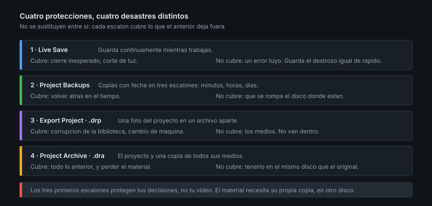

# Copias de seguridad

> Un corte de luz, una actualización de la GPU a media tarde, un `Ctrl+Z` de más. Todo
> eso va a pasarte en nueve meses. Lo que decide si pierdes diez minutos o una semana
> son cuatro casillas que se marcan una sola vez.

## 🎯 Objetivos

- Distinguir las **cuatro** protecciones distintas que ofrece Resolve
- Entender qué desastre cubre cada una y cuál no cubre ninguna
- Configurar **Live Save** y los **Project Backups** con criterio
- Saber dónde escribe Resolve sus respaldos automáticos y cómo se llaman los archivos
- Montar la estrategia de respaldo del bootcamp: dos minutos por semana
- Saber por qué respaldar el proyecto no es respaldar el trabajo

---

## 1. Qué problema resuelve

Resolve no tiene un `Ctrl+S` que haga falta pulsar cada dos minutos, pero tampoco
guarda solo si no se lo dices. Por defecto, en una instalación recién hecha, hay menos
protección de la que la gente supone.

Y hay un malentendido de fondo: la mayoría cree que "guardar el proyecto" pone a salvo
su trabajo. Pone a salvo **las decisiones**. El material sigue siendo tan frágil como
el disco donde está.

---

## 2. Las cuatro protecciones



| Protección | Qué es | Cubre | No cubre |
| ---------- | ------ | ----- | -------- |
| **Live Save** | Guarda el proyecto continuamente mientras trabajas | Cierre inesperado, corte de luz | Un error tuyo: guarda también el destrozo |
| **Project Backups** | Copias con fecha, hechas solas cada X minutos | Un error tuyo: vuelves a hace veinte minutos | Que se rompa el disco |
| **`.drp`** (`Export Project`) | Una foto del proyecto en un archivo aparte | Corrupción de la biblioteca, cambio de máquina | Los medios: no van dentro |
| **`.dra`** (*Project Archive*) | El proyecto **y** copia de todos sus medios | Todo lo anterior, y perder el material | Que la copia esté en el mismo disco que el original |

Las cuatro son complementarias. Ninguna sustituye a las otras.

> [!IMPORTANT]
> **Live Save y Project Backups son cosas distintas y se confunden constantemente.**
> Live Save evita que pierdas lo hecho desde la última vez que guardaste. Los backups
> te permiten **volver atrás en el tiempo**. Live Save encendido y backups apagados
> significa que un destrozo se guarda al instante y no hay a dónde volver.

---

## 3. Live Save

Guarda el proyecto continuamente, sin diálogo y sin pausa perceptible. Con él
encendido, `Ctrl+S` / `Cmd+S` deja de hacer falta.

**Ruta**: `Preferences > User > Project Save and Load`.

Es lo primero que se enciende en una instalación nueva, y ya lo hiciste en la
Semana 01. Cuesta nada y elimina de un plumazo el "se me cerró y perdí la tarde".

Su límite es el que ya has visto: guarda lo bueno y lo malo con la misma diligencia.
Por eso hace falta la segunda capa.

---

## 4. Project Backups

En el **mismo panel de preferencias**, Resolve puede ir dejando copias con fecha del
proyecto abierto. Funciona en **tres escalones**, y esta es la parte que casi nadie
mira:

| Escalón | Qué guarda | Valor por defecto |
| ------- | ---------- | ----------------- |
| **Reciente** | Una copia cada X minutos, conservando las últimas N | Cada **10 minutos**, **8** copias |
| **Por horas** | Una copia por hora, conservando las últimas N | **2** copias |
| **Por días** | Una copia por día, conservando las últimas N | **2** copias |

*Valores por defecto verificados en 21.0.4.5, agosto de 2026.*

Con esos números, la ventana real de recuperación es: el último **hora y veinte**
minuto a minuto, más las **dos horas** anteriores, más los **dos días** anteriores. Es
poco para un proyecto de nueve meses. Subir las copias diarias a 7 o 10 cuesta unos
megabytes y te da una semana entera de historia.

> [!NOTE]
> Hay además una casilla aparte para respaldar **timelines**. Es la que produce los
> archivos que verás en el siguiente apartado, y es la que salva el caso más común de
> todos: no perder el proyecto, sino haber destrozado una timeline concreta.

### Dónde escribe

En la carpeta que indique ese mismo panel. Por defecto, dentro de la carpeta de vídeos
de tu usuario, en `Resolve Project Backups/`. Dentro, la estructura es así:

```
Resolve Project Backups/
└── <identificador del proyecto>/
    └── <identificador de la timeline>/
        ├── Timeline.20260829062955
        ├── Timeline.20260829075505
        └── Timeline.20260829081835
```

Los nombres son identificadores largos, no nombres legibles, y los archivos se llaman
`Timeline.` seguido de la fecha y la hora en formato `AAAAMMDDHHMMSS`. Es feo a
propósito: no está pensado para que lo navegues tú, sino para que Resolve encuentre la
copia correcta. *Estructura verificada en 21.0.4.5, agosto de 2026.*

Lo que sí te toca a ti es **saber que existe y que esa carpeta crece**. Y ponerla en un
disco que no sea el del sistema, que es lo que hace la
[práctica 03](../2-practicas/03-copias-de-seguridad-de-verdad.md).

> [!TIP]
> La restauración de un respaldo automático se hace desde el Project Manager, no
> copiando archivos a mano. El nombre exacto de la opción ha cambiado entre versiones:
> míralo en el menú de clic derecho sobre el proyecto, y si no lo ves, en el capítulo
> *Project Management* del manual oficial de tu versión.

---

## 5. La estrategia del bootcamp

Dos minutos por semana, y estás cubierto:

1. **Live Save encendido**, una vez y para siempre
2. **Project Backups encendido**, con la carpeta en tu disco de trabajo
3. Al cerrar cada semana: `File > Export Project` →
   `BC-Resolve/04-respaldos/BC-Bootcamp-Resolve-semanaNN.drp`
4. Al cerrar cada **fase** del proyecto (Semanas 03, 05, 07, 12, 15, 22, 27, 29): un
   `.drp` etiquetado con la fase
5. Al terminar el bootcamp, o antes de cambiar de ordenador: un **Project Archive**
   completo

El paso 3 es el que de verdad importa, y es el que ya vienes haciendo desde la
Semana 01. Un `.drp` semanal es un historial de treinta y seis puntos de retorno que
ocupa menos que un solo clip de vídeo.

### La regla que no cubre Resolve

**Todo lo anterior protege el proyecto, no el material.** Si se te rompe el disco donde
están los vídeos, un `.drp` perfecto te devuelve una timeline llena de clips en rojo.

La regla clásica de respaldo, adaptada a lo que estás haciendo:

- **Dos copias** del material en **dos discos distintos**
- **Una** de ellas fuera de tu casa o en la nube, si el material es irrepetible
- El proyecto (`.drp`) viaja con las dos, porque no ocupa nada

Para material que puedes volver a grabar, una copia basta. Para una entrevista que no
se repite, no.

---

## 6. Antipatrones

| Antipatrón | Por qué duele | Qué hacer |
| ---------- | ------------- | --------- |
| Confiar solo en Live Save | Guarda el destrozo tan rápido como el acierto | Live Save **y** backups; son capas distintas |
| Dejar los backups en el disco del sistema | Es el disco que se llena, y el que se pierde al reinstalar | Ponlos en el disco de trabajo |
| Dejar los valores por defecto de los backups diarios | Dos días de historia en un proyecto de nueve meses | Sube las copias diarias a 7 o más |
| Creer que el `.drp` semanal respalda el material | El día que falle el disco de vídeo, el `.drp` no salva nada | Copia del material aparte, en otro disco |
| Guardar los `.drp` en el mismo disco que el proyecto | Un fallo se lleva original y copia | Al menos uno en otro disco o en la nube |
| Hacer un *Project Archive* "por si acaso" cada semana | Pesa lo que pese tu material; el disco se llena en un mes | `.drp` semanal, `.dra` al cerrar el trabajo |
| Renombrar o mover a mano los archivos de la carpeta de backups | Resolve deja de encontrarlos y la protección desaparece | Esa carpeta se configura y no se toca |

---

## 7. Trucos

| Truco | Cómo |
| ----- | ---- |
| No volver a pulsar `Ctrl+S` nunca más | `Preferences > User > Project Save and Load`, activa Live Save |
| Darte una semana de historia en vez de dos días | En el mismo panel, sube el número de copias diarias |
| Saber cuánto ocupan tus respaldos automáticos | Mira el tamaño de la carpeta `Resolve Project Backups` |
| Tener un punto de retorno por semana | `File > Export Project` a `04-respaldos/`, con el número de semana en el nombre |
| Llevarte proyecto y medios de una vez | *Project Archive* desde el clic derecho del Project Manager |
| Comprobar que un respaldo sirve | Impórtalo en una biblioteca de pruebas y ábrelo. Un respaldo sin probar es una suposición |

---

## 📚 Recursos Adicionales

- [DaVinci Resolve Reference Manual](https://www.blackmagicdesign.com/support/family/davinci-resolve-and-fusion) — el capítulo *Project Management* documenta el panel de respaldos, la restauración y el archivado con las capturas de tu versión.
- [Blackmagic Design — soporte](https://www.blackmagicdesign.com/support/) — las notas de versión avisan cuando cambia el comportamiento de los respaldos, que ha cambiado más de una vez entre versiones mayores.
- [`docs/proyecto-hilo-conductor.md`](../../../docs/proyecto-hilo-conductor.md) — la política de versionado del proyecto del bootcamp: duplicar timeline al cerrar fase y exportar el `.drp`.

---

## ✅ Checklist de Verificación

- [ ] Sé nombrar las cuatro protecciones y qué desastre cubre cada una
- [ ] Tengo Live Save encendido
- [ ] Tengo los Project Backups encendidos y en un disco que no es el del sistema
- [ ] Sé dónde escribe Resolve sus respaldos y cómo se llaman esos archivos
- [ ] Sé que Live Save y los backups no son lo mismo
- [ ] Exporto un `.drp` al cerrar cada semana
- [ ] Sé que nada de esto respalda mi material, y tengo una copia aparte

---

| Anterior | Actual | Siguiente |
| -------- | ------ | --------- |
| [03 · El Project Manager](03-el-project-manager.md) | **04 · Copias de seguridad** | [05 · Preferences: los ajustes de tu ordenador](05-preferences-los-ajustes-de-tu-ordenador.md) |

← [Volver a la Semana 03](../README.md)
