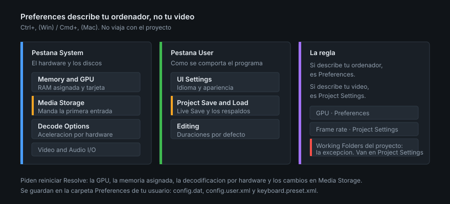

# Preferences: los ajustes de tu ordenador

> Aquí se decide qué GPU usa Resolve, de qué discos lee, dónde escribe y cómo se
> comporta el programa. Nada de esto viaja con tu proyecto: describe **esta máquina**,
> y se queda en esta máquina.

## 🎯 Objetivos

- Aplicar la regla que distingue **Preferences** de **Project Settings** sin dudar
- Recorrer las pestañas `System` y `User` y saber qué vive en cada una
- Configurar **Media Storage**, que decide de dónde lee Resolve
- Saber qué ajustes exigen **reiniciar** el programa y cuáles no
- Localizar el archivo donde se guardan tus preferencias
- Saber cómo volver a los valores de fábrica cuando algo se rompe

---

## 1. Qué problema resuelve

Dos personas abren el mismo proyecto en dos ordenadores. Una tiene una GPU potente y
tres discos; la otra, un portátil con un SSD. El proyecto tiene que verse igual en los
dos —mismo frame rate, misma resolución, mismo color— pero **no** puede pedirles lo
mismo al hardware.

Por eso Resolve parte la configuración en dos:

| | Preferences | Project Settings |
| --- | ----------- | ---------------- |
| **Describe** | Tu ordenador | Tu vídeo |
| **Alcance** | Esta máquina, todos los proyectos | Este proyecto, en cualquier máquina |
| **Viaja con el `.drp`** | No | Sí |
| **Ruta** | `DaVinci Resolve > Preferences` | `File > Project Settings` |
| **Atajo** | `Ctrl+,` (Win) / `Cmd+,` (Mac) | `Shift+9` |

**La regla**: si describe tu ordenador, es Preferences; si describe tu vídeo, es
Project Settings. Frame rate es vídeo. GPU es ordenador. La caché es ordenador, pero
—como verás en la [teoría 07](07-donde-escribe-resolve.md)— hay una parte de la caché
que es de proyecto, y esa es la excepción que hay que tener fichada.

---

## 2. Las dos pestañas



Arriba de la ventana hay dos pestañas. Todo lo demás son secciones dentro de una de las
dos.

### 🖥️ `System` — el hardware y los discos

Lo que tiene que ver con la máquina: memoria, GPU, de qué discos lee Resolve, cómo
decodifica el vídeo, qué salida de vídeo usa, qué paneles de control tiene conectados.

Las secciones que importan en el bootcamp:

| Sección | Qué decide | Cuándo la tocas |
| ------- | ---------- | --------------- |
| **Memory and GPU** | Cuánta RAM puede usar Resolve y con qué GPU trabaja | Al instalar, y si cambias de tarjeta |
| **Media Storage** | De qué carpetas lee y dónde escribe por defecto | Esta semana, y en la Semana 04 |
| **Decode Options** | Si usa aceleración por hardware para decodificar | Si la reproducción va a tirones (Semana 05) |
| **Video and Audio I/O** | La salida a un monitor de referencia por SDI o HDMI | Si tienes hardware de Blackmagic. La mayoría, nunca |

### 👤 `User` — cómo se comporta el programa

Lo que tiene que ver contigo: idioma, apariencia, cada cuánto guarda, cómo se comporta
el montaje por defecto.

| Sección | Qué decide | Cuándo la tocas |
| ------- | ---------- | --------------- |
| **UI Settings** | Idioma de la interfaz, brillo del tema | Al instalar |
| **Project Save and Load** | Live Save y los respaldos automáticos | Esta semana ([teoría 04](04-copias-de-seguridad.md)) |
| **Editing** | Duraciones por defecto de transiciones, títulos e imágenes fijas | Semanas 08-11 |

> [!TIP]
> La lista exacta de secciones cambia entre versiones y entre Free y Studio. Ábrela y
> compárala con esta tabla: lo que sobre, es una sección que el bootcamp no necesita;
> lo que falte, búscalo en el manual de tu versión. No hace falta entenderlo todo hoy.

---

## 3. Media Storage, la sección que más se nota

Es una lista ordenada de carpetas. Hace dos cosas:

1. **Alimenta el navegador Media Storage** de la página Media: lo que aparece ahí para
   arrastrar clips al proyecto sale de esta lista
2. **Marca el destino por defecto** de lo que Resolve escribe (galería, caché,
   optimized media) cuando un proyecto no dice otra cosa

El **orden importa**: la primera entrada de la lista es la que Resolve considera su
ubicación por defecto.

En el archivo de configuración esas rutas se guardan como `Site.1.FS.1.Root`,
`Site.1.FS.2.Root`, numeradas por su orden en la lista. *Verificado en 21.0.4.5, agosto
de 2026.* No hay que editarlo a mano nunca; se dice aquí para que reconozcas qué estás
viendo si alguna vez abres ese archivo.

> [!WARNING]
> Poner el disco del sistema como primera entrada es el error de configuración más
> común y el que más problemas causa a medio plazo: la caché y los medios optimizados
> —que pueden ser decenas de gigabytes— acaban en el disco donde vive el sistema
> operativo, y cuando ese disco se llena, no se llena "un poco": deja de funcionar todo,
> no solo Resolve.

---

## 4. Los ajustes que piden reiniciar

Algunos cambios se aplican al instante y otros no. Resolve avisa cuando toca reiniciar,
y no es un aviso decorativo: hasta que no reinicies, el ajuste viejo sigue en uso
aunque el panel muestre el nuevo.

| Se aplica al momento | Pide reiniciar Resolve |
| -------------------- | ---------------------- |
| Casi todo lo de `User` | La configuración de GPU |
| Los respaldos y Live Save | Cambios en la memoria asignada |
| Duraciones por defecto de edición | La aceleración por hardware de decodificación |
| | Añadir o quitar entradas de Media Storage |

Consejo práctico: **configura Preferences de una sentada y reinicia una vez**, en vez de
tocar una cosa, reiniciar, tocar otra y volver a reiniciar. Es exactamente lo que hace
la [práctica 04](../2-practicas/04-preferences-y-carpetas-de-trabajo.md).

---

## 5. Dónde viven tus preferencias

En una carpeta `Preferences` dentro del directorio de datos de Resolve de tu usuario.
En Windows:

```
%APPDATA%\Blackmagic Design\DaVinci Resolve\Preferences\
├── config.dat                 ← preferencias de System, texto plano
├── config.user.xml            ← preferencias de User, XML
├── keyboard.preset.xml        ← tus atajos personalizados
└── ...
```

*Verificado en 21.0.4.5, agosto de 2026.* En macOS y Linux la carpeta se llama igual y
cuelga del directorio de datos de la aplicación de tu usuario.

Dos consecuencias prácticas:

- **Al cambiar de ordenador, las preferencias no van con el proyecto.** Hay que
  reconfigurarlas. Son diez minutos, y por eso la práctica 01 te hace anotarlas.
- **Si Resolve empieza a comportarse de forma extraña** —paneles que no aparecen,
  ajustes que no se guardan, arranques que fallan—, la causa habitual es un archivo de
  preferencias corrupto.

### Volver a los valores de fábrica

> [!WARNING]
> Esto es el último recurso, no el primero. Pierdes **todas** tus preferencias y tus
> atajos personalizados. No toca tus proyectos ni tus medios, pero no se deshace.
>
> Con **Resolve completamente cerrado**, renombra la carpeta `Preferences` a
> `Preferences-vieja`. Al arrancar, Resolve crea una nueva con los valores de fábrica.
> Si el problema no era ese, cierras Resolve, borras la nueva y devuelves el nombre a la
> antigua: no has perdido nada.

Renombrar en vez de borrar es la diferencia entre una prueba y una pérdida.

---

## 6. Antipatrones

| Antipatrón | Por qué duele | Qué hacer |
| ---------- | ------------- | --------- |
| Buscar el frame rate en Preferences | No está ahí, y se pierden diez minutos | Si describe tu vídeo, es Project Settings |
| Dejar el disco del sistema el primero en Media Storage | Se llena con caché y se lleva por delante todo el sistema | El disco de trabajo, el primero |
| Cambiar un ajuste que pide reinicio y seguir trabajando | Crees que está aplicado y no lo está | Reinicia cuando Resolve lo pida |
| Tocar Preferences a mitad de una sesión de trabajo | Reinicios encadenados y una tarde perdida | Configura de una sentada, al principio |
| Editar `config.dat` a mano | Un error de sintaxis y Resolve arranca sin preferencias | Todo desde la interfaz |
| Borrar la carpeta `Preferences` para "arreglar" algo | Si no era eso, has perdido tus atajos para nada | Renómbrala, no la borres |
| Suponer que tus preferencias viajan en el `.drp` | En la máquina nueva nada está donde lo dejaste | Anótalas: es lo que hace la práctica 01 |

---

## 7. Trucos

| Truco | Cómo |
| ----- | ---- |
| Abrir Preferences sin buscar el menú | `Ctrl+,` (Win) / `Cmd+,` (Mac) |
| Saber si un ajuste es de máquina o de proyecto | ¿Describe tu ordenador o tu vídeo? |
| Poner el disco correcto por defecto | `Preferences > System > Media Storage`, y sube tu disco de trabajo al primer puesto |
| Probar un reseteo de preferencias sin perder nada | Renombra la carpeta `Preferences` con Resolve cerrado; si no era eso, deshaz el renombrado |
| Llevarte tus atajos a otro ordenador | Copia `keyboard.preset.xml` de la carpeta `Preferences` |
| Configurar una máquina nueva en diez minutos | Ten anotadas tus preferencias; la práctica 01 te da la plantilla |

---

## 📚 Recursos Adicionales

- [DaVinci Resolve Reference Manual](https://www.blackmagicdesign.com/support/family/davinci-resolve-and-fusion) — el capítulo de preferencias del sistema documenta cada sección campo a campo, incluidas las que este material no cubre.
- [`docs/hardware-y-rendimiento.md`](../../../docs/hardware-y-rendimiento.md) — qué valores de memoria y GPU tienen sentido según tu máquina, y qué merece la pena mejorar antes que nada.
- [Foro oficial de DaVinci Resolve](https://forum.blackmagicdesign.com/) — el sitio donde se diagnostican los arranques fallidos, que casi siempre acaban en preferencias corruptas o en un driver de GPU.

---

## ✅ Checklist de Verificación

- [ ] Sé aplicar la regla Preferences / Project Settings sin dudarlo
- [ ] Sé qué vive en la pestaña `System` y qué en la pestaña `User`
- [ ] Tengo mi disco de trabajo como primera entrada de Media Storage
- [ ] Sé qué ajustes piden reiniciar Resolve
- [ ] Sé dónde está la carpeta `Preferences` en mi disco
- [ ] Sé cómo volver a los valores de fábrica sin perder nada por el camino
- [ ] Sé que mis preferencias no viajan con el proyecto

---

| Anterior | Actual | Siguiente |
| -------- | ------ | --------- |
| [04 · Copias de seguridad](04-copias-de-seguridad.md) | **05 · Preferences: los ajustes de tu ordenador** | [06 · Project Settings: los ajustes de tu vídeo](06-project-settings-los-ajustes-de-tu-video.md) |

← [Volver a la Semana 03](../README.md)
