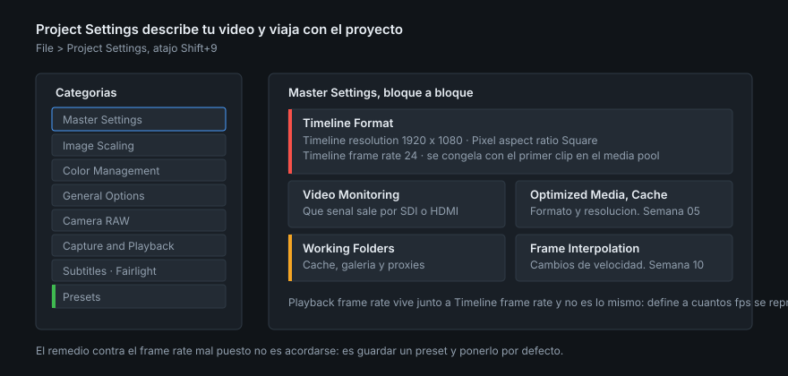

# Project Settings: los ajustes de tu vídeo

> Todo lo que describe la pieza que estás haciendo vive aquí, viaja con el proyecto a
> cualquier máquina, y una parte de ello **deja de poder cambiarse** en cuanto empiezas
> a trabajar.

## 🎯 Objetivos

- Recorrer las categorías de `Project Settings` y saber qué decide cada una
- Dominar la sección **Master Settings**, que es donde está el 80 % de lo que tocarás
- Distinguir **timeline frame rate** de **playback frame rate**
- Saber exactamente **qué ajuste es irreversible** y en qué momento se congela
- Guardar tus ajustes como **preset** para no volver a configurarlos nunca
- Saber por qué estos ajustes sí viajan con el `.drp` y las Preferences no

---

## 1. Qué problema resuelve

Un proyecto tiene una identidad técnica: va a 24 fps, mide 1920 × 1080, se trabaja en
DaVinci YRGB, entrega en Rec.709. Esa identidad tiene que ser la misma en tu portátil,
en el ordenador del estudio y dentro de tres años.

Por eso no está en las preferencias de la máquina, sino **dentro del proyecto**, y por
eso viaja en el `.drp`. Abrir tu proyecto en otro ordenador no cambia ni un valor de
esta ventana.

**Ruta**: `File > Project Settings`, atajo `Shift+9`.

---

## 2. El mapa de la ventana

A la izquierda, una lista de categorías. Estas son las que te vas a encontrar y en qué
semana entra cada una:

| Categoría | Qué decide | Semana |
| --------- | ---------- | ------ |
| **Presets** | Plantillas de ajustes guardadas, y cuál es la de los proyectos nuevos | Esta |
| **Master Settings** | Resolución, cadencia, monitorización, caché y carpetas de trabajo | Esta |
| **Image Scaling** | Qué hace Resolve cuando un clip no mide lo mismo que la timeline | 10 |
| **Color Management** | La ciencia de color y los espacios de entrada y salida | 16 |
| **General Options** | Ajustes varios de conformado y de nombres | Según haga falta |
| **Camera RAW** | Cómo se revelan los clips RAW del proyecto | 22 |
| **Capture and Playback** | Captura desde hardware y reproducción por salida de vídeo | Rara vez |
| **Subtitles** | Estilo y comportamiento por defecto de los subtítulos | 12 |
| **Fairlight** | Frecuencia de muestreo y buses por defecto del audio | 13 |

> [!TIP]
> La lista exacta depende de la versión. Si ves alguna categoría que no está en esta
> tabla, no es un problema: es una que el bootcamp cubre más adelante o no necesita.

---

## 3. Master Settings, sección a sección

Es la primera categoría y la que más se usa. Por dentro tiene varios bloques.

### Timeline Format

La identidad de la imagen:

| Ajuste | Qué es | Valor del bootcamp |
| ------ | ------ | ------------------ |
| `Timeline resolution` | El tamaño en píxeles del lienzo de montaje | `1920 x 1080 HD` |
| `Pixel aspect ratio` | Si los píxeles son cuadrados o no (Semana 01) | `Square` |
| `Timeline frame rate` | Cuántos frames por segundo tiene tu pieza | `24` |
| `Playback frame rate` | A cuántos frames por segundo **se reproduce** en tu pantalla | `24` |

> [!NOTE]
> El rótulo `Timeline frame rate` está confirmado literalmente en el `README.txt` del SDK
> de scripting que instala el propio Resolve, donde se cita como la opción de los ajustes
> de proyecto. Los demás rótulos de este bloque son los de la instalación de referencia
> (21.0.4.5, agosto de 2026): si en la tuya alguno aparece con otro nombre, gana tu
> instalación y el capítulo de ajustes de proyecto del
> [manual oficial](https://www.blackmagicdesign.com/support/family/davinci-resolve-and-fusion).

Los dos últimos se confunden siempre, y no son lo mismo:

- **`Timeline frame rate`** es una propiedad de la obra. Define cuántos frames hay en un
  segundo de tu película. Cambiarlo cambiaría dónde cae cada corte.
- **`Playback frame rate`** es una propiedad de la reproducción. Puedes tener una
  timeline a 24 fps y reproducirla a 24, o una timeline a 60 y reproducirla a 24 para
  monitorizar en un equipo que no da más.

Que puedan ser distintos es real: en la instalación con la que se escribió este
material hay un proyecto con `timeline frame rate` a 60 y `playback frame rate` a 24.
*Verificado en 21.0.4.5, agosto de 2026.*

> [!WARNING]
> **`Timeline frame rate` es el único ajuste irreversible del programa.** Se congela en
> cuanto hay **un** clip en el media pool, y a partir de ese momento el campo aparece
> atenuado. La única salida es crear un proyecto nuevo, configurarlo y volver a
> importar. Tu proyecto se congeló en la Semana 02, cuando importaste el banco de
> formatos. Si alguna vez ves ese campo activo, es que estás en un proyecto vacío: es el
> momento de mirarlo dos veces.

### Video Monitoring

Qué formato se manda a una salida de vídeo dedicada —una tarjeta Blackmagic conectada a
un monitor de referencia—. Si monitorizas en la pantalla del ordenador, como harás todo
el bootcamp, no cambia nada de lo que ves.

Se explica ahora por una razón: el día que alguien te diga "conecta el monitor de
referencia", el ajuste está aquí y no en Preferences, porque describe **qué señal
produce tu proyecto**, no qué cable tienes.

### Optimized Media and Render Cache

El formato y la resolución de los medios optimizados y de la caché de render. Es
materia de la **Semana 05**; lo que importa hoy es saber que estos ajustes son **del
proyecto**, no de la máquina.

### Working Folders

Dónde escribe **este proyecto** su caché, sus stills de galería y sus proxies. Es la
excepción a la regla de "los discos son cosa de Preferences", y tiene su propia
teoría: [07 · Dónde escribe Resolve](07-donde-escribe-resolve.md).

### Frame Interpolation

Cómo se calculan los frames intermedios al cambiar la velocidad de un clip. Semana 10.

---

## 4. Presets: configurarlo una vez

La categoría `Presets` guarda combinaciones completas de ajustes de proyecto y permite
elegir cuál se aplica a los proyectos nuevos.

Para qué sirve de verdad: si trabajas siempre a 1080p24 en Rec.709, configúralo una vez,
guárdalo como preset y ponlo por defecto. Cada proyecto nuevo nace bien y nunca vuelves
a olvidarte del frame rate el día que importas antes de configurar.

> [!IMPORTANT]
> Este es el remedio real contra el único error irreversible de Resolve. No es
> "acuérdate de mirar el frame rate": es hacer que el valor correcto sea el que ya
> viene puesto.

---

## 5. Qué viaja y qué no

| Cosa | Viaja en el `.drp` | Se queda en la máquina |
| ---- | ------------------ | ---------------------- |
| Frame rate, resolución, ciencia de color | ✅ | |
| Ajustes de caché y medios optimizados | ✅ (el ajuste) | La caché en sí, que es regenerable |
| Rutas de las carpetas de trabajo | ✅ (la ruta escrita) | El disco al que apunta, que en la otra máquina puede no existir |
| GPU, memoria, Media Storage, Live Save | | ✅ |
| Atajos de teclado y layouts | | ✅ |

La fila incómoda es la tercera: la **ruta** de las carpetas de trabajo viaja escrita en
el proyecto, pero el disco de la otra máquina puede no llamarse igual. Al abrir un
proyecto ajeno, esa es la primera casilla que hay que revisar. En la Semana 30 se hace
sistemáticamente.

---

## 6. Antipatrones

| Antipatrón | Por qué duele | Qué hacer |
| ---------- | ------------- | --------- |
| Importar antes de configurar el frame rate | Se congela el ajuste con el valor equivocado y hay que rehacer el proyecto | Configura primero, importa después. Y usa un preset |
| Aceptar el diálogo de "¿cambio el frame rate al del clip?" | Es la forma más común de perder la cadencia elegida | Di que no. Siempre |
| Confundir `playback frame rate` con `timeline frame rate` | Se toca el de la obra creyendo tocar el de la reproducción | El de la obra define la pieza; el de reproducción, tu monitor |
| Buscar la GPU en Project Settings | No está: describe tu ordenador | Preferences |
| Configurar los mismos ajustes en cada proyecto nuevo | Diez minutos por proyecto, y un olvido tarde o temprano | Un preset por defecto |
| Suponer que las rutas de caché funcionan en otra máquina | El disco `D:` de tu casa no existe en el estudio | Revisar Working Folders al abrir un proyecto ajeno |

---

## 7. Trucos

| Truco | Cómo |
| ----- | ---- |
| Abrir los ajustes del proyecto de un golpe | `Shift+9` |
| Saber si tu proyecto ya está congelado | Si `Timeline frame rate` aparece atenuado, hay clips dentro |
| Que los proyectos nuevos nazcan bien configurados | `Project Settings > Presets`: guarda el tuyo y ponlo por defecto |
| Ver los ajustes reales sin abrir la ventana | `python scripts/verificar-semana.py 03 --check frame-rate-de-proyecto` |
| Monitorizar a menos fps sin tocar la obra | Baja `Playback frame rate`, no `Timeline frame rate` |
| Comprobar qué ciencia de color tiene un proyecto ajeno | `Project Settings > Color Management`, campo de ciencia de color |

---

## 📚 Recursos Adicionales

- [DaVinci Resolve Reference Manual](https://www.blackmagicdesign.com/support/family/davinci-resolve-and-fusion) — el capítulo de ajustes de proyecto documenta cada categoría campo a campo; es la referencia para las que el bootcamp aún no ha cubierto.
- [`docs/autograding.md`](../../../docs/autograding.md) — qué ajustes de proyecto puede leer el verificador por la API y con qué nombre los devuelve. Útil para entender qué se comprueba solo.
- [Foro oficial de DaVinci Resolve](https://forum.blackmagicdesign.com/) — donde se recogen los casos límite del frame rate bloqueado, que es la pregunta más repetida del programa.

---

## ✅ Checklist de Verificación

- [ ] Sé abrir Project Settings con `Shift+9`
- [ ] Sé qué decide cada categoría de la barra lateral
- [ ] Distingo `Timeline frame rate` de `Playback frame rate`
- [ ] Sé cuál es el único ajuste irreversible y cuándo se congela
- [ ] Sé guardar un preset de proyecto y ponerlo por defecto
- [ ] Sé qué ajustes viajan con el `.drp` y cuáles se quedan en la máquina

---

| Anterior | Actual | Siguiente |
| -------- | ------ | --------- |
| [05 · Preferences: los ajustes de tu ordenador](05-preferences-los-ajustes-de-tu-ordenador.md) | **06 · Project Settings: los ajustes de tu vídeo** | [07 · Dónde escribe Resolve](07-donde-escribe-resolve.md) |

← [Volver a la Semana 03](../README.md)
