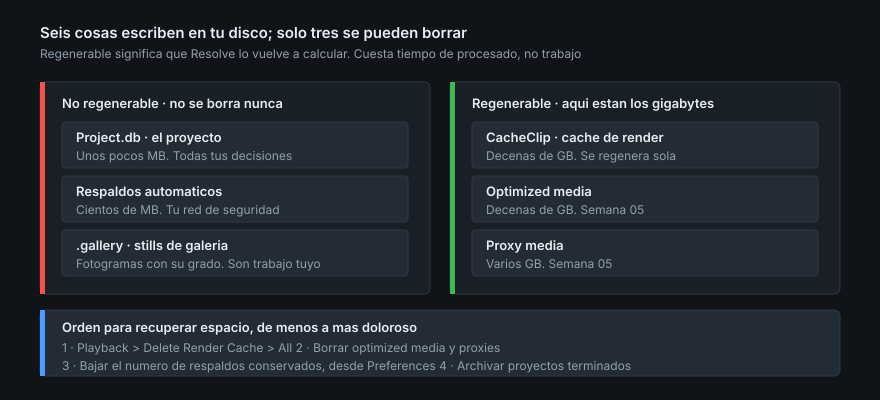

# Dónde escribe Resolve

> Un proyecto que ocupa tres megabytes puede generar cuarenta gigabytes de archivos a su
> alrededor sin decirte nada. Saber cuáles son, dónde caen y cuáles se pueden borrar sin
> perder trabajo es la diferencia entre un disco que dura nueve meses y uno que se llena
> en seis semanas.

## 🎯 Objetivos

- Enumerar **todo** lo que Resolve escribe en tu disco además del proyecto
- Distinguir lo **regenerable** de lo que no se puede recuperar
- Configurar las **Working Folders** del proyecto y saber por qué son de proyecto
- Reconocer las carpetas `CacheClip` y `.gallery` cuando las veas
- Saber qué se puede borrar sin miedo y qué no se toca jamás
- Recuperar espacio en disco sin perder ni un corte

---

## 1. Qué problema resuelve

Semana 12 del bootcamp. El disco avisa de que quedan 4 GB libres. Tú has grabado 60 GB
de material y el proyecto pesa 8 MB. ¿Dónde está el resto?

En la caché, en los medios optimizados, en los proxies, en los respaldos automáticos y
en la galería de stills. Nada de eso lo pediste explícitamente: Resolve lo genera
mientras trabajas, porque es lo que hace que la reproducción vaya fluida.

La buena noticia es que **casi todo eso es regenerable**: se puede borrar y Resolve lo
vuelve a hacer. La mala es que si no sabes cuál es cuál, acabas borrando lo que no era.

---

## 2. El inventario completo



| Qué escribe | Qué es | ¿Regenerable? | Puede pesar |
| ----------- | ------ | ------------- | ----------- |
| **El proyecto** (`Project.db`) | Tus decisiones | ❌ **No** | Unos MB |
| **Respaldos automáticos** | Copias con fecha del proyecto | ❌ No (son la red de seguridad) | Cientos de MB |
| **Stills de galería** | Fotogramas guardados con su grado | ❌ No: son trabajo tuyo | Cientos de MB |
| **Render cache** | Trozos de timeline ya calculados | ✅ Sí | **Decenas de GB** |
| **Optimized media** | Copias en un codec más fácil de reproducir | ✅ Sí | **Decenas de GB** |
| **Proxy media** | Copias en baja resolución | ✅ Sí | Varios GB |

Las tres últimas filas son el 95 % del espacio y las tres se pueden borrar sin perder
una sola decisión. Las tres primeras, no.

> [!IMPORTANT]
> **Regenerable** significa que Resolve lo puede volver a calcular a partir del proyecto
> y de los medios originales. Cuesta tiempo de procesado, no trabajo tuyo. Un still de
> galería, en cambio, es una decisión de color que guardaste a mano: si lo borras, no
> vuelve.

---

## 3. Working Folders: la excepción a la regla

En la [teoría 05](05-preferences-los-ajustes-de-tu-ordenador.md) quedó una regla: los
discos son cosa de Preferences. Aquí está la excepción.

**Ruta**: `File > Project Settings > Master Settings`, sección `Working Folders`.

| Ajuste | Qué controla |
| ------ | ------------ |
| `Cache files location` | Dónde va la caché de render **de este proyecto** |
| `Gallery stills location` | Dónde van los stills de la galería de color |
| `Proxy generation location` | Dónde van los proxies generados |

> [!NOTE]
> Los nombres de las carpetas que Resolve crea —`CacheClip` y `.gallery`— están
> verificados en disco en 21.0.4.5. Los tres rótulos de la tabla de arriba son los de esa
> misma instalación de referencia; si en la tuya aparecen con otro nombre, compáralos con
> el capítulo de ajustes de proyecto del
> [manual oficial](https://www.blackmagicdesign.com/support/family/davinci-resolve-and-fusion).

Son ajustes **de proyecto**, no de máquina. Tiene sentido: dos proyectos distintos
pueden vivir en discos distintos, y cada uno quiere su caché cerca de su material.

Si no los tocas, Resolve usa la primera entrada de `Preferences > System > Media
Storage`. Por eso el orden de esa lista importaba tanto.

En la **Semana 02** ya apuntaste `Cache files location` a `BC-Resolve/02-cache/`. Esta
semana completas las otras dos.

---

## 4. Qué carpetas aparecen y cómo se llaman

Cuando Resolve empieza a trabajar, crea sus carpetas solo, con nombres fijos:

```
<carpeta de caché>/
├── CacheClip/          ← la caché de render
└── .gallery/           ← los stills de la galería
```

`CacheClip` y `.gallery` son los nombres literales. El punto delante de `.gallery` hace
que en macOS y Linux sea una carpeta oculta: si no la ves, no es que no esté, es que tu
explorador de archivos oculta lo que empieza por punto. *Nombres verificados en
21.0.4.5, agosto de 2026.*

> [!TIP]
> Si abres un disco de trabajo ajeno y ves una carpeta `CacheClip`, ya sabes dos cosas:
> que ahí ha trabajado alguien con Resolve, y que esa carpeta se puede borrar entera si
> hace falta sitio urgente y ese proyecto no está abierto.

---

## 5. Recuperar espacio, en orden de menos a más doloroso

Cuando el disco avise, este es el orden:

### 1. Borrar la caché de render

`Playback > Delete Render Cache > All`

Libera lo que más ocupa y no pierde nada: Resolve la vuelve a generar en cuanto
reproduzcas. Lo único que pierdes es la fluidez hasta que se recalcule.

> [!WARNING]
> Es una acción **inmediata y sin deshacer**. No destruye trabajo —la caché es
> regenerable por definición— pero si estás a mitad de una sesión de color con la
> timeline entera cacheada, vas a pasar los siguientes veinte minutos esperando a que
> se vuelva a calcular. Bórrala al empezar el día, no en mitad de una revisión.

### 2. Borrar medios optimizados y proxies

Los genera y los borra la página Media, y es materia de la **Semana 05**, que es donde
se explican de verdad. Ocupan tanto como la caché.

### 3. Limpiar respaldos automáticos antiguos

La carpeta de respaldos crece sin parar. Se puede podar, pero con cabeza: estás
borrando tu red de seguridad. Baja el número de copias conservadas en
`Preferences > User > Project Save and Load` en vez de borrar a mano.

### 4. Archivar proyectos terminados

Un *Project Archive* (`.dra`) a un disco externo, y fuera del disco de trabajo. Es lo
que harás en la Semana 30.

> [!WARNING]
> Lo que **nunca** se borra para hacer sitio: la carpeta de la biblioteca de proyectos,
> la carpeta de respaldos entera, la galería de stills, y por supuesto el material
> original. Ninguna de esas cuatro cosas se regenera.

---

## 6. El caso del disco del sistema

Si Media Storage tiene el disco del sistema en primer lugar y no has tocado las Working
Folders, todo lo anterior está cayendo en el mismo disco donde vive el sistema
operativo.

Cuando ese disco se llena del todo no falla Resolve: falla el ordenador. El sistema
necesita espacio libre para su memoria virtual y para sus propios archivos temporales, y
sin él deja de arrancar programas, de guardar archivos y a veces de arrancar.

Por eso esta es una de las dos o tres cosas que hay que dejar bien puestas el primer
día y no volver a mirar. Es exactamente lo que hace la
[práctica 04](../2-practicas/04-preferences-y-carpetas-de-trabajo.md).

---

## 7. Antipatrones

| Antipatrón | Por qué duele | Qué hacer |
| ---------- | ------------- | --------- |
| Dejar caché, proxies y respaldos en el disco del sistema | Cuando se llena, no falla Resolve: falla el ordenador | Working Folders y Media Storage en el disco de trabajo |
| Borrar la carpeta de la galería para hacer sitio | Los stills son decisiones de color, no caché | Borra `CacheClip`, nunca `.gallery` |
| Borrar la caché en mitad de una sesión de color | Veinte minutos esperando a que se recalcule | Al empezar el día |
| Buscar los gigabytes perdidos en el proyecto | El proyecto pesa unos MB; el problema está en la caché | Mira `CacheClip`, los optimized media y los respaldos |
| Poner la caché en un disco de red o en un USB lento | La caché existe para ir rápido; en un disco lento estorba | Caché en el disco más rápido que tengas |
| Podar respaldos a mano borrando archivos | Resolve deja de encontrar sus propias copias | Baja el número de copias en Preferences |

---

## 8. Trucos

| Truco | Cómo |
| ----- | ---- |
| Recuperar decenas de GB en diez segundos | `Playback > Delete Render Cache > All` |
| Saber cuánta caché tienes acumulada | Mira el tamaño de la carpeta `CacheClip` de tu ubicación de caché |
| Reconocer un disco donde ha trabajado Resolve | Busca las carpetas `CacheClip` y `.gallery` |
| Ver los stills ocultos en macOS o Linux | `Cmd+Shift+.` en el Finder, o `ls -a` en la terminal |
| Que un proyecto nuevo herede tus carpetas de trabajo | Guarda un preset en `Project Settings > Presets` con las rutas ya puestas |
| Comprobar dónde escribe Resolve por defecto | `Preferences > System > Media Storage`: manda la primera entrada de la lista |

---

## 📚 Recursos Adicionales

- [DaVinci Resolve Reference Manual](https://www.blackmagicdesign.com/support/family/davinci-resolve-and-fusion) — los capítulos de medios optimizados y de caché de render explican qué genera cada opción y cuándo conviene cada una.
- [`docs/hardware-y-rendimiento.md`](../../../docs/hardware-y-rendimiento.md) — qué disco conviene para la caché y por qué la velocidad importa más que el tamaño.
- [Semana 05 · Proxies, caché y sincronización](../../week-05-proxies_cache_y_sincronizacion/README.md) — donde todo esto deja de ser un problema de espacio y se convierte en una herramienta de trabajo.

---

## ✅ Checklist de Verificación

- [ ] Sé enumerar las seis cosas que Resolve escribe en mi disco
- [ ] Distingo lo regenerable de lo que no se recupera
- [ ] Tengo las tres Working Folders apuntando a mi disco de trabajo
- [ ] Reconozco las carpetas `CacheClip` y `.gallery`
- [ ] Sé recuperar espacio en orden, de menos a más doloroso
- [ ] Sé qué cuatro cosas no se borran nunca para hacer sitio

---

| Anterior | Actual | Siguiente |
| -------- | ------ | --------- |
| [06 · Project Settings: los ajustes de tu vídeo](06-project-settings-los-ajustes-de-tu-video.md) | **07 · Dónde escribe Resolve** | [08 · El espacio de trabajo](08-el-espacio-de-trabajo.md) |

← [Volver a la Semana 03](../README.md)
