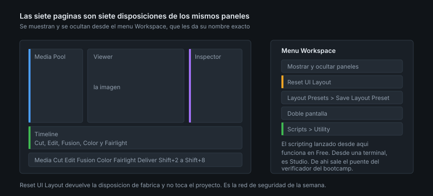

# El espacio de trabajo

> Las siete páginas no son siete programas cerrados: son siete disposiciones de los
> mismos paneles. Cuando dejas de pelearte con la interfaz y empiezas a colocarla,
> Resolve pasa de sentirse enorme a sentirse tuyo.

## 🎯 Objetivos

- Entender qué es un **panel** y cómo se muestra y se oculta en cada página
- Guardar y recuperar **layouts** propios
- Recuperar la interfaz cuando la has descolocado, sin tocar el proyecto
- Trabajar con **dos pantallas** si las tienes
- Saber dónde vive el menú **Scripts**, que es lo que hace funcionar el verificador
- Comprobar **en tu propia instalación** qué es Free y qué es Studio

---

## 1. Qué problema resuelve

En la Semana 01 recorriste las siete páginas y aprendiste a saltar entre ellas con
`Shift+2` a `Shift+8`. Eso resuelve moverse. No resuelve lo otro: que en la página Color
quieres los scopes grandes y el media pool cerrado, y en la página Edit quieres justo lo
contrario.

Resolve guarda esa disposición por página y te deja guardar la tuya. Configurarlo una
vez ahorra un minuto cada sesión durante nueve meses, y —más importante— evita el
momento de "he tocado algo y ahora no encuentro la timeline".

---

## 2. Paneles

Un **panel** es cada una de las zonas de la interfaz: el media pool, el viewer, el
inspector, la timeline, los scopes, el mezclador, el editor de nodos. Cada página tiene
los suyos, y casi todos se pueden mostrar y ocultar.

Hay dos formas de hacerlo:

1. Los **botones de la barra superior** de cada página, que encienden y apagan los
   paneles de esa página
2. El menú **`Workspace`**, que lista lo mismo con su nombre escrito

Para alguien que empieza, el menú es mejor: los botones no llevan etiqueta y se
aprenden a base de pulsarlos a ver qué pasa. `Workspace` te dice el nombre exacto de
cada cosa, que es el que usa el manual y el que usa este bootcamp.

---

## 3. Layouts

Un **layout** es la disposición completa de los paneles: cuáles están visibles y qué
tamaño tiene cada uno.

| Acción | Ruta | Qué hace |
| ------ | ---- | -------- |
| Volver al layout de fábrica | `Workspace > Reset UI Layout` | Devuelve la disposición por defecto. **No toca el proyecto** |
| Guardar el tuyo | `Workspace > Layout Presets > Save Layout Preset` | Lo guarda con un nombre |
| Recuperar uno guardado | `Workspace > Layout Presets` | Aparece en la lista, con su nombre |

`Reset UI Layout` es la red de seguridad de esta semana. Cuando algo se descoloque —y
se va a descolocar— esa es la salida, y no toca ni un frame de tu trabajo.

> [!TIP]
> Merece la pena guardar dos layouts pronto: uno de **montaje** (media pool y timeline
> grandes) y otro de **revisión** (viewer a pantalla casi completa). En la Semana 17,
> con los scopes colocados donde los quieres, agradecerás tener el hábito.

Los layouts son **de tu máquina**, no del proyecto: viven en la carpeta `Preferences`
que viste en la [teoría 05](05-preferences-los-ajustes-de-tu-ordenador.md) y no viajan
en el `.drp`.

---

## 4. Dos pantallas

Si tienes dos monitores, Resolve puede repartirse entre ellos: la interfaz de trabajo en
uno y los viewers o los scopes en el otro. Se activa desde el menú `Workspace`, en su
sección de pantallas.

No hace falta para el bootcamp, y no es la mejor inversión si tienes que elegir: **un
monitor bien calibrado vale más que dos sin calibrar**, y eso se verá en la Semana 16.

> [!NOTE]
> Si no encuentras una opción del menú `Workspace` donde este material la sitúa, no la
> busques a ojo por los menús: escribe su nombre en el buscador de
> `Keyboard Customization`. Te dice dónde está y qué atajo tiene en **tu** instalación,
> que es la que manda.

---

## 5. El menú Scripts

`Workspace > Scripts` lista los scripts de Python y Lua instalados, agrupados por
carpeta. De ahí sale el submenú `Utility`, y de ahí el **puente** que hace funcionar el
verificador del bootcamp.

Merece la pena entender por qué está justo ahí:

> [!IMPORTANT]
> **Studio** · El scripting **externo** —lanzar un script contra Resolve desde una
> terminal— es de DaVinci Resolve Studio. El scripting **interno** —un script arrancado
> desde `Workspace > Scripts`— funciona en Free.
>
> Por eso el autograding del bootcamp está partido en dos: un puente que corre **dentro**
> de Resolve y un cliente que le pregunta desde fuera por HTTP. Es lo que permite que
> las 36 semanas se corrijan solas en la versión gratuita. Está explicado entero en
> [`docs/autograding.md`](../../../docs/autograding.md), y se construye a mano en las
> Semanas 31 a 34.

---

## 6. Saber qué tienes: Free o Studio

Todo el material del bootcamp marca las funciones de pago con su bloque de aviso. Pero
la fuente de verdad sobre tu instalación es tu instalación.

### Qué versión tienes

`Help > About DaVinci Resolve`. Si el nombre dice **DaVinci Resolve Studio**, tienes la
de pago. Si dice solo **DaVinci Resolve**, tienes la gratuita, que es la que asume este
bootcamp.

Y por script, que es lo que hace el verificador: la operación `ping` del puente devuelve
`product` y `resolve_version`. En la instalación con la que se escribió este material
devuelve `"product": "DaVinci Resolve"` y `"resolve_version": "21.0.4.5"`.
*Verificado en agosto de 2026.*

### Cómo se ve una función de Studio en Free

De tres maneras, según el sitio:

| Cómo aparece | Dónde suele pasar |
| ------------ | ----------------- |
| El control existe pero está **atenuado** y no responde | Paneles de efectos y de color |
| Aparece un **aviso** al intentar usarlo | Reducción de ruido, Magic Mask |
| La opción **no está en la lista** | Codecs y resoluciones de render, en la página Deliver |

El tercero es el más engañoso porque no parece un límite de versión: parece que tu
máquina no puede. Por eso la regla de la Semana 02 sigue valiendo: **lo que veas en tus
propios desplegables de `Render Settings` es la verdad de tu instalación**.

### El mapa completo

El reparto entre versiones, semana a semana y con la alternativa en Free de cada
función, está en [`docs/free-vs-studio.md`](../../../docs/free-vs-studio.md). Esta
semana lo lees entero de una vez; después lo consultarás cuando una semana lo mencione.

**Ningún entregable evaluable del bootcamp depende de Studio.**

---

## 7. Antipatrones

| Antipatrón | Por qué duele | Qué hacer |
| ---------- | ------------- | --------- |
| Recolocar los paneles a mano en cada sesión | Un minuto perdido cada día durante nueve meses | Guarda un layout preset |
| Pelearse con una interfaz descolocada | Media hora buscando un panel que estaba oculto | `Workspace > Reset UI Layout` |
| Aprender los paneles por los iconos de la barra | No llevan etiqueta y se aprenden a base de prueba y error | Míralos en el menú `Workspace`, con su nombre |
| Comprar Studio antes de saber qué te falta | Se paga por funciones que no eres capaz de aprovechar todavía | Haz el bootcamp en Free y decide en la Semana 22 |
| Suponer que un codec ausente en Deliver es culpa de tu máquina | Se pierde una tarde buscando drivers | Comprueba primero si es una función de Studio |
| Guardar layouts y esperar encontrarlos en otro ordenador | Los layouts son de la máquina, no del proyecto | Copia la carpeta `Preferences` si te mudas |

---

## 8. Trucos

| Truco | Cómo |
| ----- | ---- |
| Recuperar una interfaz destrozada | `Workspace > Reset UI Layout`. No toca el proyecto |
| Tener un layout de montaje y otro de revisión | `Workspace > Layout Presets > Save Layout Preset`, uno para cada uno |
| Saber el nombre exacto de un panel | Míralo en el menú `Workspace`, no en los iconos |
| Encontrar cualquier comando de la aplicación | El buscador de `Keyboard Customization` |
| Saber si tienes Free o Studio en dos segundos | `Help > About DaVinci Resolve` |
| Saber qué codecs escribe **tu** instalación | Página Deliver, `Render Settings`, desplegables `Format` y `Codec` |

---

## 📚 Recursos Adicionales

- [DaVinci Resolve Reference Manual](https://www.blackmagicdesign.com/support/family/davinci-resolve-and-fusion) — el capítulo de la interfaz recorre panel a panel cada página y da el nombre oficial de cada zona.
- [`docs/free-vs-studio.md`](../../../docs/free-vs-studio.md) — el reparto completo entre versiones, con la alternativa en Free de cada función de pago y la semana en la que aparece.
- [`docs/atajos-de-teclado.md`](../../../docs/atajos-de-teclado.md) — cómo se buscan los atajos en `Keyboard Customization` y por qué conviene no importar el esquema de otro editor si empiezas de cero.

---

## ✅ Checklist de Verificación

- [ ] Sé mostrar y ocultar paneles desde el menú `Workspace`
- [ ] Sé guardar un layout propio y volver a él
- [ ] Sé recuperar la interfaz de fábrica sin tocar mi proyecto
- [ ] Sé dónde está el menú `Scripts` y por qué el puente vive ahí
- [ ] Sé qué versión de Resolve tengo instalada
- [ ] Sé reconocer una función de Studio de las tres formas en que aparece
- [ ] He leído entero `docs/free-vs-studio.md`
