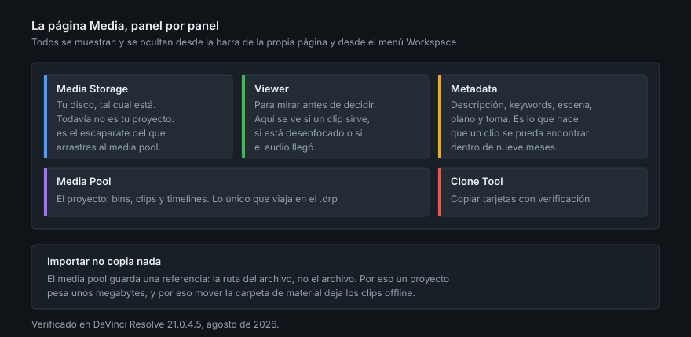

# La página Media

> Es la única página del programa que mira **fuera** de tu proyecto. Las otras seis
> trabajan con lo que ya está dentro; esta decide qué entra, cómo entra y con qué
> nombre. Todo lo que hagas mal aquí lo pagas seis páginas más adelante.

## 🎯 Objetivos

- Reconocer los cinco paneles de la página Media y para qué sirve cada uno
- Entender qué hace Resolve exactamente cuando dices "importar"
- Explicar por qué un proyecto pesa megabytes y tu material pesa gigabytes
- Saber cuándo se usa esta página y cuándo no hace falta
- Mostrar y ocultar paneles sin perderte

---

## 1. Qué problema resuelve

Tienes 60 GB repartidos en tres tarjetas, dos carpetas de descargas y un disco externo.
Resolve no sabe nada de eso. La página Media es donde se cierra esa distancia: se mira
el disco, se decide qué material entra en el proyecto y se le pone encima la
información que hará que dentro de nueve meses se pueda encontrar.

Hay una razón para que sea la **primera** página de la barra, antes que Cut y que Edit:
en un trabajo real se pasa por aquí antes que por ninguna otra, y a menudo no se vuelve.
Lo que no organices hoy se organiza igual, pero en la semana doce y con doscientos
clips.

> [!NOTE]
> **Ingestar** (*ingest*) es la palabra del oficio para todo este proceso: copiar el
> material del sitio donde se grabó a un sitio seguro, comprobar que la copia es buena,
> meterlo en el proyecto y describirlo. No es "arrastrar archivos". Arrastrar archivos
> es uno de los cinco pasos, y el más fácil.

---

## 2. Cómo funciona: los cinco paneles

Se llega con `Shift+2`, o pulsando `Media` en la barra de páginas de abajo.

### Media Storage

El navegador de **tu disco**. Muestra volúmenes y carpetas tal y como están, con
miniaturas. Es un escaparate: lo que ves aquí **todavía no está en tu proyecto**.

La lista de sitios que aparece sale de `Preferences > System > Media Storage`, que ya
configuraste en la Semana 03. De ahí la importancia que se le dio entonces.

### Viewer

Para mirar un clip **antes** de decidir si entra. Suena obvio y casi nadie lo hace: se
importa todo, se descubre en el montaje que la mitad está desenfocada, y se ha perdido
una hora organizando material que iba a la basura.

### Media Pool

**El proyecto.** Los bins, los clips y las timelines. Es lo único de esta página que
viaja dentro del `.drp` que exportas.

Ojo a la diferencia con Media Storage, que es la que más confusión genera al empezar:

| | Media Storage | Media Pool |
| --- | ------------- | ---------- |
| Qué muestra | Tu disco | Tu proyecto |
| Quién lo cambia | El sistema operativo | Tú, desde Resolve |
| Borrar algo aquí | Borra el archivo del disco | Quita la referencia; el archivo se queda |
| Viaja en el `.drp` | No | Sí |

### Metadata

Los campos que describen cada clip: qué se ve, de qué escena es, qué palabras clave le
pones. Se trata a fondo en la [teoría 06](06-metadata.md). Aquí basta con saber que este
panel es el que convierte una carpeta de archivos en un archivo consultable.

### Clone Tool

Copiar tarjetas **con verificación**. Es la única herramienta de la página que escribe
en tu disco de verdad, y la única que no tiene equivalente en el explorador de archivos
de tu sistema. Es la [teoría 03](03-el-clone-tool.md).

> [!TIP]
> Todos los paneles se muestran y se ocultan desde la barra de la propia página, y
> también desde el menú `Workspace`. Si un panel desaparece y no lo encuentras,
> `Workspace > Reset UI Layout` lo devuelve todo a su sitio sin tocar el proyecto.

---

## 3. Qué pasa exactamente cuando importas

Esto es lo más importante de la semana, y se dijo ya en la
[Semana 03](../../week-03-resolve_21_anatomia_bases_de_datos_y_preferencias/1-teoria/01-el-modelo-de-datos-de-resolve.md):

**Importar no copia el archivo. Escribe una referencia.**

Una **referencia** es una anotación de dónde está el archivo: su ruta en el disco. El
media pool guarda esa ruta, más lo que Resolve ha leído del archivo (duración, codec,
resolución, frame rate) y lo que escribas tú encima (nombre, keywords, color).

De ahí salen tres consecuencias que gobiernan todo el bootcamp:

1. **Importar es instantáneo**, incluso con 200 archivos: no se mueve ni un byte de
   vídeo.
2. **Mover o renombrar la carpeta de material rompe el enlace.** Los clips aparecen
   como *offline*: en rojo, sin imagen. No has perdido trabajo —los cortes y los grados
   siguen ahí—, has roto una ruta.
3. **Tu proyecto no es tu material.** Un `.drp` de 4 MB no sirve de nada en un
   ordenador que no tenga los archivos.

> [!IMPORTANT]
> Antes de importar nada, el material tiene que estar **en su sitio definitivo**. Si
> importas desde la carpeta de descargas y luego ordenas el disco, dejas todos los clips
> *offline*. Copia primero, ordena después, importa al final. Ese es el orden entero de
> la ingesta y el motivo de que el clone tool venga antes que la importación.

---

## 4. Cuándo se usa esta página y cuándo no

**Se usa** al empezar un proyecto, cada vez que llega material nuevo, cuando hay que
reorganizar bins, cuando hay que escribir metadata en tanda y cuando algo se queda
*offline* y hay que volver a enlazarlo.

**No se usa** para montar. Se puede arrastrar un clip del media pool a la timeline desde
la página Edit sin pasar por aquí, y es lo normal: el media pool está disponible en Cut,
Edit, Fusion y Fairlight. Esta página existe para las tareas que necesitan ver **el
disco y el proyecto a la vez**.

> [!NOTE]
> La página **Cut** tiene su propia forma de importar, pensada para ir rápida, y la
> Semana 06 la explica. Las dos meten clips en el mismo media pool: no son dos
> proyectos, son dos formas de entrar al mismo sitio.

---

## 5. El orden de la ingesta

Los cinco pasos, en el orden en el que hay que hacerlos. Cada uno depende del anterior,
y saltarse uno se paga siempre en el mismo sitio: tres meses después.

| # | Paso | Dónde se hace | Qué pasa si te lo saltas |
| - | ---- | ------------- | ------------------------ |
| 1 | **Copiar** el material a su sitio definitivo, con verificación | Clone Tool | Trabajas sobre el original de la tarjeta, que se va a formatear |
| 2 | **Comprobar** que la copia es buena | Clone Tool, o `preparar-medios.sh --sellar` | Un archivo corrupto que no se nota hasta el minuto tres |
| 3 | **Importar** al media pool | Media Storage | — |
| 4 | **Organizar** en bins | Media Pool | Doscientos clips en la raíz, imposibles de encontrar |
| 5 | **Describir** con metadata y keywords | Panel Metadata | No puedes buscar nada, y los smart bins salen vacíos |

Los pasos 1 y 2 se hacen **una sola vez** por tarjeta, y son irreversibles en el sentido
que importa: una vez formateada la tarjeta, lo que no copiaste no vuelve. Los pasos 4 y
5 se pueden rehacer siempre, pero cuestan diez veces más con el proyecto avanzado.

Esta semana recorre los cinco en ese orden: teorías 02 y 03 para copiar y comprobar,
teorías 04 y 05 para organizar, y teorías 06 a 08 para describir y encontrar.

---

## 6. Antipatrones

| Antipatrón | Por qué duele | Qué hacer |
| ---------- | ------------- | --------- |
| Importar directamente desde la tarjeta de la cámara | Trabajas sobre el único original que existe, y la tarjeta se va a formatear | Copiar con el clone tool primero, importar desde el disco de trabajo |
| Importar desde la carpeta de descargas y ordenar después | Todos los clips se quedan *offline* | El material va a su sitio definitivo antes de importarse |
| Importar los 200 archivos y mirarlos luego | Se organiza material que va a la basura | Mirar en el viewer, importar lo que sirve, y lo dudoso a un bin de descartes |
| Confundir Media Storage con el media pool | Se borra un archivo del disco creyendo que se saca del proyecto | Media Storage es el disco; el media pool es el proyecto |
| Buscar el material dentro de la carpeta del proyecto | Ahí no está: el proyecto solo guarda rutas | El material está donde tú lo pusiste |
| Renombrar archivos en el disco después de importarlos | Clips *offline* sin motivo aparente | Los nombres definitivos se ponen antes de importar |

---

## 7. Trucos

| Truco | Cómo |
| ----- | ---- |
| Ir a la página Media sin ratón | `Shift+2` |
| Recuperar un panel que ha desaparecido | `Workspace > Reset UI Layout`: no toca el proyecto, solo la disposición |
| Ver un clip sin importarlo | Selecciónalo en Media Storage y míralo en el viewer |
| Saber si un clip está *offline* sin abrirlo | En el media pool sale en rojo y el viewer muestra `Media Offline` |
| Comprobar de dónde lee Resolve | `Preferences > System > Media Storage`: la primera entrada de la lista |
| Trabajar con el media pool sin salir de Edit | Está también ahí; esta página es para ver disco y proyecto a la vez |

---

## 📚 Recursos Adicionales

- [DaVinci Resolve Reference Manual](https://www.blackmagicdesign.com/support/family/davinci-resolve-and-fusion) — el capítulo *Media Page* recorre los paneles uno a uno con las capturas de tu versión exacta. Es la fuente de verdad cuando un rótulo no coincida con lo que lees aquí.
- [Semana 03 · El modelo de datos de Resolve](../../week-03-resolve_21_anatomia_bases_de_datos_y_preferencias/1-teoria/01-el-modelo-de-datos-de-resolve.md) — las tres capas, la referencia y el clip *offline*, explicados desde cero.
- [`docs/pack-de-medios.md`](../../../docs/pack-de-medios.md) — de dónde sale el material del bootcamp y cómo se sella para que no se corrompa en silencio.

---

## ✅ Checklist de Verificación

- [ ] Sé nombrar los cinco paneles de la página Media
- [ ] Distingo Media Storage del media pool, y sé qué pasa al borrar en cada uno
- [ ] Sé explicar por qué importar es instantáneo
- [ ] Sé qué es un clip *offline* y cómo se provoca sin querer
- [ ] Sé que el material va a su sitio definitivo **antes** de importarse
- [ ] Sé recuperar un panel perdido sin tocar el proyecto

---

| Anterior | Actual | Siguiente |
| -------- | ------ | --------- |
| — | **01 · La página Media** | [02 · Media Storage: de dónde lee Resolve](02-media-storage.md) |

← [Volver a la Semana 04](../README.md)
