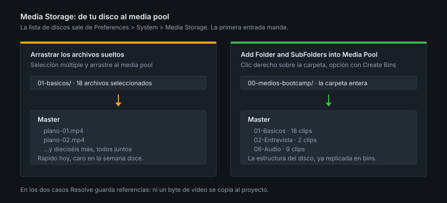

# Media Storage: de dónde lee Resolve

> El panel que enseña tu disco dentro de Resolve. Parece un explorador de archivos
> cualquiera y hace dos cosas que ningún explorador hace: decide dónde escribe el
> programa por defecto y sabe replicar tu estructura de carpetas en bins sin que muevas
> un archivo.

## 🎯 Objetivos

- Distinguir el **panel** Media Storage de la **lista** de Preferences que lo alimenta
- Añadir y ordenar ubicaciones, y saber qué implica ser la primera de la lista
- Meter material en el proyecto de las tres formas posibles, y elegir cuál toca
- Usar `Add Folder and SubFolders into Media Pool` para heredar la estructura del disco
- Saber por qué el orden importa: primero el disco ordenado, luego la importación

---

## 1. Qué problema resuelve

Un explorador de archivos te enseña nombres. Para decidir si un plano sirve necesitas
verlo, y para importarlo necesitas que Resolve sepa dónde está. Media Storage hace las
dos cosas: navega tu disco con miniaturas y previsualización, y es el sitio desde el
que el material entra al proyecto.

Y hace una tercera, menos visible y más importante: **la primera ubicación de la lista
es donde Resolve escribe todo lo que genera** si no le dices otra cosa. Caché, medios
optimizados, proxies y galería. Eso ya se explicó en la
[Semana 03](../../week-03-resolve_21_anatomia_bases_de_datos_y_preferencias/1-teoria/07-donde-escribe-resolve.md);
aquí se usa.

---

## 2. Dos cosas con el mismo nombre

| | El panel | La lista |
| --- | -------- | -------- |
| Dónde está | Página Media, panel `Media Storage` | `Preferences > System > Media Storage` |
| Qué es | Un navegador con miniaturas | Una lista ordenada de carpetas |
| Para qué | Mirar material y arrastrarlo al proyecto | Decir a Resolve qué discos te interesan y dónde escribir |
| Ámbito | La sesión | La máquina: es una preferencia, no viaja con el proyecto |

El panel muestra lo que la lista declara. Si un disco no aparece en el panel, casi
siempre es que no está en la lista.

### Añadir una ubicación

`Preferences > System > Media Storage`, botón de añadir, y eliges la carpeta. Con el
`BC-Resolve/` de la Semana 03 arriba del todo, ya tienes lo esencial. Añade también la
carpeta del pack de medios, `00-medios-bootcamp/`, para navegarla sin salir de Resolve.

> [!WARNING]
> Cambiar el **orden** de la lista cambia dónde escribe Resolve por defecto en los
> proyectos que no tengan Working Folders propias. Si subes un disco lento o pequeño al
> primer puesto, la caché empieza a caer ahí sin avisar. Si tocas el orden, comprueba
> después `Project Settings > Master Settings > Working Folders`.

> [!NOTE]
> Algunos cambios de esta pestaña piden reiniciar Resolve para tomar efecto. Si acabas
> de añadir un disco y no aparece en el panel, ciérralo y ábrelo antes de dar por hecho
> que algo va mal.

---

## 3. Las tres formas de meter material

### A · Arrastrar archivos sueltos

Seleccionas uno o varios en el panel y los arrastras al media pool. Entran **en el bin
que tengas seleccionado**.

Para cuándo: unos pocos archivos, o cuando quieres decidir uno a uno.

### B · `Add Folder into Media Pool`

Clic derecho sobre una carpeta en Media Storage. Mete el contenido de esa carpeta —solo
esa, sin bajar a las subcarpetas— en el bin seleccionado.

Para cuándo: una carpeta plana que ya corresponde a un bin.

### C · `Add Folder and SubFolders into Media Pool`

La misma carpeta, pero recorriendo todo lo que cuelga de ella, y **creando un bin por
cada subcarpeta**. Tu estructura de disco se convierte en tu estructura de bins de una
vez.

Para cuándo: la primera ingesta de un proyecto, si el disco ya está ordenado. Es la que
usarás en la práctica 01, porque el pack de medios ya viene con sus siete carpetas
numeradas.

> [!IMPORTANT]
> Esta opción es la que convierte el orden del disco en orden del proyecto. Por eso el
> trabajo de ordenar carpetas **antes** de importar no es trabajo perdido: se cobra
> entero aquí. Un disco desordenado produce un proyecto desordenado en un solo clic.

> [!NOTE]
> Los rótulos exactos de estas opciones del menú contextual están escritos tal y como
> aparecen en la instalación de referencia de este bootcamp. Si en la tuya cambian de
> redacción, la operación es la misma; el capítulo *Media Page* del
> [manual oficial](https://www.blackmagicdesign.com/support/family/davinci-resolve-and-fusion)
> los lista con las capturas de tu versión.

### Y la cuarta, que no es de esta página

`File > Import > Media…` abre el diálogo del sistema operativo. Funciona desde cualquier
página y no necesita que el disco esté en Media Storage. Es la vía rápida para un
archivo suelto que está en un sitio raro.

---

## 4. Lo que ninguna de las tres hace

Ninguna copia archivos. Las cuatro escriben referencias, y las cuatro dejan el material
exactamente donde estaba.

Esto tiene una consecuencia práctica que sorprende a todo el mundo la primera vez:
**puedes importar desde una tarjeta de memoria, y el proyecto funcionará hasta que
saques la tarjeta.** En cuanto la saques, todos esos clips quedan *offline*. No es un
fallo: es exactamente lo que pedía la referencia que escribiste.

Por eso el orden de la ingesta es copiar, comprobar y luego importar. Nunca al revés.

---

## 5. Antes de importar: cómo se llaman los archivos

El nombre del archivo es lo primero que ves en el media pool y lo que sale en la columna
`File Name` durante nueve meses. Cambiarlo **después** de importar rompe el enlace y
deja el clip *offline*, así que es ahora o nunca.

> [!IMPORTANT]
> Renombrar un clip **dentro** del media pool no toca el archivo del disco: cambia solo
> la etiqueta que muestra Resolve, y es inofensivo. Renombrar el archivo **en el disco**
> después de haberlo importado sí rompe la referencia. Son dos operaciones distintas con
> la misma palabra.

Tres reglas que se pagan solas:

1. **Sin acentos, sin eñes y sin espacios.** No es purismo: el material acaba viajando
   a otro sistema operativo, a un disco de red o a un script, y ahí los caracteres
   fuera del inglés y los espacios se convierten en errores raros de diagnosticar. Usa
   guiones: `entrevista-ana-toma03.mp4`.
2. **Números con ceros delante.** `plano-02` y no `plano-2`. Sin el cero, cualquier
   ordenación alfabética coloca el `plano-10` justo detrás del `plano-1`.
3. **Fecha en formato `AAAA-MM-DD`** si el nombre lleva fecha. Es el único formato que
   se ordena solo, y el que ya usan las grabaciones de OBS que viste en la Semana 02.

Lo que **no** hace falta es un sistema de nombres elaborado. El nombre del archivo
identifica; describir es trabajo de la metadata, que sí se puede cambiar cuando quieras
y que es la [teoría 06](06-metadata.md).

---

## 6. Antipatrones

| Antipatrón | Por qué duele | Qué hacer |
| ---------- | ------------- | --------- |
| Importar desde la tarjeta "para ir mirando" | Al sacarla, medio proyecto se queda *offline* | Copiar al disco de trabajo primero |
| Arrastrar 200 archivos sueltos al bin raíz | Toda la estructura hay que hacerla a mano después | Ordena el disco y usa `Add Folder and SubFolders into Media Pool` |
| Meter el disco del sistema como primera entrada de la lista | La caché se genera donde vive el sistema operativo | La primera entrada es tu disco de trabajo |
| Cambiar el orden de la lista sin revisar nada más | Los proyectos sin Working Folders propias cambian de sitio de escritura | Revisa `Working Folders` después de tocar el orden |
| Importar con un bin cualquiera seleccionado | El material cae en el bin equivocado y hay que moverlo | Mira qué bin está activo antes de soltar |
| Reorganizar el disco después de importar | Clips *offline* en masa | El disco se ordena antes. Siempre |

---

## 7. Trucos

| Truco | Cómo |
| ----- | ---- |
| Heredar la estructura de carpetas del disco | Clic derecho sobre la carpeta en Media Storage > `Add Folder and SubFolders into Media Pool` |
| Ver un clip antes de importarlo | Selecciónalo en Media Storage: aparece en el viewer sin entrar al proyecto |
| Navegar un disco que no aparece en el panel | Añádelo en `Preferences > System > Media Storage` y reinicia Resolve |
| Importar algo que está en un sitio raro | `File > Import > Media…`, que usa el diálogo del sistema |
| Comprobar dónde va a escribir Resolve | La primera entrada de la lista, salvo que el proyecto tenga Working Folders propias |
| Saber si un clip vive en una tarjeta | Mira la columna `File Path` en la vista de lista del media pool |

---

## 📚 Recursos Adicionales

- [DaVinci Resolve Reference Manual](https://www.blackmagicdesign.com/support/family/davinci-resolve-and-fusion) — el capítulo *Media Page* documenta el panel y todas las opciones del menú contextual de Media Storage con los rótulos de tu versión.
- [Semana 03 · Dónde escribe Resolve](../../week-03-resolve_21_anatomia_bases_de_datos_y_preferencias/1-teoria/07-donde-escribe-resolve.md) — por qué la primera entrada de la lista decide dónde caen la caché, los proxies y la galería.
- [`docs/pack-de-medios.md`](../../../docs/pack-de-medios.md) — la estructura de carpetas que este bootcamp asume, y que es la que se replica en bins.

---

## ✅ Checklist de Verificación

- [ ] Distingo el panel Media Storage de la lista de Preferences
- [ ] Sé añadir una ubicación y sé qué implica ponerla la primera
- [ ] Conozco las tres formas de meter material y sé cuál toca en cada caso
- [ ] Sé que ninguna de ellas copia archivos
- [ ] Sé por qué el disco se ordena **antes** de importar
- [ ] Sé mirar qué bin está activo antes de soltar material

---

| Anterior | Actual | Siguiente |
| -------- | ------ | --------- |
| [01 · La página Media](01-la-pagina-media.md) | **02 · Media Storage: de dónde lee Resolve** | [03 · El Clone Tool: copiar con verificación](03-el-clone-tool.md) |

← [Volver a la Semana 04](../README.md)
