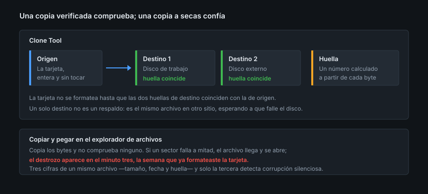

# El Clone Tool: copiar con verificación

> Copiar y pegar mueve los bytes y no comprueba ninguno. El día que uno de esos bytes
> llega mal, el archivo se abre igual, se importa igual y falla en el minuto tres, la
> semana en la que ya formateaste la tarjeta. El clone tool existe para cerrar ese
> agujero.

## 🎯 Objetivos

- Explicar qué es una **huella** (*checksum*) y por qué detecta lo que el tamaño no
- Reconocer la **corrupción silenciosa** y por qué el explorador de archivos no la ve
- Usar el Clone Tool para copiar una tarjeta a dos destinos a la vez
- Aplicar la regla de no formatear nunca hasta tener dos copias verificadas
- Sellar el material del bootcamp con `preparar-medios.sh --sellar`

---

## 1. Qué problema resuelve

Una copia puede fallar sin que nadie se entere. Un cable USB flojo, un sector del disco
que empieza a morirse, una copia interrumpida que el sistema da por buena, una tarjeta
que se sacó medio segundo antes de tiempo. El resultado es un archivo del tamaño
correcto, con la fecha correcta, que se abre y se reproduce, y que tiene un trozo
destrozado en algún punto.

Eso es la **corrupción silenciosa**: un daño que no produce ningún mensaje de error. Se
descubre montando, y para entonces la tarjeta lleva tres semanas grabando otra cosa.

El Clone Tool no evita el fallo. Lo que hace es **detectarlo mientras todavía tienes el
original**, que es la única ventana en la que se puede arreglar.

---

## 2. Cómo funciona: la huella



Una **huella** (*checksum* o *hash*) es un número que se calcula leyendo **todos** los
bytes de un archivo y pasándolos por una fórmula fija. Tiene dos propiedades:

- El mismo archivo da siempre la misma huella.
- Cambiar **un solo bit** del archivo da una huella completamente distinta.

Se calcula la huella en origen, se calcula en destino y se comparan. Si coinciden, la
copia es idéntica byte a byte. Si no, algo se rompió por el camino y lo sabes ahora.

Las tres formas de comparar dos archivos, de menos a más fiable:

| Comparación | Detecta | No detecta |
| ----------- | ------- | ---------- |
| **Tamaño** | Copias truncadas | Nada más |
| **Tamaño y fecha** | Truncadas y sustituciones evidentes | Cualquier cambio interno |
| **Huella** | Cualquier diferencia, hasta de un bit | — |

> [!NOTE]
> Verás nombres de familias de huellas: `MD5`, `SHA-1`, `SHA-256`, `xxHash`. Se
> diferencian en velocidad y en resistencia a que alguien fabrique a propósito dos
> archivos con la misma huella. Para detectar corrupción accidental **cualquiera de las
> cuatro sirve**; ese ataque deliberado no es tu problema aquí. Si puedes elegir y el
> volumen es grande, `xxHash` es el más rápido con diferencia.

---

## 3. Cómo se hace en Resolve 21

El Clone Tool es un panel de la página Media. Se muestra y se oculta desde la barra de
la página, igual que los demás.

El flujo es siempre el mismo:

1. Se **añade un trabajo** (*job*) nuevo en el panel.
2. Se arrastra la **carpeta de origen** —la tarjeta entera, no los archivos sueltos— a
   la zona de origen del trabajo.
3. Se arrastra el **destino**. Se pueden añadir **varios destinos al mismo trabajo**, y
   ese es el motivo principal para usar esta herramienta.
4. Se lanza la clonación y se espera.
5. Al terminar, el panel informa de si la verificación fue correcta.

> [!IMPORTANT]
> **La tarjeta entera, no los archivos de vídeo.** Las cámaras guardan al lado de cada
> clip archivos de índice, de audio y de metadata que el material necesita para
> reconstruirse. Copiar solo los `.mp4` que ves funciona con un móvil y rompe el
> material de cualquier cámara que grabe en una estructura de carpetas propia. Se clona
> el volumen completo.

> [!NOTE]
> El método de verificación se elige entre las opciones del propio panel. Los rótulos
> concretos de ese menú **no se han podido comprobar por la API de scripting**, que es
> lo único que este bootcamp puede verificar de forma automática; el capítulo
> *Media Page* del
> [manual oficial](https://www.blackmagicdesign.com/support/family/davinci-resolve-and-fusion)
> los recoge con las capturas de tu versión. Lo que sí importa y no cambia es el
> concepto: la copia se comprueba, y no se formatea nada hasta que la comprobación
> pasa.

### La alternativa del bootcamp

El material de este bootcamp no viene de tarjetas: se descarga. Para eso el repositorio
trae su propia herramienta, que hace lo mismo con `sha256`:

```bash
./scripts/preparar-medios.sh --sellar   # calcula y guarda las huellas
./scripts/preparar-medios.sh            # comprueba que nada ha cambiado
```

El primer comando escribe `MANIFIESTO.sha256` con la huella de cada archivo del pack.
El segundo las recalcula y te dice, por nombre, cuál ha cambiado. Es la misma idea con
otra interfaz, y funciona igual en Free.

---

## 4. La regla de las dos copias

Una copia no es un respaldo. Es el mismo archivo en otro sitio, esperando a que falle
ese sitio.

> [!WARNING]
> **No formatees una tarjeta hasta tener dos copias verificadas en dos discos
> distintos.** Es la única regla irreversible de la ingesta: una tarjeta formateada no
> se deshace, y el material de un rodaje no se vuelve a grabar. Dos destinos en el mismo
> trabajo del Clone Tool, y la tarjeta sale de la cámara solo cuando los dos han
> terminado bien.

La versión completa de esta idea se llama **regla 3-2-1**: tres copias del material, en
dos tipos de soporte distintos, y una de ellas fuera del edificio. Para un bootcamp en
casa, con dos discos ya vas muy por delante de la media.

---

## 5. Si no grabas con tarjeta: móvil, OBS y descargas

La mayoría de quien hace este bootcamp no viene de un rodaje con tarjetas. El principio
no cambia, pero el flujo sí.

### Desde el móvil

El móvil es un origen igual de frágil que una tarjeta: se llena, se borra por error y se
sincroniza con una nube que renombra archivos al resolver conflictos. Saca el material a
tu disco de trabajo el mismo día, y **no lo importes desde la carpeta sincronizada de la
nube**: un servicio que descarga archivos bajo demanda deja clips *offline* de forma
intermitente, que es la clase de fallo más difícil de diagnosticar.

### Desde OBS

> [!IMPORTANT]
> **Resolve no importa `.mkv`.** Si grabas pantalla con OBS y no has cambiado el ajuste,
> tus grabaciones son `.mkv` y el media pool no las va a aceptar. La solución está en el
> propio OBS: `Ajustes > Avanzado > Grabación`, activa el remuxeado automático a `.mp4`.
> Lo que ya esté grabado se convierte sin recomprimir con
> `ffmpeg -i entrada.mkv -c copy salida.mp4`. La Semana 02 explica por qué eso no pierde
> ni un bit de calidad.

### Desde una descarga

Es el caso del pack de medios del bootcamp. Una descarga interrumpida produce
exactamente la misma corrupción silenciosa que un cable flojo, así que el trato es el
mismo: en cuanto termine la descarga, `./scripts/preparar-medios.sh --sellar`. A partir
de ahí, cualquier sospecha se resuelve con una comprobación de treinta segundos en vez
de con una tarde mirando el clip fotograma a fotograma.

---

## 6. Antipatrones

| Antipatrón | Por qué duele | Qué hacer |
| ---------- | ------------- | --------- |
| Copiar la tarjeta arrastrando en el explorador | No comprueba nada; la corrupción aparece semanas después | Clone Tool, o una herramienta de copia verificada |
| Copiar solo los archivos de vídeo que se ven | Se pierden índices y metadata que la cámara necesita | Se clona la tarjeta entera |
| Formatear la tarjeta el mismo día, "que ya está copiada" | Si la copia salió mal, no hay marcha atrás | Dos copias verificadas antes de formatear |
| Un solo destino | Ese disco también se puede morir | Dos destinos en el mismo trabajo |
| Los dos destinos en el mismo disco físico | Dos particiones no son dos discos | Dos unidades distintas |
| Sellar el pack "cuando tenga tiempo" | Un manifiesto hecho tarde sella también lo que ya se corrompió | `--sellar` justo al terminar la descarga |
| Fiarse del tamaño y la fecha | No detectan un archivo dañado por dentro | Huella, siempre |

---

## 7. Trucos

| Truco | Cómo |
| ----- | ---- |
| Copiar a dos discos en una sola pasada | Añade dos destinos al mismo trabajo del Clone Tool |
| Comprobar el pack de medios del bootcamp | `./scripts/preparar-medios.sh`, sin argumentos |
| Sellar el pack recién descargado | `./scripts/preparar-medios.sh --sellar` |
| Saber si un disco externo está fallando | Si la verificación falla en archivos distintos cada vez, sospecha del cable antes que del disco |
| Copiar rápido y comprobar igual | Elige `xxHash` si tu herramienta lo ofrece: es el más rápido de los cuatro |
| No perder la trazabilidad de una tarjeta | Nombra la carpeta de destino con la fecha en `AAAA-MM-DD` y la cámara |

---

## 📚 Recursos Adicionales

- [DaVinci Resolve Reference Manual](https://www.blackmagicdesign.com/support/family/davinci-resolve-and-fusion) — el capítulo *Media Page* documenta el Clone Tool: cómo se añaden trabajos, cómo se ponen varios destinos y qué informa al terminar.
- [`docs/pack-de-medios.md`](../../../docs/pack-de-medios.md) — la sección de integridad explica por qué el manifiesto lo generas tú y no viene en el repositorio.
- [Semana 02 · Codecs, contenedores y flujo de datos](../../week-02-codecs_contenedores_y_flujo_de_datos/README.md) — cuánto ocupa realmente el material que vas a copiar, que es lo que decide cuántos discos necesitas.

---

## ✅ Checklist de Verificación

- [ ] Sé qué es una huella y por qué detecta lo que el tamaño no detecta
- [ ] Sé qué es la corrupción silenciosa y por qué no da ningún error
- [ ] Sé añadir un trabajo en el Clone Tool con **dos** destinos
- [ ] Sé que se clona la tarjeta entera, no los archivos de vídeo sueltos
- [ ] No formateo una tarjeta sin dos copias verificadas
- [ ] He sellado el pack de medios con `preparar-medios.sh --sellar`

---

| Anterior | Actual | Siguiente |
| -------- | ------ | --------- |
| [02 · Media Storage: de dónde lee Resolve](02-media-storage.md) | **03 · El Clone Tool: copiar con verificación** | [04 · El media pool y los bins](04-el-media-pool-y-los-bins.md) |

← [Volver a la Semana 04](../README.md)
