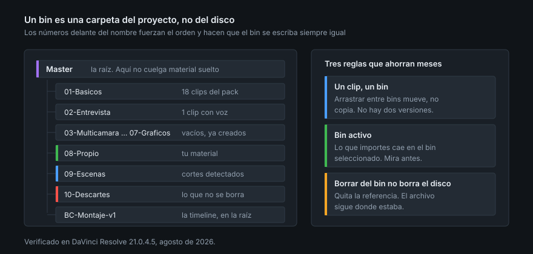

# El media pool y los bins

> Un bin es una carpeta que no existe en tu disco. Vive dentro del proyecto, no mueve ni
> un archivo cuando lo usas, y es lo único que separa doscientos clips de un montón de
> doscientos clips.

## 🎯 Objetivos

- Definir qué es un **bin** y en qué se diferencia de una carpeta del disco
- Reconocer el **bin Master** y por qué no se deja material colgando de él
- Crear, anidar, renombrar y mover bins sin romper nada
- Saber qué es el **bin activo** y por qué decide dónde cae lo que importas
- Distinguir *quitar del bin* de *borrar del disco*
- Diseñar una estructura de bins que aguante nueve meses

---

## 1. Qué problema resuelve

Con quince clips no hace falta organizar nada: se ven todos de un vistazo. Con
doscientos, encontrar "aquel plano de la calle mojada" pasa de tres segundos a tres
minutos, y eso multiplicado por las cien veces que buscas un plano en una semana es una
tarde entera.

Los bins no son un adorno de gente ordenada. Son el mecanismo por el que un proyecto
grande sigue siendo trabajable, y son además la base sobre la que funcionan los smart
bins, las búsquedas y el verificador de este bootcamp.

---

## 2. Qué es un bin, exactamente

**Bin** es la palabra que la industria del cine usaba para el cajón donde se colgaban
los trozos de película recortados. En Resolve es una **carpeta dentro del proyecto**.



| | Carpeta del disco | Bin |
| --- | ----------------- | --- |
| Dónde vive | En tu sistema de archivos | Dentro del proyecto de Resolve |
| Qué contiene | Archivos | Referencias a archivos, y timelines |
| Moverlo | Mueve datos de verdad | No toca el disco |
| Quién lo ve | Cualquier programa | Solo este proyecto |
| Viaja en el `.drp` | No | Sí |

Mover un clip de un bin a otro **no mueve nada en tu disco**. Es como cambiar una ficha
de sitio en un fichero: el libro sigue donde estaba.

### El bin Master

Es la raíz del media pool, y siempre existe. Todo lo demás cuelga de él.

La regla de oficio es sencilla: **en Master no se deja material suelto**. Se deja la
estructura de bins, y las timelines, y nada más. Un Master con clips sueltos es la
primera señal de un proyecto que se está desordenando.

> [!NOTE]
> Las **timelines también viven en el media pool**, como un elemento más. Se distinguen
> de los clips porque no tienen archivo detrás: si miras la columna `File Path` de una
> timeline, está vacía. Eso no es una curiosidad: es exactamente lo que usa el
> verificador de esta semana para contar clips reales sin contar timelines.
> *Verificado por la API de scripting en 21.0.4.5, agosto de 2026.*

---

## 3. Cómo se hace en Resolve 21

### Crear

`File > New Bin`, o clic derecho sobre un área vacía de la lista de bins. El bin nuevo
se crea **dentro del que tengas seleccionado**, así que para uno de primer nivel hay que
seleccionar Master antes.

### Anidar

Los bins se anidan arrastrando uno dentro de otro. Dos niveles bastan para casi todo;
tres ya es un sitio donde esconder material.

### Renombrar

Doble clic sobre el nombre. Es inofensivo: no toca ni el disco ni los clips. Pero si el
verificador del bootcamp busca un bin por nombre, renombrarlo lo deja sin encontrar,
así que los bins con prefijo o numeración del bootcamp se dejan como están.

### El bin activo

El bin **seleccionado** en la lista es donde cae todo lo que importes, todo lo que
arrastres desde Media Storage y todo lo que genere una operación como Scene Cut
Detection.

> [!IMPORTANT]
> Mirar qué bin está activo **antes** de importar es el hábito que más tiempo ahorra de
> toda la semana. Cuarenta clips en el bin equivocado se arreglan en un minuto si te das
> cuenta ahora, y en una tarde si te das cuenta en la semana doce, cuando ya no
> recuerdas cuáles eran los cuarenta.

### Mover clips

Arrastrar un clip de un bin a otro lo **mueve**. No lo copia: un clip vive en un solo
bin. Es una decisión de diseño y es la correcta, porque evita la duda de "¿cuál de las
dos copias es la buena?".

Si necesitas que un clip aparezca en dos sitios a la vez, eso no es un bin: es un
**smart bin**, y es la [teoría 05](05-los-bins-que-no-son-bins.md).

---

## 4. Quitar del bin no es borrar del disco

Dos operaciones distintas que la gente confunde, con consecuencias muy distintas.

| Acción | Qué hace | ¿Se recupera? |
| ------ | -------- | ------------- |
| Quitar un clip del media pool | Borra la referencia. El archivo sigue en tu disco | Sí: se vuelve a importar |
| Borrar el archivo desde el explorador | Borra el archivo | Solo desde tu segunda copia |
| Borrar un bin | Borra el bin **y las referencias que contiene** | Sí, reimportando |

> [!WARNING]
> Quitar un clip del media pool **no avisa** y **no pregunta**, porque desde el punto de
> vista de Resolve no estás destruyendo nada: el archivo sigue en el disco. Lo que sí
> pierdes es todo lo que hubieras escrito encima de ese clip: keywords, descripción,
> color, flags, y los grados si ya lo habías etalonado. Eso no vuelve al reimportar.
>
> Y si el clip está usado en una timeline, quitarlo del media pool deja el hueco
> *offline* en el montaje.

Por eso existe la convención del **bin de descartes**: lo que no sirve no se borra, se
mueve a `10-Descartes`. Cuesta cero y evita el "¿dónde estaba aquel plano que quité?".

---

## 5. Una estructura que aguante nueve meses

La estructura de este bootcamp es deliberadamente sosa, y esa es la gracia:

```
Master
├── 01-Basicos          material general del pack
├── 02-Entrevista       material con voz
├── 03-Multicamara      (vacío hasta la Semana 12)
├── 04-Log-y-RAW        (vacío hasta la Semana 16)
├── 05-Croma            (vacío hasta la Semana 25)
├── 06-Audio            música, efectos y ambientes
├── 07-Graficos         PNG con alfa y logotipos
├── 08-Propio           tu material, el de tu pieza
├── 09-Escenas          los cortes que detectes esta semana
└── 10-Descartes        lo que no sirve y no se borra
```

Tres decisiones detrás de ella:

1. **Numerados con dos dígitos.** Fuerzan el orden y hacen que el nombre se escriba
   siempre igual, que es lo que permite que un check lo encuentre.
2. **Espejo del pack de medios.** Las carpetas del disco y los bins se llaman igual, así
   que `Add Folder and SubFolders into Media Pool` crea la mitad de esto de un tirón.
3. **Los bins de semanas futuras se crean vacíos ahora.** Un bin vacío no molesta, y
   tener el hueco hecho evita que el material de la Semana 16 acabe en `01-Basicos`
   porque era el bin que estaba abierto.

> [!TIP]
> Organiza por **qué es el material**, no por qué vas a hacer con él. "Entrevista" y
> "Croma" siguen significando lo mismo en la semana treinta; "Para el montaje" y
> "Bueno" dejan de significar algo en cuanto cambias de idea, que será pronto.

---

## 6. Antipatrones

| Antipatrón | Por qué duele | Qué hacer |
| ---------- | ------------- | --------- |
| Dejar todo el material colgando de Master | Es el montón que los bins venían a evitar | Estructura de bins antes de importar |
| Bins llamados `Bueno`, `Para el montaje`, `Nuevo` | Dejan de significar algo en dos semanas | Nombra por qué **es** el material |
| Cinco niveles de bins anidados | Un sitio donde esconder material, no donde encontrarlo | Dos niveles como mucho |
| Importar sin mirar qué bin está activo | Cuarenta clips en el sitio equivocado | Selecciona el bin primero, importa después |
| Borrar del media pool lo que no sirve | Se pierden keywords, color y grados de ese clip | `10-Descartes` |
| Renombrar los bins numerados del bootcamp | El verificador los busca carácter a carácter | Déjalos como están |
| Crear los bins a medida que hacen falta | Cada semana empieza con material en el bin equivocado | Créalos todos, vacíos, esta semana |

---

## 7. Trucos

| Truco | Cómo |
| ----- | ---- |
| Crear un bin de primer nivel | Selecciona Master antes de `File > New Bin` |
| Meter un grupo de clips en un bin nuevo de una vez | Selecciónalos, clic derecho, y usa la opción de crear bin con los clips seleccionados |
| Ver el contenido de varios bins a la vez | Activa la vista que muestra el contenido de los subbins desde el menú de opciones del media pool |
| Contar clips de un bin sin abrirlo | La vista de lista muestra el número de elementos del bin abierto |
| Saber si un elemento es una timeline y no un clip | Su columna `File Path` está vacía |
| No perder nunca un descarte | Muévelo a `10-Descartes` en vez de quitarlo del media pool |

---

## 📚 Recursos Adicionales

- [DaVinci Resolve Reference Manual](https://www.blackmagicdesign.com/support/family/davinci-resolve-and-fusion) — el capítulo *Media Page* recorre el media pool, los bins y todas las opciones de su menú contextual.
- [`docs/proyecto-hilo-conductor.md`](../../../docs/proyecto-hilo-conductor.md) — la convención de nombres del bootcamp, y por qué el verificador depende de ella.
- [`docs/autograding.md`](../../../docs/autograding.md) — cómo `media_list` recorre un bin por su ruta, y qué devuelve exactamente.

---

## ✅ Checklist de Verificación

- [ ] Sé qué es un bin y en qué se diferencia de una carpeta del disco
- [ ] Sé por qué no se deja material suelto en Master
- [ ] Sé qué es el bin activo y lo compruebo antes de importar
- [ ] Distingo quitar del media pool de borrar del disco, y sé qué se pierde en cada caso
- [ ] Tengo una estructura de bins nombrada por lo que **es** el material
- [ ] Sé que arrastrar entre bins mueve y no copia

---

| Anterior | Actual | Siguiente |
| -------- | ------ | --------- |
| [03 · El Clone Tool: copiar con verificación](03-el-clone-tool.md) | **04 · El media pool y los bins** | [05 · Los bins que no son bins: Smart Bins y Power Bins](05-los-bins-que-no-son-bins.md) |

← [Volver a la Semana 04](../README.md)
