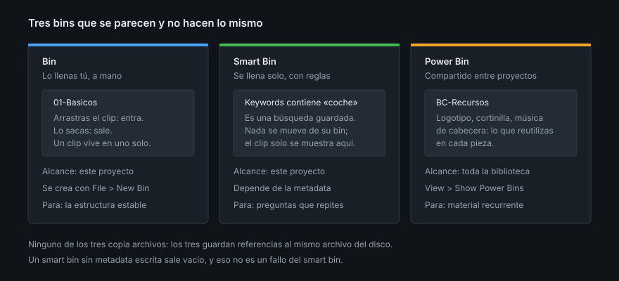

# Los bins que no son bins: Smart Bins y Power Bins

> Dos cosas que aparecen en la misma lista que los bins normales, con el mismo icono de
> carpeta, y que no funcionan como ellos. Uno se llena solo y el otro se comparte entre
> todos tus proyectos. Confundirlos con un bin normal es la causa de la mitad de los
> "he perdido un clip".

## 🎯 Objetivos

- Definir un **Smart Bin** como una búsqueda guardada, no como un contenedor
- Escribir reglas de smart bin que funcionen, y saber por qué salen vacías
- Definir un **Power Bin** y entender que su alcance es la biblioteca entera
- Elegir entre bin, smart bin y power bin sin dudar
- Saber qué pasa al borrar cada uno de los tres

---

## 1. Qué problema resuelve

Un bin normal responde a la pregunta "¿dónde metí este clip?". Pero hay dos preguntas
que un bin normal no puede responder:

1. **"Enséñame todos los planos de noche."** Un clip vive en un solo bin, y los planos
   de noche están repartidos entre `01-Basicos`, `08-Propio` y `09-Escenas`. Un bin no
   puede contenerlos sin sacarlos de donde están.
2. **"Quiero mi logotipo disponible en todos mis proyectos."** Un bin vive dentro de un
   proyecto. Volver a importar el mismo logotipo en cada proyecto nuevo funciona, y a
   la décima vez ya hay cuatro versiones distintas circulando.

Smart bins y power bins son las dos respuestas.

---

## 2. Los tres tipos, uno al lado del otro

| | Bin | Smart Bin | Power Bin |
| --- | --- | --------- | --------- |
| Quién lo llena | Tú, arrastrando | Una regla, sola | Tú, arrastrando |
| Dónde vive el clip | Aquí | En su bin de siempre | En el power bin |
| Alcance | Este proyecto | Este proyecto | **Toda la biblioteca** |
| Se puede quedar vacío por sorpresa | No | **Sí**, si falta metadata | No |
| Para qué | La estructura estable | Preguntas que repites | Material que reutilizas |

---

## 3. Smart Bins: una búsqueda guardada

Un smart bin **no contiene nada**. Guarda una o varias reglas y muestra los clips del
proyecto que las cumplen, en tiempo real. El clip no se mueve de su bin: se muestra
también aquí.

### Crearlo

En la lista de bins del media pool, clic derecho sobre un área vacía y elige la opción
de añadir un smart bin. Se abre un diálogo donde se le pone nombre y se le añaden
reglas.

Cada regla tiene tres partes: **un campo**, **una condición** y **un valor**.

| Campo | Condición | Valor | Qué reúne |
| ----- | --------- | ----- | --------- |
| `Keywords` | contiene | `noche` | Todo lo etiquetado como noche |
| `Resolution` | es | `3840x2160` | El material 4K, para vigilarlo aparte |
| `Frame Rate` | no es | `24` | Lo que va a dar problemas de velocidad |
| `Clip Color` | es | `Red` | Lo que marcaste para revisar |
| `Duration` | mayor que | `00:01:00:00` | Los clips largos, candidatos a subclip |

Con varias reglas se elige si tienen que cumplirse **todas** o **cualquiera** de ellas.

> [!NOTE]
> Los campos disponibles y sus condiciones dependen de la metadata que Resolve conoce, y
> la lista es larga. El diálogo los muestra todos en un desplegable: ábrelo y léelo una
> vez, porque la mitad de las ideas útiles salen de ahí y no de un tutorial.

### Por qué un smart bin sale vacío

Casi siempre por la misma razón: **la metadata no está escrita**. Una regla sobre
`Keywords` no puede encontrar nada si ningún clip tiene keywords.

Ese es el orden correcto y la razón de que los smart bins vengan después de la metadata
en esta semana: primero se describe el material, después se pregunta por él. Un smart
bin es tan bueno como la metadata que tenga debajo.

Las otras dos causas, en orden de frecuencia:

- **Mayúsculas y variantes.** `Noche` y `noche` pueden no coincidir según la condición
  que elijas, y `nocturno` no coincide con `noche` en ningún caso. Un vocabulario corto
  y escrito en minúsculas resuelve esto de raíz.
- **`Todas` en vez de `cualquiera`.** Dos reglas exigentes combinadas con "todas" dejan
  fuera casi todo.

### Qué pasa al borrarlo

Nada. Se borra la regla; los clips siguen intactos en sus bins de siempre. Es la
operación más inofensiva del media pool.

---

## 4. Power Bins: material compartido entre proyectos

Un power bin es un bin normal en todo menos en una cosa: **es el mismo para todos los
proyectos de la biblioteca**. Lo que metas aquí desde un proyecto está disponible en los
demás, sin volver a importarlo.

### Mostrarlos

No se ven por defecto. Se activan con **`View > Show Power Bins`**.

### Para qué se usan de verdad

Para material recurrente y estable: tu logotipo, tu cortinilla de entrada y salida, la
música de cabecera, una plantilla de títulos, una carta de ajuste. Cosas que no
pertenecen a una pieza concreta sino a todas.

> [!WARNING]
> Un power bin sigue guardando **referencias**, no archivos. Si mueves o borras el
> archivo del logotipo, se queda *offline* en todos tus proyectos a la vez. Ponles una
> carpeta propia en tu disco de trabajo y no la toques nunca: es material que quieres
> especialmente estable, porque el fallo se multiplica por el número de proyectos.

> [!IMPORTANT]
> Los power bins pertenecen a la **biblioteca de proyectos**, no al proyecto. Eso
> significa dos cosas que conviene tener claras desde hoy: que no viajan dentro del
> `.drp` que exportas, y que si cambias de biblioteca —como hiciste en la práctica 03 de
> la Semana 03— tus power bins no están ahí.

### Qué pasa al borrarlo

Se borra para todos los proyectos de la biblioteca a la vez, sin más aviso que el
habitual. El archivo del disco no se toca.

---

## 5. Cuál usar

La pregunta que lo decide:

- ¿El material **es** de esta pieza y quiero decidir yo dónde va? → **bin**.
- ¿Quiero **ver** un conjunto que se calcula solo, y que cambie cuando cambie la
  metadata? → **smart bin**.
- ¿Lo voy a usar en **más de un proyecto**? → **power bin**.

Y la trampa a evitar: no hagas un smart bin de algo que ya es un bin. Si tienes
`02-Entrevista`, un smart bin que reúna "todo lo de la entrevista" no aporta nada y sí
añade una lista más que mirar.

---

## 6. Un smart bin es vivo, y eso tiene consecuencias

Un bin normal cambia cuando tú lo cambias. Un smart bin cambia **cuando cambia la
metadata**, y eso pasa a menudo sin que estés pensando en él.

Escribes la keyword `descarte` en seis clips de `01-Basicos` y el smart bin de descartes
crece solo. Quitas esa keyword y se vacía. Cambias el color de un clip a rojo y aparece
en el smart bin que filtra por rojo, aunque no hayas tocado ningún bin.

Eso es lo que se quiere, y también la razón de dos sustos frecuentes:

| Lo que ves | Qué ha pasado |
| ---------- | ------------- |
| Un smart bin que ayer tenía veinte clips y hoy tiene tres | Alguien —tú— cambió la metadata que alimenta la regla |
| Un clip que aparece en dos smart bins a la vez | Es lo normal: cumple las dos reglas. Sigue viviendo en un solo bin de verdad |
| Un smart bin que se llena de clips que no esperabas | La condición es más laxa de lo que creías: `contiene` frente a `es` |

> [!TIP]
> Si un smart bin devuelve algo raro, no toques el smart bin: mira la metadata de dos o
> tres de los clips que salen. El problema casi nunca está en la regla, sino en lo que
> hay escrito debajo.

---

## 7. Antipatrones

| Antipatrón | Por qué duele | Qué hacer |
| ---------- | ------------- | --------- |
| Esperar que un smart bin "guarde" clips | No guarda nada: muestra los que cumplen la regla | Úsalo como lo que es, una búsqueda guardada |
| Crear smart bins antes de escribir metadata | Salen todos vacíos y parece que la función no va | Primero la metadata, después las reglas |
| Keywords libres, cada clip con su palabra | `noche`, `nocturno`, `de noche` no se agrupan | Vocabulario corto, en minúsculas, escrito en el proyecto |
| Un smart bin por cada matiz | Veinte listas que revisar es peor que ninguna | Los que respondan a preguntas que te haces de verdad |
| Meter el material de la pieza en un power bin | Se mezcla con el de todos los demás proyectos | Los power bins son para lo recurrente |
| Mover el archivo que alimenta un power bin | Se queda *offline* en todos los proyectos a la vez | Carpeta propia y estable en el disco de trabajo |
| Suponer que los power bins viajan en el `.drp` | Al abrir el proyecto en otra máquina no están | Van con la biblioteca, no con el proyecto |

---

## 8. Trucos

| Truco | Cómo |
| ----- | ---- |
| Ver los power bins | `View > Show Power Bins` |
| Vigilar el material que se sale del estándar | Smart bin con `Frame Rate` distinto del de tu proyecto |
| Encontrar lo que aún no has descrito | Smart bin con `Keywords` vacío: es tu lista de pendientes |
| Reunir lo marcado para revisar | Smart bin por `Clip Color` o por flag |
| Probar una regla antes de guardarla | Escribe primero la búsqueda en el buscador del media pool y mira si devuelve lo que esperas |
| Borrar un smart bin sin miedo | No se lleva ningún clip: solo la regla |

---

## 📚 Recursos Adicionales

- [DaVinci Resolve Reference Manual](https://www.blackmagicdesign.com/support/family/davinci-resolve-and-fusion) — el capítulo *Media Page* documenta el diálogo de smart bins con la lista completa de campos y condiciones de tu versión.
- [Teoría 06 · Metadata](06-metadata.md) — sin ella, ningún smart bin encuentra nada.
- [Semana 03 · Bibliotecas de proyectos](../../week-03-resolve_21_anatomia_bases_de_datos_y_preferencias/1-teoria/02-bibliotecas-de-proyectos.md) — qué es la biblioteca, que es a quien pertenecen los power bins.

---

## ✅ Checklist de Verificación

- [ ] Sé que un smart bin es una búsqueda guardada y no un contenedor
- [ ] Sé escribir una regla con campo, condición y valor
- [ ] Sé las tres razones por las que un smart bin sale vacío
- [ ] Sé mostrar los power bins y sé que su alcance es la biblioteca
- [ ] Sé que los power bins no viajan dentro del `.drp`
- [ ] Sé elegir entre los tres tipos con la pregunta del apartado 5

---

| Anterior | Actual | Siguiente |
| -------- | ------ | --------- |
| [04 · El media pool y los bins](04-el-media-pool-y-los-bins.md) | **05 · Los bins que no son bins: Smart Bins y Power Bins** | [06 · Metadata: describir para poder encontrar](06-metadata.md) |

← [Volver a la Semana 04](../README.md)
