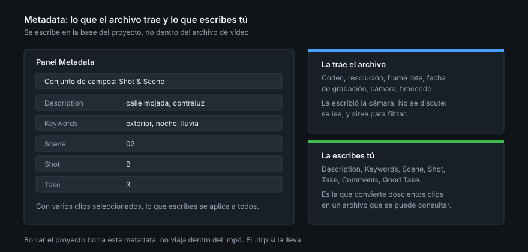

# Metadata: describir para poder encontrar

> Es la única parte de la ingesta que no tiene recompensa inmediata. Escribir keywords
> en cuarenta clips un martes no mejora nada ese martes. Lo que mejora es la semana
> doce, cuando buscas "el plano de la calle mojada" y aparece en dos segundos en vez de
> en veinte minutos.

## 🎯 Objetivos

- Definir **metadata** y distinguir la que trae el archivo de la que escribes tú
- Manejar el panel Metadata y sus conjuntos de campos
- Saber qué campo usar para qué: `Description`, `Keywords`, `Scene`, `Shot`, `Take`
- Escribir metadata sobre **varios clips a la vez**
- Entender dónde se guarda, qué viaja y qué se pierde

---

## 1. Qué problema resuelve

El nombre de un archivo cabe en una línea y no admite matices. `plano-07.mp4` no dice si
es de día, si hay alguien hablando, si la cámara se mueve, ni si esa toma era la buena.

La metadata es donde cabe todo eso. Y no es un cuaderno aparte: está pegada al clip
dentro del proyecto, se puede buscar, se puede filtrar y alimenta los smart bins de la
[teoría 05](05-los-bins-que-no-son-bins.md).

La prueba de si vale la pena es esta pregunta: **si mañana tuvieras que encontrar los
tres planos con niños en la calle, ¿cuánto tardarías?** Con metadata, dos segundos. Sin
ella, abriendo clips uno a uno.

---

## 2. Dos metadatas con el mismo nombre

### La que trae el archivo

La escribió la cámara o el programa que generó el archivo: codec, resolución, frame
rate, fecha y hora de grabación, modelo de cámara, timecode, número de canales de audio.

No se discute y casi nunca se edita: se **lee**, y sirve para filtrar. Es la misma
información que ya viste en la Semana 02 con `media_clip_properties`.

### La que escribes tú

`Description`, `Keywords`, `Scene`, `Shot`, `Take`, `Comments`, `Good Take` y unas
cuantas más. Está vacía hasta que alguien la rellena, y es la que convierte doscientos
archivos en un archivo consultable.

> [!IMPORTANT]
> Toda esta segunda metadata se guarda **en el proyecto**, no dentro del `.mp4`. Tres
> consecuencias: viaja dentro del `.drp` que exportas, **no** la ve ningún otro programa
> que abra el mismo archivo, y si quitas el clip del media pool y lo vuelves a importar,
> **se ha perdido**. Escribirla es trabajo, y como todo trabajo, entra en los respaldos
> de la Semana 03.

---

## 3. Cómo se hace en Resolve 21

El panel `Metadata` se muestra desde la barra de la página Media. Enseña los campos del
clip que tengas seleccionado.

### Los conjuntos de campos

Los campos son muchos, así que el panel los agrupa en conjuntos que se eligen en un
desplegable en su parte superior: uno de plano y escena, uno de detalles del clip, uno
de cámara, uno de audio, y varios más de producción.

El que se usa a diario es el de **plano y escena** (`Shot & Scene`), que es donde están
los campos que vas a rellenar tú.

> [!NOTE]
> Los nombres de los conjuntos varían entre versiones y no se han podido confirmar por
> la API de scripting, que es lo único verificable de forma automática en este bootcamp.
> Ábrelo en tu instalación y mira cuáles tienes; el capítulo *Media Page* del
> [manual oficial](https://www.blackmagicdesign.com/support/family/davinci-resolve-and-fusion)
> los lista con las capturas de tu versión. Los **campos** de la tabla siguiente sí son
> estables entre versiones.

### Qué campo es cada uno

| Campo | Qué va aquí | Ejemplo |
| ----- | ----------- | ------- |
| `Description` | Una frase que describa lo que se ve | `calle mojada de noche, contraluz` |
| `Keywords` | Palabras sueltas, de un vocabulario corto tuyo | `exterior, noche, lluvia` |
| `Scene` | La escena, si tu pieza tiene escenas | `02` |
| `Shot` | El plano dentro de la escena | `B` |
| `Take` | El número de toma | `3` |
| `Comments` | Notas para tu yo futuro | `el audio se satura al final` |
| `Good Take` | La marca de la toma buena | activado |

La diferencia entre `Description` y `Keywords` es la que más se falla, y es la que más
importa:

- **`Description` es prosa.** Se lee. Sirve para acordarte.
- **`Keywords` son etiquetas.** Se buscan. Alimentan los smart bins.

Una descripción larguísima es inútil para filtrar. Una lista de keywords no te dice qué
pasa en el plano. Se necesitan las dos, y cuestan poco juntas.

### Escribir sobre varios clips a la vez

Es el truco que hace viable todo esto. Selecciona **todos** los clips que compartan algo
—los quince de la calle de noche, por ejemplo— y escribe la keyword una vez: se aplica a
los quince.

Ese es el orden eficiente:

1. Selección grande, keywords comunes de una tanda: `exterior`, `noche`.
2. Selección mediana, lo que distingue subgrupos: `lluvia`, `coche`.
3. Clip a clip, solo la `Description` de los que de verdad la necesiten.

Cuarenta clips descritos así son quince minutos. Clip a clip, son dos horas, y por eso
nadie lo hace.

---

## 4. El vocabulario de keywords

La regla que decide si esto funciona o no:

> [!TIP]
> **Escribe tu lista de keywords antes de empezar, y no improvises encima.** Diez o
> quince palabras bastan para una pieza corta. Guárdala en un archivo de texto junto al
> proyecto, en `BC-Resolve/04-respaldos/`.

Sin lista, en dos semanas tendrás `noche`, `nocturno`, `de noche` y `Noche`, y ninguna
búsqueda te devolverá el conjunto entero. Con lista, cualquier smart bin funciona a la
primera.

Un vocabulario de partida razonable para casi cualquier pieza:

| Eje | Palabras |
| --- | -------- |
| Lugar | `interior`, `exterior` |
| Luz | `dia`, `noche`, `contraluz` |
| Contenido | `voz`, `paisaje`, `detalle`, `gente` |
| Cámara | `fija`, `mano`, `movimiento` |
| Estado | `bueno`, `revisar`, `descarte` |

Sin acentos, en minúsculas y en singular. No por estética: porque así solo hay una
forma posible de escribir cada una, y las búsquedas dejan de fallar por un tilde.

---

## 5. El pase de metadata: veinte minutos, una vez

Un guion concreto para cuarenta clips recién importados. Se hace entero en vista de
lista, con la columna `Keywords` puesta para ir viendo el avance.

| Paso | Qué haces | Cuánto |
| ---- | --------- | ------ |
| 1 | Escribe tu vocabulario en un archivo de texto, si aún no lo tienes | 3 min |
| 2 | Selecciona **todo** el bin y pon las keywords comunes a la tanda: de dónde viene, de qué día | 2 min |
| 3 | Ordena por `Date Created` y ve por bloques: los quince del exterior, `exterior` y `dia` | 5 min |
| 4 | Segundo pase por contenido: `voz`, `paisaje`, `detalle` | 5 min |
| 5 | Clip a clip, `Description` solo en los que te vayan a costar de recordar | 5 min |

La clave está en los pasos 2 a 4: **se trabaja por selecciones, no por clips**. Cada
selección grande ahorra veinte escrituras.

> [!TIP]
> Si en algún momento no sabes qué keyword poner, es señal de que falta una palabra en
> tu vocabulario. Añádela al archivo de texto en ese momento, no la improvises solo en
> ese clip: la disciplina del vocabulario se rompe justo así.

---

## 6. Antipatrones

| Antipatrón | Por qué duele | Qué hacer |
| ---------- | ------------- | --------- |
| Dejar la metadata "para cuando haya tiempo" | Nunca lo hay, y en la semana doce ya no recuerdas qué era cada clip | Se escribe el mismo día que se importa |
| Meterlo todo en `Description` | La prosa no se filtra bien y los smart bins salen vacíos | Prosa en `Description`, etiquetas en `Keywords` |
| Keywords improvisadas clip a clip | Cuatro variantes de la misma palabra, ninguna búsqueda completa | Vocabulario cerrado, escrito antes de empezar |
| Escribir clip por clip | Dos horas para lo que son quince minutos | Selección múltiple y keywords comunes de una tanda |
| Suponer que la metadata está dentro del `.mp4` | Se pierde al reimportar, y ningún otro programa la ve | Vive en el proyecto: entra en los respaldos |
| Rellenar los treinta campos de todos los conjuntos | Trabajo enorme y sin uso | Seis campos bien puestos valen más que treinta a medias |
| Acentos y mayúsculas en las keywords | Las búsquedas fallan por un tilde | Minúsculas, sin acentos, en singular |

---

## 7. Trucos

| Truco | Cómo |
| ----- | ---- |
| Describir cuarenta clips en quince minutos | Selección múltiple y escribe la keyword una sola vez |
| Ver las keywords sin abrir el panel | Añade la columna `Keywords` en la vista de lista del media pool |
| Encontrar lo que aún no has descrito | Un smart bin con la regla de `Keywords` vacío |
| Recordar por qué un clip no servía | `Comments`, en el momento en que lo descartas |
| Marcar la toma buena de una serie | El campo `Good Take`, que después se puede usar como regla de smart bin |
| No perder el vocabulario | Un archivo de texto en `04-respaldos/` junto al mapa de instalación |

---

## 📚 Recursos Adicionales

- [DaVinci Resolve Reference Manual](https://www.blackmagicdesign.com/support/family/davinci-resolve-and-fusion) — el capítulo *Media Page* recorre el panel Metadata, sus conjuntos y el significado de cada campo en tu versión.
- [Teoría 05 · Los bins que no son bins](05-los-bins-que-no-son-bins.md) — para qué sirve todo esto en cuanto está escrito.
- [`docs/autograding.md`](../../../docs/autograding.md) — la forma exacta que devuelve `media_clip_properties`, que es la metadata que trae el archivo.

---

## ✅ Checklist de Verificación

- [ ] Distingo la metadata que trae el archivo de la que escribo yo
- [ ] Sé qué va en `Description` y qué va en `Keywords`, y por qué no es lo mismo
- [ ] Sé escribir metadata sobre varios clips a la vez
- [ ] Tengo un vocabulario de keywords escrito **antes** de empezar
- [ ] Sé que la metadata vive en el proyecto y se pierde al reimportar
- [ ] Escribo las keywords en minúsculas, sin acentos y en singular

---

| Anterior | Actual | Siguiente |
| -------- | ------ | --------- |
| [05 · Los bins que no son bins: Smart Bins y Power Bins](05-los-bins-que-no-son-bins.md) | **06 · Metadata: describir para poder encontrar** | [07 · Keywords, flags y colores](07-keywords-flags-y-colores.md) |

← [Volver a la Semana 04](../README.md)
