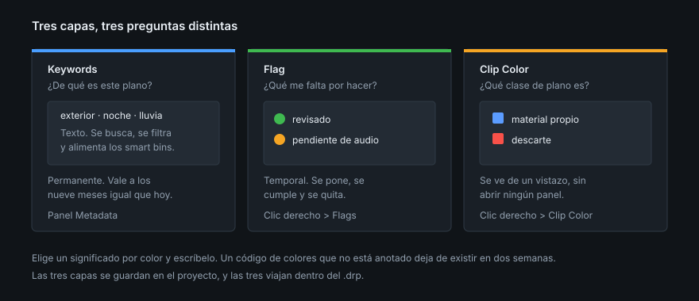

# Keywords, flags y colores

> Tres formas de marcar un clip que se parecen mucho y responden a preguntas distintas.
> Usarlas al azar produce un proyecto lleno de marcas que ya no significan nada. Usarlas
> con un criterio escrito convierte el media pool en un panel de control.

## 🎯 Objetivos

- Separar las tres capas: **keyword**, **flag** y **clip color**
- Elegir cuál usar según si la marca es permanente o temporal
- Aplicar flags y colores desde el media pool, y quitarlos
- Escribir un código de colores y dejarlo anotado
- Filtrar el media pool por cualquiera de las tres

---

## 1. Qué problema resuelve

Después de la metadata sabes **qué es** cada clip. Falta lo otro: qué has decidido sobre
él. Que este hay que revisarlo, que aquel es descarte, que estos veinte son material
propio y estos cuarenta son del pack.

Esa información cambia mientras trabajas. Meterla en la `Description` no funciona: es
prosa, y se queda obsoleta sin que nadie se dé cuenta. Para eso están las otras dos
capas.

---

## 2. Las tres capas

| | Keyword | Flag | Clip Color |
| --- | ------- | ---- | ---------- |
| Pregunta | ¿De qué es este plano? | ¿Qué me falta por hacer? | ¿Qué clase de plano es? |
| Forma | Texto | Marca de color | Color de fondo de la fila |
| Vida | Permanente | Temporal: se pone y se quita | Estable, cambia poco |
| Cuántos por clip | Muchos | Varios | **Uno** |
| Se ve sin abrir nada | No, hay que añadir la columna | Sí | Sí |
| Se busca por texto | Sí | No | No |

La forma corta de decidir:

- Si sigue siendo verdad dentro de un año → **keyword**.
- Si describe algo que tienes pendiente → **flag**.
- Si es una categoría de la que quieres darte cuenta de un vistazo → **clip color**.

---

## 3. Cómo se hace en Resolve 21

### Flags

Clic derecho sobre uno o varios clips en el media pool > `Flags`, y eliges el color.
Un clip puede llevar **varios flags a la vez**, y se quitan desde el mismo menú.

Los flags también existen en la timeline, sobre los clips ya montados, y son los mismos.
Eso los hace especialmente útiles como lista de tareas que sobrevive al montaje.

### Clip Color

Clic derecho > `Clip Color`, y eliges. A diferencia de los flags, **un clip tiene un
solo color**: asignar uno nuevo sustituye al anterior.

El color pinta la fila entera en la vista de lista y el borde de la miniatura en la
vista de miniaturas, así que se ve sin buscarlo. Es la marca más visible de las tres, y
por eso conviene reservarla para pocas categorías.

> [!NOTE]
> El color de clip que pones en el media pool es el mismo que se ve en la timeline
> cuando montas ese clip. No es un detalle menor: un código de colores puesto hoy sigue
> hablándote en la página Edit dentro de cuatro semanas, sin hacer nada más.

### Filtrar por ellos

Las tres capas se pueden usar como regla de smart bin, y las tres aparecen como columna
en la vista de lista. Además, el buscador del media pool encuentra texto de metadata,
que es donde viven las keywords.

Esa es la razón práctica de tener las tres: **una regla de smart bin que combine un
color y una keyword responde preguntas que ninguna de las dos responde por separado.**

---

## 4. El código de colores

Aquí está el error que comete casi todo el mundo: empezar a poner colores sin decidir
qué significa cada uno. A las dos semanas hay clips rojos, verdes y azules, y nadie
recuerda por qué.

> [!IMPORTANT]
> **Un código de colores que no está escrito deja de existir en dos semanas.** Elige
> cuatro o cinco significados, escríbelos en un archivo junto al proyecto —el mismo
> `04-respaldos/` de la Semana 03— y no improvises encima.

Un punto de partida que funciona:

| Color | Significado | Por qué ese |
| ----- | ----------- | ----------- |
| **Azul** | Material propio, grabado por ti | El más numeroso, y el que distingues de un vistazo del material del pack |
| **Verde** | Seleccionado para el montaje | Se ve avanzar la selección sin abrir nada |
| **Amarillo** | Requiere trabajo extra: audio malo, exposición rara | Avisa antes de montarlo |
| **Rojo** | Descarte | Junto con el bin `10-Descartes`, doble red |
| Sin color | Todavía sin revisar | El estado por defecto es "pendiente", y eso es correcto |

Y para los flags, con dos basta:

| Flag | Significado |
| ---- | ----------- |
| Uno | Revisado y aprobado |
| Otro | Pendiente de algo concreto, anotado en `Comments` |

> [!TIP]
> Si dudas entre flag y color, pregúntate si vas a quitar la marca alguna vez. Si la
> respuesta es sí, es un flag. Un color es una clasificación; un flag es una tarea.

---

## 5. Cuándo se hace todo esto

En el mismo pase de la metadata, y en este orden:

1. **Keywords** en tanda, con selección múltiple: qué es cada grupo de clips.
2. **Clip color** en tanda: material propio, material del pack, descartes.
3. **Flags** clip a clip, solo en los que tengan algo pendiente.

Los dos primeros pasos son rápidos porque se hacen sobre selecciones grandes. El tercero
es lento y por eso se reserva a los pocos clips que lo necesiten de verdad.

> [!WARNING]
> Marcar **todos** los clips con algo destruye el valor de la marca. Si el 90 % del
> media pool está en verde, el verde ha dejado de informar. Una marca sirve porque
> distingue a unos pocos del resto.

---

## 6. Un flag no es un marcador

Se confunden porque los dos son marcas de color, y no tienen nada que ver.

| | Flag | Marcador (*marker*) |
| --- | ---- | ------------------- |
| A qué se pega | Al **clip entero** | A un **punto o un rango** dentro del clip |
| Qué dice | "Este clip tiene algo" | "Aquí, en este fotograma, pasa algo" |
| Dónde se ve | Media pool y timeline | En la regla del clip y en la timeline |
| Lleva texto | No | Sí: nombre y nota |
| Cuándo se usa | Al organizar material | Al montar |

Un flag amarillo dice "este clip hay que revisarlo". Un marcador dice "en el segundo 12
hay un golpe de audio". Los dos hacen falta y en momentos distintos del trabajo.

Los marcadores son materia de la
[Semana 09](../../week-09-trimming_quirurgico/README.md), donde ya estarás montando y
donde por fin sirven de algo. Esta semana no se usan.

---

## 7. Antipatrones

| Antipatrón | Por qué duele | Qué hacer |
| ---------- | ------------- | --------- |
| Poner colores sin haber decidido qué significan | En dos semanas nadie lo recuerda, ni tú | Código escrito en `04-respaldos/` antes de empezar |
| Usar los ocho colores disponibles | Ocho categorías no se recuerdan de un vistazo | Cuatro o cinco, como mucho |
| Marcar el 90 % del material | La marca deja de distinguir nada | Marca la excepción, no la norma |
| Flags que nunca se quitan | Se convierten en un segundo código de colores, peor | Un flag es una tarea: se cumple y se quita |
| Usar el color para lo que es una keyword | El color no se busca por texto ni agrupa bien | Lo permanente y consultable va en keywords |
| Marcar en la timeline lo que debía marcarse en el media pool | La marca solo vive en esa timeline | Marca el clip en el media pool y viaja a todas |
| Cambiar el significado de un color a mitad de proyecto | Todo lo marcado antes queda mal etiquetado | Si hay que cambiarlo, se repasa lo ya marcado |

---

## 8. Trucos

| Truco | Cómo |
| ----- | ---- |
| Marcar cuarenta clips de una vez | Selección múltiple y clic derecho: flags y colores se aplican a todo lo seleccionado |
| Ver el avance de la selección sin abrir nada | Clip color verde para lo elegido: la vista de miniaturas se lee sola |
| Que la marca sobreviva al montaje | El color del clip en el media pool se ve también en la timeline |
| Reunir lo pendiente en una sola lista | Un smart bin con la regla del flag correspondiente |
| Combinar dos capas | Smart bin con `Clip Color` es amarillo **y** `Keywords` contiene `voz` |
| Empezar de cero con las marcas | Selecciona todo y quita el color: no toca ni metadata ni archivos |

---

## 📚 Recursos Adicionales

- [DaVinci Resolve Reference Manual](https://www.blackmagicdesign.com/support/family/davinci-resolve-and-fusion) — el capítulo *Media Page* documenta flags y clip colors, y dónde aparecen en el resto del programa.
- [Teoría 05 · Los bins que no son bins](05-los-bins-que-no-son-bins.md) — cómo convertir estas marcas en listas que se mantienen solas.
- [Teoría 08 · Vistas, columnas y búsqueda](08-vistas-columnas-y-busqueda.md) — cómo ver las tres capas a la vez sin abrir ningún panel.

---

## ✅ Checklist de Verificación

- [ ] Sé qué pregunta responde cada una de las tres capas
- [ ] Sé aplicar y quitar flags y colores sobre varios clips a la vez
- [ ] Mi código de colores está escrito en un archivo, no en mi memoria
- [ ] Uso cuatro o cinco colores, no ocho
- [ ] Marco la excepción, no la norma
- [ ] Sé que el color del clip se ve también en la timeline

---

| Anterior | Actual | Siguiente |
| -------- | ------ | --------- |
| [06 · Metadata: describir para poder encontrar](06-metadata.md) | **07 · Keywords, flags y colores** | [08 · Vistas, columnas y búsqueda del media pool](08-vistas-columnas-y-busqueda.md) |

← [Volver a la Semana 04](../README.md)
