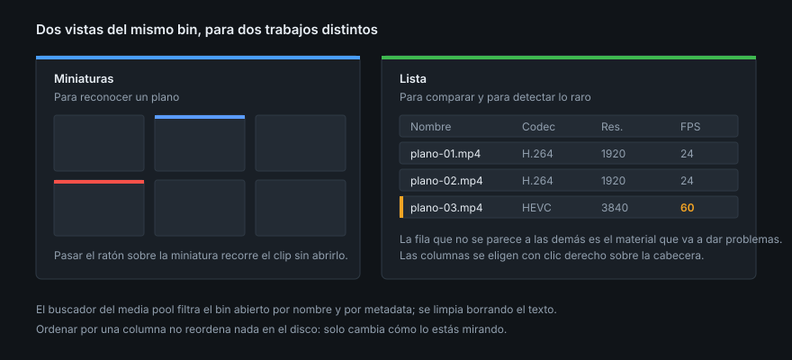

# Vistas, columnas y búsqueda del media pool

> El mismo bin puede verse de dos formas muy distintas, y cada una sirve para un
> trabajo. La de miniaturas es para reconocer un plano; la de lista es para descubrir
> que uno de los cuarenta clips va a 60 fps y va a dar problemas dentro de tres semanas.

## 🎯 Objetivos

- Alternar entre vista de miniaturas y vista de lista, y saber cuándo toca cada una
- Elegir las columnas que de verdad usas y ordenar por ellas
- Detectar material que no encaja con el resto **antes** de montar
- Buscar dentro de un bin, y saber qué campos alcanza el buscador
- Leer el media pool como un instrumento de diagnóstico

---

## 1. Qué problema resuelve

Cuando importas cuarenta clips de fuentes distintas, algunos no van a comportarse como
los demás: uno viene a 60 fps, otro es 4K entre material HD, otro llega en un codec que
tu ordenador reproduce a trompicones. Todos se importan sin quejarse.

El problema aparece en el montaje, cuando algo va a cámara lenta sin motivo o la
reproducción se atasca. Y el diagnóstico es siempre el mismo: **ese clip no se parecía a
los demás, y se podía haber visto el primer día en la vista de lista**.

---

## 2. Las dos vistas

Se alternan con los botones de vista del media pool.

### Miniaturas

Cada clip con su imagen. Para reconocer un plano cuando ya sabes lo que buscas.

Aquí se ven los **colores de clip** —tiñen el borde de la miniatura— y los flags, así
que un bin bien marcado se lee de un vistazo sin abrir nada.

### Lista

Una fila por clip y una columna por propiedad. Para comparar, ordenar y descubrir lo
raro.

Es la vista de trabajo de esta semana, y la que casi nadie usa porque la de miniaturas
es más bonita.

---

## 3. Las columnas

En vista de lista, **clic derecho sobre la cabecera de columnas** abre la lista de todas
las disponibles, y se marcan las que quieras. Son muchas; estas son las que ganan sitio:

| Columna | Para qué |
| ------- | -------- |
| `Frame Rate` | Detectar el clip que va a otra velocidad que tu proyecto |
| `Resolution` | Ver el material que no es de tu formato |
| `Video Codec` | Saber cuál te va a costar reproducir |
| `Duration` | Encontrar los clips largos, candidatos a subclip |
| `Keywords` | Ver de un vistazo qué falta por describir |
| `Clip Color` | Leer tu propio código sin abrir el menú |
| `File Path` | Saber de qué disco vive cada clip; vacío significa que es una timeline |
| `Date Created` | Ordenar por cuándo se grabó, no por cómo se llama |

> [!TIP]
> Las columnas que elijas son un ajuste de **tu interfaz**, no del proyecto. Se quedan
> puestas de un proyecto a otro, así que configúralas bien una vez y ya está.

### Ordenar

Clic sobre la cabecera de una columna ordena por ella; otro clic invierte el orden.

Ordenar por `Frame Rate` o por `Resolution` agrupa el material raro al principio o al
final de la lista, que es la forma más rápida que existe de encontrarlo. Ordenar por
`Duration` te da los clips largos, que son los que conviene revisar antes de montar.

Ordenar **no cambia nada**: ni el disco, ni el proyecto, ni el orden real del bin. Solo
cambia cómo lo estás mirando.

---

## 4. El pase de diagnóstico

Cinco minutos, y se hace una sola vez por tanda de material importado. Es de lo más
rentable de toda la semana.

1. Vista de lista, con las columnas `Frame Rate`, `Resolution` y `Video Codec` puestas.
2. Ordena por `Frame Rate`. **¿Hay clips que no van al frame rate de tu proyecto?**
   Márcalos en amarillo. La Semana 10 explica qué hacer con ellos; hoy basta con
   saberlo.
3. Ordena por `Resolution`. **¿Hay material 4K entre material HD, o al revés?** Mismo
   trato.
4. Ordena por `Video Codec`. **¿Hay algo en HEVC o en un codec exótico?** Ese es el
   candidato a ir a trompicones, y es exactamente lo que resuelve la Semana 05 con
   proxies y medios optimizados.
5. Ordena por `Duration`. **¿Hay clips de más de un minuto?** Son los que pedirán
   subclips o una detección de escenas.

Al terminar sabes qué material te va a dar problemas y de qué clase, antes de haber
montado ni un corte.

> [!NOTE]
> Nada de esto se arregla esta semana. El objetivo del pase es **enterarse**, no
> resolver: un problema conocido en la semana cuatro es una tarea de la semana cinco;
> el mismo problema descubierto en la semana doce es una tarde perdida en mitad del
> montaje.

---

## 5. Buscar dentro del media pool

El buscador del media pool filtra lo que estás viendo. Alcanza el nombre del clip y los
campos de metadata, así que las keywords que escribiste en la
[teoría 06](06-metadata.md) se encuentran desde aquí.

Dos cosas que conviene saber:

- **Filtra, no busca en todo el proyecto.** Lo que ves depende del bin que tengas
  abierto. Si buscas algo y no aparece, comprueba primero en qué bin estás.
- **Se queda puesto.** Un buscador con texto dentro hace que un bin parezca casi vacío.
  Es la causa número uno de "he perdido la mitad de los clips". Bórralo al terminar.

> [!TIP]
> Si una búsqueda la vas a repetir, no la repitas: conviértela en un smart bin. El
> buscador es para preguntas de una vez; el smart bin, para las que te haces cada
> semana.

---

## 6. El mismo media pool en las otras páginas

El media pool no es de la página Media: **es del proyecto**, y aparece igual en Cut, en
Edit, en Fusion y en Fairlight. Lo que cambia es cuánto sitio tiene y, con él, cuántas
columnas caben.

Eso tiene una consecuencia práctica que ahorra idas y venidas: **el trabajo de
organización se puede hacer desde donde estés**. Renombrar un clip, cambiarle el color,
moverlo de bin o marcarlo con un flag son operaciones del media pool, y funcionan igual
montando en Edit que aquí.

Lo que sí conviene hacer en la página Media es lo que necesita **ver el disco**:
importar, relinkear y clonar. Y el pase de diagnóstico del apartado anterior, que pide
la vista de lista ancha y ocho columnas visibles a la vez.

> [!TIP]
> Si en Edit el media pool se te queda estrecho para ver columnas, no cambies de página:
> ensancha el panel arrastrando su borde, o pásalo a vista de miniaturas mientras montas
> y vuelve a la de lista cuando toque organizar.

---

## 7. Antipatrones

| Antipatrón | Por qué duele | Qué hacer |
| ---------- | ------------- | --------- |
| Trabajar siempre en vista de miniaturas | No ves ni frame rate, ni codec, ni resolución | Vista de lista para el pase de diagnóstico |
| Dejar las columnas por defecto | Ocupan sitio con información que no usas | Elige ocho columnas útiles, una sola vez |
| Descubrir el clip a 60 fps en el montaje | Reparar en la semana doce lo que se veía en la cuatro | Pase de diagnóstico al importar |
| Dejar texto en el buscador | Medio bin desaparece y parece un fallo | Bórralo al terminar de buscar |
| Repetir la misma búsqueda cada semana | Trabajo manual que se puede guardar | Conviértela en smart bin |
| Suponer que ordenar cambia algo | No cambia nada, pero genera desconfianza | Ordenar es solo una forma de mirar |
| Buscar en el bin equivocado y concluir que el clip no está | Reimportas algo que ya tenías | Comprueba el bin abierto antes de dar nada por perdido |

---

## 8. Trucos

| Truco | Cómo |
| ----- | ---- |
| Encontrar el material que se sale del estándar | Vista de lista, ordena por `Frame Rate` |
| Ver qué clips te faltan por describir | Añade la columna `Keywords` y ordena por ella |
| Distinguir una timeline de un clip en el media pool | La columna `File Path` de una timeline está vacía |
| Elegir columnas | Clic derecho sobre la cabecera de columnas, en vista de lista |
| Recorrer un clip sin abrirlo | Pasa el ratón por encima de su miniatura |
| Recuperar un bin que "se ha vaciado" | Borra el texto del buscador |

---

## 📚 Recursos Adicionales

- [DaVinci Resolve Reference Manual](https://www.blackmagicdesign.com/support/family/davinci-resolve-and-fusion) — el capítulo *Media Page* lista todas las columnas del media pool y qué significa cada una.
- [Semana 02 · Codecs, contenedores y flujo de datos](../../week-02-codecs_contenedores_y_flujo_de_datos/README.md) — qué quiere decir cada valor de la columna `Video Codec` y por qué unos cuestan más de reproducir que otros.
- [Semana 05 · Proxies, caché y sincronización](../../week-05-proxies_cache_y_sincronizacion/README.md) — qué hacer con el material que el pase de diagnóstico marque como problemático.

---

## ✅ Checklist de Verificación

- [ ] Sé alternar entre las dos vistas y sé para qué sirve cada una
- [ ] Tengo elegidas las columnas que uso, no las de fábrica
- [ ] He hecho el pase de diagnóstico sobre el material importado
- [ ] Sé que ordenar por una columna no cambia nada
- [ ] Sé que el buscador filtra el bin abierto y que se queda puesto
- [ ] Convierto en smart bin las búsquedas que repito

---

| Anterior | Actual | Siguiente |
| -------- | ------ | --------- |
| [07 · Keywords, flags y colores](07-keywords-flags-y-colores.md) | **08 · Vistas, columnas y búsqueda del media pool** | [09 · Scene Cut Detection](09-scene-cut-detection.md) |

← [Volver a la Semana 04](../README.md)
