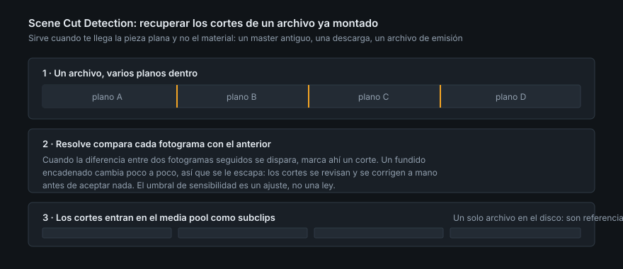

# Scene Cut Detection

> La operación que recupera los cortes de un vídeo que ya viene montado. No es una
> herramienta que uses todas las semanas, pero el día que te llega un archivo plano de
> cuarenta minutos y hay que trabajar con él, es la diferencia entre media hora y una
> tarde.

## 🎯 Objetivos

- Reconocer los casos en los que hace falta, y los muchos en los que no
- Explicar cómo detecta un corte y por qué se le escapan los fundidos
- Ejecutarla, revisar los cortes propuestos y corregirlos antes de aceptar
- Saber qué llega al media pool: subclips, no archivos nuevos
- Distinguirla de un subclip hecho a mano

---

## 1. Qué problema resuelve

Casi siempre trabajas con **material**: clips cortos, uno por toma, tal y como salieron
de la cámara. Cada archivo es un plano.

A veces no. A veces lo que llega es la **pieza ya montada** en un único archivo: un
master antiguo del que se ha perdido el proyecto, un vídeo descargado, una grabación de
emisión, un montaje que hizo otra persona en otro programa. Un archivo, cuarenta
minutos, doscientos planos dentro.

Trabajar con eso a mano significa buscar cada corte moviendo el cursor fotograma a
fotograma. Scene Cut Detection lo hace por ti: analiza el archivo, propone dónde están
los cortes, y te deja revisarlos antes de aceptar nada.

---

## 2. Cómo funciona

La idea es sencilla: **compara cada fotograma con el anterior**. Dos fotogramas
consecutivos del mismo plano se parecen mucho; el último fotograma de un plano y el
primero del siguiente no se parecen en nada. Cuando la diferencia se dispara por encima
de un umbral, ahí hay un corte.

De ese mecanismo salen directamente sus dos límites:

- **Un corte seco se detecta casi siempre.** El salto es brusco por definición.
- **Un fundido encadenado se le escapa a menudo.** La imagen cambia poco a poco, así que
  no hay ningún par de fotogramas con una diferencia grande. Lo mismo pasa con un
  fundido a negro lento.

Y también sus dos falsos positivos habituales: un **flash** de luz o el **disparo de un
flash de fotografía** dentro de un plano producen un salto enorme entre dos fotogramas
consecutivos, y se detectan como corte sin serlo.

> [!IMPORTANT]
> Por eso **la detección se revisa siempre antes de aceptarla**. No es un fallo del
> programa: es la consecuencia inevitable de detectar cortes mirando diferencias entre
> fotogramas. Ningún método automático distingue un corte de un relámpago sin entender
> la imagen.

---

## 3. Cómo se hace en Resolve 21

1. Selecciona en el media pool el bin donde quieres que caiga el resultado.
2. Clic derecho sobre el clip largo > `Scene Cut Detection…`.
3. Se abre una ventana propia con el vídeo, una gráfica de diferencias entre fotogramas
   y la lista de cortes detectados.
4. Lanza el análisis y espera. En un archivo largo tarda: está leyendo todos los
   fotogramas.
5. **Revisa la lista**. Se pueden borrar cortes que sobran y añadir los que faltan,
   colocándote en el fotograma y marcándolo.
6. Acepta: los cortes se añaden al media pool.

> [!NOTE]
> El umbral de sensibilidad es un ajuste de esa ventana. Subirlo detecta menos cortes y
> pierde los suaves; bajarlo detecta más y añade falsos positivos. No hay un valor
> correcto universal: depende del material, y por eso siempre se revisa el resultado.
> Los rótulos exactos de esa ventana **no se han podido verificar por la API de
> scripting**; el capítulo *Media Page* del
> [manual oficial](https://www.blackmagicdesign.com/support/family/davinci-resolve-and-fusion)
> los recoge con las capturas de tu versión.

### Qué llega al media pool

Aquí está la parte que sorprende: **no se crea ni un archivo nuevo en tu disco**.

Lo que entra en el media pool son **subclips**: referencias al mismo archivo de siempre,
cada una con un punto de entrada y uno de salida distintos. Cuarenta cortes de un
archivo de 2 GB siguen siendo 2 GB en el disco, no 80.

Es la misma lógica de todo el media pool, y por eso Scene Cut Detection es rápida de
deshacer: si el resultado no sirve, se quitan los subclips del bin y no se ha tocado
nada.

> [!NOTE]
> Los **subclips** —qué son exactamente, cómo se crean a mano y cuándo conviene— son
> materia de la [Semana 05](../../week-05-proxies_cache_y_sincronizacion/README.md).
> Aquí solo necesitas saber que un subclip es una referencia con entrada y salida, no
> una copia.

---

## 4. Cuándo **no** usarla

Casi siempre. Merece la pena decirlo claro, porque es una función llamativa y se usa
donde no toca:

| Situación | Qué hacer en vez de detectar escenas |
| --------- | ------------------------------------ |
| Material de cámara, un archivo por toma | Nada: ya está separado |
| Un clip largo del que quieres tres trozos | Subclips a mano, en la Semana 05 |
| Una grabación de OBS de una sesión seguida | No hay cortes que detectar: no los hay |
| Un multicámara sin sincronizar | Sincronización por timecode o por audio, Semana 05 y Semana 12 |
| Un archivo con fundidos encadenados largos | Se le va a escapar casi todo; revisa si compensa |

El caso legítimo es uno: **te llega la pieza montada y necesitas el material**.

---

## 5. Un caso completo, de principio a fin

El de la práctica 04 de esta semana, con material que se puede descargar legalmente.

1. **Consigue un archivo montado con licencia clara.** Un cortometraje de
   [Blender Open Movies](https://studio.blender.org/films/) sirve: son Creative Commons,
   están en `.mp4` y tienen cortes secos de sobra.
2. **Cópialo a `01-basicos/`… no.** Va a su sitio: crea `08-material-montado/` en tu
   carpeta de medios. No es material de rodaje y no conviene mezclarlo.
3. **Impórtalo** al bin `09-Escenas`.
4. **Selecciona `09-Escenas`** como bin activo. Esto es lo que decide dónde caen los
   subclips.
5. **Clic derecho sobre el clip > `Scene Cut Detection…`**, y lanza el análisis.
6. **Revisa**: recorre la lista de cortes propuestos y comprueba dos o tres. Borra los
   que caigan en mitad de un plano; añade los que falten en un fundido.
7. **Acepta.** Los subclips entran en `09-Escenas`.
8. **Comprueba** en la vista de lista que todos comparten el mismo `File Path` y tienen
   duraciones distintas. Eso confirma que son subclips del mismo archivo.

Con un corto de tres o cuatro minutos, el análisis tarda menos de un minuto y salen
entre diez y cuarenta cortes. Es material suficiente para entender el mecanismo sin
pasar la tarde revisando.

---

## 6. Antipatrones

| Antipatrón | Por qué duele | Qué hacer |
| ---------- | ------------- | --------- |
| Aceptar los cortes sin revisarlos | Los fundidos se pierden y los flashes se cuelan | Revisar siempre la lista antes de aceptar |
| Usarla sobre material de cámara | No hay nada que detectar; solo añade ruido al bin | Un archivo por toma ya está separado |
| Lanzarla con el bin equivocado seleccionado | Cuarenta subclips en medio de tu material bueno | Selecciona el bin de destino antes |
| Bajar el umbral hasta que salga todo | Aparecen decenas de cortes falsos que hay que borrar a mano | Ajusta y revisa; no hay valor mágico |
| Esperar archivos nuevos en el disco | Se busca una carpeta que no existe | Son subclips: referencias al mismo archivo |
| Detectar escenas en un archivo que no es tuyo | El material con copyright no entra en este bootcamp | Usa material con licencia explícita |

---

## 7. Trucos

| Truco | Cómo |
| ----- | ---- |
| Que los cortes caigan donde quieres | Selecciona el bin de destino **antes** de lanzar la detección |
| Saber si merece la pena antes de esperar el análisis | Mira el archivo: si tiene fundidos largos, la detección va a rendir poco |
| Deshacer una detección que no sirvió | Quita los subclips del bin: no hay archivos que borrar |
| Comprobar cuántos cortes salieron | La vista de lista del media pool muestra el número de elementos del bin |
| Distinguir un subclip de un clip entero | Comparte `File Path` con el original y tiene otra duración |
| Encontrar material legal con cortes de verdad | Los cortometrajes de [Blender Open Movies](https://studio.blender.org/films/), que son Creative Commons |

---

## 📚 Recursos Adicionales

- [DaVinci Resolve Reference Manual](https://www.blackmagicdesign.com/support/family/davinci-resolve-and-fusion) — el capítulo *Media Page* documenta la ventana de Scene Cut Detection, su umbral y sus controles de revisión.
- [Blender Open Movies](https://studio.blender.org/films/) — cortometrajes completos en Creative Commons, con cortes de verdad. Es el material con el que se hace la práctica 04 de esta semana sin tocar nada con copyright.
- [Semana 05 · Proxies, caché y sincronización](../../week-05-proxies_cache_y_sincronizacion/README.md) — los subclips a mano, que es la herramienta que sí vas a usar todas las semanas.

---

## ✅ Checklist de Verificación

- [ ] Sé para qué caso concreto existe esta función
- [ ] Sé cómo detecta un corte y por qué se le escapan los fundidos
- [ ] Reviso los cortes propuestos antes de aceptarlos
- [ ] Sé que el resultado son subclips y no archivos nuevos
- [ ] Selecciono el bin de destino antes de lanzarla
- [ ] Sé enumerar tres situaciones en las que **no** se usa

---

| Anterior | Actual | Siguiente |
| -------- | ------ | --------- |
| [08 · Vistas, columnas y búsqueda del media pool](08-vistas-columnas-y-busqueda.md) | **09 · Scene Cut Detection** | — |

← [Volver a la Semana 04](../README.md)
