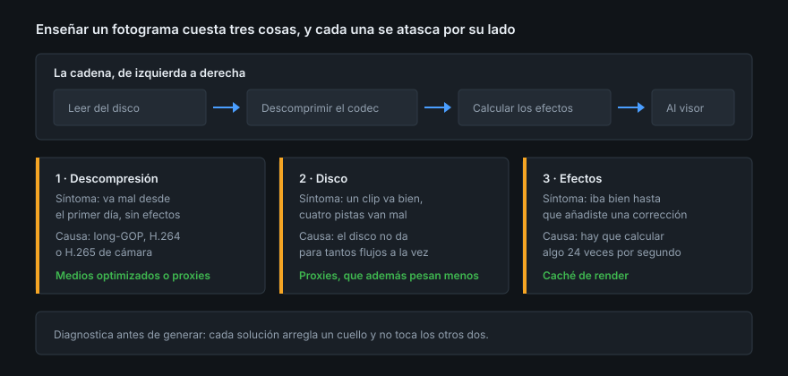

# Por qué el material no va fluido

> Tu ordenador no es lento. Lo que pasa es que le has pedido que descomprima veinticinco
> veces por segundo un formato diseñado para ocupar poco, no para editarse. Esta semana
> entera existe para resolver eso, y empieza por entender exactamente dónde se atasca.

## 🎯 Objetivos

- Explicar por qué un `.mp4` de móvil se reproduce bien en el móvil y mal en Resolve
- Distinguir un codec **long-GOP** de un codec **intra-frame**, y por qué el segundo
  edita mejor aunque ocupe diez veces más
- Localizar el cuello de botella real de tu equipo: descompresión, disco o efectos
- Deducir de ahí las tres soluciones de la semana y cuándo toca cada una

---

## 1. Qué problema resuelve

Importas el material de la Semana 04, lo pones a reproducir y pasa algo de esto: la
imagen se entrecorta, el contador de fotogramas por segundo baja de 24, el audio sigue
pero el vídeo va a saltos, o el programa se queda parado un segundo cada vez que mueves
el cursor de la timeline.

La reacción normal es pensar que hace falta un ordenador mejor. A veces sí. Casi siempre
no: lo que hace falta es **darle al programa un material que se pueda leer rápido**, y
eso es exactamente lo que hacen los medios optimizados, los proxies y la caché.

Antes de aplicar ninguna de las tres hay que saber por qué el material que tienes es
difícil de leer.

---

## 2. Cómo funciona: por qué un archivo pequeño cuesta caro

Reproducir un fotograma no es leerlo: es **reconstruirlo**. Y cuánto cuesta
reconstruirlo depende de cómo se guardó.

### Intra-frame: cada fotograma es independiente

Un codec **intra-frame** —también llamado *all-intra*— guarda cada fotograma completo,
comprimido por su cuenta, sin mirar a los vecinos. Para mostrar el fotograma 1.000 se
lee el fotograma 1.000 y ya está.

Es lo que hacen DNxHR, Apple ProRes y los formatos de las cámaras de cine. Ocupan mucho
—decenas o cientos de megabits por segundo— y se descomprimen casi sin esfuerzo.

### Long-GOP: la mayoría de los fotogramas no existen

Un codec **long-GOP** guarda un fotograma completo cada cierto tiempo y, entre medias,
solo **las diferencias** respecto al anterior. **GOP** significa *Group of Pictures*,
grupo de imágenes: el bloque que va de un fotograma completo al siguiente.

> [!NOTE]
> Los tres tipos de fotograma de un GOP tienen nombre y aparecen en toda la
> documentación: **I** (*intra*, el fotograma completo), **P** (*predicted*, se
> reconstruye a partir del anterior) y **B** (*bi-directional*, se reconstruye mirando
> al anterior **y al siguiente**). Un GOP típico de H.264 tiene un fotograma I cada 12,
> 15 o 30, y el resto son P y B.

Para mostrar el fotograma 1.000, el programa tiene que buscar el último fotograma
completo —pongamos el 990—, descomprimirlo, y aplicarle encima las diferencias del 991,
992, 993… hasta llegar al 1.000. **Diez descompresiones para enseñar una imagen.**

Eso es H.264 y H.265: los codecs de tu móvil, de tu cámara sin espejo y de OBS. Son
excelentes guardando y pésimos editando, y no es un defecto: es para lo que se
diseñaron. Se explicó en la [Semana 02](../../week-02-codecs_contenedores_y_flujo_de_datos/README.md).

### Y por eso el móvil sí puede

Tu móvil reproduce ese mismo archivo sin despeinarse porque lleva un **circuito
dedicado** a descomprimir H.264 y H.265, y porque solo le pides una cosa: reproducir de
principio a fin, hacia delante, sin efectos.

Al montar le pides lo contrario: saltar a un punto cualquiera, ir hacia atrás, reproducir
a media velocidad, y hacerlo mientras calculas encima una corrección de color. Ahí el
circuito dedicado se queda corto o directamente no se usa.

---

## 3. Los tres cuellos de botella, y cómo distinguirlos

Cuando algo va a saltos, el atasco está en uno de estos tres sitios. Distinguirlos es lo
que decide qué herramienta de esta semana te toca.

| Cuello | Síntoma característico | Solución de esta semana |
| ------ | ---------------------- | ----------------------- |
| **Descompresión** | Va mal desde el primer día, con el material tal cual, sin haber tocado nada | Medios optimizados o proxies |
| **Disco** | Va bien con un clip y mal con cuatro pistas a la vez; el disco suena o el sistema marca uso alto | Proxies (que además son más pequeños) |
| **Efectos** | Iba bien hasta que añadiste una corrección, un desenfoque o un nodo de Fusion | Caché de render |

> [!IMPORTANT]
> **La distinción no es académica: cada solución arregla un cuello y no los otros dos.**
> Generar proxies para un problema de efectos no sirve de nada; cachear no arregla un
> codec que no se descomprime. Diagnostica antes de generar cincuenta gigabytes de nada.

### Cómo se mide, sin instalar nada

Resolve muestra en el visor un contador de fotogramas por segundo durante la
reproducción. Si baja del frame rate de tu timeline, no vas a tiempo real.

- **Reproduce un clip solo, sin efectos.** Si ya va mal: cuello de descompresión.
- **Añade tres o cuatro pistas de vídeo con clips distintos.** Si el clip solo iba bien
  y esto va mal: cuello de disco.
- **Vuelve a un clip solo y añádele una corrección de color.** Si empieza a caer ahí:
  cuello de efectos.

Tres pruebas de un minuto que te ahorran una tarde generando lo que no era.

---

## 4. Cómo se hace en Resolve 21: las tres salidas

Esta semana verás las tres, cada una en su archivo. Aquí van en una tabla para que
sepas desde el principio en qué se diferencian, porque se confunden constantemente.

| | Medios optimizados | Proxies | Caché de render |
| --- | ------------------ | ------- | --------------- |
| **Qué genera** | Una copia del clip en un codec fácil | Una copia del clip en un codec fácil, normalmente más pequeña | El resultado ya calculado de un tramo de la timeline |
| **A qué se aplica** | A clips del media pool | A clips del media pool | A tramos de la timeline, con sus efectos |
| **Quién lo gestiona** | Resolve, en su carpeta de caché | Resolve, o tú con archivos generados fuera | Resolve, en su carpeta de caché |
| **Dónde se activa** | `Playback > Use Optimized Media if Available` | `Playback > Proxy Handling` | `Playback > Render Cache` |
| **Arregla** | Descompresión | Descompresión y disco | Efectos |
| **Se puede llevar a otro equipo** | No con facilidad | **Sí**, es su motivo de existir | No |

Las tres tienen algo en común, y es la idea que sostiene la semana entera: **ninguna
toca tu material original.** Son capas de sustitución temporal. Se borran, se
regeneran, y al renderizar la entrega final Resolve vuelve a los archivos de cámara.

> [!WARNING]
> Ese "vuelve a los archivos de cámara" tiene una excepción que cuesta disgustos y que
> se ve en el archivo [03 · Proxies](03-proxies.md): existe un ajuste de la página
> Deliver que permite renderizar **usando los proxies**. Existe por buenos motivos, y
> activado por error entrega un máster a resolución de proxy. Se mira siempre antes de
> exportar.

---

## 5. Lo que no vas a arreglar esta semana

Para que no te lleves una decepción con expectativas mal puestas:

- **La exportación final no se acelera con nada de esto.** Renderizar lee el material
  original a propósito. Un proxy hace fluido el montaje, no la entrega.
- **Un disco lleno no se arregla generando más archivos.** Optimizados, proxies y caché
  ocupan, y a veces ocupan más que el material. Si vas justo de espacio, esta semana
  empieza haciendo sitio.
- **Un ordenador que va mal con un clip solo, sin efectos y con proxies generados**, sí
  es un problema de hardware. Es el único caso de los tres, y es poco frecuente.

---

## 6. Antipatrones

| Antipatrón | Por qué duele | Qué hacer |
| ---------- | ------------- | --------- |
| Generar proxies de todo el material el primer día | Horas de generación y decenas de gigabytes para clips que no vas a usar | Genera para lo que vas a montar, cuando sepas qué es |
| Culpar al ordenador antes de mirar el codec | Se compra hardware para un problema de formato | Las tres pruebas de la sección 3, que son tres minutos |
| Mezclar las tres soluciones a la vez ante el primer tirón | No sabes cuál funcionó, y ocupas el triple | Una cada vez, y comprueba el contador de fps entre medias |
| Suponer que la caché arregla un H.265 pesado | La caché guarda el resultado de los efectos, no el clip | Optimizados o proxies para el codec; caché para los efectos |
| Trabajar sin mirar nunca el contador de fps | No sabes si vas a tiempo real, solo si "se ve raro" | Míralo: es el único dato objetivo que tienes |
| Grabar en H.265 "porque ocupa menos" sin más | Ocupa poco y edita fatal: pagas en tiempo lo que ahorras en disco | Es válido si generas proxies. Decidido a conciencia, no por defecto |

---

## 7. Trucos

| Truco | Cómo |
| ----- | ---- |
| Saber en dos minutos qué tipo de cuello tienes | Las tres pruebas de la sección 3, en este orden: clip solo, cuatro pistas, clip con corrección |
| Ver si de verdad vas a tiempo real | El contador de fotogramas por segundo del visor durante la reproducción |
| Saber qué material te va a dar guerra antes de montarlo | La columna `Video Codec` del media pool: los H.264 y H.265 largos son los sospechosos |
| Comprobar si el disco es el problema | Reproduce el mismo clip desde el disco interno y desde el externo, y compara |
| Descartar los efectos como causa | Desactiva temporalmente el nodo o el efecto y vuelve a reproducir |

---

## 📚 Recursos Adicionales

- [Semana 02 · Codecs, contenedores y flujo de datos](../../week-02-codecs_contenedores_y_flujo_de_datos/README.md) — de dónde salen H.264, H.265, DNxHR y ProRes, y qué significa el bitrate que vas a ver en las tablas de esta semana.
- [DaVinci Resolve Reference Manual](https://www.blackmagicdesign.com/support/family/davinci-resolve-and-fusion) — los capítulos de *Optimized Media and Render Cache* y de *Improving Performance* documentan los ajustes que esta semana usa, con las capturas de tu versión.
- [`docs/hardware-y-rendimiento.md`](../../../docs/hardware-y-rendimiento.md) — qué parte del equipo interviene en cada cuello de botella y qué se nota de verdad al cambiarla.

---

## ✅ Checklist de Verificación

- [ ] Sé explicar por qué un long-GOP se descomprime más caro que un intra-frame
- [ ] Sé qué son los fotogramas I, P y B y qué es un GOP
- [ ] Sé por qué mi móvil reproduce sin problema lo que Resolve reproduce a saltos
- [ ] Sé distinguir el cuello de descompresión del de disco y del de efectos
- [ ] Sé qué herramienta de la semana arregla cada uno de los tres
- [ ] Sé que ninguna de las tres toca mi material original

---

| Anterior | Actual | Siguiente |
| -------- | ------ | --------- |
| — | **01 · Por qué el material no va fluido** | [02 · Medios optimizados](02-medios-optimizados.md) |

← [Volver a la Semana 05](../README.md)
