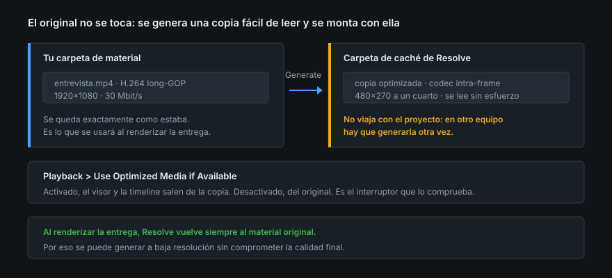

# Medios optimizados

> Es la solución de un clic y la que casi nadie configura antes de usar. Generar medios
> optimizados con los ajustes por defecto funciona; generarlos habiéndolos mirado un
> minuto ocupa la mitad y va el doble de rápido.

## 🎯 Objetivos

- Explicar qué es un **medio optimizado** y en qué se diferencia del material original
- Configurar el formato y la resolución antes de generar, y saber qué elige cada ajuste
- Generar medios optimizados para una selección de clips y comprobar que se usan
- Reconocer los tres casos en los que **no** son la herramienta adecuada

---

## 1. Qué problema resuelve

Tu material está en un codec que se descomprime caro —H.264, H.265, un long-GOP de
cámara— y la reproducción no llega a tiempo real. No quieres cambiar de material, porque
es el que grabaste, y no quieres perder calidad en la entrega final.

Un **medio optimizado** es una copia del clip en un codec fácil de descomprimir, que
Resolve genera y guarda por su cuenta, y que **sustituye al original mientras montas**.
El original sigue intacto en su carpeta; en la entrega final se vuelve a él.

Es la solución del cuello de **descompresión** del archivo anterior: una vez por clip,
para siempre, sin volver a pensarlo.

---

## 2. Cómo funciona

Al generar un medio optimizado, Resolve:

1. Lee el clip original entero.
2. Lo vuelve a escribir en el **codec y la resolución que hayas configurado**, en su
   carpeta de caché.
3. Anota en el proyecto que ese clip tiene una versión optimizada disponible.

A partir de ahí, si el interruptor de reproducción está activado, todo lo que ves —el
visor, la timeline, los scopes— sale de la copia. La entrega vuelve al original.

> [!IMPORTANT]
> Los medios optimizados **viven en la carpeta de caché de Resolve, no junto a tu
> material**. Eso tiene dos consecuencias que se pagan más adelante si no se saben
> ahora: ocupan espacio en el disco que declaraste como caché en la Semana 03, y **no
> viajan con el proyecto**. Abrir el `.drp` en otro equipo significa generarlos otra vez.

Que el original quede intacto no es un detalle: es lo que permite generar sin miedo.
Si el resultado no te convence, se borran y se generan de otra manera. Nada de lo que
hagas aquí se puede perder, salvo el tiempo de generación.

---

## 3. Cómo se hace en Resolve 21

### Primero se configura, después se genera

La configuración vive en
`File > Project Settings > Master Settings > Optimized Media and Render Cache`, y es
donde están los dos ajustes que deciden cuánto ocupan y cuánto tardan:

- **La resolución de los medios optimizados.** Se expresa como fracción de la original:
  la mitad, un cuarto. Un cuarto de 1920×1080 es 480×270, que se descomprime
  instantáneamente y se ve pixelado en pantalla completa.
- **El formato de los medios optimizados**, es decir, el codec. Aquí aparecen las
  familias intra-frame que el archivo anterior describía —DNxHR y ProRes entre ellas—,
  cada una en varias calidades.

> [!NOTE]
> **La lista exacta de codecs depende de tu sistema operativo.** La familia ProRes, por
> ejemplo, no ofrece las mismas opciones de codificación en Windows que en macOS. Los
> rótulos de esos desplegables **no se pueden comprobar por la API de scripting**, que
> es lo único que este bootcamp verifica de forma automática; el capítulo
> *Optimized Media and Render Cache* del
> [manual oficial](https://www.blackmagicdesign.com/support/family/davinci-resolve-and-fusion)
> los recoge con las capturas de tu versión. Lo que no cambia es el criterio de
> elección, que es lo de la tabla siguiente.

| Si tu objetivo es | Elige |
| ----------------- | ----- |
| Montar rápido, y no vas a etalonar desde el optimizado | Resolución baja (un cuarto) y una calidad media del codec |
| Etalonar mirando el optimizado | Resolución completa o la mitad, y una calidad alta |
| Ahorrar espacio a toda costa | Resolución baja y la calidad más baja del codec |
| Generar deprisa | Resolución baja: es lo que más acorta la generación |

> [!WARNING]
> **No etalones mirando un optimizado de baja calidad.** Un codec de calidad baja tira
> información de color para ocupar menos, y tú tomas decisiones de color sobre lo que
> ves. Si vas a corregir, o generas en calidad alta, o desactivas el interruptor de
> reproducción mientras corriges. Esto vuelve a aparecer en la Semana 17.

### Generar

En el media pool, seleccionas los clips —selección múltiple, como en la Semana 04— y
usas la opción `Generate Optimized Media` del menú contextual. Resolve encola el trabajo
y lo procesa en segundo plano; puedes seguir trabajando mientras.

Al terminar, los clips optimizados quedan marcados en el media pool. La columna que
informa de ello se activa como cualquier otra, con clic derecho sobre la cabecera de
columnas en vista de lista.

### El interruptor que hay que conocer

`Playback > Use Optimized Media if Available`

Es un interruptor de la reproducción, no un ajuste del proyecto. Activado, Resolve usa
el optimizado cuando existe. Desactivado, usa siempre el original aunque el optimizado
esté generado.

Sirve para dos cosas concretas:

1. **Comprobar que de verdad funcionó**: actívalo y desactívalo mientras reproduces, y
   mira el contador de fotogramas por segundo. Si no cambia nada, no estabas usando el
   optimizado.
2. **Ver el material real un momento**, sin borrar nada: para juzgar el foco de una toma
   o mirar el ruido antes de una decisión de color.

---

## 4. Cuándo **no** usarlos

| Caso | Por qué no | Qué usar |
| ---- | ---------- | -------- |
| El problema son los efectos, no el codec | El optimizado sustituye al clip, no calcula la corrección | Caché de render |
| Vas a llevarte el proyecto a otro equipo | No viajan: se regeneran allí desde cero | Proxies |
| Solo te falla un tramo de la timeline | Optimizar cuarenta clips para arreglar diez segundos | Caché de render en modo User |
| Estás corto de espacio en el disco de caché | Una tanda grande de optimizados puede pesar más que el material | Proxies a resolución baja, o generar por partes |

---

## 5. Cuánto ocupan, de verdad

La cifra sorprende siempre, y conviene verla antes de generar y no después.

Un codec intra-frame de calidad media a 1080p ronda los **100-150 Mbit/s**. El H.264 de
un móvil ronda los **20-40 Mbit/s**. Es decir: **el material fácil de leer ocupa entre
tres y cinco veces más que el original**, a igual resolución.

Bajar la resolución es lo que corrige eso. A un cuarto de resolución la cuenta se
invierte y el optimizado ocupa bastante menos que el original.

> [!TIP]
> Antes de lanzar una tanda grande, genera **un solo clip** con los ajustes que has
> elegido y mira lo que ha ocupado en la carpeta de caché. Multiplica por el número de
> clips. Es medio minuto, y evita descubrir a mitad de la generación que no cabe.

---

## 6. Antipatrones

| Antipatrón | Por qué duele | Qué hacer |
| ---------- | ------------- | --------- |
| Generar sin mirar los ajustes | Los valores por defecto pueden ocupar mucho más de lo que necesitas | Un minuto en `Optimized Media and Render Cache`, antes |
| Optimizar todo el media pool | Horas y gigabytes para clips que no van a entrar en el montaje | Selecciona lo que vas a usar |
| Etalonar mirando un optimizado de calidad baja | Decides color sobre información que se ha tirado | Calidad alta, o desactiva el interruptor al corregir |
| Dar por hecho que se están usando | Si el interruptor está desactivado, has generado para nada | Compruébalo con el contador de fps, activando y desactivando |
| Usarlos para llevar el proyecto a otro equipo | No viajan con el `.drp` | Proxies |
| Optimizar antes de mirar qué clips fallan | El material que ya iba fluido no gana nada | El pase de diagnóstico de la Semana 04, y a partir de ahí |

---

## 7. Trucos

| Truco | Cómo |
| ----- | ---- |
| Comprobar que el optimizado se está usando | Activa y desactiva `Playback > Use Optimized Media if Available` mientras reproduces |
| Ver de un vistazo qué clips están optimizados | Vista de lista, y activa la columna correspondiente con clic derecho en la cabecera |
| Estimar el espacio antes de una tanda grande | Genera un clip, mira lo que ocupa y multiplica |
| Ver el material real sin borrar nada | Desactiva el interruptor un momento |
| Generar solo lo que importa | Selección múltiple en el media pool: el menú contextual actúa sobre toda la selección |
| Que no te pille el trabajo a medias | La generación va en segundo plano: sigue montando mientras |

---

## 📚 Recursos Adicionales

- [DaVinci Resolve Reference Manual](https://www.blackmagicdesign.com/support/family/davinci-resolve-and-fusion) — el capítulo *Optimized Media and Render Cache* documenta los desplegables de formato y resolución con las opciones exactas de tu sistema operativo.
- [Semana 03 · Anatomía, bases de datos y preferencias](../../week-03-resolve_21_anatomia_bases_de_datos_y_preferencias/README.md) — dónde declaraste la carpeta de caché, que es donde va a aparecer todo lo que generes esta semana.
- [`docs/hardware-y-rendimiento.md`](../../../docs/hardware-y-rendimiento.md) — cuánto se nota cada ajuste según el equipo, y por qué el disco de caché importa más que la CPU.

---

## ✅ Checklist de Verificación

- [ ] Sé qué es un medio optimizado y dónde se guarda
- [ ] Sé que el original no se toca y que la entrega vuelve a él
- [ ] Sé configurar formato y resolución **antes** de generar
- [ ] Sé generar para una selección de clips, no para todo el media pool
- [ ] Sé comprobar con el contador de fps que se están usando de verdad
- [ ] Sé por qué no sirven para llevarme el proyecto a otro equipo

---

| Anterior | Actual | Siguiente |
| -------- | ------ | --------- |
| [01 · Por qué el material no va fluido](01-por-que-el-material-no-va-fluido.md) | **02 · Medios optimizados** | [03 · Proxies](03-proxies.md) |

← [Volver a la Semana 05](../README.md)
