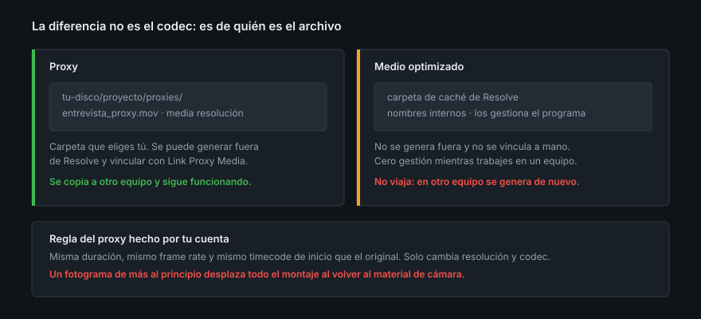

# Proxies

> Un proxy es un doble de acción: se parece lo justo al plano real, hace todo el trabajo
> duro y desaparece cuando llega el momento de la toma buena. La diferencia con un medio
> optimizado es pequeña por dentro y enorme por fuera: **un proxy es un archivo tuyo, en
> una carpeta tuya, que puedes copiar a otro ordenador.**

## 🎯 Objetivos

- Explicar qué es un **proxy** y en qué se diferencia de un medio optimizado
- Generar proxies desde Resolve y saber dónde acaban
- Vincular y desvincular proxies generados fuera de Resolve
- Manejar el interruptor de reproducción de proxies y saber para qué sirve cada opción
- Reconocer el ajuste de la página Deliver que puede arruinar una entrega

---

## 1. Qué problema resuelve

Dos problemas que el medio optimizado no resuelve:

1. **Montar en un equipo y acabar en otro.** Empiezas en el portátil de viaje y terminas
   en el ordenador de casa. Un optimizado no viaja; un proxy sí, porque es un archivo
   normal en una carpeta que tú eliges.
2. **El material no cabe en el disco rápido.** El original vive en un disco externo
   lento o en un servidor, y los proxies —mucho más pequeños— caben en el disco interno.
   Montas del interno y solo tocas el original al entregar.

El proxy es, además, la manera estándar de trabajar en equipo en el oficio: se montan
proxies, se entrega una lista de decisiones, y el acabado se hace contra el material
original. Eso se ve en la [Semana 12](../../week-12-multicam_subtitulos_y_gestion_de_timeline/README.md)
con el intercambio de proyectos.

---

## 2. Cómo funciona



Un proxy es una copia del clip en un codec fácil y una resolución menor, **vinculada**
al clip del media pool. Mientras la reproducción esté configurada para preferirlos,
Resolve enseña el proxy; al renderizar, vuelve al original.

Hasta ahí, igual que un optimizado. Las diferencias son las que importan:

| | Medio optimizado | Proxy |
| --- | ---------------- | ----- |
| Dónde vive | En la carpeta de caché de Resolve | En una carpeta que tú eliges |
| Lo puedes generar fuera de Resolve | No | **Sí** |
| Viaja a otro equipo | No | **Sí** |
| Se vincula a mano si se pierde | No aplica | **Sí**, con `Link Proxy Media` |
| Lo gestiona | Resolve | Tú |

> [!NOTE]
> Las dos cosas se pueden usar a la vez y no se estorban, pero rara vez tiene sentido:
> son dos copias del mismo material ocupando disco para el mismo fin. Elige una. Si vas
> a mover el proyecto de equipo alguna vez, proxies; si no, optimizados y menos gestión.

---

## 3. Cómo se hace en Resolve 21

### Configurar

Los ajustes de proxy están en la misma página que los del archivo anterior:
`File > Project Settings > Master Settings > Optimized Media and Render Cache`. Ahí se
elige la **resolución** del proxy —de nuevo como fracción de la original— y su
**formato**.

El criterio es distinto al del optimizado, porque el objetivo también lo es: un proxy
existe para ser pequeño y ligero. La mitad o un cuarto de resolución es lo habitual, con
un codec intra-frame de calidad media.

### Generar desde Resolve

Con los clips seleccionados en el media pool, `Generate Proxy Media` en el menú
contextual. Igual que los optimizados: trabajo en segundo plano, con el original
intacto.

### Generar fuera de Resolve

Esta es la parte que hace del proxy lo que es. Puedes producir los archivos con
cualquier herramienta —`ffmpeg`, un flujo de la cámara, otro programa— y decirle a
Resolve que esos archivos son los proxies de estos clips:

- `Link Proxy Media` sobre un clip seleccionado, para vincular el archivo.
- `Unlink Proxy Media` para deshacer el vínculo sin borrar nada.

> [!IMPORTANT]
> **Un proxy tiene que corresponder al original fotograma a fotograma.** Misma duración,
> mismo frame rate y mismo timecode de inicio. Si el proxy tiene un fotograma de más al
> principio, todo tu montaje irá desplazado un fotograma al volver al original, y lo
> descubrirás en la entrega. Al generar por tu cuenta, no recortes, no cambies el frame
> rate y no reencuadres: solo baja resolución y cambia de codec.

> [!NOTE]
> Los rótulos exactos del menú contextual y de los desplegables de proxy **no se pueden
> comprobar por la API de scripting**. El capítulo *Media Page* del
> [manual oficial](https://www.blackmagicdesign.com/support/family/davinci-resolve-and-fusion)
> los recoge con las capturas de tu versión. El concepto —generar, vincular, desvincular
> y preferir— es lo que no cambia.

### El interruptor de reproducción

`Playback > Proxy Handling`

Decide qué hace Resolve cuando un clip tiene proxy disponible: preferir el proxy,
preferir el material original, o ignorar los proxies por completo. Es la palanca que
usas para comprobar que están funcionando y para mirar el material real un momento.

Hay además un ajuste vecino que se confunde con este y que **no** tiene nada que ver con
los proxies: `Playback > Timeline Proxy Mode`, que reduce la resolución del cálculo de
la timeline a la mitad o a un cuarto **sobre la marcha**, sin generar ningún archivo. Es
la solución instantánea y gratuita, y también la de peor calidad de imagen. Sirve para
salir del paso; no sustituye a nada de esta semana.

---

## 4. El ajuste que arruina una entrega

> [!WARNING]
> En la página **Deliver** existe una opción que hace que el render **use los proxies en
> lugar del material original**. Existe por buenos motivos —revisiones rápidas para
> cliente, previsualizaciones de trabajo—, y activada por descuido entrega un máster con
> la resolución y la calidad de un proxy. Nadie lo nota hasta que el archivo está
> subido. **Se comprueba antes de cada entrega**, y vuelve a salir en la
> [Semana 28](../../week-28-deliver_page_render_y_codecs/README.md).

La comprobación de treinta segundos, hasta que la Semana 28 la explique entera: antes de
exportar, mira que en los ajustes de render no esté marcado el uso de proxies, y
comprueba la resolución de salida.

---

## 5. Cuándo cada cosa: la decisión en tres preguntas

1. **¿Vas a abrir este proyecto en otro ordenador?** Sí → proxies.
2. **¿El material vive en un disco lento o remoto?** Sí → proxies.
3. **Si las dos son no** → medios optimizados, que no hay que gestionar.

Y una cuarta, transversal: **¿el problema son los efectos?** Entonces ninguna de las
dos, sino la caché de render del [archivo siguiente](04-la-cache-de-render.md).

---

## 6. Un proxy hecho por tu cuenta, con `ffmpeg`

Es el caso que justifica todo lo anterior: generar los proxies fuera de Resolve, en el
ordenador que esté libre, mientras sigues trabajando en el que no lo está.

`ffmpeg` es una herramienta de línea de comandos, libre y gratuita, que convierte vídeo
entre formatos. La receta mínima para un proxy útil:

```bash
ffmpeg -i original.mp4 -vf scale=-2:540 -c:v dnxhd -profile:v dnxhr_lb -c:a pcm_s16le proxy.mov
```

Qué hace cada parte, porque copiar sin entender es como no tenerlo:

| Parte | Qué hace |
| ----- | -------- |
| `-vf scale=-2:540` | Baja la altura a 540 px y calcula el ancho manteniendo la proporción |
| `-c:v dnxhd -profile:v dnxhr_lb` | Codifica el vídeo en un codec intra-frame de calidad baja |
| `-c:a pcm_s16le` | Deja el audio sin comprimir, para que no se desplace ni un fotograma |

> [!WARNING]
> **Lo que no debe aparecer nunca en esa orden**: `-r` (cambia el frame rate), `-ss` o
> `-t` (recortan), `-crop` o cualquier reencuadre. Cualquiera de los tres rompe la
> correspondencia fotograma a fotograma con el original, y el montaje saldrá desplazado
> al volver al material de cámara. Solo se cambia resolución y codec.

Después, en Resolve: seleccionas los clips, `Link Proxy Media`, y señalas la carpeta.

---

## 7. Antipatrones

| Antipatrón | Por qué duele | Qué hacer |
| ---------- | ------------- | --------- |
| Generar proxies con otra duración o frame rate | El montaje se desplaza al volver al original, y se descubre entregando | Misma duración, frame rate y timecode. Solo cambia resolución y codec |
| Proxies y optimizados a la vez, sin decidir | Doble ocupación de disco para el mismo fin | Elige uno según las tres preguntas |
| Guardar los proxies dentro de la carpeta del material original | Se mezclan con el material de cámara y acaban copiados o borrados por error | Carpeta propia y hermana, `proxies/` |
| Renderizar la entrega sin comprobar el ajuste de Deliver | Entregas un máster a resolución de proxy | Mirarlo antes de cada exportación |
| Etalonar sobre el proxy sin darse cuenta | Decides color sobre una copia degradada | `Playback > Proxy Handling`, y trabaja sobre el original al corregir |
| Borrar los proxies "que ya no hacen falta" a mitad de proyecto | Vuelves a reproducción a saltos y a horas de regeneración | Bórralos al archivar, no antes |

---

## 8. Trucos

| Truco | Cómo |
| ----- | ---- |
| Comprobar que los proxies se usan | Cambia `Playback > Proxy Handling` mientras reproduces y mira el contador de fps |
| Llevarte el montaje a otro equipo | Copia el `.drp` y la carpeta de proxies; vincula allí con `Link Proxy Media` |
| Salir del paso sin generar nada | `Playback > Timeline Proxy Mode` a media o un cuarto de resolución |
| Que los proxies no se pierdan al mover el material | Guárdalos en una carpeta hermana del material, no dentro |
| Volver al original un momento | Cambia el modo de reproducción de proxies, no desvincules |
| Saber si un clip tiene proxy | Vista de lista y la columna correspondiente, con clic derecho en la cabecera |

---

## 📚 Recursos Adicionales

- [DaVinci Resolve Reference Manual](https://www.blackmagicdesign.com/support/family/davinci-resolve-and-fusion) — los capítulos *Media Page* e *Improving Performance* documentan la generación, el vínculo y el modo de reproducción de proxies.
- [Semana 02 · Codecs, contenedores y flujo de datos](../../week-02-codecs_contenedores_y_flujo_de_datos/README.md) — qué codec elegir para un proxy y por qué el bitrate manda sobre el nombre.
- [`docs/free-vs-studio.md`](../../../docs/free-vs-studio.md) — qué formatos de codificación quedan disponibles en la versión gratuita, que es lo que limita la lista de codecs de proxy.

---

## ✅ Checklist de Verificación

- [ ] Sé en qué se diferencia un proxy de un medio optimizado, y sé elegir entre los dos
- [ ] Sé generar proxies desde Resolve para una selección de clips
- [ ] Sé vincular y desvincular proxies generados fuera
- [ ] Sé que el proxy debe coincidir en duración, frame rate y timecode con el original
- [ ] Sé usar `Playback > Proxy Handling` para comprobar que funcionan
- [ ] Sé que hay un ajuste en Deliver que renderiza con proxies, y lo compruebo antes de entregar

---

| Anterior | Actual | Siguiente |
| -------- | ------ | --------- |
| [02 · Medios optimizados](02-medios-optimizados.md) | **03 · Proxies** | [04 · La caché de render](04-la-cache-de-render.md) |

← [Volver a la Semana 05](../README.md)
