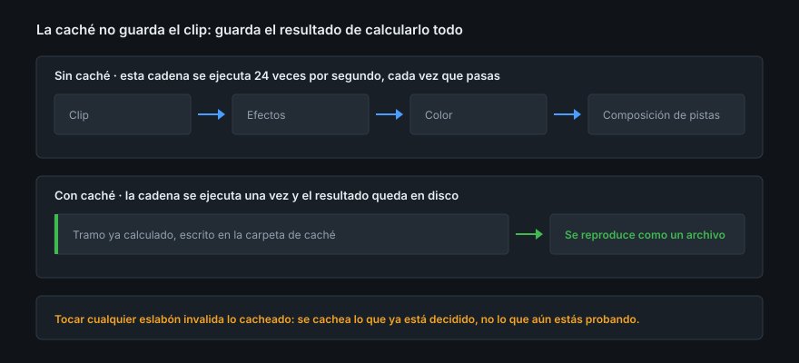

# La caché de render

> Optimizados y proxies sustituyen el clip. La caché sustituye **el cálculo**: guarda en
> disco el resultado ya montado de un tramo de la timeline, con sus efectos aplicados,
> para no tener que volver a calcularlo cada vez que pasas por encima.

## 🎯 Objetivos

- Explicar qué guarda exactamente la caché de render y en qué se diferencia de un proxy
- Distinguir el modo **Smart** del modo **User** y saber cuándo toca cada uno
- Cachear un tramo concreto de la timeline, y saber leer la barra de estado de la caché
- Borrar la caché sin perder trabajo, sabiendo qué es irreversible y qué no

---

## 1. Qué problema resuelve

Reproduces la timeline, va fluida, y en cuanto añades una corrección de color o un
desenfoque el mismo tramo empieza a ir a saltos. El clip no ha cambiado: lo que ha
cambiado es que ahora hay que **calcular algo encima**, y eso hay que hacerlo veinticuatro
veces por segundo, cada vez que pasas por ahí.

La caché de render calcula ese tramo **una sola vez**, escribe el resultado en disco y a
partir de entonces lo reproduce como si fuera un archivo cualquiera. Es la única de las
tres soluciones de la semana que arregla el cuello de **efectos**.

---

## 2. Cómo funciona

Un fotograma de la timeline es el resultado de una cadena: se descomprime el clip, se
aplican los efectos, se aplica la corrección de color, se compone con las pistas de
arriba. Cada eslabón cuesta tiempo.

Cachear un tramo significa **ejecutar esa cadena una vez, escribir el resultado en la
carpeta de caché, y reproducir desde ahí**. El formato de esos archivos se elige en
`File > Project Settings > Master Settings > Optimized Media and Render Cache`, en el
ajuste de formato de la caché de render.

La caché se **invalida sola**: si tocas cualquier eslabón de la cadena de ese tramo
—cambias la corrección, mueves el clip, editas el efecto—, lo cacheado deja de valer y
Resolve lo vuelve a generar. No hay que acordarse de nada, y esa es la gracia.

> [!NOTE]
> Por eso cachear **antes** de terminar de decidir es tirar tiempo: cada retoque manda a
> la basura lo cacheado. Se cachea lo que ya está decidido.

---

## 3. Los tres modos

`Playback > Render Cache`, con tres estados:

### `None`

Sin caché. Todo se calcula al vuelo. Es lo correcto mientras montas material sencillo,
y lo que evita llenar el disco de archivos que no necesitas.

### `Smart`

Resolve decide por su cuenta qué cachear: los tramos que sabe que le van a costar caro.
Qué entra en esa decisión se configura en la misma página de ajustes del proyecto, con
las opciones que deciden si se cachean automáticamente las transiciones, los compuestos
y los efectos de Fusion.

Es el modo por defecto de trabajo para la mayoría, y el que se recomienda esta semana.

### `User`

Resolve no cachea nada por su cuenta: cachea **solo lo que tú marques**. Se marca en la
timeline, con el menú contextual sobre el clip o sobre el tramo.

Es el modo del control total, y el que tiene sentido cuando el disco de caché va justo o
cuando estás en un tramo muy pesado y no quieres que el programa se ponga a generar por
su cuenta a mitad de faena.

| Modo | Quién decide | Cuándo |
| ---- | ------------ | ------ |
| `None` | Nadie: no se cachea | Montaje sencillo, sin efectos, o disco muy justo |
| `Smart` | Resolve | El día a día. Es el punto de partida razonable |
| `User` | Tú, tramo a tramo | Discos justos, tramos muy pesados, control fino |

---

## 4. La barra de la caché

Debajo de la regla de tiempo de la timeline hay una franja fina que informa del estado
de la caché tramo a tramo: qué está cacheado, qué está pendiente y qué se está generando
en este momento.

Es la forma de comprobar si la caché está haciendo algo. Si reproduces un tramo pesado y
esa franja no cambia de estado, o el modo es `None`, o el tramo no entra en los
criterios de `Smart`.

> [!NOTE]
> Los colores exactos de esa franja y sus rótulos **no se pueden comprobar por la API de
> scripting**. El capítulo *Improving Performance* del
> [manual oficial](https://www.blackmagicdesign.com/support/family/davinci-resolve-and-fusion)
> los documenta con las capturas de tu versión. Lo que sí puedes hacer sin manual es
> mirar la franja antes y después de reproducir un tramo con efectos: el cambio se ve.

---

## 5. Borrar la caché

`Playback > Delete Render Cache`, con opciones para borrar **todo**, borrar solo lo que
ya **no se está usando**, o borrar lo de los **clips seleccionados**.

> [!WARNING]
> **Borrar la caché no se puede deshacer, y no hay diálogo de confirmación que te
> explique qué vas a perder.** Lo que se pierde es tiempo de generación, no trabajo: tus
> cortes, tus efectos y tus grados siguen exactamente donde estaban, y lo borrado se
> regenera solo la próxima vez que reproduzcas. Aun así, borrar la caché entera de un
> proyecto avanzado puede significar media hora de regeneración, así que la opción de
> borrar solo lo que ya no se usa es la que quieres el 90 % de las veces.

Es una operación de mantenimiento normal, no una emergencia. La carpeta de caché crece
sola y hay que vaciarla de vez en cuando: eso es materia del
[archivo siguiente](05-donde-vive-la-cache.md).

---

## 6. Lo que la caché **no** es

Tres confusiones habituales, y merece la pena tener las tres claras:

- **No es una entrega.** Los archivos de caché no son tu vídeo exportado, aunque sean
  vídeo. Entregar es materia de la Semana 28.
- **No es un respaldo.** Se puede borrar entera sin perder nada de tu trabajo. Si algo
  se perdiera al borrarla, sería un error grave y no lo es.
- **No arregla un codec pesado.** Si el clip solo, sin efectos, ya va a saltos, el
  problema es la descompresión y la caché no lo toca. Optimizados o proxies.

---

## 7. El orden en que se prueban las tres soluciones

Ante una timeline que va a saltos, el orden importa: cada paso descarta una causa y evita
generar lo que no era.

1. **Reproduce un clip solo, sin efectos.** Si ya va mal, no toques la caché: el problema
   es el codec, y toca lo del archivo 02 o el 03.
2. **Desactiva los efectos del tramo y reproduce.** Si con ellos desactivados va fluido,
   el cuello son los efectos y la caché es la herramienta.
3. **Comprueba el modo de caché** antes de concluir nada. En `None` no se cachea, por
   pesado que sea el tramo.
4. **Cachea solo ese tramo**, en modo `User`, y vuelve a medir. Si los fps suben, era eso.
5. **Si sigue igual con el tramo cacheado**, el cuello está en el disco: la caché se está
   generando pero no se lee lo bastante rápido. Ahí toca mirar dónde vive la carpeta de
   trabajo, que es lo del archivo siguiente.

> [!TIP]
> Los cinco pasos son cinco minutos y una sola cifra en cada uno: el contador de
> fotogramas por segundo. Es la diferencia entre arreglar el problema y generar cincuenta
> gigabytes por si acaso.

---

## 8. Antipatrones

| Antipatrón | Por qué duele | Qué hacer |
| ---------- | ------------- | --------- |
| Cachear antes de decidir el efecto | Cada retoque invalida lo cacheado: generas para nada | Cachea lo que ya está cerrado |
| Dejar `Smart` con el disco casi lleno | La caché crece sola hasta llenarlo, y Resolve se para | `User`, o haz sitio antes |
| Usar la caché para arreglar un H.265 pesado | Cachea el cálculo, no el clip | Optimizados o proxies |
| Borrar la caché entera cada vez que algo va raro | Media hora de regeneración para nada | Borra solo lo no usado, y solo cuando haga falta espacio |
| Suponer que está cacheado sin mirar la barra | Se monta creyendo que va fluido "porque está la caché puesta" | Mira la franja de estado bajo la regla de tiempo |
| Cachear la timeline entera "por si acaso" | Gigabytes y minutos para tramos que aún vas a cambiar | Tramos concretos, en modo `User` |

---

## 9. Trucos

| Truco | Cómo |
| ----- | ---- |
| Ver si la caché está trabajando | La franja de estado bajo la regla de tiempo de la timeline |
| Cachear solo lo pesado | `Playback > Render Cache > User` y marca los tramos que quieras |
| Hacer sitio sin perder lo bueno | `Playback > Delete Render Cache`, con la opción de borrar solo lo no usado |
| Saber si el problema son los efectos | Desactiva el efecto y reproduce: si va fluido, era eso, y la caché lo arregla |
| No pelear con la caché mientras experimentas | Déjala en `None` hasta que el tramo esté decidido |
| Que la caché no compita con tu material | La carpeta de caché, en un disco distinto del material, como en la Semana 03 |

---

## 📚 Recursos Adicionales

- [DaVinci Resolve Reference Manual](https://www.blackmagicdesign.com/support/family/davinci-resolve-and-fusion) — el capítulo *Improving Performance* documenta los modos de caché, la barra de estado y las opciones de borrado.
- [Semana 03 · Anatomía, bases de datos y preferencias](../../week-03-resolve_21_anatomia_bases_de_datos_y_preferencias/README.md) — dónde configuraste las *Working Folders*, que es la carpeta que esta semana empieza a llenarse de verdad.
- [`docs/hardware-y-rendimiento.md`](../../../docs/hardware-y-rendimiento.md) — por qué la velocidad del disco de caché condiciona más la fluidez que la potencia de la CPU.

---

## ✅ Checklist de Verificación

- [ ] Sé qué guarda la caché y en qué se diferencia de un proxy
- [ ] Sé distinguir `None`, `Smart` y `User` y cuándo usar cada uno
- [ ] Sé cachear un tramo concreto en modo `User`
- [ ] Sé leer la franja de estado de la caché bajo la regla de tiempo
- [ ] Sé que borrar la caché no pierde trabajo, solo tiempo de generación
- [ ] Sé que la caché no arregla un problema de codec

---

| Anterior | Actual | Siguiente |
| -------- | ------ | --------- |
| [03 · Proxies](03-proxies.md) | **04 · La caché de render** | [05 · Dónde vive la caché](05-donde-vive-la-cache.md) |

← [Volver a la Semana 05](../README.md)
