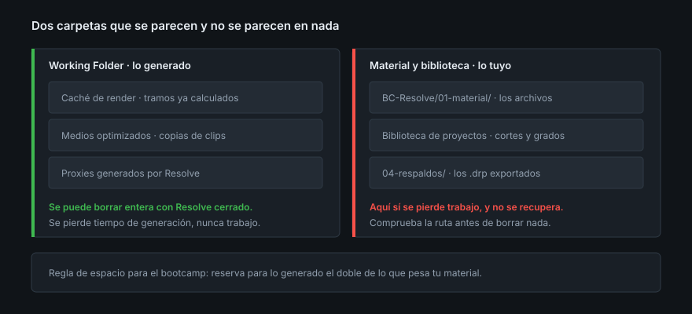

# Dónde vive la caché

> Todo lo de los tres archivos anteriores escribe archivos en tu disco. Bastantes, y
> grandes. Esta es la parte que nadie enseña y la que hace que en el mes cuatro tu disco
> esté lleno y no sepas de qué.

## 🎯 Objetivos

- Localizar la carpeta donde Resolve escribe caché, optimizados y proxies generados
- Entender la estructura de esa carpeta y por qué no se toca a mano casi nunca
- Estimar cuánto va a ocupar tu proyecto en caché durante el bootcamp
- Vaciar espacio con criterio, sabiendo qué se regenera solo y qué no
- Decidir en qué disco poner la caché y por qué eso importa más que la CPU

---

## 1. Qué problema resuelve

Es el problema más aburrido de la semana y el que más gente sufre: **el disco se llena**.
Un lunes cualquiera Resolve empieza a comportarse raro, la reproducción se cae, el
proyecto tarda en guardar, y el explorador de archivos dice que quedan 4 GB libres.

La caché crece sola. Está diseñada para eso: cachea lo que hace falta y lo deja ahí por
si vuelves a pasar. Nadie la vacía si no vas tú a vaciarla.

Saber **dónde** está y **cuánto** ocupa convierte eso en una tarea de dos minutos al mes.

---

## 2. Cómo funciona: una carpeta y tres inquilinos

En la Semana 03 configuraste las **Working Folders** en
`Preferences > Media Storage` y en los ajustes del proyecto. Esa es la carpeta donde
Resolve escribe lo que genera. Dentro conviven tres cosas distintas, y confundirlas es
lo que lleva a borrar lo que no era:

| Inquilino | Qué es | Si lo borras |
| --------- | ------ | ------------ |
| **Caché de render** | Tramos de timeline ya calculados | Se regenera solo al reproducir. Pierdes tiempo, no trabajo |
| **Medios optimizados** | Copias de clips en codec fácil | Hay que regenerarlos a mano. Pierdes tiempo, no trabajo |
| **Proxies generados por Resolve** | Copias de clips, vinculadas | Hay que regenerarlos o revincularlos. Pierdes tiempo, no trabajo |

La buena noticia está en la columna de la derecha, y conviene decirla en voz alta: **en
esa carpeta no hay nada irreemplazable**. Tus cortes, tus grados, tus keywords y tus
timelines viven en la base de datos del proyecto, no aquí. Borrar esta carpeta entera con
Resolve cerrado deja el proyecto intacto y lento, no roto.

> [!WARNING]
> Eso vale **solo** para la carpeta de caché. La carpeta de tu **material** y la
> **biblioteca de proyectos** son otra cosa completamente distinta y ahí sí se pierde
> trabajo. Antes de borrar nada, comprueba que la ruta que tienes delante es la que
> declaraste como *Working Folder* en la Semana 03, y no `BC-Resolve/01-material/`.

---

## 3. Cómo se hace en Resolve 21

### Encontrar la carpeta

La ruta está a la vista en los ajustes del proyecto, en la sección
`Master Settings`, junto a los ajustes de optimizados y caché: ahí se declara la
carpeta de trabajo donde va todo lo generado. La estructura interna la crea Resolve y
tiene nombres poco descriptivos, con carpetas por proyecto y por tipo de contenido.

> [!IMPORTANT]
> **No reorganices esa carpeta a mano.** Los nombres los usa Resolve para encontrar lo
> que generó. Mover archivos dentro no rompe nada grave, pero hace que todo lo movido
> deje de reconocerse y haya que regenerarlo. Si quieres orden, cambia la carpeta entera
> de sitio desde los ajustes, no por dentro.

### Borrar desde dentro de Resolve

Es la forma recomendada, porque Resolve sabe qué está en uso:

- `Playback > Delete Render Cache`, con sus tres alcances (todo, lo no usado, lo
  seleccionado).
- Los medios optimizados y los proxies se borran desde el menú contextual del media pool,
  con las opciones correspondientes de eliminación y desvinculación.

### Borrar desde fuera

Con **Resolve cerrado**, se puede vaciar la carpeta de trabajo desde el explorador de
archivos. Es lo que se hace cuando el disco está tan lleno que Resolve ni arranca bien.

> [!WARNING]
> Cierra Resolve antes. Borrar archivos que el programa está usando en ese momento
> produce fallos de reproducción raros y difíciles de diagnosticar, y en el peor caso
> obliga a reiniciar a mitad de faena. Cerrar, borrar, abrir.

---

## 4. Cuánto va a ocupar esto

Los números importan porque deciden si tu disco aguanta el bootcamp. Estas cifras son
órdenes de magnitud para 1080p, no promesas:

| Qué | Orden de magnitud |
| --- | ----------------- |
| Material original, H.264 de móvil | 20-40 Mbit/s ≈ **0,2 GB por minuto** |
| Proxy a un cuarto de resolución | ≈ **0,1 GB por minuto** |
| Medio optimizado a resolución completa, calidad media | 100-150 Mbit/s ≈ **1 GB por minuto** |
| Caché de render de un tramo con color | Del orden del optimizado, por tramo cacheado |

Traducido al bootcamp: con **treinta minutos de material** y medios optimizados a
resolución completa, la carpeta de caché puede acercarse a **30 GB**. A un cuarto de
resolución, a menos de 5 GB. Esa es toda la diferencia entre las dos casillas del
desplegable que miraste en el archivo 02.

> [!TIP]
> Regla práctica para este bootcamp: **reserva el doble del tamaño de tu material** para
> caché y generados. Si tu pack pesa 10 GB, cuenta con 20 GB más. Si no los tienes,
> trabaja a un cuarto de resolución y borra la caché no usada al cerrar cada semana.

---

## 5. En qué disco ponerla

Si tienes más de un disco, esta decisión se nota más que cualquier ajuste de calidad:

1. **El disco más rápido que tengas**, y a ser posible **distinto del disco del
   material**. Mientras reproduces, Resolve lee material y lee caché a la vez; si los
   dos están en el mismo disco, compiten.
2. **Nunca en un disco de red ni en una carpeta sincronizada con la nube.** La caché se
   escribe y se borra constantemente; un servicio de sincronización intentará subir cada
   archivo generado, y eso satura la red y el disco a la vez.
3. **Nunca en el mismo sitio que los respaldos.** No es por rendimiento, es por
   seguridad: el día que vacíes la caché a lo bruto, quieres estar seguro de que en esa
   carpeta no hay nada más.

---

## 6. La rutina de mantenimiento de dos minutos

No hace falta ninguna disciplina especial: basta con hacer esto al cerrar cada semana del
bootcamp, y el disco no se llena nunca por sorpresa.

1. **Guarda el proyecto** y ciérralo o déjalo quieto.
2. `Playback > Delete Render Cache`, con la opción que borra **lo no usado**.
3. Mira el **tamaño de la carpeta de trabajo** en el explorador de archivos.
4. Mira el **espacio libre** del disco.
5. Anota las dos cifras y la fecha en `rendimiento.md`, que es el archivo que escribes en
   la práctica 01 de esta semana.

Con esas dos cifras anotadas semana a semana tienes algo que ningún tutorial te da: la
**tendencia**. Si el disco pierde diez gigabytes por semana y te quedan cuarenta, sabes
que en la Semana 09 tienes un problema, y lo sabes con cuatro semanas de margen para
resolverlo con calma.

> [!TIP]
> Si el número no baja al borrar lo no usado, es que **todo** lo cacheado está en uso: tu
> proyecto necesita ese espacio. Entonces la palanca no es borrar, es bajar la resolución
> de los optimizados o pasar la caché a modo `User`.

---

## 7. Antipatrones

| Antipatrón | Por qué duele | Qué hacer |
| ---------- | ------------- | --------- |
| Descubrir la carpeta de caché cuando el disco está lleno | Ya vas con prisa y con Resolve funcionando mal | Mírala hoy, con el proyecto en calma |
| Reorganizar la carpeta de caché a mano | Lo movido deja de reconocerse y se regenera entero | Cambia la carpeta de sitio desde los ajustes |
| Caché en una carpeta sincronizada con la nube | La sincronización sube gigabytes de archivos temporales | Carpeta local, siempre |
| Caché en el mismo disco que el material | Los dos flujos compiten por el mismo disco | Discos distintos si los tienes |
| Borrar la carpeta con Resolve abierto | Fallos de reproducción raros y difíciles de diagnosticar | Cerrar, borrar, abrir |
| Generar optimizados a resolución completa "por calidad" | Un gigabyte por minuto de material | A un cuarto, salvo que vayas a etalonar sobre ellos |
| Confundir la carpeta de caché con la del material | Ahí sí se pierde trabajo | Comprueba la ruta antes de borrar. Siempre |

---

## 8. Trucos

| Truco | Cómo |
| ----- | ---- |
| Saber cuánto ocupa lo generado | Mira el tamaño de la carpeta de trabajo en el explorador de archivos |
| Hacer sitio sin perder lo que estás usando | `Playback > Delete Render Cache`, opción de borrar solo lo no usado |
| Mantenimiento de dos minutos al cerrar la semana | Borra la caché no usada y anota el espacio libre en tus notas |
| Que la caché no compita con el material | Carpeta de trabajo en un disco distinto del material |
| Emergencia: el disco lleno y Resolve no arranca bien | Cierra Resolve y vacía la carpeta de trabajo desde el explorador |
| No borrar lo que no era | Comprueba que la ruta coincide con la *Working Folder* de la Semana 03 |

---

## 📚 Recursos Adicionales

- [Semana 03 · Anatomía, bases de datos y preferencias](../../week-03-resolve_21_anatomia_bases_de_datos_y_preferencias/README.md) — donde declaraste las *Working Folders* y por qué se separó caché de material.
- [DaVinci Resolve Reference Manual](https://www.blackmagicdesign.com/support/family/davinci-resolve-and-fusion) — el capítulo *Improving Performance* documenta la gestión de la caché y sus opciones de borrado.
- [`docs/hardware-y-rendimiento.md`](../../../docs/hardware-y-rendimiento.md) — por qué el disco de caché es la pieza que más se nota, por encima de la CPU y de la memoria.

---

## ✅ Checklist de Verificación

- [ ] Sé dónde está mi carpeta de trabajo y qué hay dentro
- [ ] Sé que en esa carpeta no hay nada irreemplazable
- [ ] Sé distinguirla de la carpeta del material y de la biblioteca de proyectos
- [ ] Sé estimar cuánto va a ocupar mi proyecto en caché
- [ ] Sé vaciar espacio desde Resolve y, con el programa cerrado, desde fuera
- [ ] Sé por qué la caché no va en la nube ni en el disco del material

---

| Anterior | Actual | Siguiente |
| -------- | ------ | --------- |
| [04 · La caché de render](04-la-cache-de-render.md) | **05 · Dónde vive la caché** | [06 · Sincronizar audio y vídeo](06-sincronizar-audio-y-video.md) |

← [Volver a la Semana 05](../README.md)
