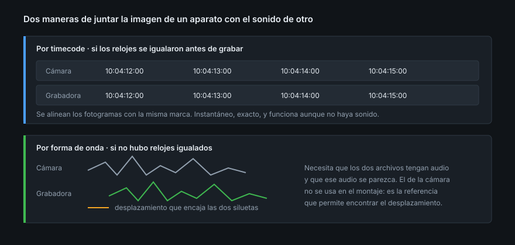

# Sincronizar audio y vídeo

> El micrófono bueno casi nunca está en la cámara. Eso significa que la imagen viene de
> un sitio y el sonido de otro, y que alguien tiene que juntarlos con precisión de un
> fotograma. Ese alguien eres tú, y hay dos maneras: por reloj o por forma de onda.

## 🎯 Objetivos

- Explicar qué es el **sonido de doble sistema** y por qué se graba así
- Definir **timecode** y entender por qué sincroniza sin mirar el audio
- Explicar cómo se sincroniza por **forma de onda** y qué necesita para funcionar
- Sincronizar clips desde el media pool y comprobar el resultado con criterio
- Reconocer y arreglar una deriva de sincronía

---

## 1. Qué problema resuelve

El micrófono que trae una cámara está a metros del que habla y apuntando a donde apunta
el objetivo. El resultado es voz lejana, con eco de la sala y con el ruido de todo lo
demás. La solución del oficio es grabar el sonido aparte: un micrófono de solapa, una
grabadora, una pértiga.

Eso se llama **sonido de doble sistema**: la imagen se graba en un aparato y el sonido en
otro. Y produce el problema de esta página: dos archivos que empezaron en momentos
distintos y que tienen que acabar pegados al fotograma.

> [!NOTE]
> Aunque grabes con el móvil y no tengas grabadora, esto te toca igual: el momento en
> que grabas la voz con un micrófono de solapa conectado a otro aparato, o cuando montas
> una entrevista con dos cámaras, ya estás en doble sistema. Y la Semana 12, con
> multicámara, lo da por sabido.

---

## 2. Las dos maneras

### Por timecode

El **timecode** es la marca de tiempo que un aparato escribe en cada fotograma o en cada
fragmento de audio que graba, con el formato `HH:MM:SS:FF` —horas, minutos, segundos y
fotogramas— que ya viste en la [Semana 01](../../week-01-fundamentos_de_imagen_en_movimiento/README.md).

Si la cámara y la grabadora han puesto sus relojes **a la misma hora** antes de empezar,
sincronizar es aritmética: se buscan los fotogramas cuyo timecode coincide y se alinean.
Es instantáneo, es exacto y funciona aunque el audio esté en silencio.

Su condición es dura y no se puede arreglar después: **los relojes tenían que estar
igualados en el rodaje**. Si nadie lo hizo, este método no sirve.

### Por forma de onda

La **forma de onda** (*waveform*) es el dibujo del sonido: la representación de su
volumen a lo largo del tiempo, con sus picos y sus valles. Dos grabaciones del mismo
momento, hechas por dos micrófonos distintos, suenan diferente pero **dibujan la misma
silueta**.

Sincronizar por forma de onda es buscar el desplazamiento en el que las dos siluetas
encajan. Funciona sin ninguna preparación previa, que es su gran ventaja, y necesita dos
cosas:

1. Que **los dos archivos tengan audio**. La cámara tiene que haber grabado algo,
   aunque sea con su micrófono malo. Ese audio no se usa: sirve de referencia.
2. Que ese audio **se parezca**. Si la cámara estaba a treinta metros o hay viento
   tapándolo todo, no hay silueta común que encontrar.

| | Timecode | Forma de onda |
| --- | -------- | ------------- |
| Necesita preparación en el rodaje | **Sí**: relojes igualados | No |
| Funciona con audio en silencio | **Sí** | No |
| Funciona si la cámara grabó audio malo | Sí | **Sí**, es justo su caso |
| Velocidad | Instantánea | Segundos por clip |
| Precisión | Al fotograma | Muy alta, y comprobable a ojo |

---

## 3. Cómo se hace en Resolve 21

Se sincroniza **en el media pool**, antes de montar. Es importante: sincronizar clip a
clip encima de la timeline es lento, se desalinea al mover, y hay que rehacerlo cada vez
que cambias un corte.

1. Selecciona en el media pool el clip de vídeo y el de audio que van juntos.
2. Menú contextual > `Auto Sync Audio`.
3. Elige el método: por **timecode** o por **forma de onda**.

Hay además una decisión que se elige en ese mismo submenú y que conviene entender, porque
determina qué pasa con el audio original de la cámara:

- **Sustituir** el audio de la cámara por el bueno. Queda un clip limpio con una sola
  pista de audio.
- **Añadir** el audio bueno como una pista más, conservando el de cámara. Quedan dos
  pistas: la buena y la de referencia.

> [!TIP]
> **Añadir, no sustituir**, mientras aprendes. Conservar el audio de cámara te da algo
> con lo que comparar si la sincronía se tuerce, y no cuesta prácticamente nada de disco.
> Se puede silenciar la pista de referencia en el montaje y no volver a pensar en ella.

> [!NOTE]
> Los rótulos exactos de las opciones de este submenú **no se pueden comprobar por la API
> de scripting**. El capítulo *Media Page* del
> [manual oficial](https://www.blackmagicdesign.com/support/family/davinci-resolve-and-fusion)
> los recoge con las capturas de tu versión. El concepto —dos métodos, y sustituir frente
> a añadir— es lo que no cambia.

### Comprobar el resultado

Sincronizar sin comprobar es media tarea. Dos comprobaciones, en este orden:

1. **Mira una consonante explosiva.** Una "p" o una "t" produce un pico visible en la
   forma de onda y un movimiento de labios visible en la imagen. Colócate ahí y avanza
   fotograma a fotograma: el pico y el cierre de labios tienen que caer en el mismo.
2. **Escucha el final del clip.** Si al principio cuadra y al final no, no es un error de
   sincronía: es **deriva**, y se arregla de otra manera.

> [!IMPORTANT]
> El oído humano detecta un desfase de sonido **antes** que el ojo detecta el de la
> imagen: un audio adelantado se nota mucho más que uno atrasado, porque en la vida real
> el sonido siempre llega después. Si dudas entre dos posiciones, elige la que deja el
> audio ligeramente **atrasado**, nunca adelantado.

---

## 4. La deriva: cuando cuadra al principio y no al final

Si el clip empieza sincronizado y termina desplazado, los dos aparatos no estaban
midiendo el tiempo igual. Las causas habituales:

- **Frecuencias de muestreo distintas.** La grabadora graba a 48 kHz y la cámara a
  44,1 kHz; la diferencia se acumula minuto a minuto.
- **Frame rates casi iguales pero no iguales.** 24 y 23,976 fps parecen lo mismo y no lo
  son: se separan un fotograma cada 42 segundos aproximadamente.

La solución de fondo está antes del rodaje: **48 kHz en todo lo que grabe audio, y el
mismo frame rate en todas las cámaras**. Con material ya grabado, lo que queda es cortar
la escena en trozos y sincronizar cada trozo por su cuenta, que es exactamente por lo que
existen los subclips del [archivo 08](08-subclips.md).

---

## 5. El caso más común de todos: pantalla y cámara

Si tu pieza es un tutorial o un vídeo formativo, esto te toca aunque no tengas ni
grabadora ni micrófono de pértiga: **la grabación de pantalla y la de cámara son un par de
doble sistema**, y casi nadie lo trata como tal.

Son dos aparatos —o dos programas— grabando el mismo momento, cada uno con su reloj y su
propio arranque. Las diferencias con un rodaje:

| | Rodaje con grabadora | Pantalla y cámara |
| --- | -------------------- | ----------------- |
| Método que funciona | Forma de onda | **Forma de onda**, si la captura de pantalla graba también el micrófono |
| Riesgo de deriva | Medio | **Alto**: una captura de pantalla puede tener frame rate variable |
| Qué audio es el bueno | El de la grabadora | El del micrófono, casi nunca el del sistema |

> [!IMPORTANT]
> **La captura de pantalla es el caso donde más aparece la deriva**, porque muchos
> programas de captura graban a *frame rate variable* —van soltando fotogramas según la
> carga del ordenador— y eso no encaja con una timeline de frame rate fijo. Si tu material
> de pantalla se desincroniza sola, es esto. La solución está en el programa de captura:
> configúralo a frame rate fijo y al mismo valor que tu proyecto.

Y una regla que ahorra la mitad del trabajo: **graba el micrófono también en la captura de
pantalla**, aunque no vayas a usar ese audio. Es lo que da a la sincronización por forma
de onda una silueta común con la que trabajar.

---

## 6. Antipatrones

| Antipatrón | Por qué duele | Qué hacer |
| ---------- | ------------- | --------- |
| Sincronizar arrastrando clips en la timeline | Lento, frágil y hay que rehacerlo con cada corte | En el media pool, antes de montar |
| Sincronizar por forma de onda sin audio en la cámara | No hay silueta que comparar: no funciona | Graba siempre audio de referencia, aunque sea malo |
| Dar la sincronía por buena sin mirar | Un fotograma de desfase se nota, y se descubre en la mezcla | Comprueba una explosiva, fotograma a fotograma |
| Sustituir el audio de cámara mientras aprendes | Pierdes la referencia para diagnosticar | Añádelo como pista extra |
| Grabar a 44,1 kHz | Deriva acumulada y una conversión que no querías | 48 kHz en todo. Es el estándar de vídeo |
| Cámaras a frame rates distintos en la misma escena | Deriva imposible de arreglar bien después | Mismo frame rate en todas, decidido antes de grabar |
| Confiar en el timecode sin haber igualado los relojes | El método no puede funcionar y parece que falla el programa | Forma de onda, o iguala los relojes en el rodaje |

---

## 7. Trucos

| Truco | Cómo |
| ----- | ---- |
| Sincronía comprobable en un segundo | Da una palmada delante de la cámara al empezar cada toma: es una claqueta gratis |
| Que la forma de onda tenga con qué trabajar | Graba siempre audio en la cámara, aunque el micrófono sea malo |
| Comprobar al fotograma | Busca una "p" o una "t": pico de audio y cierre de labios en el mismo fotograma |
| Diagnosticar una deriva en diez segundos | Comprueba el principio y el final del mismo clip |
| Conservar la referencia sin que moleste | Añade el audio bueno como pista extra y silencia la de cámara |
| Evitar el problema entero | 48 kHz y un solo frame rate para todo el proyecto |

---

## 📚 Recursos Adicionales

- [Semana 01 · Fundamentos de imagen en movimiento](../../week-01-fundamentos_de_imagen_en_movimiento/README.md) — qué es el timecode y por qué `HH:MM:SS:FF` depende del frame rate.
- [DaVinci Resolve Reference Manual](https://www.blackmagicdesign.com/support/family/davinci-resolve-and-fusion) — el capítulo *Media Page* documenta las opciones de sincronización automática de audio del media pool.
- [Semana 13 · Fairlight: anatomía y mezcla base](../../week-13-fairlight_anatomia_y_mezcla_base/README.md) — dónde el audio sincronizado esta semana se convierte en una mezcla.

---

## ✅ Checklist de Verificación

- [ ] Sé qué es el sonido de doble sistema y por qué se graba así
- [ ] Sé qué es el timecode y qué condición necesita para sincronizar
- [ ] Sé cómo funciona la sincronización por forma de onda y qué necesita
- [ ] Sé sincronizar desde el media pool, no en la timeline
- [ ] Sé comprobar la sincronía con una consonante explosiva
- [ ] Sé reconocer una deriva y sé de dónde sale

---

| Anterior | Actual | Siguiente |
| -------- | ------ | --------- |
| [05 · Dónde vive la caché](05-donde-vive-la-cache.md) | **06 · Sincronizar audio y vídeo** | [07 · Preparar el material multicámara](07-preparar-el-material-multicamara.md) |

← [Volver a la Semana 05](../README.md)
