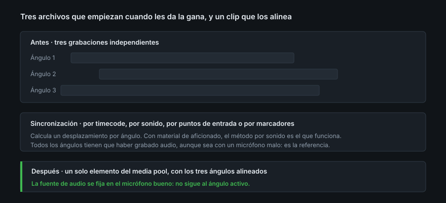

# Preparar el material multicámara

> Montar multicámara es fácil y espectacular: se reproduce, se van pulsando ángulos y el
> montaje sale solo. Lo que decide si eso funciona o es una tarde perdida ocurre **antes**,
> aquí, cuando construyes el clip multicámara. Esta semana lo preparas; en la Semana 12 lo
> montas.

## 🎯 Objetivos

- Explicar qué es un **clip multicámara** y qué contiene por dentro
- Elegir el método de sincronización de ángulos adecuado al material que tienes
- Construir un clip multicámara desde el media pool y comprobar que los ángulos cuadran
- Saber qué decisiones tomadas ahora no se pueden cambiar cómodamente después

---

## 1. Qué problema resuelve

Una escena grabada desde tres ángulos son tres archivos que empiezan y terminan en
momentos distintos, con tres relojes distintos y tres audios distintos del mismo
momento. Montarla a mano significa alinear los tres, cortarlos en paralelo y no
descuadrar nada al mover un corte. Es posible y es horrible.

Un **clip multicámara** (*multicam clip*) resuelve eso: es **un solo elemento del media
pool que contiene varios ángulos ya sincronizados entre sí**. Se monta como si fuera un
clip normal, y en cualquier punto puedes decidir qué ángulo se ve.

---

## 2. Cómo funciona

Por dentro, un clip multicámara es una estructura con:

- **Varios ángulos** (*angles*), cada uno con su vídeo y su audio.
- **Un desplazamiento por ángulo**, calculado al sincronizar, que es lo que los mantiene
  alineados.
- **Un ángulo activo**, el que se ve en cada momento de la timeline.
- **Una fuente de audio**, que puede ser la de un ángulo concreto o seguir al ángulo
  activo.

En el media pool aparece como un elemento más. Sigue sin haber archivos nuevos: como
todo lo del media pool desde la Semana 04, son **referencias** con una capa de
organización encima.

> [!NOTE]
> No confundir un clip multicámara con un **compound clip**, que también agrupa varios
> elementos en uno. El compound clip apila cosas para tratarlas como una: es materia de
> la [Semana 11](../../week-11-titulos_texto_plus_efectos_y_compuestos/README.md). El
> multicámara guarda **alternativas** del mismo momento, y por eso permite cambiar de
> ángulo mientras reproduces.

---

## 3. Cómo se hace en Resolve 21

Se construye desde el media pool: seleccionas los clips que son los ángulos de la misma
escena y usas la opción de crear un clip multicámara con la selección, del menú
contextual.

El diálogo que aparece pide tres decisiones. Las tres importan:

### El método de sincronización de ángulos

Las opciones son las mismas ideas del archivo anterior, más dos manuales:

| Método | Cuándo es el bueno |
| ------ | ------------------ |
| **Timecode** | Las cámaras tenían los relojes igualados. Instantáneo y exacto |
| **Sonido** | Lo normal si no hubo relojes igualados: todas grabaron algo de audio común |
| **Puntos de entrada y salida** | Marcaste tú el mismo instante en cada ángulo. El recurso cuando lo demás falla |
| **Marcadores** | Igual, pero con marcadores en vez de puntos de entrada |

> [!TIP]
> El método por sonido es el que resuelve la mayoría de los casos de este bootcamp,
> porque nadie iguala relojes grabando con un móvil y una cámara. Necesita lo mismo que
> la sincronización por forma de onda: que **todos los ángulos hayan grabado audio** y
> que ese audio se parezca.

### El orden de los ángulos

El orden que fijes aquí es el que tendrán los ángulos al montar, y es el orden en el que
pulsarás las teclas en la Semana 12. Ponlo con criterio: el plano general primero, los
cerrados después, o el orden que uses siempre. Cambiarlo más tarde es posible y molesto.

### La fuente de audio

Elige de qué ángulo sale el sonido, o si el sonido sigue al ángulo que esté activo.

> [!IMPORTANT]
> **Salvo que estés montando un concierto, el sonido no sigue al ángulo.** En una
> entrevista o una escena de diálogo, el audio bueno es siempre el del mismo micrófono, y
> quieres que suene ese aunque cambies de imagen quince veces. Un audio que salta de
> cámara en cámara suena a montaje amateur porque cambia de sala en cada corte.

> [!NOTE]
> Los rótulos exactos del diálogo de creación **no se pueden comprobar por la API de
> scripting**. El capítulo *Multicam Editing* del
> [manual oficial](https://www.blackmagicdesign.com/support/family/davinci-resolve-and-fusion)
> los recoge con las capturas de tu versión.

---

## 4. Comprobar antes de dar por bueno

Un clip multicámara mal sincronizado no avisa: parece correcto hasta que montas y ves un
salto en el cambio de ángulo. Dos comprobaciones que llevan un minuto:

1. **Abre el clip multicámara y ve a un punto con habla.** Cambia de ángulo y escucha:
   si la voz da un salto o repite una sílaba, un ángulo está desplazado.
2. **Busca un gesto brusco** —una palmada, una puerta, alguien que se levanta— y
   compruébalo en los tres ángulos fotograma a fotograma.

Si un ángulo no cuadra y los demás sí, casi siempre es que ese aparato grabó a otro frame
rate o a otra frecuencia de muestreo. Es la **deriva** del archivo anterior, y aquí
también se arregla partiendo la escena en trozos.

---

## 5. Lo que decides ahora y arrastras después

| Decisión | Se puede cambiar luego | Coste de cambiarla |
| -------- | ---------------------- | ------------------ |
| Método de sincronización | Sí, rehaciendo el clip | Bajo si aún no has montado; alto si sí |
| Orden de los ángulos | Sí | Medio: cambia las teclas que ya tenías aprendidas |
| Fuente de audio | Sí | Bajo |
| Qué clips son ángulos | No cómodamente | **Alto**: se rehace el clip y se pierde lo montado con él |

De ahí la regla de esta semana: **el clip multicámara se construye cuando todo el
material de esa escena está ingestado**. Añadir un cuarto ángulo tres semanas después
significa rehacerlo.

---

## 6. Si no tienes tres cámaras

La mayoría de quien hace este bootcamp tiene un móvil y poco más. El multicámara se puede
aprender igual, y hay tres maneras honestas de conseguir material:

1. **Un móvil, una cámara y una webcam.** Tres aparatos que graben a la vez son tres
   ángulos, aunque la calidad de imagen no se parezca en nada. Para aprender el flujo es
   exactamente lo mismo.
2. **Pide prestados dos móviles.** Cualquier móvil de los últimos años graba a 1080p. Lo
   único que hay que cuidar es que los tres graben al **mismo frame rate**, y eso se
   configura en la aplicación de cámara antes de empezar.
3. **Graba tres veces la misma acción.** No es multicámara de verdad —los ángulos no
   corresponden al mismo instante— pero permite practicar el diálogo de creación, el orden
   de ángulos y la fuente de audio. Para lo que se evalúa esta semana, sirve.

> [!IMPORTANT]
> Sea cual sea la opción, **que todos los aparatos graben audio y que graben al mismo
> frame rate**. Sin lo primero no hay sincronización por sonido; sin lo segundo tendrás
> deriva y culparás al programa. Una palmada al empezar te asegura el resto.

Y si vas a grabar de verdad: sitúa las cámaras **cruzadas, no en fila**. Tres ángulos que
miran desde el mismo sitio no dan alternativas de montaje, dan tres versiones del mismo
plano.

---

## 7. Antipatrones

| Antipatrón | Por qué duele | Qué hacer |
| ---------- | ------------- | --------- |
| Crear el multicámara con la mitad del material | Añadir un ángulo después obliga a rehacerlo | Ingesta completa primero |
| Dejar que el audio siga al ángulo activo | El sonido cambia de sala en cada corte | Fija la fuente de audio en el micrófono bueno |
| No comprobar la sincronía antes de montar | El error aparece con el montaje ya hecho | Un punto con habla y un gesto brusco: un minuto |
| Ángulos a frame rates distintos | Deriva que no se arregla bien después | Mismo frame rate en todas las cámaras |
| Meter en el mismo multicámara tomas distintas | No son alternativas del mismo momento: no hay nada que sincronizar | Un clip multicámara por toma |
| Orden de ángulos arbitrario | Te peleas con las teclas durante toda la Semana 12 | General primero, cerrados después, y siempre igual |

---

## 8. Trucos

| Truco | Cómo |
| ----- | ---- |
| Sincronizar cuando no hubo relojes igualados | Método por sonido: es el que funciona con material de aficionado |
| Sincronía gratis y a prueba de todo | Una palmada delante de las tres cámaras al empezar la escena |
| Comprobar el multicámara en un minuto | Un punto con habla y un gesto brusco, cambiando de ángulo |
| No perder el audio bueno | Fija la fuente de audio en el ángulo con el micrófono de calidad |
| Preparar la Semana 12 desde hoy | Orden de ángulos coherente en todos tus clips multicámara |
| Salvar una escena con deriva | Pártela en subclips y construye un multicámara por trozo |

---

## 📚 Recursos Adicionales

- [Semana 12 · Multicam, subtítulos y gestión de timeline](../../week-12-multicam_subtitulos_y_gestion_de_timeline/README.md) — donde este clip se monta de verdad, con el visor multicámara y los atajos de ángulo.
- [DaVinci Resolve Reference Manual](https://www.blackmagicdesign.com/support/family/davinci-resolve-and-fusion) — el capítulo *Multicam Editing* documenta la creación del clip y sus opciones de sincronización.
- [`docs/pack-de-medios.md`](../../../docs/pack-de-medios.md) — qué tiene que haber en `03-multicamara/` y cómo grabarlo tú si no lo tienes.

---

## ✅ Checklist de Verificación

- [ ] Sé qué contiene un clip multicámara y en qué se diferencia de un compound clip
- [ ] Sé elegir el método de sincronización según el material que tengo
- [ ] Sé por qué el audio no debe seguir al ángulo activo en una entrevista
- [ ] Sé comprobar la sincronía de los ángulos antes de montar
- [ ] Sé qué decisiones son caras de cambiar después
- [ ] Sé que el multicámara se construye con toda la escena ya ingestada

---

| Anterior | Actual | Siguiente |
| -------- | ------ | --------- |
| [06 · Sincronizar audio y vídeo](06-sincronizar-audio-y-video.md) | **07 · Preparar el material multicámara** | [08 · Subclips](08-subclips.md) |

← [Volver a la Semana 05](../README.md)
