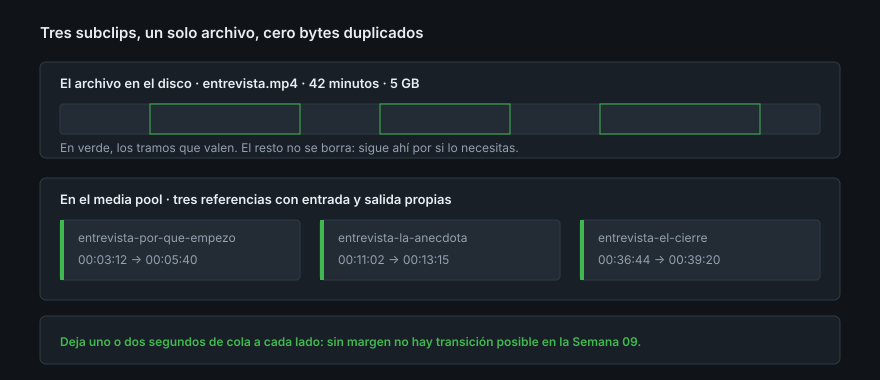

# Subclips

> Una entrevista de cuarenta minutos tiene dentro seis respuestas buenas y treinta y
> nueve minutos de otras cosas. Un subclip es la manera de quedarse con las seis sin
> tocar el archivo, sin duplicar un byte y sin perder la capacidad de volver al original.

## 🎯 Objetivos

- Explicar qué es un **subclip** y por qué no ocupa espacio en disco
- Marcar puntos de entrada y salida en el visor de origen y crear un subclip
- Nombrar y organizar subclips para que sirvan de algo dentro de un mes
- Saber qué se puede recuperar de un subclip y qué no

---

## 1. Qué problema resuelve

Tienes material largo: una entrevista, una charla, una actuación entera, un plano de
diez minutos. Dentro hay trozos que valen y trozos que no, y necesitas trabajar solo con
los que valen.

Las dos salidas malas son evidentes en cuanto se dicen:

- **Recortar el archivo en disco** con otra herramienta: pierdes el original, ocupas el
  doble mientras lo haces, y el día que necesites dos segundos más no están.
- **Buscar el trozo bueno cada vez** en un clip de cuarenta minutos: cuatro veces al día
  durante nueve meses.

Un **subclip** es la tercera salida: una referencia al mismo archivo, con un punto de
entrada y uno de salida propios, que se comporta en el media pool como si fuera un clip
independiente.

Ya los usaste sin saberlo: la detección de escenas de la Semana 04 produce subclips.

---

## 2. Cómo funciona

El media pool guarda referencias. Un clip normal es una referencia a un archivo con su
duración completa; un subclip es una referencia **al mismo archivo** con dos números
más: dónde empieza y dónde acaba.

De ahí salen todas sus propiedades, y conviene deducirlas en vez de memorizarlas:

- **No ocupa espacio.** Veinte subclips de un archivo de 5 GB siguen siendo 5 GB.
- **Se crean instantáneamente.** No hay nada que copiar.
- **Si el archivo original se va, se van todos sus subclips a la vez.** Comparten el
  mismo enlace, y por eso el archivo 09 va justo después de este.
- **Tienen su propia metadata.** Un subclip puede llevar sus keywords, su color y sus
  flags, distintos de los del clip padre. Es lo que los hace útiles de verdad.

> [!IMPORTANT]
> Un subclip **no impide** volver al material que quedó fuera. Los fotogramas anteriores
> al punto de entrada y posteriores al de salida se llaman **colas** (*handles*), y
> siguen existiendo en el archivo. Se pueden recuperar extendiendo el subclip, y son
> justo lo que necesitarás en la Semana 09 para hacer una transición. Deja siempre uno o
> dos segundos de margen a cada lado.

---

## 3. Cómo se hace en Resolve 21

El flujo es de tres pasos y no cambia:

1. **Abre el clip en el visor de origen.** Doble clic sobre él en el media pool.
2. **Marca la entrada y la salida.** `I` para el punto de entrada, `O` para el de salida.
   Son dos de los atajos que más vas a usar en todo el bootcamp; se usan igual en Cut, en
   Edit y en Fairlight.
3. **Crea el subclip** con la opción `Create Subclip` del menú contextual sobre el clip
   en el media pool.

El subclip aparece en el bin activo —**el bin activo otra vez**, como en la Semana 04— con
un nombre derivado del original.

### El nombre importa más de lo que parece

Un bin con `entrevista_subclip_1`, `entrevista_subclip_2` y `entrevista_subclip_3` no es
mejor que el archivo largo: sigues sin saber qué hay dentro de cada uno.

Renombra en cuanto lo crees, con lo que vas a buscar dentro de un mes:
`entrevista-por-que-empezo`, `entrevista-la-anecdota-del-taller`. Cuesta cinco segundos
por subclip y es lo que convierte una entrevista de cuarenta minutos en material
montable.

> [!TIP]
> Los subclips y las keywords de la Semana 04 son la misma idea a dos escalas: el subclip
> acota **dónde** está lo bueno, la keyword dice **de qué** es. Un subclip nombrado y con
> keywords aparece solo en el smart bin que le toque, y eso es lo que hace que en la
> Semana 08 el montaje empiece con el material ya elegido.

---

## 4. Cuándo hacer subclips y cuándo no

| Situación | ¿Subclips? |
| --------- | ---------- |
| Entrevista larga con respuestas separadas | **Sí**, uno por respuesta |
| Charla o actuación de una hora | **Sí**, por bloques |
| Plano de diez minutos con tres momentos buenos | **Sí**, uno por momento |
| Clip de ocho segundos | No: ya es un subclip de hecho |
| Material del que aún no sabes qué quieres | No todavía: primero míralo |
| Una escena con deriva de sincronía | **Sí**: partirla en trozos es lo que la salva |

La regla corta: **subclip cuando el clip es tan largo que buscar dentro cuesta tiempo**.
Con clips cortos, la organización la hacen los bins y las keywords.

---

## 5. Lo que un subclip no hace

- **No es un corte de montaje.** Marcar entrada y salida aquí sirve para organizar; los
  cortes del montaje se hacen en la timeline y son otra cosa.
- **No protege el material.** Si borras el archivo del disco, el subclip se queda
  *offline* igual que su padre.
- **No arregla un material largo mal grabado.** Acota lo bueno; no crea nada que no
  estuviera.

---

## 6. El flujo completo de una entrevista

Es el caso que más se repite en las cinco piezas posibles del bootcamp, y conviene verlo
entero y en orden, porque cada paso apoya al siguiente.

1. **Míralo una vez, entero, sin tocar nada.** Con papel al lado, apuntando los minutos de
   lo que valga. Es la media hora mejor invertida de la semana.
2. **Marca `I` y `O`** en el primero de esos momentos, con un segundo de margen a cada
   lado.
3. **Crea el subclip** en el bin de subclips y **renómbralo con lo que dice**, no con lo
   que es: `entrevista-el-dia-que-lo-dejo`, no `entrevista-respuesta-3`.
4. **Ponle sus keywords** del vocabulario que escribiste en la Semana 04.
5. **Repite** con los demás momentos.
6. **Comprueba** en vista de lista que todos comparten `File Path` y que la carpeta del
   material pesa lo mismo que antes.

Al terminar tienes una entrevista de cuarenta minutos convertida en seis elementos con
nombre propio, buscables y que aparecen solos en los smart bins que ya tenías. Lo que en
la Semana 08 se traduce en empezar el montaje con el material ya elegido, en vez de con un
clip de cuarenta minutos y buena voluntad.

> [!TIP]
> Los subclips de una entrevista tienen una keyword que no es de contenido y que vale oro:
> el **tema** del que habla ahí. Es lo que te permite montar por temas y no por orden de
> grabación, que casi siempre es el mejor montaje posible de una entrevista.

---

## 7. Antipatrones

| Antipatrón | Por qué duele | Qué hacer |
| ---------- | ------------- | --------- |
| Subclips ajustados al fotograma exacto | Sin colas no hay transición posible en la Semana 09 | Uno o dos segundos de margen a cada lado |
| Dejar los nombres automáticos | Un bin lleno de `_subclip_4` no te dice nada | Renombra al crearlos, con lo que vas a buscar |
| Trocear material que aún no has visto | Aciertas por casualidad y rehaces el trabajo | Mira primero, trocea después |
| Hacer subclips de clips de ocho segundos | Trabajo sin ganancia | Bins y keywords bastan |
| Crear subclips sin mirar el bin activo | Aparecen mezclados con el material original | Selecciona el bin antes |
| Creer que el subclip protege el original | Se queda *offline* con su padre | El respaldo es la copia verificada de la Semana 04 |
| No poner keywords a los subclips | Se quedan fuera de los smart bins que ya tienes | Descríbelos como cualquier otro clip |

---

## 8. Trucos

| Truco | Cómo |
| ----- | ---- |
| Marcar entrada y salida sin ratón | `I` y `O` en el visor de origen. Funciona en todas las páginas |
| No quedarte sin margen para transiciones | Un segundo o dos de cola a cada lado, siempre |
| Encontrar el subclip dentro de un mes | Nómbralo con la frase que dice, no con un número |
| Que los subclips entren en tus smart bins | Ponles keywords: son clips a todos los efectos |
| Comprobar que no has duplicado nada | Vista de lista y columna `File Path`: todos comparten la ruta del padre |
| Salvar una escena con deriva de sincronía | Pártela en subclips cortos y sincroniza cada uno |

---

## 📚 Recursos Adicionales

- [Semana 04 · Media page: ingesta y organización](../../week-04-media_page_ingesta_y_organizacion/README.md) — Scene Cut Detection, que produce subclips en masa, y las keywords que aquí se heredan.
- [DaVinci Resolve Reference Manual](https://www.blackmagicdesign.com/support/family/davinci-resolve-and-fusion) — el capítulo *Media Page* documenta la creación de subclips y sus opciones de nombre.
- [Semana 09 · Trimming quirúrgico](../../week-09-trimming_quirurgico/README.md) — dónde las colas que dejas hoy se convierten en transiciones y en ajustes de corte.

---

## ✅ Checklist de Verificación

- [ ] Sé qué es un subclip y por qué no ocupa espacio
- [ ] Sé marcar entrada y salida con `I` y `O` en el visor de origen
- [ ] Sé crear un subclip y dónde cae
- [ ] Dejo colas de uno o dos segundos a cada lado
- [ ] Renombro los subclips con algo que pueda buscar dentro de un mes
- [ ] Sé que un subclip se queda *offline* si su archivo original desaparece

---

| Anterior | Actual | Siguiente |
| -------- | ------ | --------- |
| [07 · Preparar el material multicámara](07-preparar-el-material-multicamara.md) | **08 · Subclips** | [09 · Medios offline y relink](09-medios-offline-y-relink.md) |

← [Volver a la Semana 05](../README.md)
