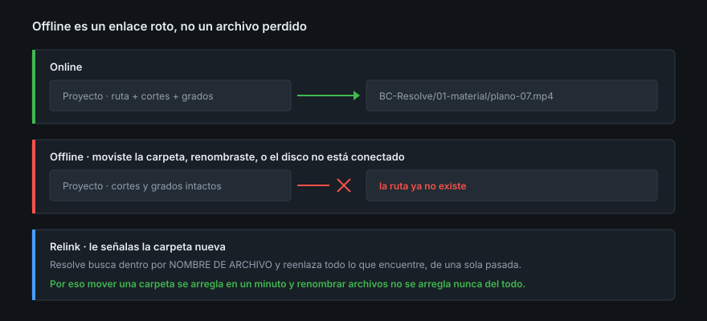

# Medios offline y relink

> Un día abres el proyecto y la timeline está roja con el rótulo `Media Offline`. No has
> perdido nada: has roto un enlace. La diferencia entre las dos frases son tres horas de
> angustia, y esta página existe para que nunca las pases.

## 🎯 Objetivos

- Explicar por qué un clip queda **offline** y qué se ha perdido exactamente (nada)
- Enumerar las cinco causas habituales y reconocer cuál es la tuya en un minuto
- Volver a enlazar clips con `Relink`, uno a uno o una carpeta entera
- Prevenir el problema con las tres reglas que lo hacen casi imposible

---

## 1. Qué problema resuelve

Desde la Semana 04 sabes que el media pool guarda **referencias**: la ruta del archivo en
el disco, no el archivo. Esa decisión es lo que hace que importar doscientos clips sea
instantáneo, y tiene su contrapartida: **si la ruta deja de ser válida, la referencia
apunta a la nada**.

Eso es un clip *offline*. En el media pool aparece marcado, y en la timeline el visor
muestra el rótulo `Media Offline` sobre fondo rojo.

Lo primero, porque es lo que quita el pánico: **tu trabajo sigue intacto**. Los cortes,
las duraciones, los grados, los efectos, las keywords y los marcadores están en el
proyecto, no en el archivo. Al reenlazar vuelve todo, exactamente como estaba.

---

## 2. Las cinco causas, en orden de frecuencia

| Causa | Cómo se reconoce |
| ----- | ---------------- |
| **Moviste o renombraste la carpeta** del material | Pasó justo antes; falla todo un bin de golpe |
| **El disco externo no está conectado** | Falla todo el material de ese disco, y el disco no aparece en el sistema |
| **Renombraste archivos sueltos** | Falla justo lo que tocaste, y lo demás va bien |
| **Carpeta sincronizada en la nube** que descarga bajo demanda | Falla de forma **intermitente**: hoy sí, mañana no |
| **Abriste el proyecto en otro equipo** | Falla todo, y las rutas del original no existen en esta máquina |

> [!TIP]
> La cuarta es la más difícil de diagnosticar y la que más tiempo hace perder, porque no
> es constante: el servicio de nube libera espacio dejando en el disco un archivo vacío
> que se descarga al abrirlo, y Resolve lo lee como ausente. Si tu material vive en una
> carpeta sincronizada, sácalo de ahí hoy. No es un consejo de organización: es la
> diferencia entre que el proyecto funcione o no.

---

## 3. Cómo se hace en Resolve 21

### Reenlazar

En el media pool, sobre los clips offline seleccionados, la opción de **relink** del menú
contextual abre un selector de carpeta. Le señalas dónde está ahora el material y
Resolve busca dentro, **por nombre de archivo**, y reenlaza todo lo que encuentre.

Ese detalle explica lo que funciona y lo que no:

- Si moviste la carpeta entera, **se arregla de una vez**: los nombres siguen siendo los
  mismos.
- Si renombraste los archivos, **no encuentra nada**: no hay por dónde buscar. Toca
  devolverles el nombre o reenlazar a mano, archivo por archivo.

Existe también la operación inversa, **desenlazar** (*unlink*), que deja el clip offline
a propósito. Suena absurdo y tiene un uso real: comprobar que un reenlace masivo va a
funcionar antes de hacerlo en el proyecto de verdad, y es lo que vas a practicar esta
semana en un proyecto de pruebas.

> [!NOTE]
> Los rótulos exactos de las opciones de relink **no se pueden comprobar por la API de
> scripting**. El capítulo *Media Page* del
> [manual oficial](https://www.blackmagicdesign.com/support/family/davinci-resolve-and-fusion)
> los recoge con las capturas de tu versión, incluida la variante que reenlaza clips por
> carpeta.

### Reenlazar los proxies

Los proxies del [archivo 03](03-proxies.md) tienen su propio enlace, independiente del
material original. Un clip puede estar perfectamente online y haber perdido su proxy, con
lo que la reproducción vuelve a ir a saltos sin ninguna otra señal. Se arregla con la
opción de vincular proxies, señalando la carpeta donde estén.

> [!IMPORTANT]
> **Que el material esté online no garantiza que sus proxies lo estén.** Si de repente la
> reproducción va peor que ayer y no has cambiado nada, mira el estado de los proxies
> antes de buscar culpables en otro sitio.

---

## 4. Las tres reglas que evitan el problema

1. **El material va a su sitio definitivo antes de importarlo.** No se importa desde la
   carpeta de descargas, ni desde el escritorio, ni desde la tarjeta. Se copia a
   `BC-Resolve/01-material/`, se verifica, y desde ahí se importa. Es literalmente la
   práctica 01 de la Semana 04.
2. **Los archivos no se renombran después de importar.** Si hace falta renombrar, se hace
   antes. Renombrar después convierte un relink de un minuto en uno manual de una hora.
3. **Nada de material en carpetas sincronizadas con la nube.** Ni el material, ni los
   proxies, ni la caché.

Cumplidas las tres, un clip offline solo puede aparecer por un disco externo desconectado
o por haber cambiado de equipo, que son los dos casos que el relink resuelve en un minuto.

---

## 5. Si el archivo ya no existe

Es el único caso en el que sí se ha perdido algo, y ninguna función del programa lo
arregla: si el archivo se borró y no hay copia, se acabó. Lo que queda es:

- La **segunda copia verificada** de la Semana 04, si la hiciste. Reenlazas contra ella y
  no ha pasado nada.
- El proyecto sigue teniendo el hueco con su duración exacta y sus efectos, así que si
  consigues volver a grabar ese plano puedes reenlazarlo y recuperar el montaje.

Es el momento de recordar por qué la práctica de la copia a dos destinos era el único
paso irreversible de la semana pasada.

---

## 6. El diagnóstico, en orden

Cuando la timeline aparece en rojo, la tentación es empezar a probar cosas. Estas cinco
preguntas, en este orden, identifican la causa en menos de un minuto y sin tocar nada.

1. **¿Falla todo el proyecto o solo un bin?** Todo el proyecto apunta a un disco
   desconectado o a un cambio de equipo. Un bin, a una carpeta movida.
2. **¿Está conectado el disco donde vive el material?** Es la causa más tonta y una de las
   más frecuentes. Conéctalo y reabre el proyecto: se reenlaza solo.
3. **¿Has movido o renombrado algo desde la última vez que abriste esto?** Si la respuesta
   es sí, ya sabes la causa y el relink lo arregla en una pasada.
4. **¿El material vive en una carpeta sincronizada con la nube?** Si falla de forma
   intermitente —hoy sí, mañana no—, es esto casi seguro. Saca el material de ahí antes de
   seguir.
5. **¿Existen los archivos, con su nombre, en el disco?** Compruébalo en el explorador de
   archivos, no de memoria. Si existen, es relink; si no existen, es la segunda copia de la
   Semana 04.

> [!TIP]
> Las cinco preguntas se responden **sin tocar el proyecto**. Esa es la idea: el error más
> caro de esta situación no es el enlace roto, es lo que la gente hace con prisa antes de
> haber entendido qué pasó —reimportar clips, borrar bins, rehacer el montaje— y eso sí
> pierde trabajo.

---

## 7. Antipatrones

| Antipatrón | Por qué duele | Qué hacer |
| ---------- | ------------- | --------- |
| Reimportar los clips offline en vez de reenlazarlos | Entran como clips nuevos: pierdes keywords, color, comentarios, y la timeline sigue rota | Relink, siempre |
| Renombrar archivos después de importar | El relink busca por nombre y no encuentra nada | Renombrar antes de importar, nunca después |
| Material en una carpeta sincronizada con la nube | Offline intermitente, imposible de diagnosticar | Carpeta local, fuera de la nube |
| Importar desde la carpeta de descargas | Es temporal por definición | Sitio definitivo primero |
| Entrar en pánico al ver la timeline roja | Se toman decisiones malas con prisa | Nada se ha perdido. Diagnostica la causa con la tabla de la sección 2 |
| Ignorar un proxy desenlazado | Se monta a saltos creyendo que el equipo va mal | Comprueba el estado de los proxies |
| No tener segunda copia del material propio | Es el único caso irrecuperable | La práctica 01 de la Semana 04 |

---

## 8. Trucos

| Truco | Cómo |
| ----- | ---- |
| Diagnosticar en un minuto | ¿Falla un bin entero o clips sueltos? Un bin entero es una carpeta movida; sueltos, un renombrado |
| Reenlazar cien clips de una vez | Relink sobre toda la selección y señala la carpeta raíz: busca dentro por nombre |
| Comprobar un relink sin riesgo | Practícalo en un proyecto de pruebas, desenlazando a propósito |
| Saber si el problema son los proxies | Si el material está online y aun así va a saltos, mira el vínculo de los proxies |
| Llevarte el proyecto a otro equipo sin sufrir | Copia el material con la misma estructura de carpetas y reenlaza la raíz de una vez |
| Que un disco externo desconectado no te asuste | Conéctalo y reabre el proyecto: se reenlaza solo |

---

## 📚 Recursos Adicionales

- [Semana 04 · Media page: ingesta y organización](../../week-04-media_page_ingesta_y_organizacion/README.md) — por qué el media pool guarda referencias, y la copia verificada que es el seguro de esta página.
- [DaVinci Resolve Reference Manual](https://www.blackmagicdesign.com/support/family/davinci-resolve-and-fusion) — el capítulo *Media Page* documenta las variantes de relink y el reenlace de proxies.
- [Semana 30 · Gestión de proyectos, archivado y colaboración](../../week-30-gestion_de_proyectos_archivado_y_colaboracion/README.md) — el relink masivo y el archivado, que es este problema a escala de proyecto entero.

---

## ✅ Checklist de Verificación

- [ ] Sé qué significa que un clip esté offline y sé que no he perdido trabajo
- [ ] Sé reconocer cuál de las cinco causas es la mía
- [ ] Sé reenlazar una carpeta entera de una sola vez
- [ ] Sé que el relink busca por nombre de archivo, y qué implica eso
- [ ] Sé que los proxies tienen su propio enlace, independiente del material
- [ ] Cumplo las tres reglas de prevención: sitio definitivo, sin renombrar, sin nube

---

| Anterior | Actual | Siguiente |
| -------- | ------ | --------- |
| [08 · Subclips](08-subclips.md) | **09 · Medios offline y relink** | — |

← [Volver a la Semana 05](../README.md)
