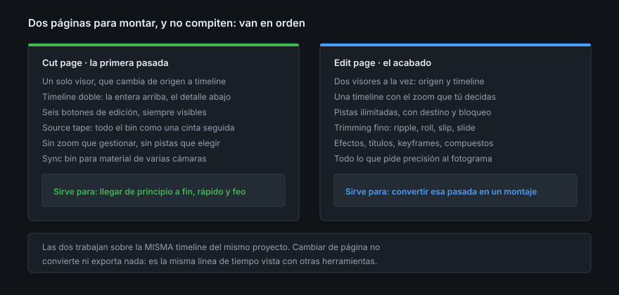

# Por qué existe la Cut page

> Un montaje no se hace de una vez. Se hace en dos: primero se llega al final, aunque
> quede feo, y después se afina. La Cut page es el programa de la primera de esas dos
> pasadas, y por eso se aprende antes que la Edit page.

## 🎯 Objetivos

- Explicar qué problema concreto resuelve la Cut page y por qué Blackmagic la añadió
- Nombrar las cinco diferencias que la separan de la Edit page
- Decidir, ante un trabajo, con cuál de las dos empezar
- Entender que las dos páginas trabajan sobre **la misma timeline**, no sobre copias

---

## 1. Qué problema resuelve

Tienes doscientos clips organizados —eso fue la Semana 04— y reproduciendo fluido —eso
fue la Semana 05—. Ahora hay que convertirlos en una pieza que se vea de principio a fin.

El error que casi todo el mundo comete la primera vez es este: abrir el primer clip,
recortarlo al fotograma, ponerle una transición, ajustar el volumen, y pasar al segundo.
Tres horas después hay cuarenta segundos perfectos y ninguna idea de si la pieza
funciona.

No funciona porque **una pieza no es la suma de sus planos**. Es su orden y su duración
total. Y ninguna de esas dos cosas se puede juzgar hasta que la pieza existe entera,
aunque exista mal.

De ahí sale el reparto:

| Pasada | Qué se decide | Página |
| ------ | ------------- | ------ |
| **Primera** — el montaje bruto | Qué planos entran, en qué orden y aproximadamente cuánto duran | **Cut** |
| **Segunda** — el acabado | Dónde cae cada corte al fotograma, transiciones, títulos, ritmo fino | **Edit** |

> [!NOTE]
> **Montaje bruto** (*rough cut*): la versión de una pieza que ya va de principio a fin
> pero no está acabada por ningún lado. Los cortes están aproximados, no hay transiciones
> ni títulos, y el sonido es el que trajo cada clip. Es fea a propósito: sirve para
> mirarla entera y decidir si la pieza se sostiene.

La Cut page es una página construida **entera** alrededor de esa primera pasada. Todo lo
que sobra para ir rápido, no está.

---

## 2. Cómo funciona

Las cinco diferencias que importan, y ninguna es cosmética:

### 2.1 Un visor en vez de dos

La Edit page enseña a la vez el material de origen y la timeline. La Cut page enseña
**uno de los dos**, y cambias entre ellos. Menos que mirar, menos que decidir.

### 2.2 La timeline es doble y no tiene zoom

En vez de una timeline con un zoom que hay que ir ajustando, hay dos: la entera arriba y
el detalle abajo. Nunca ajustas el zoom porque no hay zoom que ajustar. Es el archivo 02.

### 2.3 Seis botones de edición, siempre a la vista

Smart Insert, Append, Ripple Overwrite, Close Up, Place on Top y Source Overwrite. Están
en la barra de herramientas, uno al lado del otro, y hacen las seis cosas que se hacen en
una primera pasada. Ocupan los archivos 06, 07, 08 y 09.

### 2.4 El material se revisa como una cinta

`Source Tape` presenta todos los clips del bin como un único flujo continuo, como una
cinta de vídeo. Se recorre entero sin abrir un solo archivo. Es el archivo 03.

### 2.5 No hay que elegir pista ni posición

En la Edit page, antes de meter un clip decides en qué pista va y dónde. En la Cut page
lo decide la página: el **indicador inteligente** marca el destino y tú solo eliges la
herramienta. Es el archivo 05.

> [!IMPORTANT]
> **Las dos páginas trabajan sobre la misma timeline del mismo proyecto.** Cambiar de Cut
> a Edit no exporta, no convierte y no copia nada: es la misma línea de tiempo con otras
> herramientas encima. Puedes ir y volver todas las veces que quieras, incluso en mitad de
> un montaje.

---

## 3. Cómo se hace en Resolve 21

Entrar en la Cut page es pulsar su botón en la barra inferior, o `Shift+3`. El orden de
los botones es el orden de las páginas: Media, Cut, Edit, Fusion, Color, Fairlight,
Deliver.

Lo que te encuentras, de arriba abajo:

1. **El media pool**, arriba a la izquierda, con sus bins.
2. **El visor**, arriba a la derecha, con sus modos de origen y su transporte.
3. **La barra de herramientas**, en medio, con los seis botones de edición.
4. **La timeline doble**, abajo, ocupando el ancho entero.

No hay paneles que abrir ni ventanas que colocar. Si algo se te descoloca,
`Workspace > Reset UI Layout` lo devuelve a su sitio sin tocar el proyecto.

### Cuándo Cut y cuándo Edit

No es una cuestión de gusto. Es una cuestión de qué estás decidiendo:

| Lo que tienes delante | Empieza en |
| --------------------- | ---------- |
| Material bruto sin montar | **Cut** |
| Mucho material y poco tiempo | **Cut** |
| Varias cámaras del mismo momento | **Cut**, por el sync bin |
| Un montaje bruto que hay que afinar | **Edit** |
| Un corte concreto que no acaba de funcionar | **Edit** |
| Títulos, efectos, keyframes | **Edit** |
| Una pieza de treinta segundos con cuatro planos | Cualquiera: da igual |

> [!TIP]
> Hay una prueba de un segundo que resuelve la duda: **¿ya existe la pieza entera?** Si
> no existe, tu trabajo es que exista, y eso es Cut. Si existe y no te gusta, tu trabajo
> es mejorarla, y eso es Edit.

---

## 4. Qué se decide en una primera pasada, y qué no

La Cut page va rápida porque el trabajo que se hace en ella tiene **pocas** decisiones. Y
saber cuáles son evita el error más caro de la semana: ponerse a decidir cosas que
todavía no toca decidir.

### 4.1 Las tres decisiones que sí

- **Qué entra.** De doscientos clips, entran cuarenta. Los otros ciento sesenta no son
  malos: sobran para esta pieza, que es otra cosa.
- **En qué orden.** Es la decisión con más peso de todo el montaje. Dos piezas con los
  mismos planos en distinto orden cuentan historias distintas.
- **Cuánto dura cada uno, aproximadamente.** Aproximadamente significa al segundo, no al
  fotograma. Si un plano tiene que durar "unos cuatro segundos", cuatro segundos.

### 4.2 Las que no

- **Dónde cae exactamente cada corte.** Eso es *trimming*, recorte fino, y es la Semana 09.
- **Las transiciones.** Un corte seco es la transición por defecto y es la correcta la
  mayoría de las veces. Las transiciones son la Semana 07.
- **Títulos, efectos y color.** Fases 3, 5 y 6. Meterlos ahora significa rehacerlos en
  cuanto cambie un corte.
- **El sonido.** El audio que trae cada clip vale para la primera pasada. La mezcla es la
  Fase 4.

> [!TIP]
> La prueba de que has terminado la primera pasada no es que te guste. Es que **la pieza
> llega al final**. Si la reproduces entera y termina donde tiene que terminar, la pasada
> está hecha, aunque no te guste ni un solo corte.

### 4.3 Por qué el orden importa más que el resto

Un plano mal recortado se arregla en treinta segundos en la Semana 09. Un orden
equivocado se arregla rehaciendo la pieza. Por eso la primera pasada se dedica al orden y
casi a nada más: es la decisión más cara de cambiar y la más barata de probar mientras el
montaje todavía está en bruto.

---

## 5. Lo que la Cut page no es

Tres malentendidos que conviene desactivar ahora, porque sobreviven años:

- **No es "la página para principiantes".** Es la página para ir rápido. Hay
  profesionales que montan piezas enteras de informativos en ella todos los días, porque
  el trabajo es exactamente ese: mucho material, poco tiempo, entrega hoy.
- **No es una versión reducida de la Edit page.** Tiene cosas que la Edit page **no**
  tiene: el source tape, el sync bin, el fast review y la timeline doble.
- **No es un paso obligatorio.** Una pieza de cuatro planos se monta en Edit sin
  perder nada. La Cut page se rentabiliza cuando hay volumen.

---

## 6. Antipatrones

| Antipatrón | Por qué duele | Qué hacer |
| ---------- | ------------- | --------- |
| Afinar cortes al fotograma en la primera pasada | Gastas la mañana en un plano que igual acabas quitando | Aproxima ahora, afina en la Semana 09 |
| Montar de principio a fin sin haber visto el material | Montas lo que recuerdas, no lo que tienes | Fast review y source tape primero |
| Cambiar a Edit para "guardar el avance" | No hay nada que guardar: es la misma timeline | Sigue montando y usa `Ctrl+S` (Win) / `Cmd+S` (Mac) |
| Empezar por el plano que más te gusta | La pieza acaba construida alrededor de un plano | El orden es del principio al final |
| Añadir música antes de tener el montaje | El montaje se acomoda a la música y ya no se puede cambiar | La música es Fase 4, Semanas 13 a 15 |
| Descartar la Cut page "porque parece básica" | Te pierdes el sync bin y el source tape para siempre | Es una página distinta, no una más simple |

---

## 7. Trucos

| Truco | Cómo |
| ----- | ---- |
| Entrar y salir de la Cut page sin ratón | `Shift+3` para Cut, `Shift+4` para Edit. La timeline es la misma |
| Recuperar el layout si lo destrozas | `Workspace > Reset UI Layout`, que no toca el proyecto |
| Saber si te toca Cut o Edit | ¿Existe ya la pieza entera? No: Cut. Sí: Edit |
| Ver la timeline entera sin tocar nada | Ya la estás viendo: es la mitad de arriba de la timeline doble |
| Evitar rehacer el montaje entero | Deja la música y los títulos para su fase. Aquí solo van planos |

---

## 📚 Recursos Adicionales

- [DaVinci Resolve Reference Manual](https://www.blackmagicdesign.com/support/family/davinci-resolve-and-fusion) — el capítulo dedicado a la Cut page documenta cada control de la página, y viene con la instalación en `Documents/DaVinci Resolve.pdf`.
- [Semana 03 · Resolve 21: anatomía, bases de datos y preferencias](../../week-03-resolve_21_anatomia_bases_de_datos_y_preferencias/README.md) — el recorrido por las siete páginas del que esta semana es la continuación natural.
- [Semana 08 · Edit page: anatomía y edición básica](../../week-08-edit_page_anatomia_y_edicion_basica/README.md) — la otra mitad del reparto, donde el montaje bruto de esta semana se convierte en un montaje.
- [`docs/proyecto-hilo-conductor.md`](../../../docs/proyecto-hilo-conductor.md) — qué capa añade la Fase 2 a tu pieza y por qué tiene que llegar completa hasta el final.

---

## ✅ Checklist de Verificación

- [ ] Sé qué es un montaje bruto y por qué se hace antes que el acabado
- [ ] Sé nombrar las cinco diferencias entre la Cut page y la Edit page
- [ ] Sé que las dos páginas trabajan sobre la misma timeline
- [ ] Sé decidir en cuál de las dos empezar un trabajo concreto
- [ ] Entro en la Cut page con `Shift+3` sin buscar el botón

---

| Anterior | Actual | Siguiente |
| -------- | ------ | --------- |
| — | **01 · Por qué existe la Cut page** | [02 · La timeline doble](02-la-timeline-doble.md) |

← [Volver a la Semana 06](../README.md)
