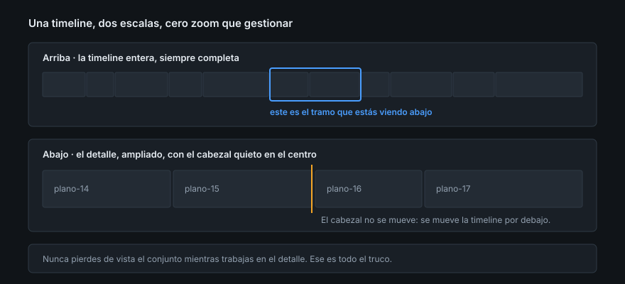

# La timeline doble

> Montar es ir todo el rato del detalle al conjunto y del conjunto al detalle. En la
> mayoría de los programas eso se hace con el zoom, y el zoom cuesta tiempo cada vez. La
> Cut page lo resuelve enseñando las dos escalas a la vez, para siempre.

## 🎯 Objetivos

- Explicar qué muestra cada una de las dos timelines y en qué se diferencian
- Navegar por una pieza larga sin tocar ni una sola vez el zoom
- Entender el **cabezal fijo** y por qué al principio parece que se mueve el mundo
- Saber qué hacen `Zoom to Fit`, `Full Extent Zoom` y `Detail Zoom` y cuándo tocarlos

---

## 1. Qué problema resuelve

Un montaje de seis minutos a 24 fps son 8.640 fotogramas. La pantalla tiene mil y pico
píxeles de ancho. No caben las dos cosas: o ves la pieza entera y cada corte mide dos
píxeles, o ves el corte y no sabes por qué minuto vas.

En un programa con una sola timeline, la solución es el zoom, y el precio son dos
movimientos por cada decisión: alejar para orientarte, acercar para trabajar. Cuarenta
veces por hora, todos los días.

> [!NOTE]
> **Zoom**, en una timeline, es la escala: cuántos segundos de pieza ocupa un centímetro
> de pantalla. Nada que ver con el zoom de una cámara ni con el reencuadre de un clip.

La Cut page parte la pantalla y enseña las dos escalas a la vez. El zoom deja de ser una
decisión.

---

## 2. Cómo funciona

### 2.1 La de arriba: la pieza entera, siempre

Ocupa el ancho de la ventana y contiene **toda** la timeline, dure lo que dure. Un
rectángulo señala el tramo que estás viendo abajo. Cuando el montaje crece, los clips se
estrechan; la timeline de arriba nunca se sale de la pantalla.

Sirve para tres cosas, y son las tres que hace un editor cada minuto:

- **Orientarte**: por qué parte de la pieza vas.
- **Saltar lejos**: un clic en el minuto cuatro y estás ahí.
- **Ver la forma**: dónde se acumulan los planos cortos y dónde hay un ladrillo de dos
  minutos sin un solo corte.

Esa tercera es la que no tiene sustituto. El ritmo de una pieza **se ve** en la timeline
de arriba antes de oírse.

### 2.2 La de abajo: el detalle, con el cabezal quieto

Muestra un tramo ampliado alrededor del punto en el que estás. Y tiene una rareza que
descoloca el primer día: **el cabezal no se mueve**. Se queda en el centro y lo que se
desplaza por debajo es la timeline.

> [!NOTE]
> **Cabezal** (*playhead*): la línea vertical que marca el fotograma que estás viendo. En
> casi todos los programas recorre la timeline de izquierda a derecha. En la timeline de
> detalle de la Cut page ocurre al revés.

Es raro dos minutos y cómodo para siempre, porque el sitio donde vas a trabajar —debajo
del cabezal— está siempre en el mismo píxel de la pantalla. No lo persigues: viene solo.

### 2.3 Las dos están sincronizadas

No son dos vistas independientes. Mueves una y la otra responde. Un clic arriba en el
minuto cuatro trae abajo el detalle del minuto cuatro.

---

## 3. Cómo se hace en Resolve 21

Las dos timelines están montadas y visibles en cuanto entras en la página (`Shift+3`). No
hay nada que activar.

### 3.1 Navegar

| Quiero | Qué hago |
| ------ | -------- |
| Ir a un punto lejano | Clic en la timeline **de arriba**, a esa altura |
| Moverme fino | Arrastro la timeline **de abajo**, o uso `←` y `→` |
| Reproducir y parar | `Espacio` |
| Avanzar y retroceder a distintas velocidades | `J`, `K`, `L` |
| Ir al principio o al final | `Inicio` y `Fin` (Win) / `Home` y `End` (Mac) |

`J`, `K` y `L` son los tres atajos más rentables del bootcamp entero: `L` avanza, `K`
para, `J` retrocede, y pulsar `L` o `J` varias veces multiplica la velocidad. Se usan
igual en Cut, en Edit y en Fairlight, y son el motivo de que un editor con oficio casi no
toque el ratón.

### 3.2 La escala de la vista de detalle

Al lado de la timeline hay controles de escala. Los tres que vas a usar:

- **`Zoom to Fit`** — ajusta la vista para que quepa el conjunto.
- **`Full Extent Zoom`** — la escala completa de la timeline.
- **`Detail Zoom`** — la escala corta, para trabajar sobre un corte.

Alternar entre la escala completa y la de detalle es el movimiento que sustituye al zoom
continuo de otros programas: dos estados, no un deslizador.

> [!TIP]
> Si te pierdes, mira siempre la timeline **de arriba** primero. Es la que responde a la
> pregunta "¿dónde estoy?". La de abajo responde a "¿qué hay aquí?", que es otra pregunta.

### 3.3 El imán

`Snapping` hace que los clips se peguen entre sí y al cabezal al arrastrarlos, en vez de
quedar a tres fotogramas con un hueco negro invisible. Se alterna con `N`.

> [!IMPORTANT]
> **Déjalo activado durante toda la primera pasada.** Un hueco de dos fotogramas entre
> dos clips no se ve en la timeline, pero en reproducción es un parpadeo negro. Y en la
> Semana 09 tendrás que buscarlos uno a uno.

---

## 4. Leer la forma de una pieza

La timeline de arriba no es solo un mapa para saltar. Es la única vista del bootcamp donde
el **ritmo** de un montaje se ve en lugar de oírse, y aprender a leerla ahorra horas de
reproducción.

Cuatro formas reconocibles, y qué suele significar cada una:

| Lo que ves arriba | Qué suele significar |
| ----------------- | -------------------- |
| Un bloque ancho y liso de dos minutos | Un plano que nadie ha tocado. Casi siempre hay que partirlo |
| Cortes muy juntos durante veinte segundos | Un tramo acelerado. Bien si es a propósito; cansa si no lo es |
| Clips de duración idéntica de principio a fin | Montaje mecánico. Suena a metrónomo aunque los planos sean buenos |
| Un tramo denso y luego un desierto | El material no está repartido: sobra de una parte y falta de otra |

Ninguna de las cuatro es un error por sí sola. Un videoclip vive de cortes juntos y un
documental de planos largos. Lo que la vista te dice es si la forma que tiene la pieza es
**la que querías darle** o la que salió sola.

> [!TIP]
> Al terminar la primera pasada, mira la timeline de arriba antes de reproducir nada. Si
> la forma ya te chirría ahí, te chirriará más al verla. Y corregirla ahora, moviendo
> clips en bruto, cuesta minutos; en la Semana 09, horas.

---

> [!NOTE]
> La timeline doble no es exclusiva de la Cut page en el sentido de que sea "otra"
> timeline: es **la misma** que verás en la Edit page, dibujada dos veces a dos escalas.
> Un clip que muevas aquí está movido allí, y al revés. Cambiar de página no sincroniza
> nada porque no hay dos cosas que sincronizar.

---

## 5. Antipatrones

| Antipatrón | Por qué duele | Qué hacer |
| ---------- | ------------- | --------- |
| Buscar el deslizador de zoom | No hay: hay dos timelines | Clic arriba para saltar, detalle abajo para trabajar |
| Arrastrar el cabezal de la timeline de detalle | No se mueve: se mueve la timeline | Arrastra la timeline, o clic arriba |
| Montar mirando solo la de abajo | Pierdes la forma de la pieza | Mira arriba cada pocos cortes |
| Trabajar con el imán desactivado | Huecos de dos fotogramas que no se ven y sí se oyen | `N` para activarlo y déjalo así |
| Reproducir con el ratón, botón a botón | Es tres veces más lento y ocupa una mano | `Espacio`, y `J` `K` `L` |
| Usar la timeline de arriba para ajustar un corte | Un píxel son diez fotogramas | Los ajustes finos, abajo |

---

## 6. Trucos

| Truco | Cómo |
| ----- | ---- |
| Saltar al minuto cuatro sin buscar | Clic directo en la timeline de arriba, a esa altura |
| Ver el ritmo de tu pieza de un vistazo | Mira la distribución de cortes en la timeline de arriba |
| Detectar el ladrillo de dos minutos sin un corte | Es el bloque ancho y liso de la timeline de arriba |
| Recorrer material a tres velocidades | `L` `L` `L` acelera; `K` para; `J` hace lo mismo hacia atrás |
| Trabajar siempre en el mismo punto de la pantalla | Es lo que te da el cabezal fijo: aprovéchalo |
| No dejar huecos invisibles | Imán activado con `N` desde el primer clip |

---

## 📚 Recursos Adicionales

- [DaVinci Resolve Reference Manual](https://www.blackmagicdesign.com/support/family/davinci-resolve-and-fusion) — el capítulo de la Cut page describe la timeline doble y sus controles de escala, con los nombres exactos de tu versión.
- [`docs/atajos-de-teclado.md`](../../../docs/atajos-de-teclado.md) — `J`, `K`, `L` y los transversales, con el método para aprenderlos de tres en tres.
- [Semana 08 · Edit page: anatomía y edición básica](../../week-08-edit_page_anatomia_y_edicion_basica/README.md) — la timeline de la Edit page, que es la otra manera de resolver el mismo problema.

---

## ✅ Checklist de Verificación

- [ ] Sé qué muestra la timeline de arriba y para qué sirve
- [ ] Sé qué muestra la de abajo y por qué el cabezal está quieto
- [ ] Salto a cualquier punto de la pieza con un clic
- [ ] Uso `J`, `K` y `L` en lugar de los botones del transporte
- [ ] Tengo el imán activado y sé alternarlo con `N`
- [ ] Leo el ritmo de mi pieza mirando la timeline de arriba

---

| Anterior | Actual | Siguiente |
| -------- | ------ | --------- |
| [01 · Por qué existe la Cut page](01-por-que-existe-la-cut-page.md) | **02 · La timeline doble** | [03 · Source tape](03-source-tape.md) |

← [Volver a la Semana 06](../README.md)
