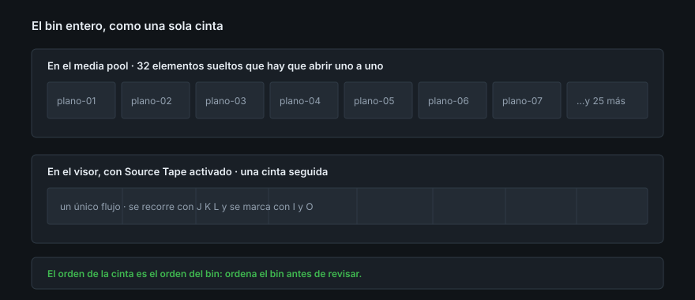

# Source tape

> El material no se elige abriendo archivos. Se elige viéndolo. El source tape convierte
> un bin de doscientos clips en una sola cinta que se recorre de un tirón, y es la
> herramienta que hace que revisar deje de ser una tarde perdida.

## 🎯 Objetivos

- Explicar qué es el source tape y en qué se diferencia de abrir un clip
- Distinguir los cuatro modos del visor de origen de la Cut page
- Recorrer un bin entero y marcar lo bueno sin abrir un solo archivo
- Saber qué determina el orden de la cinta y cómo se controla

---

## 1. Qué problema resuelve

Para montar hay que saber qué tienes. Y saber qué tienes significa haberlo visto, no
haber leído los nombres de los archivos.

Verlo clip a clip es un bucle de cuatro pasos por archivo: doble clic, esperar, ver,
cerrar. Con doscientos clips son ochocientas acciones, y la mitad del tiempo se va en las
que no son "ver". Peor todavía: el bucle **rompe el hilo**. Cada cierre y apertura es una
pausa que te saca de lo que estabas evaluando.

En cinta era distinto, y ahí está la idea: metías la cinta, le dabas al play, y el
material pasaba seguido. Marcabas al vuelo lo que servía. El source tape trae ese
comportamiento a un media pool.

---

## 2. Cómo funciona

Con `Source Tape` activado, el visor deja de mostrar **un** clip y muestra **todos los
del bin seleccionado**, uno detrás de otro, como un solo flujo continuo.

Consecuencias, y las cuatro importan:

- **No hay que abrir nada.** Le das a reproducir y el material pasa.
- **Se recorre con el transporte normal.** `Espacio`, `J`, `K`, `L`, `←`, `→`.
- **Se marca con `I` y `O`**, igual que en un clip suelto. Los mismos dos atajos de la
  Semana 05.
- **El orden es el orden del bin.** Lo que ves primero es lo que está primero en la lista.

Esa última tiene una consecuencia práctica que se aprovecha mucho: **ordenando el bin
ordenas la cinta**. Ordenado por hora de grabación, el source tape reproduce la jornada
en el orden en que ocurrió, que es como se revisa material de un rodaje.

> [!IMPORTANT]
> El source tape **no crea ningún archivo ni modifica el bin**. Es una forma de mirar. Al
> cambiar de modo, el bin está exactamente igual que estaba.

---

## 3. Cómo se hace en Resolve 21

El visor de la Cut page tiene cuatro modos de origen, y conviene conocerlos porque cada
uno responde a una pregunta distinta:

| Modo | Qué muestra | Cuándo se usa |
| ---- | ----------- | ------------- |
| **`Source Clip`** | Un solo clip, el que hayas seleccionado | Cuando ya sabes cuál quieres |
| **`Source Tape`** | Todos los clips del bin, seguidos | Revisar material, elegir |
| **`Multi Source`** | Varios clips a la vez, en cuadrícula | Comparar tomas o ángulos |
| **`Recent 5 Mins`** | Lo último que has visto | Volver a algo que acabas de ver y no localizas |

Los cuatro están en el visor de la Cut page y se alternan sin salir de la página.
*Verificado en 21.0.4.5, agosto de 2026.*

### 3.1 El flujo de revisión completo

Es el mismo cada vez, y son cinco pasos:

1. **Selecciona el bin** que quieres revisar en el media pool. La cinta es la de **ese**
   bin: seleccionar otro cambia la cinta entera.
2. **Ordena el bin** por lo que te interese. Por hora de grabación para reconstruir la
   jornada; por nombre si tu nomenclatura ya lleva el orden dentro.
3. **Activa `Source Tape`** en el visor.
4. **Reproduce y recorre.** `L` para avanzar, `L` otra vez para ir más rápido, `K` para
   parar, `J` para volver atrás.
5. **Marca lo bueno con `I` y `O`** según pasa. Un segundo antes y un segundo después:
   las **colas** de la Semana 05, que en la Semana 09 se convierten en transiciones.

Al final de esa pasada sabes qué tienes. Que es exactamente lo que hacía falta para poder
montar.

### 3.2 Source tape y montaje directo

Se puede montar **desde** el source tape: marcas `I` y `O` sobre la cinta y pulsas una de
las herramientas de edición. Es el flujo más rápido que hay en Resolve para una primera
pasada, y es lo que hace la práctica 02.

> [!TIP]
> Combínalo con lo que ya construiste: si revisas un **smart bin** en vez de un bin
> normal, la cinta contiene solo el material que cumple esa regla. "Todo lo etiquetado
> como entrevista, en una sola cinta" son dos clics, no una búsqueda.

### 3.3 La forma de onda

En el menú de opciones del visor hay ajustes para mostrar la forma de onda del audio
sobre el source tape. Con material hablado ayuda: se ve dónde hay voz y dónde hay
silencio antes de oírlo, y eso permite saltar los silencios en la revisión.

---

## 4. El método de la pasada de revisión

El source tape es la herramienta. La pasada de revisión es el oficio, y tiene reglas que
no dependen del programa.

### 4.1 Una pasada, sin parar a montar

La tentación es montar según ves. No lo hagas en la primera pasada: montar te obliga a
decidir, y decidir con la mitad del material visto es decidir a ciegas. Primero mira todo,
después monta. Es la misma regla que la Semana 05 aplicaba a los subclips de una
entrevista.

### 4.2 Apunta mientras pasa

Papel al lado, o un archivo de texto abierto. Dos columnas: **minuto** y **qué hay**. No
hace falta más. Lo que buscas al terminar es poder responder tres preguntas sin volver a
abrir nada:

- ¿Tengo un principio? ¿Y un final?
- ¿Qué es lo mejor que tengo, y dónde está?
- ¿Qué me falta, y todavía puedo grabarlo?

Esa última es la que salva piezas. Descubrir en la Semana 06 que falta un plano de
recurso te deja veintinueve semanas para grabarlo; descubrirlo en la Semana 22 no.

### 4.3 Marca poco y marca ancho

Marcar `I` y `O` en cuarenta sitios de una pasada es normal. Marcarlos ajustados no lo es:
en la revisión todavía no sabes dónde va a caer el corte, así que marca de sobra. Recortar
después cuesta un segundo; recuperar material que no marcaste cuesta otra pasada entera.

### 4.4 Cuánto dura esto

Una hora de material se revisa en unos veinte minutos con `L` `L` y saltando silencios. Es
tiempo del bootcamp y cuenta como trabajo: sin esa pasada, el montaje se hace de memoria,
y la memoria elige mal.

---

> [!NOTE]
> El source tape respeta los **subclips** igual que a cualquier otro clip. Si en la Semana
> 05 partiste una entrevista de cuarenta minutos en seis subclips, la cinta de ese bin son
> esos seis trozos seguidos, sin los treinta y cuatro minutos que sobraban. Es la primera
> vez que el trabajo de organización de la Fase 1 se cobra en tiempo de montaje, y no será
> la última.

---

## 5. Antipatrones

| Antipatrón | Por qué duele | Qué hacer |
| ---------- | ------------- | --------- |
| Revisar abriendo clips uno a uno | Ochocientas acciones y el hilo roto cada pocos segundos | `Source Tape` y una sola pasada |
| Montar sin haber visto el material | Montas lo que recuerdas, y recuerdas mal | Una pasada de revisión completa antes |
| Revisar `Master` en vez de un bin | La cinta sale desordenada y mezcla todo | Bin a bin, que para eso están |
| Marcar sin colas | Sin margen no hay transición posible | Un segundo a cada lado, siempre |
| No ordenar el bin antes | La cinta sale en un orden que no significa nada | Ordena por hora de grabación o por nombre |
| Creer que el source tape junta los archivos | No crea nada: es una forma de mirar | Compruébalo: el bin sigue igual |

---

## 6. Trucos

| Truco | Cómo |
| ----- | ---- |
| Revisar doscientos clips sin abrir ninguno | `Source Tape` en el visor de la Cut page |
| Reproducir la jornada en el orden en que ocurrió | Ordena el bin por hora de grabación antes de activarlo |
| Revisar solo un tipo de material | Selecciona un smart bin de la Semana 04 en vez de un bin |
| Marcar al vuelo mientras pasa | `I` y `O` sin parar la reproducción |
| Volver a algo que acabas de ver | Modo `Recent 5 Mins` |
| Comparar dos tomas de lo mismo | Modo `Multi Source` |
| Saltarte los silencios de una entrevista | Activa la forma de onda sobre el source tape |

---

## 📚 Recursos Adicionales

- [DaVinci Resolve Reference Manual](https://www.blackmagicdesign.com/support/family/davinci-resolve-and-fusion) — el capítulo de la Cut page documenta los modos del visor de origen con los nombres exactos de la versión instalada.
- [Semana 04 · Media page: ingesta y organización](../../week-04-media_page_ingesta_y_organizacion/README.md) — los bins y smart bins que aquí determinan qué contiene la cinta.
- [Semana 05 · Proxies, caché y sincronización](../../week-05-proxies_cache_y_sincronizacion/README.md) — los subclips, que son la otra forma de acotar lo bueno, y las colas que aquí se dejan.

---

## ✅ Checklist de Verificación

- [ ] Sé qué es el source tape y que no crea ningún archivo
- [ ] Distingo los cuatro modos del visor de origen y para qué sirve cada uno
- [ ] Sé que la cinta es la del bin seleccionado y que el orden es el del bin
- [ ] Recorro un bin entero con `J`, `K` y `L` sin abrir clips
- [ ] Marco con `I` y `O` dejando un segundo de cola a cada lado
- [ ] Sé revisar un smart bin como cinta

---

| Anterior | Actual | Siguiente |
| -------- | ------ | --------- |
| [02 · La timeline doble](02-la-timeline-doble.md) | **03 · Source tape** | [04 · Fast review](04-fast-review.md) |

← [Volver a la Semana 06](../README.md)
