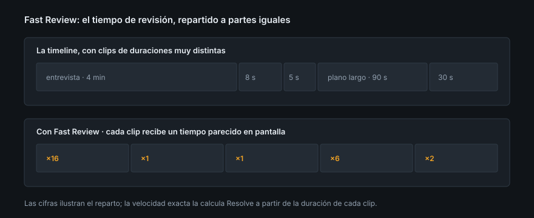

# Fast review

> Ver dos horas de material a velocidad normal cuesta dos horas. Fast Review las recorre
> en unos minutos repartiendo el tiempo de forma desigual: mucho a los clips cortos, poco
> a los largos. Es la herramienta que convierte "tengo que revisar esto algún día" en algo
> que se hace antes de comer.

## 🎯 Objetivos

- Explicar qué hace Fast Review y por qué su velocidad no es constante
- Usarlo para revisar material y para revisar un montaje ya hecho
- Saber qué se detecta con esta herramienta y qué no
- Distinguirlo de reproducir rápido con `L`

---

## 1. Qué problema resuelve

Revisar tiene un problema de aritmética. Dos horas de material son dos horas de
reproducción, y en esas dos horas la mayor parte del tiempo no pasa nada: el plano ya lo
has entendido a los tres segundos y siguen quedando cuarenta.

La salida evidente es acelerar. Pero acelerar **a una velocidad fija** rompe por los dos
extremos:

- A ×8, un plano de cuatro segundos pasa en medio segundo. No te enteras de que existió.
- A ×2, la entrevista de cuarenta minutos sigue durando veinte.

El material real tiene duraciones muy desiguales, y una velocidad única no puede servir
para las dos puntas.

Fast Review resuelve eso repartiendo el **tiempo de pantalla**, no la velocidad: cada clip
recibe aproximadamente el mismo rato de revisión, sea cual sea su duración. Los largos
pasan deprisa, los cortos casi a velocidad normal.

---

## 2. Cómo funciona

Resolve mira la duración de cada clip y calcula su velocidad de reproducción para que
todos ocupen un tiempo parecido en pantalla. El resultado es una revisión donde:

- **No te saltas nada.** Todos los clips aparecen, incluido el de tres segundos.
- **No esperas.** El clip de cuatro minutos no se lleva cuatro minutos de tu tiempo.
- **El audio se silencia** durante la reproducción acelerada, porque a esa velocidad no
  aporta nada.

> [!NOTE]
> Fast Review recorre **la timeline**, no el media pool. Para revisar material sin montar,
> la herramienta es el `Source Tape` del archivo anterior. Las dos se complementan: el
> source tape para elegir, fast review para comprobar lo elegido.

### 2.1 No es lo mismo que pulsar `L` varias veces

Son dos cosas distintas y conviene no confundirlas:

| | `L` repetido | Fast Review |
| - | ------------ | ----------- |
| Velocidad | Fija, la que elijas | Variable, calculada por clip |
| Reparto del tiempo | Proporcional a la duración | Parecido para todos los clips |
| Para qué sirve | Buscar un punto concreto | Ver el conjunto |
| Audio | Se oye acelerado | Silenciado |

`L` sirve para **llegar** a un sitio. Fast Review sirve para **ver** todo lo que hay.

---

## 3. Cómo se hace en Resolve 21

Fast Review es un botón del transporte del visor de la Cut page, junto a los controles de
reproducción. Se pulsa y la timeline empieza a recorrerse; se para como cualquier
reproducción.
*Verificado en 21.0.4.5, agosto de 2026.*

Si no lo localizas, el panel `DaVinci Resolve > Keyboard Customization` es la fuente de
verdad: busca el comando por su nombre en inglés y verás si tiene atajo asignado en tu
instalación.

### 3.1 Los dos momentos en que se usa

**Antes de montar**, sobre una timeline de revisión: metes el material en una timeline
cualquiera y lo recorres para hacerte una idea del conjunto.

**Después de la primera pasada**, y este es el uso importante de esta semana: recorres tu
montaje bruto entero y ves **la forma** que tiene. En cuatro minutos sabes tres cosas que
no se ven mirando la timeline:

- Si hay tramos que se hacen largos.
- Si hay planos repetidos que no habías notado que repetías.
- Si el principio y el final están donde tienen que estar.

### 3.2 Qué detecta y qué no

| Se detecta bien | No se detecta |
| --------------- | ------------- |
| Un tramo que se hace largo | Si un corte cae dos fotogramas tarde |
| Planos repetidos o muy parecidos | Un problema de audio |
| Un salto brusco de contenido | Un fallo de continuidad fino |
| Que falte el plano de cierre | La calidad del encuadre |
| Que el material esté desequilibrado | Nada que dependa del sonido |

Es una herramienta de **conjunto**. Todo lo fino es de la Edit page y de las Semanas 08 y
09, y buscarlo aquí es perder el tiempo dos veces.

---

## 4. Cómo se usa de verdad, en tres pasadas

Un montaje bruto se revisa tres veces y cada pasada busca una cosa. Las tres juntas no
llegan a quince minutos:

1. **Fast review, sin tocar nada.** Solo mirar. La pregunta es: ¿esto llega al final y se
   entiende? Nada de parar a arreglar; se apunta y se sigue.
2. **Reproducción normal del tramo que chirriaba.** Con sonido, a velocidad real. La
   mayoría de las veces el problema no era donde creías: era el plano de antes.
3. **La timeline de arriba, mirando la forma.** Con lo que aprendiste en el archivo 02.

> [!IMPORTANT]
> **No pares a arreglar durante la primera pasada.** Es la regla que más cuesta cumplir y
> la que más tiempo ahorra. Si paras, dejas de ver la pieza y vuelves a ver un plano, que
> es justo lo que ya sabes hacer y no es lo que hace falta ahora.

---

## 5. Qué hacer con lo que detectas

Una revisión produce una lista, y una lista sin criterio produce parálisis. Cada cosa que
anotes cae en una de estas cuatro casillas, y solo una de las cuatro es trabajo de esta
semana:

| Lo que has anotado | Cuándo se arregla |
| ------------------ | ----------------- |
| "Falta un plano aquí", "sobra este", "este va antes" | **Ahora**, esta semana, con las herramientas de los archivos 06 a 08 |
| "Este corte cae un poco tarde" | Semana 09, con trimming |
| "Aquí hace falta un rótulo" | Semana 11 |
| "Este plano se ve oscuro", "el audio de este va bajo" | Fases 4 y 5, Semanas 13 a 22 |

Escribe la lista con esa casilla al lado. Las tres últimas no se tocan ahora, y anotarlas
sirve para dos cosas: dejas de pensar en ellas, y llegas a esas semanas con trabajo ya
identificado en tu propia pieza en vez de con un ejercicio abstracto.

> [!TIP]
> Marca los puntos con un marcador de timeline (`M` sobre el clip) mientras revisas. Un
> marcador no interrumpe la reproducción y queda anclado al sitio exacto, que es más de lo
> que consigue una nota que dice "por el minuto tres y pico".

---

## 6. Antipatrones

| Antipatrón | Por qué duele | Qué hacer |
| ---------- | ------------- | --------- |
| Revisar el montaje a velocidad normal siempre | Cuarenta minutos por pasada, y hacen falta varias | Fast review para el conjunto |
| Parar a corregir en mitad de la revisión | Pierdes la visión de conjunto, que era el motivo de revisar | Apunta y sigue; corrige al final |
| Buscar errores de corte con fast review | A esa velocidad no se ven, y no es su trabajo | Semanas 08 y 09, en la Edit page |
| Juzgar el sonido durante fast review | Está silenciado por diseño | Pasada normal, con auriculares |
| Usarlo en lugar del source tape para elegir material | Recorre la timeline, no el media pool | Source tape para elegir |
| Revisar una sola vez y darlo por bueno | La primera pasada solo ve lo evidente | Tres pasadas, cada una con su pregunta |

---

## 7. Trucos

| Truco | Cómo |
| ----- | ---- |
| Ver un montaje de seis minutos en menos de dos | Fast Review sobre la timeline, de principio a fin |
| Detectar planos repetidos | En fast review saltan solos: los ves casi seguidos |
| Comprobar que la pieza llega al final | Es literalmente lo que enseña: si acaba, acaba |
| No perder lo que detectas | Marcador con `M` al vuelo, sin parar la revisión |
| Saber si tienes un tramo muerto | El aburrimiento a velocidad alta es aburrimiento severo a velocidad normal |
| Comprobar el atajo en tu instalación | `DaVinci Resolve > Keyboard Customization`, busca el comando por nombre |

---

## 📚 Recursos Adicionales

- [DaVinci Resolve Reference Manual](https://www.blackmagicdesign.com/support/family/davinci-resolve-and-fusion) — el capítulo de la Cut page documenta el control de fast review y el resto del transporte del visor.
- [Semana 05 · Proxies, caché y sincronización](../../week-05-proxies_cache_y_sincronizacion/README.md) — si la revisión va a saltos, el problema no es fast review: es el cuello de botella que diagnosticaste allí.
- [Semana 09 · Trimming quirúrgico](../../week-09-trimming_quirurgico/README.md) — donde se corrige, al fotograma, todo lo que esta revisión detecta en bruto.

---

## ✅ Checklist de Verificación

- [ ] Sé por qué la velocidad de Fast Review no es constante
- [ ] Sé que recorre la timeline y no el media pool
- [ ] Distingo Fast Review de pulsar `L` varias veces
- [ ] Sé qué problemas detecta esta herramienta y cuáles no
- [ ] Reviso sin parar a corregir, apuntando lo que veo
- [ ] Sé localizar su atajo en `Keyboard Customization`

---

| Anterior | Actual | Siguiente |
| -------- | ------ | --------- |
| [03 · Source tape](03-source-tape.md) | **04 · Fast review** | [05 · El indicador inteligente](05-el-indicador-inteligente.md) |

← [Volver a la Semana 06](../README.md)
