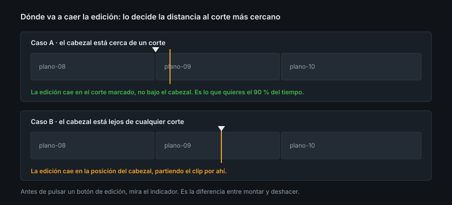

# El indicador inteligente

> En la Edit page, antes de meter un clip decides la pista y la posición. En la Cut page
> no decides ninguna de las dos: las decide la página y te enseña el resultado antes de
> que pulses. Ese aviso es el indicador inteligente, y no mirarlo es la causa número uno
> de "esto no ha caído donde yo quería".

## 🎯 Objetivos

- Explicar qué es el indicador inteligente y qué información da
- Predecir dónde va a caer una edición antes de pulsar el botón
- Colocar el cabezal para que el destino sea el que quieres
- Entender por qué la Cut page decide sola la pista de destino

---

## 1. Qué problema resuelve

Meter un clip en una timeline necesita responder dos preguntas: **en qué pista** y **en
qué punto**. Un programa de montaje clásico te hace contestar las dos, cada vez: eliges
pista de destino, colocas el cabezal, y solo entonces editas.

Es preciso y es lento. Y en una primera pasada, donde la mayoría de las ediciones van al
mismo sitio —al final, o en el corte que tienes delante—, contestar dos preguntas por clip
es papeleo.

La Cut page invierte el reparto: **contesta ella y te enseña la respuesta**. Tú miras, y
si es la que querías, pulsas. Si no lo es, mueves el cabezal y vuelve a contestar.

---

## 2. Cómo funciona

La regla es una sola, y de ella sale todo lo demás:

> **Si el cabezal está cerca de un punto de corte, el destino de la edición es ese corte.
> Si no hay ninguno cerca, el destino es la posición del cabezal.**

En la timeline, un indicador señala cuál de los dos casos es el tuyo. Miras el indicador,
sabes dónde va a caer la edición.

### 2.1 Por qué esa regla y no otra

Porque en una primera pasada casi todo lo que haces es **respecto a un corte**: meter un
plano justo antes de este, sustituir este por otro, poner algo encima de este. El punto de
interés casi nunca es un fotograma arbitrario en medio de un plano: es una junta entre dos
planos.

La regla acierta la mayor parte del tiempo, y cuando no acierta se corrige moviendo el
cabezal, que es un gesto que ibas a hacer de todos modos.

> [!NOTE]
> **Punto de corte** (*edit point*): la junta entre dos clips consecutivos de una pista. En
> una timeline con doce clips hay once puntos de corte, más el principio y el final.

### 2.2 La pista de destino también se decide sola

Las seis herramientas de edición de la Cut page tienen una pista escrita en su definición:

- Smart Insert, Append y Ripple Overwrite trabajan sobre la **pista de vídeo principal**.
- Close Up, Place on Top y Source Overwrite trabajan sobre la **pista de encima**, y la
  crean si no existe.

Por eso en la Cut page no hay que seleccionar pista de destino: elegir la herramienta ya
es elegir la pista. Es una de las razones de que la página vaya rápida, y una de las
razones de que para trabajos con muchas pistas se vaya a la Edit page.

---

## 3. Cómo se hace en Resolve 21

No hay nada que activar: el indicador aparece en la timeline en cuanto hay clips.

El flujo de una edición en la Cut page es siempre el mismo, de cuatro pasos:

1. **Elige el material** en el visor de origen y márcalo con `I` y `O`.
2. **Coloca el cabezal** en la timeline, cerca del corte donde quieres que caiga la
   edición, o lejos de cualquiera si quieres que caiga en un punto concreto.
3. **Mira el indicador.** ¿Marca el corte que querías?
4. **Pulsa la herramienta.**

El paso 3 es el que todo el mundo se salta las primeras cincuenta veces, y es el que
separa montar de deshacer.

### 3.1 Cómo forzar un destino concreto

- **Quiero que caiga en un corte**: acerca el cabezal a ese corte. Al acercarte, el
  indicador lo marca.
- **Quiero que caiga en medio de un plano**: aleja el cabezal de cualquier corte y
  colócalo exactamente donde quieres. El indicador dejará de señalar un corte.
- **Quiero que caiga al final de todo**: usa Append, que ignora el cabezal por completo.
  Es el archivo 06.

### 3.2 Cuando algo cae donde no esperabas

Pasa, y la reacción correcta es siempre la misma: `Ctrl+Z` (Win) / `Cmd+Z` (Mac), mueve el
cabezal, mira el indicador, repite. No arrastres el clip a su sitio: arrastrar en una
primera pasada es lento y suele dejar huecos.

> [!TIP]
> Si te equivocas más de dos veces seguidas en el mismo punto, es que el cabezal está en
> la frontera: lo bastante cerca del corte para dudar. Aléjalo o acércalo con decisión, y
> la ambigüedad desaparece.

---

## 4. La otra mitad: la pista de destino en la práctica

Hay una consecuencia de que la herramienta elija pista que conviene tener clara desde el
primer día, porque explica el aspecto que va a tener tu timeline al terminar la semana.

Tu montaje bruto va a acabar con **dos pistas de vídeo**:

- **`Video 1`** — la columna vertebral: el orden de la pieza, plano tras plano, sin
  huecos, construida con Append, Smart Insert y Ripple Overwrite.
- **`Video 2`** — lo que va encima: los recursos, los primeros planos, los insertos, lo
  puesto con Close Up, Place on Top y Source Overwrite.

Esa separación no es un capricho de la página: es la forma estándar de montar en cualquier
programa. Abajo, la continuidad; arriba, lo que la tapa en momentos concretos. Y tiene una
ventaja inmediata para trabajar en bruto: **quitar la pista de arriba devuelve el montaje
a como estaba**, sin deshacer nada.

> [!IMPORTANT]
> Una edición que cae en `Video 1` cuando querías `Video 2` **rompe la continuidad**: has
> sustituido o empujado algo que sostenía la pieza. Al revés no pasa nada. Por eso, en la
> duda, la herramienta de la pista de arriba es la opción segura.

---

## 5. Las seis herramientas y su destino, de un vistazo

Con lo que llevas de archivo ya se puede leer la tabla entera. Es el resumen que conviene
tener delante durante las prácticas de la semana:

| Herramienta | Pista | Qué le pasa a lo que ya había | Se ve en |
| ----------- | ----- | ----------------------------- | -------- |
| **Append** | Principal | Nada: entra al final | Archivo 06 |
| **Smart Insert** | Principal | Se desplaza a la derecha | Archivo 07 |
| **Ripple Overwrite** | Principal | El clip del destino sale del montaje | Archivo 07 |
| **Place on Top** | La de encima | Nada: se tapa mientras dura | Archivo 08 |
| **Close Up** | La de encima | Nada, y el clip nuevo entra reencuadrado | Archivo 08 |
| **Source Overwrite** | La de encima | Nada, y el clip cae alineado por hora de grabación | Archivo 09 |

Dos lecturas que salen solas de la tabla, y las dos valen para toda la semana:

- **Las tres de arriba de la tabla cambian la duración de la pieza; las tres de abajo,
  no.** Si la pieza ya dura lo que tiene que durar, tu trabajo está en la mitad de abajo.
- **Las tres de abajo son reversibles sin efectos colaterales.** Borrar lo que pusiste en
  la pista de encima devuelve el montaje a como estaba; deshacer un ripple, no siempre es
  tan limpio si ya has seguido montando encima.

---

## 6. Antipatrones

| Antipatrón | Por qué duele | Qué hacer |
| ---------- | ------------- | --------- |
| Pulsar la herramienta sin mirar el indicador | La edición cae donde la página decidió, no donde tú creías | Mirar antes de pulsar. Siempre |
| Arrastrar el clip a mano hasta su sitio | Lento y deja huecos de dos fotogramas | Cabezal, indicador, botón |
| Buscar el selector de pista de destino | En la Cut page no hay: lo elige la herramienta | Elige la herramienta que trabaja en la pista que quieres |
| Corregir un error moviendo lo que cayó mal | Arrastras el problema por toda la timeline | `Ctrl+Z` / `Cmd+Z` y repetir bien |
| Dejar el cabezal justo en la frontera | El destino cambia entre un intento y el siguiente | Acércate o aléjate con claridad |
| Montarlo todo en `Video 1` | Te quedas sin la red de seguridad de la pista de arriba | Los recursos, encima |

---

## 7. Trucos

| Truco | Cómo |
| ----- | ---- |
| Saber dónde va a caer una edición | Mira el indicador antes de pulsar el botón |
| Forzar que caiga en un corte | Acerca el cabezal a ese corte |
| Forzar que caiga en medio de un plano | Aléjalo de cualquier corte |
| Editar al final sin pensar en el cabezal | Append lo ignora por completo |
| Deshacer sin arrastrar nada | `Ctrl+Z` (Win) / `Cmd+Z` (Mac) y repetir con el cabezal bien puesto |
| Probar sin miedo a romper el montaje | Trabaja en la pista de arriba: quitarla lo deja como estaba |

---

## 📚 Recursos Adicionales

- [DaVinci Resolve Reference Manual](https://www.blackmagicdesign.com/support/family/davinci-resolve-and-fusion) — el capítulo de la Cut page explica el comportamiento del indicador y de cada herramienta de edición.
- [Semana 08 · Edit page: anatomía y edición básica](../../week-08-edit_page_anatomia_y_edicion_basica/README.md) — donde se aprende a elegir pista de destino a mano, que es lo que aquí se hace solo.
- [`docs/atajos-de-teclado.md`](../../../docs/atajos-de-teclado.md) — los atajos de montaje del bootcamp, con el panel donde comprobar el mapa de tu instalación.

---

## ✅ Checklist de Verificación

- [ ] Sé enunciar la regla del indicador inteligente
- [ ] Predigo dónde va a caer una edición antes de pulsar
- [ ] Sé colocar el cabezal para forzar el destino que quiero
- [ ] Sé qué tres herramientas trabajan en la pista principal y cuáles en la de encima
- [ ] Corrijo con `Ctrl+Z` / `Cmd+Z` en vez de arrastrando
- [ ] Entiendo por qué `Video 1` es la continuidad y `Video 2` lo que va encima

---

| Anterior | Actual | Siguiente |
| -------- | ------ | --------- |
| [04 · Fast review](04-fast-review.md) | **05 · El indicador inteligente** | [06 · Append: la primera pasada](06-append-la-primera-pasada.md) |

← [Volver a la Semana 06](../README.md)
