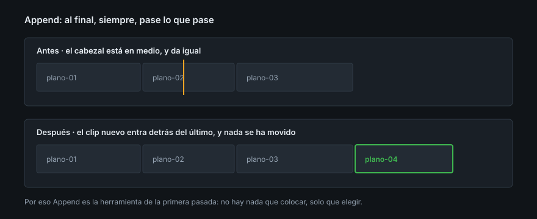

# Append: la primera pasada

> De las seis herramientas de edición de la Cut page, esta es la que construye la pieza.
> Las otras cinco corrigen. Un montaje bruto entero se puede hacer con Append y nada más,
> y de hecho es como conviene hacerlo la primera vez.

## 🎯 Objetivos

- Explicar qué hace Append y por qué ignora la posición del cabezal
- Construir un montaje bruto de principio a fin usando solo esta herramienta
- Entender por qué es imposible romper el montaje con Append
- Saber elegir el orden de los planos mientras montas, no antes

---

## 1. Qué problema resuelve

La primera pasada tiene una forma muy concreta: coges un plano, lo pones detrás del
anterior, y repites hasta llegar al final. No hay que colocar nada en ningún sitio: el
sitio es siempre "después del último".

Cualquier herramienta que te obligue a pensar dónde va el clip está cobrándote una
decisión que no existe. Append elimina esa decisión: el destino está fijado por
definición.

Eso tiene un efecto secundario que importa más de lo que parece: **libera la cabeza para
lo único que sí hay que decidir**, que es qué plano va ahora. Cuando la mecánica es un
botón, la atención se va entera a la elección.

---

## 2. Cómo funciona

Append coloca el material marcado **al final de la timeline**, detrás del último clip de
la pista de vídeo principal.

Tres propiedades, y las tres son consecuencia de la misma definición:

- **Ignora el cabezal.** Da igual dónde esté. El destino es el final.
- **No desplaza nada.** Todo lo que ya estaba se queda exactamente donde estaba.
- **No machaca nada.** No hay nada al final que machacar.

De ahí sale la propiedad que la convierte en la herramienta de la primera pasada:

> [!IMPORTANT]
> **Con Append es imposible estropear lo que ya has montado.** Cualquier otra herramienta
> puede empujar, sustituir o tapar algo. Esta solo puede añadir al final. Es la única de
> las seis que no necesita que mires el indicador antes de pulsar.

### 2.1 El audio va con el vídeo

Al hacer Append de un clip con sonido, el audio entra en su pista de audio en paralelo, y
los dos quedan **vinculados**: mover o borrar uno mueve o borra el otro.

> [!NOTE]
> **Vínculo** (*linked selection*): la relación que hace que el vídeo y el audio de un
> mismo clip se comporten como una sola pieza. Se puede romper cuando hace falta, y eso es
> materia de la Semana 08. En la primera pasada interesa que esté puesto.

---

## 3. Cómo se hace en Resolve 21

Append es uno de los seis botones de la barra de herramientas de la Cut page. El ciclo
completo son tres pasos y se repite hasta el final de la pieza:

1. **Elige el material** en el visor de origen: un clip suelto, un subclip de los que
   creaste en la Semana 05, o un tramo del source tape.
2. **Marca `I` y `O`.** Si no marcas nada, entra el clip entero.
3. **Pulsa Append.**

Y vuelta a empezar. En una hora larga de trabajo así se construye un montaje bruto de
varios minutos.

> [!TIP]
> Los seis botones de edición tienen tecla dedicada en el panel de hardware **Speed
> Editor** de Blackmagic, con el nombre del comando serigrafiado encima. No hace falta el
> panel para nada del bootcamp; se menciona porque explica por qué la página está diseñada
> alrededor de esos seis comandos y no de veinte.

### 3.1 Montar desde el source tape

La combinación más rápida de la semana es esta, y es la que hace la práctica 02:

1. Bin seleccionado, `Source Tape` activado.
2. Recorres la cinta con `L`, `K` y `J`.
3. Cuando pasa algo que sirve: `I` al principio, `O` al final.
4. Append.
5. Sigues recorriendo desde donde estabas.

No cierras nada, no abres nada, no vuelves al media pool. La cinta sigue avanzando y la
timeline va creciendo por detrás.

### 3.2 Qué duración marcar en bruto

La respuesta corta: **de sobra**. En una primera pasada conviene marcar cada plano un
poco más largo de lo que va a quedar, por dos razones:

- Acortar en la Semana 09 cuesta un gesto; alargar sin material no se puede.
- Un montaje que va sobrado de duración enseña dónde recortar. Uno que va justo no enseña
  nada.

Como referencia de bruto: un plano descriptivo, cuatro o cinco segundos; una frase de
entrevista, la frase entera más un segundo a cada lado; un plano de acción, hasta que la
acción termine.

---

## 4. El orden se decide montando

Hay dos maneras de decidir el orden de una pieza, y solo una funciona en la práctica.

La que no funciona es **decidirlo entero antes**, en papel, y luego ejecutarlo. Suena
ordenado y falla siempre por lo mismo: en papel los planos duran lo que tú quieres, y en
la timeline duran lo que duran.

La que funciona es **decidirlo montando**, con una estructura mínima en la cabeza. Para
cualquiera de las cinco piezas del bootcamp, esa estructura mínima son tres bloques:

| Bloque | Qué hace | Cuánto ocupa |
| ------ | -------- | ------------ |
| **Apertura** | Sitúa: dónde estamos, quién es, de qué va | 10-20 % |
| **Desarrollo** | La pieza en sí: lo que se cuenta o se enseña | 60-80 % |
| **Cierre** | Cierra: una conclusión, una vuelta al principio, un final claro | 10-20 % |

Monta en ese orden. Si a mitad del desarrollo descubres que el orden interno no funciona,
lo cambias ahí mismo: mover clips en un montaje bruto es barato, y por eso se hace ahora y
no en la Semana 09.

> [!TIP]
> **Empieza por el final.** Saber cómo termina la pieza antes de montar el desarrollo hace
> que el desarrollo se ordene solo: cada plano se elige por si acerca al final o no. Es el
> único truco de estructura que funciona para las cinco piezas del bootcamp.

---

## 5. Cuando te atascas eligiendo

Pasa en toda primera pasada, y casi siempre por el mismo motivo: tienes tres planos que
podrían ir aquí y ninguno te convence. Cuatro salidas, por orden de utilidad:

1. **Mete el menos malo y sigue.** Es la respuesta correcta el 90 % de las veces. El plano
   se sustituye después con Ripple Overwrite en diez segundos, y mientras tanto la pieza
   avanza. Un montaje bruto con un plano regular sirve; uno que se quedó en el minuto dos,
   no.
2. **Mete los tres, uno detrás de otro.** Al verlos seguidos en reproducción se decide
   solo, porque el problema casi nunca es el plano: es que no sabías qué venía después.
3. **Salta el hueco y sigue montando.** Deja el punto marcado con `M` y sigue por el
   siguiente bloque. Al volver, con la pieza más avanzada, la elección es evidente.
4. **Vuelve a revisar ese tramo del material.** Última opción, porque es la más cara: si
   ninguno de los tres sirve, puede que el bueno esté en un clip que descartaste rápido.

> [!IMPORTANT]
> Lo que **no** es una salida: quedarte comparando los tres planos veinte minutos. La
> elección entre dos planos parecidos casi nunca cambia la pieza; llegar al final, sí.

---

## 6. Antipatrones

| Antipatrón | Por qué duele | Qué hacer |
| ---------- | ------------- | --------- |
| Recortar al fotograma mientras montas en bruto | Gastas media hora en un plano que puede que quites | Marca de sobra y sigue |
| Volver al media pool entre clip y clip | Rompes el ritmo de trabajo y el hilo de la pieza | Source tape, y no salgas de la cinta |
| Montar por orden de grabación | El orden en que se grabó casi nunca es el mejor orden | Apertura, desarrollo, cierre |
| Empezar por el plano que más te gusta | La pieza acaba girando alrededor de un plano | Del principio al final, en orden |
| Parar a arreglar cada corte que no encaja | Nunca llegas al final | Apunta y sigue: la pasada primero |
| Marcar los planos justos de duración | Sin material sobrante no hay nada que ajustar después | Un poco más largo, siempre |
| Meter música o títulos en esta pasada | Se rehace todo en cuanto muevas un corte | Fases 3 y 4 |

---

## 7. Trucos

| Truco | Cómo |
| ----- | ---- |
| Montar sin miedo a romper nada | Append no desplaza ni machaca: solo añade al final |
| El ciclo más rápido de la semana | Source tape, `I`, `O`, Append, seguir |
| Meter un clip entero sin marcar | No marques `I` ni `O`: entra completo |
| Saber cuánto marcar en bruto | De sobra. Recortar es barato, alargar no siempre se puede |
| Ordenar la pieza sin papel | Apertura, desarrollo, cierre, y empieza sabiendo el final |
| Comprobar que la pasada terminó | Reproduce entera: si llega al final, está hecha |

---

## 📚 Recursos Adicionales

- [DaVinci Resolve Reference Manual](https://www.blackmagicdesign.com/support/family/davinci-resolve-and-fusion) — el capítulo de la Cut page documenta las seis herramientas de edición una por una.
- [Semana 05 · Proxies, caché y sincronización](../../week-05-proxies_cache_y_sincronizacion/README.md) — los subclips que aquí se montan y las colas que hacen posible ajustar después.
- [`docs/proyecto-hilo-conductor.md`](../../../docs/proyecto-hilo-conductor.md) — por qué el montaje bruto de la Fase 2 tiene que llegar completo hasta el final antes de afinar nada.

---

## ✅ Checklist de Verificación

- [ ] Sé qué hace Append y por qué ignora el cabezal
- [ ] Sé por qué es imposible romper el montaje con esta herramienta
- [ ] Monto desde el source tape sin volver al media pool
- [ ] Marco los planos con margen en lugar de ajustados
- [ ] Tengo una estructura de apertura, desarrollo y cierre
- [ ] Sé que el vídeo y el audio entran vinculados

---

| Anterior | Actual | Siguiente |
| -------- | ------ | --------- |
| [05 · El indicador inteligente](05-el-indicador-inteligente.md) | **06 · Append: la primera pasada** | [07 · Corregir el montaje ya hecho](07-corregir-el-montaje-ya-hecho.md) |

← [Volver a la Semana 06](../README.md)
