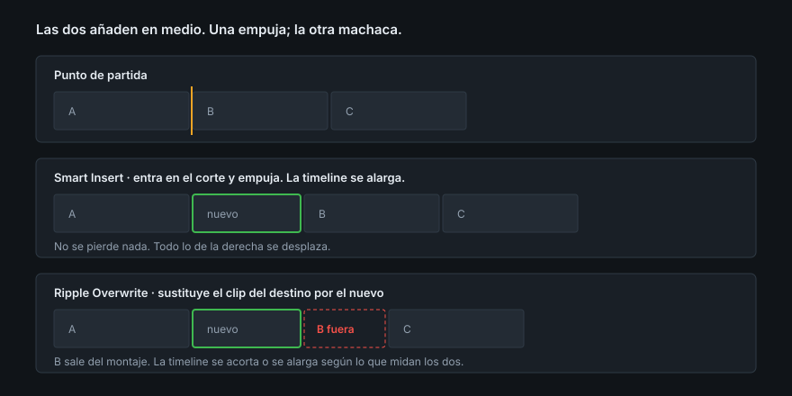

# Corregir el montaje ya hecho

> La primera pasada termina y la pieza tiene tres problemas: falta un plano en el minuto
> dos, sobra uno en el cuatro, y el del final no era ese. Smart Insert y Ripple Overwrite
> son las dos herramientas que arreglan eso sin romper el resto.

## 🎯 Objetivos

- Explicar qué hace Smart Insert y qué le pasa a la timeline al usarlo
- Explicar qué hace Ripple Overwrite y en qué se diferencia del anterior
- Elegir entre las dos según lo que quieras que le pase al material existente
- Saber por qué las dos son operaciones de **ripple** y qué significa eso

---

## 1. Qué problema resuelve

Un montaje bruto acabado no está bien. Está **completo**, que es otra cosa. Al verlo
entero aparecen tres tipos de problema, y son siempre los mismos:

- **Falta algo.** Entre dos planos hace falta uno que no está.
- **Sobra algo.** Un plano no aporta y encima estorba.
- **Ese no era.** El plano funciona en su sitio pero el elegido no es el bueno.

Arreglarlos arrastrando clips a mano es posible y es mala idea: cada arrastre puede dejar
un hueco de dos fotogramas, y cuarenta arrastres dejan cuarenta huecos que no se ven hasta
que se reproduce.

Las herramientas de esta página hacen esas tres correcciones **sin dejar huecos**, porque
mueven lo que haga falta automáticamente.

---

## 2. Cómo funciona

Las dos entran en el destino que marca el indicador inteligente del archivo 05. La
diferencia está en qué le pasa a lo que ya había.

### 2.1 Smart Insert: entra y empuja

El clip nuevo se mete en el punto de corte y **todo lo que venía después se desplaza hacia
la derecha**. No se pierde nada; la timeline se alarga exactamente lo que mide el clip
nuevo.

Es la herramienta de "aquí falta un plano".

### 2.2 Ripple Overwrite: entra y sustituye

El clip nuevo **ocupa el lugar del clip que hay en el destino**, que sale del montaje. El
resto se recoloca detrás, sin huecos: la timeline se alarga o se acorta según la
diferencia de duración entre el que entra y el que sale.

Es la herramienta de "ese plano no era ese".

### 2.3 Qué significa *ripple*

> [!NOTE]
> **Ripple** es el desplazamiento en cadena: al cambiar la duración de algo, todo lo que
> viene detrás se mueve para que no queden huecos. Literalmente, "ondulación": el cambio
> se propaga hasta el final de la pista.

Que las dos herramientas hagan ripple tiene una consecuencia práctica que hay que tener
presente **antes** de pulsar:

> [!IMPORTANT]
> Una edición con ripple **mueve todo lo que hay a la derecha**. Si en la pista de encima
> tienes un rótulo colocado en el minuto cuatro, o un recurso sincronizado con algo, dejan
> de estar en su sitio. Por eso los rótulos y los recursos precisos se ponen **después** de
> haber cerrado la estructura, y no antes. En esta semana, primero `Video 1`; después,
> `Video 2`.

---

## 3. Cómo se hace en Resolve 21

Las dos son botones de la barra de herramientas de la Cut page, y las dos siguen el mismo
ciclo de cuatro pasos:

1. **Elige el material** y márcalo con `I` y `O`.
2. **Coloca el cabezal** cerca del corte donde quieres que ocurra.
3. **Mira el indicador.** Este es el paso que no se salta.
4. **Pulsa Smart Insert o Ripple Overwrite.**

### 3.1 Cuál de las dos

| Lo que quieres | Herramienta |
| -------------- | ----------- |
| Añadir un plano que falta, sin perder nada | **Smart Insert** |
| Cambiar un plano por otro | **Ripple Overwrite** |
| Alargar un tramo que se pasa demasiado rápido | **Smart Insert** |
| Sustituir el plano de apertura por uno mejor | **Ripple Overwrite** |
| Meter un plano de recurso sin tocar la continuidad | Ninguna de las dos: Place on Top, archivo 08 |

La pregunta que decide es una: **¿lo que hay en el destino se queda o se va?** Se queda:
Smart Insert. Se va: Ripple Overwrite.

### 3.2 Quitar un plano que sobra

No hace falta ninguna de las dos. Se selecciona el clip y se borra con ripple, que es el
borrado que cierra el hueco arrastrando el resto hacia la izquierda. El borrado normal
deja un hueco negro en su sitio; el borrado con ripple, no.

> [!WARNING]
> Comprueba el resultado de un borrado antes de seguir montando. Un hueco de unos pocos
> fotogramas es invisible en la timeline a esta escala y en reproducción es un parpadeo a
> negro. Si dudas, amplía la vista de detalle sobre ese punto.

### 3.3 El orden en que se corrige

Corrige en este orden y ahorrarás la mitad del trabajo:

1. **Quita lo que sobra.** Cada plano que quitas cambia el ritmo de su alrededor, y a
   veces resuelve el problema de al lado sin tocarlo.
2. **Sustituye lo que está mal elegido.** Con Ripple Overwrite.
3. **Añade lo que falta.** Con Smart Insert, y al final, porque hasta aquí no sabías del
   todo qué faltaba.

Hacerlo al revés —añadir primero— es la forma habitual de acabar con una pieza que dura el
doble de lo que debía.

---

## 4. Las dos preguntas antes de pulsar

Se resume en dos preguntas, y con eso se elige bien el 100 % de las veces:

1. **¿Dónde?** Lo responde el indicador inteligente. Míralo.
2. **¿Y lo que hay ahí?** Se queda y se desplaza (Smart Insert), o se va (Ripple
   Overwrite).

Cuando la respuesta a la segunda es "no quiero tocar nada de lo que hay", la respuesta no
es ninguna de estas dos herramientas: es la pista de encima, y eso es el archivo 08.

### 4.1 Un caso que conviene ver entero

Tienes montado `A · B · C`. Al revisar decides tres cosas: que `B` no aporta, que `A` es
correcto pero el plano bueno era otro, y que entre `A` y `C` hace falta un plano de
transición.

En el orden correcto:

1. **Quitas `B`** con borrado con ripple. Queda `A · C`.
2. **Sustituyes `A`** con Ripple Overwrite, cabezal al principio. Queda `A2 · C`.
3. **Metes el plano nuevo** con Smart Insert en el corte entre los dos. Queda
   `A2 · nuevo · C`.

Tres operaciones, ningún arrastre, ningún hueco. Y si algo sale mal, `Ctrl+Z` (Win) /
`Cmd+Z` (Mac) deshace paso por paso.

---

## 5. Antipatrones

| Antipatrón | Por qué duele | Qué hacer |
| ---------- | ------------- | --------- |
| Arrastrar clips a mano para colocarlos | Deja huecos invisibles de pocos fotogramas | Las herramientas, que recolocan solas |
| Usar Ripple Overwrite creyendo que añade | Se lleva por delante el plano que había | Si el destino se queda, Smart Insert |
| Borrar sin ripple y dejar el hueco | Parpadeo a negro en reproducción | Borrado con ripple, y comprobar |
| Corregir añadiendo antes de quitar | La pieza crece y el ritmo empeora | Quitar, sustituir, añadir. En ese orden |
| Colocar rótulos antes de cerrar la estructura | Cualquier ripple los descoloca | `Video 1` primero, `Video 2` después |
| Pulsar sin mirar el indicador | La edición cae en otro corte | Paso 3, siempre |
| Corregir sin haber revisado la pieza entera | Arreglas lo que no era el problema | Fast review primero, correcciones después |

---

## 6. Trucos

| Truco | Cómo |
| ----- | ---- |
| Elegir herramienta sin dudar | ¿Lo que hay en el destino se queda o se va? |
| Añadir un plano sin perder nada | Smart Insert en el corte |
| Cambiar un plano por otro | Ripple Overwrite con el cabezal sobre él |
| Quitar sin dejar agujeros | Borrado con ripple, y comprueba ampliando la vista |
| No descolocar lo de la pista de arriba | Cierra la estructura de `Video 1` antes de poner nada encima |
| Corregir en el orden que menos trabajo da | Quitar, sustituir, añadir |
| Deshacer una cadena de errores | `Ctrl+Z` (Win) / `Cmd+Z` (Mac), tantas veces como haga falta |

---

## 📚 Recursos Adicionales

- [DaVinci Resolve Reference Manual](https://www.blackmagicdesign.com/support/family/davinci-resolve-and-fusion) — el capítulo de la Cut page documenta el comportamiento exacto de cada herramienta sobre el material existente.
- [Semana 09 · Trimming quirúrgico](../../week-09-trimming_quirurgico/README.md) — donde el concepto de ripple se convierte en un modo de trabajo completo, con roll, slip y slide.
- [Semana 08 · Edit page: anatomía y edición básica](../../week-08-edit_page_anatomia_y_edicion_basica/README.md) — los mismos comandos con selección de pista de destino manual.

---

## ✅ Checklist de Verificación

- [ ] Sé qué le pasa a la timeline con Smart Insert
- [ ] Sé qué le pasa con Ripple Overwrite
- [ ] Elijo entre las dos con la pregunta de si el destino se queda o se va
- [ ] Sé qué es una operación de ripple y qué arrastra
- [ ] Borro con ripple y compruebo que no queda hueco
- [ ] Corrijo en el orden: quitar, sustituir, añadir

---

| Anterior | Actual | Siguiente |
| -------- | ------ | --------- |
| [06 · Append: la primera pasada](06-append-la-primera-pasada.md) | **07 · Corregir el montaje ya hecho** | [08 · Editar sobre la pista de arriba](08-editar-sobre-la-pista-de-arriba.md) |

← [Volver a la Semana 06](../README.md)
